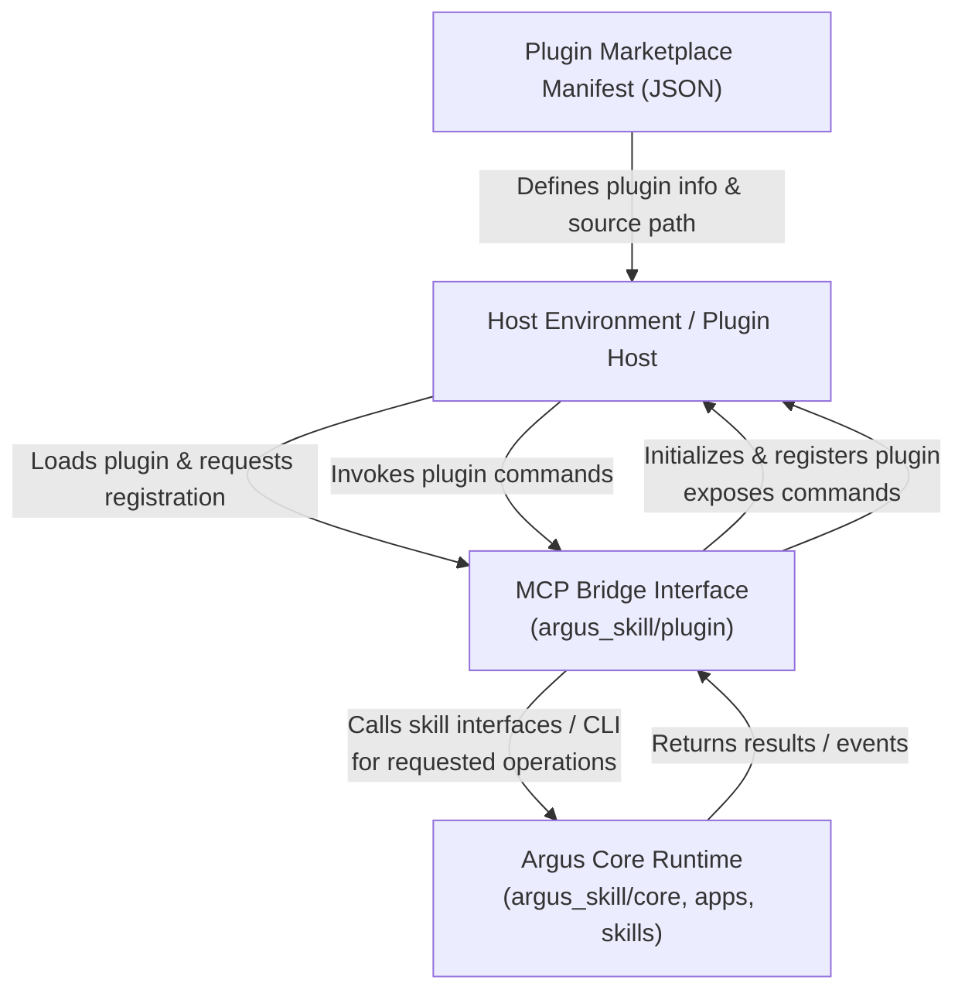
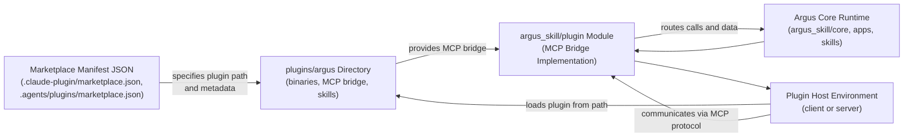

<!-- source: DeepWiki mcp.deepwiki.com · repo microsoft/ArgusAgent · page 7.1 Plugin Marketplace and MCP Bridge · fetched 2026-10-26 -->

# Plugin Marketplace and MCP Bridge

<details>
<summary>Relevant source files</summary>

The following files were used as context for generating this wiki page:

- [.agents/plugins/marketplace.json](.agents/plugins/marketplace.json)
- [.agents/skills/minimal-rigorous-work/SKILL.md](.agents/skills/minimal-rigorous-work/SKILL.md)
- [.claude-plugin/marketplace.json](.claude-plugin/marketplace.json)

</details>


This page details the **Plugin Marketplace** manifests and the **MCP (Marketplace Client Protocol) Bridge** implementation that package Argus as a host plugin. It covers the JSON plugin manifests found in `.claude-plugin/marketplace.json` and `.agents/plugins/marketplace.json`, the `plugins/argus` directory containing binaries and skill packages, and the `argus_skill/plugin` Python module responsible for the host plugin interface.

---

## Overview and Purpose

Argus is packaged as a host plugin to enable integration with external plugin marketplaces and host environments supporting the MCP standard. This packaging exposes Argus’s persistent, reviewed autonomy workflows in a standardized interface, making it available as a Productivity plugin.

- **Marketplace Manifests** define Argus’s metadata, plugin entries, categories, installation policies, and source locations.
- **MCP Bridge** provides the runtime interface wrapping Argus’s capabilities to the host.
- **Plugin Packaging** bundles Argus scripts, binaries, and skills for deployment and runtime use by host environments.

This page serves as a comprehensive technical reference for the plugin manifests and bridge implementation layering Argus into plugin marketplaces and compatible clients.

---

## 1. Plugin Marketplace Manifests

Argus publishes two primary JSON manifests to be consumable by plugins ecosystems:

### 1.1 `.claude-plugin/marketplace.json`

This manifest defines Argus for Claude-compatible plugin stores:

```json
{
  "name": "argus",
  "owner": {
    "name": "Argus contributors"
  },
  "description": "Argus persistent, independently reviewed research and engineering workflows",
  "plugins": [
    {
      "name": "argus",
      "source": "./plugins/argus",
      "description": "Persistent reviewed research and engineering runtime",
      "version": "0.1.1",
      "category": "Productivity"
    }
  ]
}
```

- **name**: Plugin bundle name ("argus").
- **owner**: Shown as "Argus contributors".
- **description**: Highlights Argus’s role in persistent research and engineering.
- **plugins**: Lists one plugin entry:
  - **name**: "argus"
  - **source**: Local path `"./plugins/argus"` relative to repo root.
  - **version**: "0.1.1"
  - **category**: Classified as "Productivity"

### 1.2 `.agents/plugins/marketplace.json`

This manifest targets the Microsoft Agents plugin ecosystem:

```json
{
  "name": "argus",
  "interface": {
    "displayName": "Argus"
  },
  "plugins": [
    {
      "name": "argus",
      "source": {
        "source": "local",
        "path": "./plugins/argus"
      },
      "policy": {
        "installation": "AVAILABLE",
        "authentication": "ON_INSTALL"
      },
      "category": "Productivity"
    }
  ]
}
```

- Defines an **interface.displayName** as "Argus" for UI display.
- The single plugin entry includes:
  - **source** indicating a local plugin at `./plugins/argus`.
  - **policy** specifying the installation is "AVAILABLE" and requires authentication "ON_INSTALL".
- Same "Productivity" category.

---

## 2. Plugin Packaging : `plugins/argus`

The `./plugins/argus` directory contains all necessary artifacts to run Argus as a plugin host target:

- **Bin**: Executable CLI or helper scripts for launching Argus workflows.
- **MCP (Marketplace Client Protocol) files**: Protocol adapters and registration metadata.
- **Skills**: Argus skill sets that implement core autonomous capabilities.
- **argus_skill/plugin**: Python module exposing the plugin bridge interface.

These components tightly integrate to deliver the persistent and independently reviewed intelligence Argus facilitates, exposed as a host plugin.

---

## 3. MCP Bridge and argus_skill/plugin Module

The MCP Bridge acts as the runtime **host-plugin interface adaptor**, implementing standard MCP plugin lifecycle, registration, and invocation methods. It mediates between the Argus core systems and the host environment.

Key responsibilities of the bridge:

- **Plugin Registration**: Advertises capabilities and API endpoints to the host.
- **Command Dispatching**: Routes host commands to Argus skill invocations or CLI.
- **Lifecycle Management**: Handles initialization, installation events, and tear down.
- **Security and Authentication**: Enforces host-mandated policies, such as auth requirements on install.
- **Data Flow**: Converts host messages into Argus skill requests, and maps skill responses back to host format.

The `argus_skill/plugin` module encapsulates this logic as a Python package compatible with Argus's runtime and the MCP protocol.

### Data Flow Diagram: Natural Language Space to Code Entities



This diagram illustrates the chain from static marketplace manifests through the MCP bridge to Argus's core runtime components.

---

## 4. Plugin Manifest to Runtime Bridge Association

The plugin manifests `.claude-plugin/marketplace.json` and `.agents/plugins/marketplace.json` explicitly reference the `./plugins/argus` directory. This directory contains the MCP Bridge implementation that the host uses to interact with Argus as a plugin.

### Mapping Manifest Fields to Code

| Manifest Field                | Runtime Code Entity                        | Description                            |
|------------------------------|------------------------------------------|------------------------------------|
| `.claude-plugin/marketplace.json.plugins[0].source` | `plugins/argus` directory | Location of runtime bridge and skill packages |
| `.agents/plugins/marketplace.json.plugins[0].source.path` | `plugins/argus` | Same local source path |
| `category`                   | Plugin metadata parsed by MCP bridge     | Categorizes plugin as Productivity |
| `policy.authentication`      | Enforced by MCP bridge on install event  | Controls auth lifecycle |
| `argus_skill/plugin`         | Python module implementing MCP interface | Core bridge logic and plugin initialization |

---

## 5. Key Classes and Functions in `argus_skill/plugin`

While this page cannot display specific code snippets, the main responsibilities implemented include:

- **Plugin Registration Handler**: Registers Argus plugin commands to the host.
- **Command Dispatcher**: Routes host plugin RPC or IPC calls to Argus skill invocations.
- **Initialization Routines**: Load skill sets and runtime configurations.
- **Authentication Enforcement**: Checks policies embedded in plugin manifests.
- **State Persistence Hooks**: Manage state snapshots across plugin sessions.

These components ensure seamless integration between host UI/runtime environment and Argus autonomous workflow engine.

---

## 6. Summary Diagram: End-to-End Flow from Marketplace to Argus Runtime



This diagram frames the relationship between static manifests, the physical plugin package, the run-time MCP bridge interface, the Argus core systems, and the external plugin host environment.

---

# References and Sources

- `.claude-plugin/marketplace.json` [`.claude-plugin/marketplace.json:1-16`]()
- `.agents/plugins/marketplace.json` [`.agents/plugins/marketplace.json:1-20`]()
- `plugins/argus` directory content (implied)
- `argus_skill/plugin` module (implied implementation)
- `.agents/skills/minimal-rigorous-work/SKILL.md` for minimal rigorous work conventions relevant to skill packaging [`.agents/skills/minimal-rigorous-work/SKILL.md:1-33`]()

---

