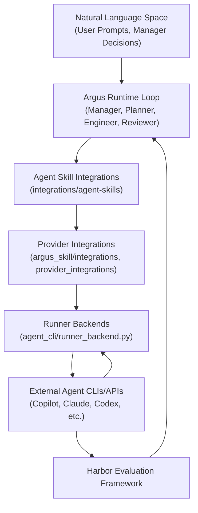
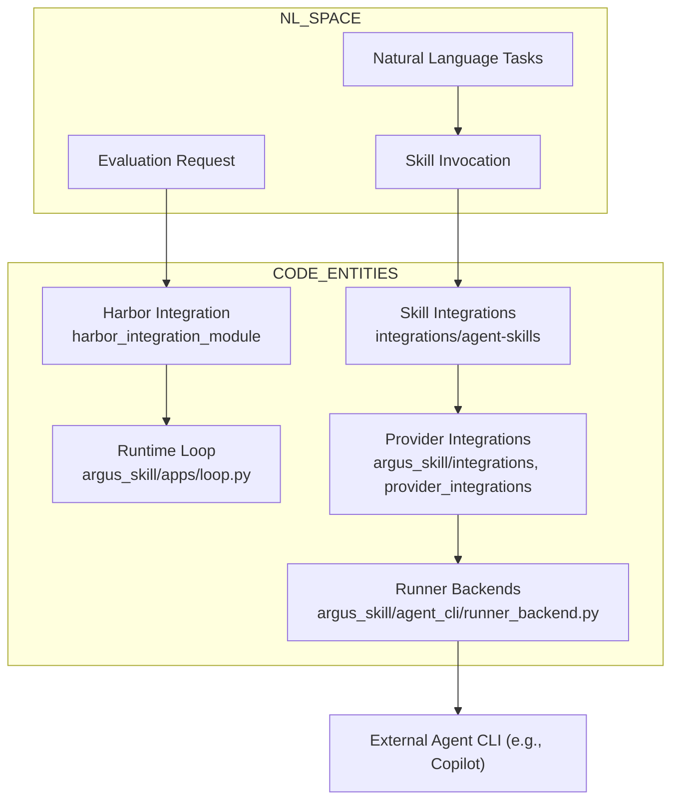

<!-- source: DeepWiki mcp.deepwiki.com · repo microsoft/ArgusAgent · page 7.2 External Integrations and Provider Bridges · fetched 2026-10-26 -->

# 7.2 External Integrations and Provider Bridges

Relevant source files

The following files were used as context for generating this wiki page:

- [.agents/plugins/marketplace.json](.agents/plugins/marketplace.json)
- [argus_skill/agent_cli/runner_backend.py](argus_skill/agent_cli/runner_backend.py)

This section details how Argus integrates externally with other system components, agent CLI backends, provider bridges, and evaluation systems such as Harbor. It covers the orchestration layer for agent skills, the integration packages in `argus_skill/integrations`, the provider integration abstraction, and third-party evaluation hook-ups. Understanding these components is essential for extending Argus to new external capabilities or integrating it into larger workflows.

---

## Purpose and Scope

Argus is designed to orchestrate long-running autonomous agents using a set of internal roles (Manager, Planner, Engineer, Reviewer) and runtime loops. To expand its reach and functionality, Argus supports:

- Plugging in external agent execution backends (e.g. Copilot, Claude, Codex).
- Implementing provider integration bridges that unify access to multiple LLM or coding backends.
- Hosting external agent skills orchestrated by runtime.
- Integrating evaluation subsystems such as Harbor to conduct automatic benchmark tests.

This page introduces how those external integration layers are architected and implemented, covering:

- Agent skills as integration points (`integrations/agent-skills`).
- The `argus_skill/integrations` and `provider_integrations` packages for encapsulating external provider logic.
- The Harbor evaluation integration subsystem.

---

## Agent Skills Integration: `integrations/agent-skills`

### Overview

The `integrations/agent-skills` package serves as a host for orchestrating external agent skills within the Argus runtime. These skills are autonomous agent drivers implemented as runtime skills, integrating third-party providers and APIs.

The package is part of the "argus-runtime-orchestration" model, enabling orchestrated delegation to external agent providers using the familiar skill abstraction.

### Technical Details

- Skills leverage the same skill interface defined in `argus_skill/skills`, allowing seamless embedding in orchestration campaigns.
- The integration skill(s) serve as wrappers adapting the external CLI or API to Argus' internal agent execution model.
- Each skill encapsulates token budgeting, input-output prompt assembly, and result parsing tailored to the specific agent backend.

This approach creates a consistent abstraction layer bridging natural language interface and external system calls, handling error translation and state tracking in agent conversations.

### Key Elements

- **Skill Definitions**: Defined within the integration skill package with explicit contracts on input prompts and expected responses.
- **Runtime Orchestration Hooks**: Loops in the argus runtime can dispatch work to these skills transparently.
- **Provider Commands**: These skills internally translate to commands for external agents, including managing process execution and streaming.

---

## Provider Integrations: `argus_skill/integrations` and `provider_integrations`

### Overview

The critical abstraction point for managing interoperable language model providers and coding agent backends is the provider integration layer. It unifies differences across providers, exposing consistent API endpoints to Argus components.

### `argus_skill/integrations`

This subpackage contains integrations that operate at a more abstracted level, implementing bridges to external APIs and managing provider-specific request/response paradigms.

- It supports various backends selected dynamically based on configuration.
- Translates Argus internal prompts and tasks into provider-formatted calls.
- Manages lifecycle hooks, rate limits, retries, and error handling specific to providers.
- Supplies result normalization across heterogeneous providers for downstream processing.

### `provider_integrations`

This package is the core provider bridge implementation layer. Each provider has an integration module implementing:

- **Connection management** (API keys, tokens).
- **Prompt/response formatting** based on provider protocol.
- **Streaming support** for progressive responses.
- **Sandboxing and security policies** to isolate untrusted code execution.
- **Unified interface** for the Argus runtime to invoke providers regardless of differences in underlying APIs.

### Runner Backends

Central to provider integrations is the set of supported *runner backends* which implement CLI and API interfaces for external agents. The runners handled (see `agent_cli/runner_backend.py`) include:

- `codex`
- `claude`
- `copilot`
- `cursor`
- `opencode`
- `pi`
- `grok`
- `qoder`
- `dsh`

These runners are declared as a typed `RunnerBackend` literal union, ensuring consistent enumeration and usage throughout the runtime. Special handling is present for families like the Claude family which includes `claude` and `qoder`, due to shared protocols.

The runner backend code handles environment sanitization and node runtime path discovery to avoid runtime errors on Windows systems, illustrating integration challenges with external CLI tooling.

---

## Harbor Evaluation Integration

### Purpose

Harbor is an external evaluation framework for benchmarking language models and agents. Argus integrates with Harbor to perform automatic evaluations of agents against benchmarks.

### Implementation

- Argus hosts Harbor as a subcomponent or calls its APIs to run evaluation campaigns.
- Results from Harbor are ingested to the Argus evidence ledger, feeding into research verticals and campaign reports.
- The integration ensures evaluation is reproducible, traceable, and linked to campaign artifacts.

This closes the loop from agent orchestration to external benchmarking, enabling continuous improvement cycles.

---

## Data Flow and Execution Diagram

*Diagram 1: End-to-End Data Flow from User/Natural Language Input to External Agent Execution and Evaluation*

Sources: `integrations/agent-skills/*`, `argus_skill/integrations/*`, `provider_integrations/*`, `argus_skill/agent_cli/runner_backend.py:1-178`()

---

## Mapping System Concepts to Code Entities

*Diagram 2: Natural Language and Evaluation Concepts Bridged to Code Packages and Files*

Sources: `integrations/agent-skills/*`, `argus_skill/integrations/*`, `provider_integrations/*`, `argus_skill/agent_cli/runner_backend.py:1-178`()

---

## Key Functions and Classes

- **RunnerBackend** (Literal type): Enumerates supported external backends, e.g., `"codex"`, `"copilot"`, `"claude"`. Located in `argus_skill/agent_cli/runner_backend.py` at lines 9-19.

- **SUPPORTED_BACKENDS** tuple: The list of all backends that the CLI runtime can drive (lines 26-26).

- **BACKEND_CLAUDE, BACKEND_QODER** etc.: Constants for each backend string to avoid magic strings (lines 28-36).

- Environment and path utilities help in resolving CLI runtime environment quirks, especially on Windows with node wrappers and nvm (lines 74-177).

These backend abstractions are foundational to provider integrations, letting Argus launch and control external agent CLI processes, route streaming outputs, and handle environment setups.

---

## Integration Usage Summary

- External integrations reside primarily under `integrations/agent-skills` for runtime orchestration of agent skills based on external providers.

- The `argus_skill/integrations` and `provider_integrations` layers implement unified bridges to heterogeneous provider APIs, handling SDK calls, REST APIs, and CLI wrappers.

- Agent CLI backends like Copilot and Claude are abstracted as runner backends (`RunnerBackend`), enabling a standardized invocation interface.

- Harbor evaluation is integrated to validate agent performance continuously; results are fed back into the Argus research stack.

This layered approach cleanly separates concerns: orchestrated agent skills invoke provider bridges that invoke runner backends to call external agent APIs or CLIs, closing with evaluation feedback loops.

---

## References and Sources

- `integrations/agent-skills` package: Agent skill orchestration layer (code base)

- `argus_skill/integrations` and `provider_integrations` packages: Provider bridge implementations (code base)

- `argus_skill/agent_cli/runner_backend.py:1-178`: Runner backend literals, environment setup, CLI launcher and code constants

- `.agents/plugins/marketplace.json`: Plugin manifest linking Argus integration

---

This completes the detailed technical overview of External Integrations and Provider Bridges in Argus.

---

