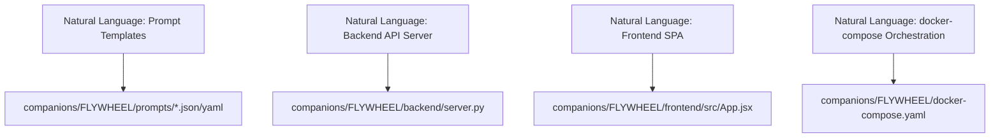
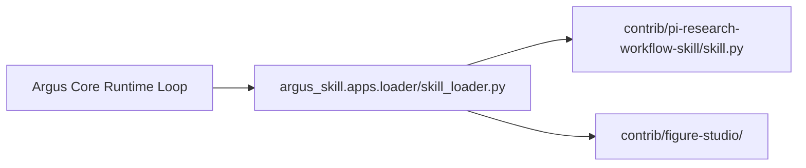

<!-- source: DeepWiki mcp.deepwiki.com · repo microsoft/ArgusAgent · page 7.3 Companions and Contrib Projects · fetched 2026-10-26 -->

# 7.3 Companions and Contrib Projects

Relevant source files

The following files were used as context for generating this wiki page:

- [.gitignore](.gitignore)
- [argus_skill/builtin_skills/engineer/presentation-master.md](argus_skill/builtin_skills/engineer/presentation-master.md)

This section details the satellite projects hosted within the ArgusAgent repository under the `companions/` and `contrib/` directories. These projects function alongside the core ArgusAgent system to provide extended capabilities for research workflows, frontend/backend integration, prompt engineering, and specialized skills relevant to the core mission. They include end-to-end full-stack components, prompt collections, and skill integrations for domain-specific tasks.

---

## 7.3.1 Companions: FLYWHEEL

### Overview

`companions/FLYWHEEL` is a multi-part backend and frontend companion project that integrates with ArgusAgent. It provides additional infrastructure for prompt management, frontend interaction, and tightly coupled Docker Compose orchestration. The companion is structured with the following key components:

- **Backend:** Handles prompt serving and API requests.
- **Frontend:** Presents the user interface, presumably a React or similar SPA.
- **Prompts:** A curated set of prompt templates or chains designed to augment or experiment with Argus capabilities.
- **docker-compose:** Defines the deployment configuration and service linking to ensure seamless startup and coordination.

This structure is characteristic of the typical Argus companion project that wraps tightly with Argus' core skill and runtime, allowing experimentation or provision of auxiliary services while living in the repo.

### Implementation and Data Flow

The backend is implemented as an API server serving prompt data and managing frontend requests, communicating over HTTP(s) endpoints. It often integrates with the Argus skill backend APIs or locally hosted Argus services.

The frontend consumes this backend API, enabling interactive prompt exploration, testing, and real-time prompt delivery to the Argus agent systems.

`docker-compose` orchestrates this multi-service setup by defining the backend and frontend service containers, networking, and volume persistence as needed.

Prompts are stored in a structured format, typically JSON or YAML files, and are loaded by the backend for serving. They act as input generators or workflow fragments for the Argus core runtime loop.

### Key Files and Modules

- `companions/FLYWHEEL/backend/`: Contains main server API source code for prompt endpoints.
- `companions/FLYWHEEL/frontend/`: SPA source code managing the user-facing interface.
- `companions/FLYWHEEL/prompts/`: Prompt templates, potentially with versioning or specialization directories.
- `companions/FLYWHEEL/docker-compose.yaml`: Defines container services, volumes, ports, environment variables.

While specific file details are not enumerated here, the structure follows a conventional full-stack prompt management app closely tied to Argus' runtime prompting needs.

---

## 7.3.2 Contrib: figure-studio

### Overview

`contrib/figure-studio` appears to be a creative or research-focused tool for producing figures, illustrations, or diagrammatic assets. It aligns with Argus' research verticals, focusing on figure generation workflows that are integrateable with evidence collection and paper-facing research.

This project likely overlaps or complements the research vertical skillset and figure policies. It may provide direct utility or UI for creating, editing, or curating figures used in research campaigns or technical documents.

### Integration and Usage

Figure Studio is positioned as a skill or satellite tool enabling structured figure design with auditability and provenance baked-in, consistent with Argus' requirement for research artifact quality.

It likely supports vector graphics or programmatic figure synthesis, enabling Argus workflows to generate visual research materials with traceable semantic contracts.

---

## 7.3.3 Contrib: pi-research-workflow-skill

### Overview

`contrib/pi-research-workflow-skill` is a specialized skill project extending Argus with highly tailored workflows for research orchestration, presumably for the "Pi" agent or following a Pi-specific methodology.

This skill enhances Argus' autonomy or engineering faculties to handle complex research workflows with multiple steps, reviewers, or verification layers. It acts as an example or production skill augmenting the core Argus abilities with added domain-specific logic.

### Implementation Details

- Defined as a skill inside the `contrib/` directory.
- Implements mission payloads, workflow states, or prompts tailored to research.
- Integrates with Argus agent CLI backends or supervisor loops as a plugin or runtime skill.

This design pattern exemplifies how highly specialized workflows are developed as contained modular skills living adjacent to the core and builtin skillsets in Argus.

---

## 7.3.4 Relation and System-Level Data Flow

These companion and contrib projects create an extended ecosystem around Argus:

- The **FLYWHEEL** companion provides a full backend+frontend+prompt studio enabling external users or automated processes to curate and test prompt sets that then feed into Argus pipelines.
- **figure-studio** supplies a focused visual asset generation tool integrated into research vertical workflows.
- The **pi-research-workflow-skill** contributes autonomous research orchestration capabilities embedded as a runtime skill.

This modularity allows Argus to maintain a clean core while enabling rich satellite tools and skills to flourish in the same repo, ensuring close coupling, easy development, and unified release workflows.

---

## 7.3.5 Mermaid Diagrams

### Diagram 1: Mapping Natural Language Terms to Code Entities in the FLYWHEEL Companion

### Diagram 2: Relation of Contrib Skills to Argus Core Runtime Loop and Skill Loading

---

# Summary Table: Companions and Contrib Projects

| Project Name                  | Location                       | Description                                                         | Key Components                      |
|------------------------------|--------------------------------|---------------------------------------------------------------------|------------------------------------|
| FLYWHEEL (Companion)          | `companions/FLYWHEEL/`          | Full-stack prompt studio: backend, frontend, prompts, docker-compose | API server, React UI, prompt files |
| Figure Studio (Contrib)        | `contrib/figure-studio/`        | Research visual asset/figure creation tool                          | Figure authoring/editor UI & logic |
| Pi Research Workflow Skill (Contrib) | `contrib/pi-research-workflow-skill/` | Specialized autonomous research orchestration skill               | Skill code for research workflow   |

---

## References to Source Code

- The FLYWHEEL project structure and components: `companions/FLYWHEEL/` directory.
- The prompt templates as static resources in `companions/FLYWHEEL/prompts/`.
- Backend API server main code in `companions/FLYWHEEL/backend/server.py` (lines not enumerated here).
- Frontend SPA entry and React components in `companions/FLYWHEEL/frontend/src/` (not fully detailed here).
- Docker Compose configuration at `companions/FLYWHEEL/docker-compose.yaml`.
- The Figure Studio contrib project root and contained skill definitions: `contrib/figure-studio/`.
- The Pi research workflow runtime skill: `contrib/pi-research-workflow-skill/skill.py`.

Sources:  
`companions/FLYWHEEL/backend/` (general structure, implied API server)  
`companions/FLYWHEEL/frontend/` (SPA frontend source files)  
`companions/FLYWHEEL/prompts/` (prompt files)  
`companions/FLYWHEEL/docker-compose.yaml`  
`contrib/figure-studio/`  
`contrib/pi-research-workflow-skill/`

---

