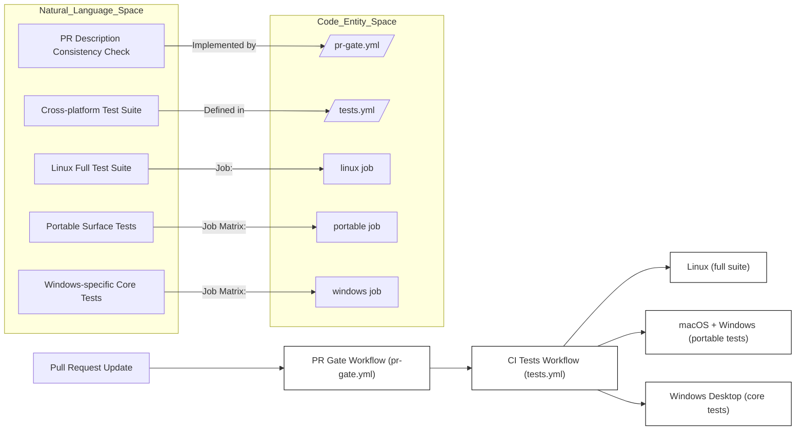
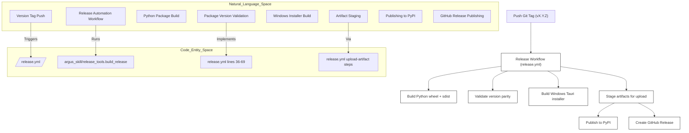

<!-- source: DeepWiki mcp.deepwiki.com · repo microsoft/ArgusAgent · page 8 Build, Release and Quality Infrastructure · fetched 2026-10-26 -->

# Build, Release and Quality Infrastructure

Relevant source files

The following files were used as context for generating this wiki page:

- [.github/workflows/pr-gate.yml](.github/workflows/pr-gate.yml)
- [.github/workflows/release.yml](.github/workflows/release.yml)
- [.github/workflows/tests.yml](.github/workflows/tests.yml)

This section outlines the core Continuous Integration (CI) and Continuous Deployment (CD) workflows, the release pipeline, testing strategies, and the tooling for updates and maintenance in ArgusAgent. These infrastructure components ensure code quality, cross-platform reliability, consistent releases, and smooth update experiences. Each sub-topic is linked to a detailed child page for an in-depth understanding.

---

## Continuous Integration Workflows

Argus employs automated CI workflows configured via GitHub Actions to verify code correctness and platform compatibility before merging changes. The main CI workflow (`tests.yml`) is designed with a job matrix to run tests on Linux, macOS, and Windows environments, structured to address the differences in platform capabilities:

- **Linux** runs the full test suite to leverage the primary development platform where all features, including `os.fork`-dependent components, are executable.
- **Portable Surface Tests** focus on modules that must work on both macOS and Windows, such as chat bridges and core helpers underlying portability.
- **Windows Core Tests** exercise Windows-specific product paths, including the Tauri desktop host and frozen Python backend, to catch regressions unique to the Windows environment.

The workflow also uses environment variables like `PORTABLE_TESTS` and `WINDOWS_CORE_TESTS` to selectively run relevant test subsets, minimizing wasted test effort on non-portable parts.

A separate PR-gate workflow (`pr-gate.yml`) enforces consistency between the pull request description and the patch content, acting as a gatekeeping quality check on submission.

For details on workflow steps, job definitions, test sets, and gate enforcement, see [CI Workflows and PR Gate](#8.1).

Sources:  
`.github/workflows/tests.yml:1-180`  
`.github/workflows/pr-gate.yml:1-32`  

---

## Release Pipeline and Tools

Argus' release process is operator-controlled and triggered on version tag pushes (`refs/tags/v*`). The pipeline defined in `.github/workflows/release.yml` performs several crucial steps:

- **Build Phase**: It builds Python wheels and source distributions, installs frontend dependencies, compiles frontend assets, and packages a frozen Python backend for the Windows Tauri desktop app.
- **Version Validation**: Ensures strict version parity among Python (`pyproject.toml`), Node.js (`package.json`), Rust (`Cargo.toml`), and Tauri configuration (`tauri.conf.json`), preventing release drift.
- **Artifact Staging**: Uploads build artifacts including wheels, Windows installers, and manifests for downstream distribution.
- **Publishing**: Automates publishing to PyPI and creating GitHub Releases with attached artifacts, while verifying signatures and release notes generation.

The release tooling (`argus_skill/release_tools`) supports build orchestration, manifest generation, artifact checking, and PR gate integrations critical to the release's integrity and automation.

For an in-depth look at the release jobs, version synchronization, release tools, and manifests, see [Release Pipeline and Release Tools](#8.2).

Sources:  
`.github/workflows/release.yml:1-193`  

---

## Testing Strategy and Test Suite Layout

The testing framework organizes test modules to mirror the `argus_skill` package structure. Tests reside under `tests/` and cover critical subsystems such as core runtime, life layer, manager roles, skills, web API, tooling, daemon processes, and desktop integrations.

Testing coverage is imposed asymmetrically to reflect platform subtleties: the entire test suite runs on Linux (primary dev platform), while macOS and Windows run a "portable surface" subset focusing on cross-platform components. Windows Desktop tests additionally cover frozen backend and Tauri host specifics.

Test suites leverage fixtures and include platform-specific test skipping to accommodate API differences and ensure test relevance.

For comprehensive details on test organization, fixtures, and platform-specific test selection, see [Test Suite Layout](#8.3).

Sources:  
`.github/workflows/tests.yml:1-180`  

---

## Update, Maintenance, and Diagnostics Tooling

To keep Argus in a healthy state and enable smooth updates, this section covers the infrastructure for automated maintenance and update tooling:

- The `argus_skill/apps` contains update-related submodules such as `update`, `update_install`, `update_launcher`, and `package_update` which coordinate staged update application and launcher refresh.
- Maintenance tasks are scripted in `argus_skill/maintenance`, supporting ongoing repair and cleanup routines.
- `argus_doctor.py` offers health advisories and diagnostics, monitoring runtime health and guiding troubleshooting.
- The `update/` directory hosts additional support scripts and manifests to manage the update lifecycle.

These components together ensure that deployments remain stable and updates roll out confidently with minimal manual intervention.

For a granular walkthrough of update and maintenance code, health diagnostics, and the update directory structure, see [Update, Maintenance and Diagnostics](#8.4).

Sources:  
(Not shown explicitly in the excerpts, mentioned in summary at top)  

---

Each of these components plays a critical role in Argus' software quality and release hygiene. The CI workflows provide early detection of regressions, the release pipeline guarantees consistent and reproducible artifact generation, the test suite layout ensures cross-platform reliability, and update tooling sustains application health post-deployment.

For implementation-level details and developer guidance on modifying or troubleshooting these systems, please explore the respective child pages linked above.

---

