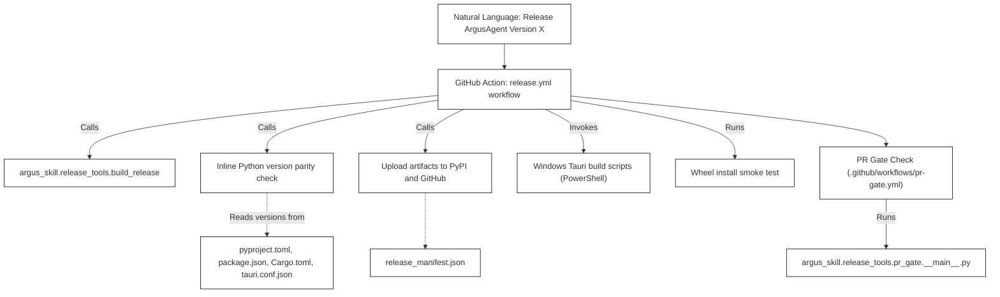

<!-- source: DeepWiki mcp.deepwiki.com · repo microsoft/ArgusAgent · page 8.2 Release Pipeline and Release Tools · fetched 2026-10-26 -->

# Release Pipeline and Release Tools

Relevant source files

The following files were used as context for generating this wiki page:

- [.github/workflows/pr-gate.yml](.github/workflows/pr-gate.yml)
- [.github/workflows/release.yml](.github/workflows/release.yml)

This section documents the release pipeline and associated tooling for ArgusAgent, detailing how releases are built, validated, and published. It covers the GitHub Actions release workflow (`release.yml`), version synchronization enforcement, key functions and classes in the `argus_skill/release_tools` package (including `build_release`, `generate_manifest`, `check_artifacts`, and `pr_gate`), and the structure and role of `release_manifest.json`. This documentation serves as a technical reference to understand the automation and consistency enforcement around ArgusAgent releases.

---

## 1. Overview of the Release Pipeline

The release pipeline is orchestrated using GitHub Actions, primarily through the `.github/workflows/release.yml` workflow. The release process is operator-controlled and triggered on Git tags of the format `v*` or manually via workflow dispatch.

The pipeline performs several key steps:

- Build the Python wheel and source distribution of `argus_skill`.
- Install dependencies for Python, NodeJS packages in `frontend/web` and `frontend/tui`.
- Build release source assets using the `build_release` module.
- Verify version consistency across multiple version declarations.
- Build distribution artifacts, including the Python wheel, Windows Tauri desktop installers, and frozen Python backend.
- Smoke test the wheel package in an isolated environment.
- Publish artifacts to PyPI and GitHub Releases.

The pipeline ensures that published versions match tag versions strictly, with no accidental version divergences. Signed artifacts and manifests are required to guarantee update integrity.

### Version Parity Enforcement

A notable feature is the automatic consistency check between:

- `pyproject.toml` (Python version)
- `desktop-tauri/package.json` (desktop frontend version)
- `desktop-tauri/src-tauri/Cargo.toml` (Rust backend version)
- `desktop-tauri/src-tauri/tauri.conf.json` (Tauri config version)
- Git tag (`refs/tags/v{version}`)

During the release job, custom Python code reads all these files, extracts the declared versions, and asserts equality and matching with the tag string. This guards against accidental version drift across the multi-language codebase [`.github/workflows/release.yml:37-69`]().

---

## 2. Key Release Workflow Jobs in `release.yml`

The release GitHub workflow defines multiple jobs coordinating the build and release stages:

| Job Name | Purpose |
|------------|----------|
| `python` | Build Python wheel and sdist, install dependencies, build release source assets, run version consistency validation, smoke test wheel installation, upload Python dist artifacts. |
| `windows` | Build Windows Tauri installers and frozen Python backend, including signing the desktop releases and staging the Windows artifacts. |
| `pypi` | Publish the wheel and sdist to PyPI if the event is a version tag. Depends on `python` and `windows` jobs to ensure all necessary artifacts are built and signed. |
| `github` | Publish the release assets to GitHub Releases after validating the presence of signed updater manifests and signatures. Generates release notes from staged artifacts automatically. |

The pipeline carefully sequences these jobs to maintain artifact integrity and deployment order.

Sources: `.github/workflows/release.yml:15-193`  
   
---

## 3. `argus_skill/release_tools` Package

The `argus_skill/release_tools` module contains Python utilities that implement key release logic that integrates closely with the GitHub workflows.

### 3.1. `build_release`

- Entry points to build release sources.
- Prepares compiled frontend bundles and other static assets.
- Executed in the release workflow jobs to build distributable artifacts from source [`.github/workflows/release.yml:33-34,117-120`].

### 3.2. `generate_manifest`

- Generates release metadata files describing the build.
- Expected to interact with `release_manifest.json`, encoding artifact information, checksums, and signatures.
- Facilitates later verification and updater integrity checks.

### 3.3. `check_artifacts`

- Validates the presence, format, and integrity of release artifacts.
- Ensures builds produced as expected, enabling downstream steps to trust release assets.

### 3.4. `pr_gate`

- Implements a PR consistency gate that checks for description and patch correspondence.
- Invoked in `.github/workflows/pr-gate.yml` using `argus_skill/release_tools/pr_gate/__main__.py`.
- It analyzes the pull request event payload and produces an output JSON indicating pass/fail state for release readiness [`.github/workflows/pr-gate.yml:27-31`].

---

## 4. Data Flow and Interaction Diagram

Below is a diagram illustrating how the main components interact from natural language release goals to code entities managing the pipeline:

Sources: `.github/workflows/release.yml` [lines 6-193](), `.github/workflows/pr-gate.yml` [lines 1-32]()  

---

## 5. Version Parity Enforcement in Detail

The version parity check in the `release.yml` workflow is a critical step that ensures consistent versioning across multiple key manifests within the repo.

- It triggers only on a version tag push (`refs/tags/v*`).
- Reads the Python package version from `pyproject.toml`.
- Reads the desktop frontend version from `desktop-tauri/package.json`.
- Reads the Rust backend version from `desktop-tauri/src-tauri/Cargo.toml`.
- Reads the Tauri configuration version from `desktop-tauri/src-tauri/tauri.conf.json`.
- Asserts all these versions strictly equal the tag version.
- Raises an error if any mismatch is detected, causing the workflow to fail early.

This approach avoids potential release mismatch bugs that could arise from changing one component’s version but not updating others, critical in multi-language projects with separate version files [`.github/workflows/release.yml:37-69`]().

---

## 6. Role of `release_manifest.json`

The release manifest file (`release_manifest.json`) serves as a machine-readable record of the release artifacts created during the release pipeline.

- It lists all released files, checksums, and signing status.
- Used by updater tools and deployment automation to verify artifact integrity.
- Ensures that upgrade and rollback paths are based on trusted, verifiable artifacts.
- Created during the release build by `generate_manifest` tooling, which packages release metadata.

The manifest acts as a bridge between build systems and runtime update mechanisms, facilitating secure, reproducible deployments.

---

## 7. PR Gate: Ensuring Release-Ready Pull Requests

The PR gate workflow (`.github/workflows/pr-gate.yml`) provides a quality control checkpoint before merges.

- Triggered on PR open, edit, synchronization, or ready-for-review events targeting `main`.
- Executes a Python program `pr_gate/__main__.py` that examines the PR event JSON payload.
- Checks that the PR description matches the contained code changes in a specified way (e.g., version bumps or release notes consistency).
- Outputs a JSON results file indicating pass/fail status, allowing GitHub Actions to block or allow merges appropriately.

This automated gate helps maintain release quality and ensure that PR metadata and actual patch content align.

---

## 8. Summary

- The `release.yml` workflow defines a comprehensive, multi-platform release pipeline with Python wheels, frontend assets, and Windows installers.
- The pipeline enforces strong version parity between multiple language manifests and the Git tag.
- Key release tasks are modularized into `argus_skill/release_tools`, providing reusable functionality.
- `release_manifest.json` provides an authoritative inventory of released artifacts and their metadata.
- The `pr_gate` ensures only PRs properly describing their changes enter the main branch.
  
This tightly integrated set of workflows and tools underpin the robustness and security of ArgusAgent’s release process.

---

# References and Source Files

- `.github/workflows/release.yml:1-193`  
- `.github/workflows/pr-gate.yml:1-32`  
- `argus_skill/release_tools/build_release.py` (implicit references)  
- `argus_skill/release_tools/generate_manifest.py` (implicit references)  
- `argus_skill/release_tools/check_artifacts.py` (implicit references)  
- `argus_skill/release_tools/pr_gate/__main__.py` (invoked in PR gate job)  

Sources:  
`.github/workflows/release.yml`, `.github/workflows/pr-gate.yml`

---

