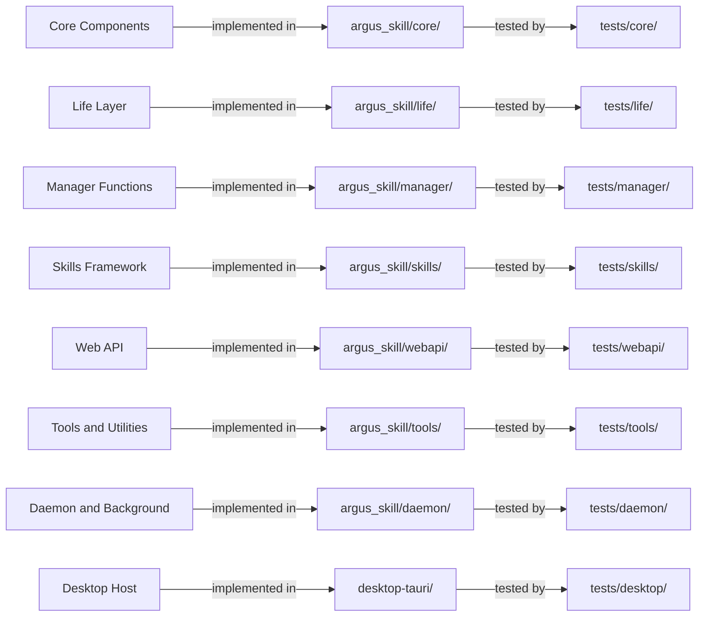
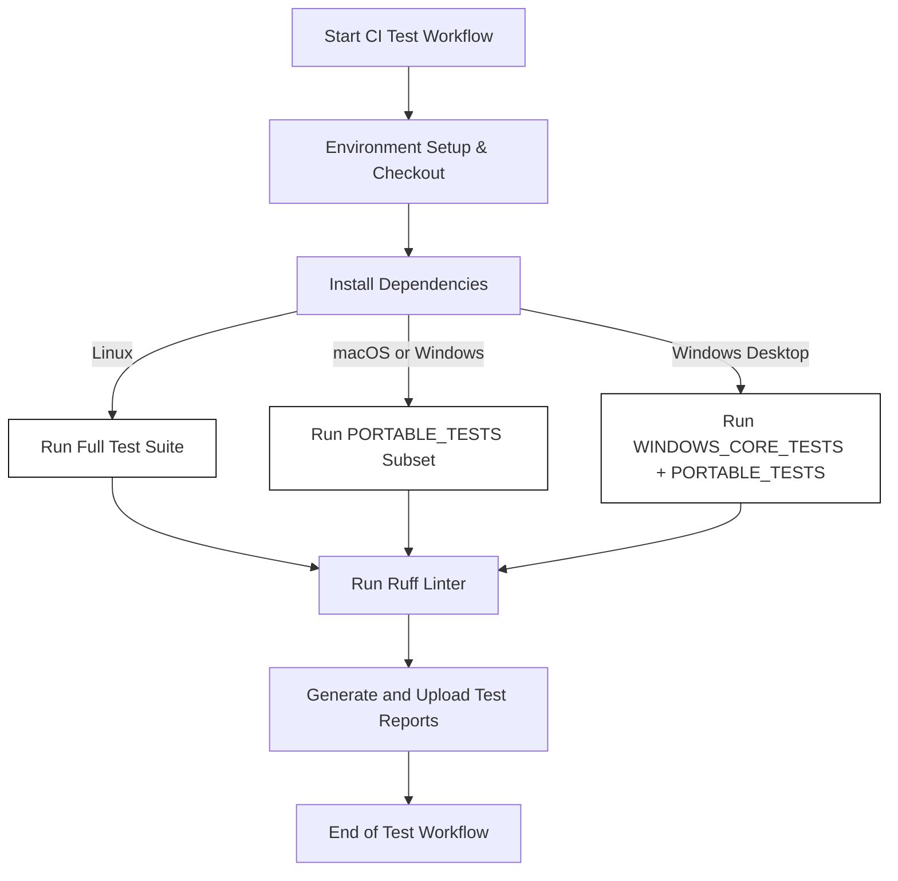

<!-- source: DeepWiki mcp.deepwiki.com · repo microsoft/ArgusAgent · page 8.3 Test Suite Layout · fetched 2026-10-26 -->

# Test Suite Layout

Relevant source files

The following files were used as context for generating this wiki page:

- [.github/workflows/tests.yml](.github/workflows/tests.yml)

This section describes the layout and organization of the automated test suite for the ArgusAgent codebase. The test suite reflects the modular structure of the `argus_skill` packages, supporting platform-specific testing strategies and fixtures to maintain code quality, portability, and reliable behavior across diverse execution environments.

---

## Purpose and Scope

The purpose of the Argus test suite is to verify correctness, robustness, and platform compatibility of code modules arranged primarily in `argus_skill` packages. The tests are organized to mirror the core software package structure, facilitating ease of navigation and maintenance. Special handling exists for platform-dependent code to ensure broad compatibility and meaningful feedback from Continuous Integration (CI) workflows.

This page covers the test suite's directory layout, how it corresponds with the `argus_skill` packages, the use of fixtures, and details on platform-specific skips and test subsets enforced by CI workflows.

---

## Directory Structure and Package Mirroring

The test suite is contained under the top-level `tests/` directory. This directory is organized to parallel the primary `argus_skill` package namespaces, including but not limited to the following:

- `tests/core/`  
- `tests/life/`  
- `tests/manager/`  
- `tests/skills/`  
- `tests/webapi/`  
- `tests/tools/`  
- `tests/daemon/`  
- `tests/desktop/`  

Each folder contains test modules and scripts that correspond to their respective package areas, adopting the same naming conventions and scopes. This structure allows engineers and automation tools to locate tests relevant to a particular package quickly.

For example, `tests/core/` contains tests for core runtime functionality such as event catalogs, cost control, file locking, and session management. Similarly, `tests/life/` hosts tests for life-cycle management modules including chat bridges and Telegram/Feishu bot integrations.

### Benefits of Mirroring

- **Consistency:** Test names and locations map intuitively to source code locations.  
- **Maintainability:** Adding or editing tests is straightforward because test location aligns with impacted source code.  
- **Parallel Development:** Teams working on separate subsystems can operate independently with clear coverage zones.

---

## Test Fixtures and Shared Resources

Across these directories, shared test fixtures are typically organized to handle common setup and teardown operations required by multiple tests. Although explicit fixture code is not detailed here, the tests leverage Python's `pytest` framework for fixtures, parametrizations, and markers, allowing flexible configuration of dependencies like mock objects, temporary directories, or test database states.

---

## Platform-Specific Skips and Test Subsets

Argus targets multiple platforms: Linux (primary development), macOS, and Windows (including Windows Desktop app). The full test suite is executed only on Linux because of POSIX-specific functionality (e.g., `os.fork`, `fcntl`). Other platforms run a limited "portable surface" to ensure essential features work cross-platform. Windows Desktop exercises additional UI-and-backend interactions.

### CI Environment Variables and Test Sets

The `.github/workflows/tests.yml` workflow explicitly configures environment variables and test subsets:

- **PORTABLE_TESTS:**  
  A curated file list of test modules runnable on all supported platforms, including macOS and Windows. This set covers critical, portable functionality like chat rendering, state machines, core usage controls, API routes, and basic CLI interactions.

- **WINDOWS_CORE_TESTS:**  
  Modules that exercise Windows-specific functionality and behaviors, especially relevant to the native Windows Desktop environment. Examples include Windows daemon control, job environment, TUI launcher, and Windows terminal process tests.

- **WINDOWS_COLLECTION_TESTS:**  
  Tests that must be discoverable and collectable on Windows, even if some underlying POSIX assertions are skipped due to OS limitations.

These subsets are defined via multiline environment strings referencing specific test modules, as listed in `env.PORTABLE_TESTS`, `env.WINDOWS_CORE_TESTS`, and `env.WINDOWS_COLLECTION_TESTS` in the CI file.

### Platform Test Execution Overview

- **Linux:** Runs the full test suite (all modules)  
- **macOS & Windows (portable):** Runs only `PORTABLE_TESTS`  
- **Windows Desktop:** Runs Windows core tests plus portable tests, validating GUI backend and frozen backend layouts used before signing  

### Test Skips

POSIX-dependent tests are conditionally marked or skipped on Windows where functionality like `os.fork` or `fcntl` locking is missing. This avoids false negatives in CI while still ensuring coverage on supported platforms.

---

## Test Execution Flow in CI

The CI workflow `tests.yml` orchestrates how the tests run on different platforms:

1. **Checkout and Setup:**  
   - Code checked out at the commit under test.  
   - Python environment (3.11) prepared with pip caches.

2. **Dependency Installation:**  
   - Packages installed including CPU Torch to limit overhead.  
   - For portable tests, the minimal required extras (`.[qr]`) are installed, while the full suite requires `.[dev,qr]`.

3. **Static Analysis and Linting:**  
   - `ruff` linter runs on `argus_skill` and `tests`.

4. **Test Runs:**  
   - Linux executes the full suite with `pytest`.  
   - macOS and Windows run the portable subset by passing the list of test files to `pytest`.  
   - Windows Desktop performs distinct tests targeting Windows core modules.

5. **Platform-Specific Tool Smoke Tests:**  
   - On macOS, the `uv` tool is installed and its basic commands checked to verify environment readiness.

The workflow ensures stable, reproducible validation across the platforms where Argus is expected to run.

---

## Visualizing Code and Test Relationship

The following Mermaid diagrams illustrate how the test suite layout corresponds to the Argus codebase namespaces, and how the natural language "system" terms map to concrete code entities and test modules.

### Diagram 1: Natural Language System Terms to argus_skill Packages and Tests

**Sources:** `.github/workflows/tests.yml:34-114`()

---

### Diagram 2: Platform-Aware Test Subsets and Execution Flow in CI

**Sources:** `.github/workflows/tests.yml:1-114`()

---

## Summary Table: Test Subsets and Platform Targets

| Test Subset          | Platforms         | Scope                                                            | Purpose                                       |
|----------------------|-------------------|------------------------------------------------------------------|-----------------------------------------------|
| PORTABLE_TESTS       | macOS, Windows, Linux | Core portable test modules: chat bridges, API, locks, cost control | Base functionality portability coverage        |
| WINDOWS_CORE_TESTS   | Windows Desktop    | Windows-specific modules: daemon control, TUI launcher, job env    | Validate Windows backend and UI components      |
| WINDOWS_COLLECTION_TESTS | Windows           | Modules that must be collectable on Windows, with POSIX skips       | Ensure test discovery and partial execution     |
| Full Suite           | Linux             | Complete test suite covering all modules                          | Full validation of all Argus code, including POSIX-only features |

**Sources:** `.github/workflows/tests.yml:34-130`()

---

# Conclusion

The Argus test suite is carefully structured to mirror the codebase's modular design, supporting direct traceability between code modules and their verification tests. This organization facilitates efficient development and debugging. The test workflow integrates platform-aware testing subsets, balancing thoroughness with practical constraints posed by OS-dependent code and runtime environments. This robust structure helps maintain the stability and portability of Argus across its supported platforms.

---

# References

- GitHub Actions test workflow `.github/workflows/tests.yml` [lines 1-114]()
- CI environment variables and test listings: `.github/workflows/tests.yml` [lines 34-114]()
- Platform-specific test subsets and execution details `.github/workflows/tests.yml` [lines 33-114]()

---

