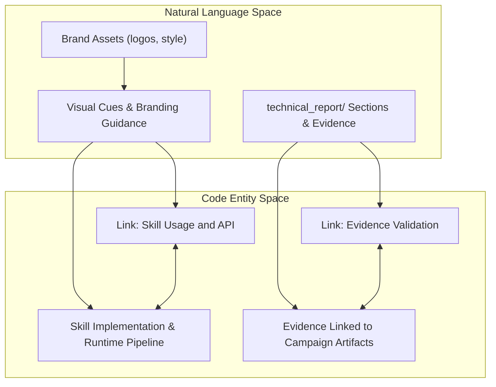

<!-- source: DeepWiki mcp.deepwiki.com · repo microsoft/ArgusAgent · page 9 Documentation and Technical Report · fetched 2026-10-26 -->

# Documentation and Technical Report

Relevant source files

The following files were used as context for generating this wiki page:

- [README.md](README.md)

This section provides a high-level overview of where the written content that supports Argus resides. It outlines the organization of all prose-related materials, user guides, technical reports, brand assets, and the structured evidence bundles that underpin research claims. The Documentation and Technical Report area is primarily split into two main pillars: *User Guides and Examples* and *Technical Report and Evidence*. Each pillar is detailed in its own child page, focusing respectively on user-facing documentation and the rigorous technical content including experimental data.

---

## Overview

Argus maintains a clear separation between its runtime and codebase and the accompanying prose that documents its architecture, usage, and evaluation. The documentation is primarily housed within the `docs/` directory and covers user guides, installation instructions, branding guidelines, audits, demo descriptions, and evaluations. Alongside this, the `technical_report/` directory contains formal research sections, figures, and extensive evidence bundles organized by campaign, which support the core claims made about Argus’s performance and capabilities.

This parent page does not delve into the minute details of each guide or report component but provides a roadmap to navigate these two essential parts of the Argus knowledge ecosystem.

---

## Docs: Guides, Examples, and Brand Assets

The `docs/` directory includes comprehensive user-facing material designed to facilitate getting started, integrating, and effectively using Argus. Content ranges from instructional guides on installation (`agent-install`), platform-specific setups such as Windows desktop usage, the plugin marketplace, and Harbor evaluation framework walkthroughs. It also contains interactive labs like the Counterexample Lab and example projects that demonstrate Argus's core features in action.

Moreover, brand assets such as logos, graphical elements, and style guidelines are stored here to ensure consistency in communication and presentation.

The guides assist users and developers alike, providing clear instructions, common workflows, troubleshooting help, and brand voice standards that align with Argus’s mission and technical framework.

For details, see the child page: [docs/ Guides and Examples](#9.1).

---

## Technical Report and Evidence Bundles

The `technical_report/` directory holds formal research papers, structured evidence, and appendices that underpin Argus’s claims. These cover scientific methods, campaign-specific results, empirical figures, and audit trails necessary for academic and engineering validation.

The content is sectioned by research campaign—e.g., `swebench_pro`, `erdos_trace`, `fla_kernel_optimization`, `mle_bench_lite`, `ace2_chip`—allowing precise mapping from claims made in the technical report sections to the underlying experimental data and code artifacts that generated the evidence.

This organized structure supports reproducibility and independent verification of Argus’s autonomous agent research, echoing the rigor expected in scientific and engineering disciplines.

For details, see the child page: [Technical Report and Evidence](#9.2).

---

## Bridging Natural Language and Code Entities

The Documentation and Technical Report sphere acts as a bridge between two knowledge spaces:

- **Natural Language Space:** The prose, user guides, theoretical frameworks, research narratives, explanations, and campaign descriptions.
- **Code Entity Space:** The concrete code artifacts, skill implementations, runtime modules, pipelines, and evidence ledger files where the system’s logic and results reside.

The documents establish named relationships and references so users can move fluidly between understanding concepts and exploring code implementations or experimental results.

Below is a conceptual diagram illustrating the interaction between documentation and codebase components to clarify how system concepts map onto code entities and evidence repositories.

---

## Summary

The *Documentation and Technical Report* section serves as the anchor point for all prose and research output related to Argus. It ensures that users and researchers have crisp, navigable access to guides for using the system and formal evidence supporting its autonomous agent claims. The split into two child areas clarifies where to find practical how-tos versus rigorous research data and narrative.

- For hands-on user guidance, setup instructions, example workflows, and brand resources, see [docs/ Guides and Examples](#9.1).
- For research papers, technical sections, figures, audit evidence, and campaigns, see [Technical Report and Evidence](#9.2).

This modular organization reflects Argus’s dual focus on practical autonomy and scientific transparency.

---

Sources:  
- README.md [1-128]()

---

