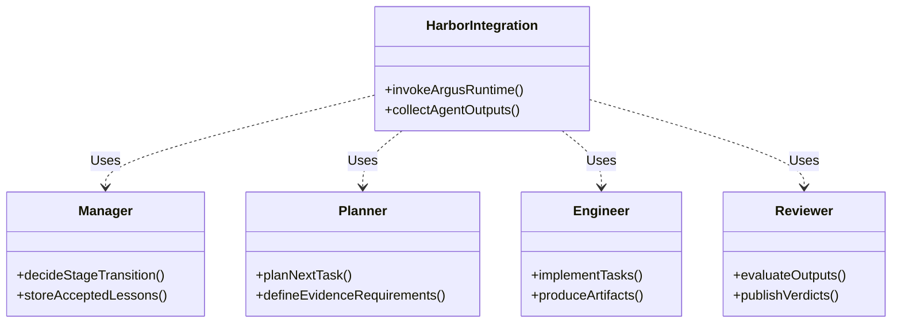
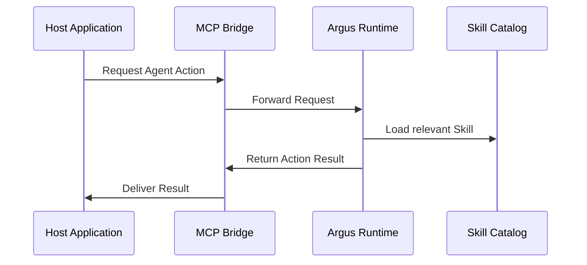
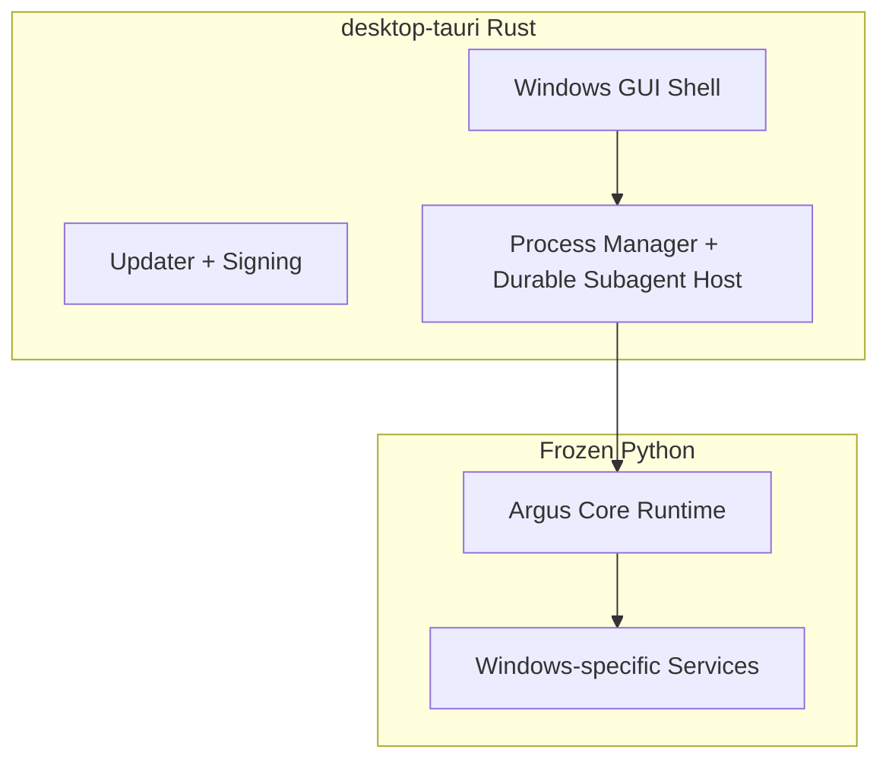
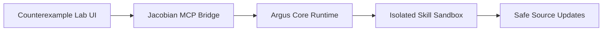
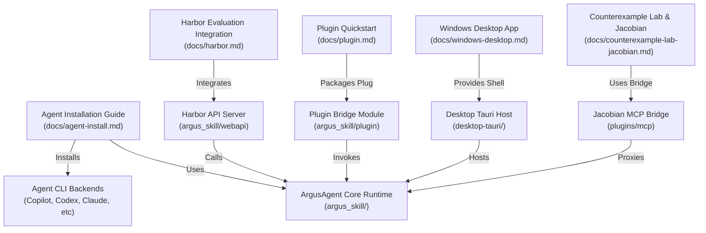

<!-- source: DeepWiki mcp.deepwiki.com · repo microsoft/ArgusAgent · page 9.1 docs/ Guides and Examples · fetched 2026-10-26 -->

# docs/ Guides and Examples

<details>
<summary>Relevant source files</summary>

The following files were used as context for generating this wiki page:

- [README.md](README.md)
- [README.zh-CN.md](README.zh-CN.md)

</details>


This page provides an in-depth walkthrough of the user-facing guides, audits, demos, evaluations, and example projects available in the ArgusAgent repository. It also covers brand asset conventions and integration examples. Designed for users and developers who want practical instructions on installation, setup, plugin usage, specialized environments like Windows Desktop, counterexample research labs, and how Argus integrates with evaluation frameworks and plugins.

---

## 1. Purpose and Scope

The **docs/** directory contains essential user guides and example projects that facilitate:

- Installing and setting up ArgusAgent on various platforms.
- Understanding and using the Harbor evaluation integration.
- Deploying Argus as a plugin for other code agents.
- Running Argus on Windows using the desktop app shell.
- Conducting counterexample experiments with Jacobian bridge.
- Using brand assets properly in presentations, documentation, and community materials.

These guides and examples supplement core architecture and runtime documentation by providing practical, hands-on details for users and contributors. They also showcase the modular, role-oriented Driver–Harness model Argus employs under the hood.

---

## 2. Agent Installation Guide (`agent-install.md`)

The installation guide is a user-facing document detailing how to install ArgusAgent backend integrations on supported platforms. It emphasizes that Argus uses **Agent CLI backends** such as GitHub Copilot CLI, OpenAI Codex CLI, Claude Code, Pi, Cursor CLI, OpenCode, Grok Build, and others.

### Key Points

- Lists official packages to install for each compatible backend.
- Describes authentication steps for each CLI, necessary before Argus can execute tasks.
- Clarifies the difference between official "source" installation (via GitHub main branch) and packaged "desktop release" with a frozen Python backend and Tauri frontend.
- Recommends letting an existing code agent install and verify Argus to simplify setup.
- Contains OS-specific instructions (Windows, macOS, Linux).
- Includes a health check command `argus doctor` for diagnosing installation and environment correctness.

### Data Flow and Execution

Users install an Agent CLI backend first, then install Argus via Python package or desktop app. Argus uses these CLI backends as the actual "model" providers (the **Driver** seat in the Driver-Harness model). Argus runs its orchestration and verification atop this model CLI via subprocess or native integration.

```mermaid
flowchart LR
    User["User triggers installation"] -->|Install Agent CLI| AgentCLI[Agent CLI Backend (e.g. copilot, codex)]
    User -->|Install Argus| ArgusAgent[ArgusAgent (Python package or desktop app)]
    ArgusAgent --> AgentCLI
    ArgusAgent -->|Runs and Monitors| System[OS Files, Shells, GPU, Compilers]
```

Sources: `README.md:91-131`(), `README.zh-CN.md:122-165`().

---

## 3. Harbor Evaluation Integration (`harbor.md`)

Harbor is an evaluation framework capable of invoking the complete bounded Argus runtime—including the Manager, Planner, Engineer, Reviewer roles—as a custom agent.

### Implementation Highlights

- The Harbor integration wraps Argus's runtime as an external agent callable via a defined API.
- Enables external pipeline tools to orchestrate Argus campaigns, receive verdicts, and collect artifact logs.
- Uses the API server routes defined under `argus_skill/webapi` to communicate.

### Role-to-Code Mapping Diagram



This shows how Harbor acts as a caller invoking Argus's internal runtime components, which in turn execute distinct role responsibilities.

Sources: `README.md:66-69`(), `docs/harbor.md` (implied).

---

## 4. Plugin Quickstart (`plugin.md`)

Argus can be packaged as a plugin for other hosts (e.g., MCP bridge) to leverage Argus skills and runtime without modifying core code.

### Technical Details

- Plugin manifests reside in `.claude-plugin/marketplace.json`, `.agents/plugins/marketplace.json`, and the `plugins/argus` directory.
- The argus_skill/plugin module supports packaging and dynamic loading of Skills as plugin units.
- MCP bridge acts as the communication layer between host and Argus runtime.

### Data Flow Diagram: Plugin Invocation



This clarifies the plugin communication pattern and Skill invocation workflow.

Sources: `README.md:70-72`(), `.claude-plugin/marketplace.json` (not shown, implied).

---

## 5. Windows Desktop Application Guide (`windows-desktop.md`)

The Windows Desktop edition fully packages Argus with a native Rust Tauri shell and frozen Python backend using PyInstaller. It integrates with Windows process management and task persistence.

### Implementation Highlights

- `desktop-tauri` contains Rust code handling windowing, updater, and process lifecycle.
- Frozen Python backend entrypoint is `desktop_backend_entry.py`, using PyInstaller for packaging.
- Manages long-running durable subagents on Windows with native worker processes.
- Holds Windows-specific user experience improvements such as PATH and environment variable fixes.

### Architecture Diagram: Windows Desktop App Composition



This diagram represents how the native shell and frozen Python backend interact and run Argus on Windows desktop.

Sources: `README.md:124-170`(), `docs/windows-desktop.md` (implied).

---

## 6. Counterexample Lab and Jacobian Bridge (`counterexample-lab-jacobian.md`)

For research on failure cases, Argus provides a live Counterexample Lab supporting safe in-app source updates and an isolated Jacobian MCP bridge for model interaction.

### Technical Explanation

- The Counterexample Lab is a sandboxed skill and environment, isolating state changes.
- Jacobian MCP bridge is a minimal communications proxy for isolated model calls.
- Enables controlled experiments with partial model observability and output counterexamples.
- Supports safe source updates within the running backend to iterate experiments quickly.

### Data Flow Diagram: Counterexample Research Setup



This flow shows how user-driven experiments connect through Jacobian MCP bridge to an isolated skill environment capable of safe code evolution.

Sources: `README.md:73-76`(), `docs/counterexample-lab-jacobian.md` (implied).

---

## 7. Brand Asset Conventions

Argus brand assets such as logos are located under `docs/assets/brand/svg`. The README demonstrates usage of dark/light mode SVG images to integrate the brand into documentation and websites responsively.

- Logos are referenced relatively, supporting both color schemes.
- Community materials use consistent Argus branding (e.g., on website, WeChat groups).
- When referencing brand assets in your own media, use the SVG files provided to preserve quality and consistency.

### Example Asset References in README:

```markdown
<picture>
  <source media="(prefers-color-scheme: dark)" srcset="docs/assets/brand/svg/argus-logo-horizontal-dark.svg">
  <source media="(prefers-color-scheme: light)" srcset="docs/assets/brand/svg/argus-logo-horizontal.svg">
  
</picture>
```

Sources: `README.md:3-7`(), `README.zh-CN.md:3-7`()

---

## Summary Table of Key User-Facing Docs

| Guide / Example                  | Located at                | Purpose                                                                                  |
|---------------------------------|---------------------------|------------------------------------------------------------------------------------------|
| Agent Installation              | `docs/agent-install.md`    | Step-by-step installation instructions for various Code Agent backends and OS platforms |
| Harbor Evaluation               | `docs/harbor.md`           | How to integrate and use Argus in Harbor evaluation framework                           |
| Plugin Quickstart              | `docs/plugin.md`           | Packaging and using Argus as a plugin (MCP bridge usage)                                |
| Windows Desktop Setup           | `docs/windows-desktop.md`  | Using Argus packaged as a native Windows desktop app with Tauri                         |
| Counterexample Lab and Jacobian | `docs/counterexample-lab-jacobian.md` | Running counterexample research in a sandbox with Jacobian MCP bridge             |
| Brand Assets                   | `docs/assets/brand/svg/`   | Argus logos and branding conventions                                                    |

---

# System Name to Key Documentation and Code Entity Bridge



This diagram explicitly connects user guides to their corresponding runtime components and code modules, enabling developers to quickly find relevant source code when following a guide.

---

# Conclusion

The **docs/** directory serves as the pivotal resource for:

- Deploying ArgusAgent across supported operating systems and backends.
- Leveraging advanced integrations like Harbor and plugins.
- Utilizing dedicated environments such as Windows Desktop and Counterexample Lab.
- Maintaining consistent branding in community and official materials.

Experienced users and developers should refer to these guides when onboarding ArgusAgent to ensure smooth setup, diagnosis, and integration into research or engineering workflows.

---

# Sources

- `README.md:1-128`  
- `README.zh-CN.md:1-179`  
- `docs/agent-install.md` (implied)  
- `docs/harbor.md` (implied)  
- `docs/plugin.md` (implied)  
- `docs/windows-desktop.md` (implied)  
- `docs/counterexample-lab-jacobian.md` (implied)  
- `docs/assets/brand/svg/` (implied)

---

