# Page: Overview

# 1. Overview

<details>
<summary>Relevant source files</summary>

The following files were used as context for generating this wiki page:

- [.gitignore](.gitignore)
- [README.md](README.md)
- [README.zh-CN.md](README.zh-CN.md)

</details>


Argus is a system designed for persistent, reviewed autonomy in research and engineering tasks. It enables long-running agent work that can plan, execute, verify, pause, and continue beyond a single model turn [README.md:11-12](). This page provides a high-level overview of Argus's core concepts, its architectural roles, and the overall repository structure.

## The Driver-Harness Model

Argus operates on a "Driver-Harness" model [README.md:35](). In this model, a **model** is an engine that processes compute and outputs tokens. A **harness** is the mechanism that connects these tokens to real-world tools like files, shells, compilers, GPUs, and tests. The **Driver** is the decision-maker, determining the next action, evaluating results, and knowing when to seek human intervention [README.md:37-41]().

Unlike other agent systems where a human typically fills the Driver's seat, Argus takes on this role itself, distributing its responsibilities across four distinct roles: Manager, Planner, Engineer, and Reviewer [README.md:43-44](). These roles are intentionally designed with strict authority boundaries to prevent them from performing each other's jobs [README.md:44-45]().

### Argus Roles and Responsibilities

The four core roles in Argus are:

*   **Manager**: Owns stage transitions and determines where admitted lessons are stored. It is explicitly *not* allowed to perform the work it is admitting [README.md:46-49]().
*   **Planner**: Owns the next task and defines the evidence required for its completion. It is *not* allowed to move the campaign to the next stage [README.md:46-50]().
*   **Engineer**: Responsible for implementation, research, experiments, and artifacts. It is *not* allowed to declare its own work complete [README.md:46-51]().
*   **Reviewer**: Owns the verdict on correctness, evidence, and limitations, and can return a `blocked` status. Crucially, it runs in a **read-only** mode and cannot edit anything [README.md:46-52]().

This separation of concerns ensures that the worker cannot grade its own work, reducing the need for constant human oversight [README.md:60-61]().

**Title: Argus Driver-Harness Model and Role Split**
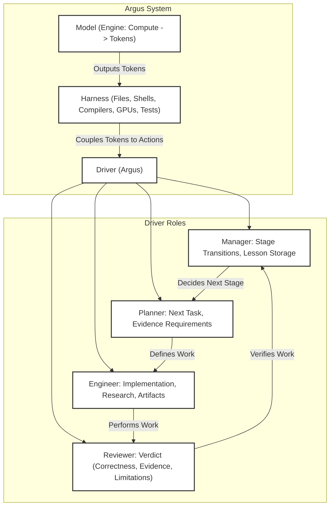
Sources: [README.md:35-52]()

## Repository Layout

The Argus codebase is organized into several key directories, each serving a specific purpose in the overall system architecture.

**Title: Argus Repository High-Level Structure**
```mermaid
graph TD
    A[Argus Repository] --> B[argus_skill/: Core Runtime & Logic]
    A --> C[frontend/: User Interfaces]
    A --> D[desktop-tauri/: Desktop Application]
    A --> E[tests/: Test Suite]
    A --> F[docs/: Documentation]

    subgraph "argus_skill/"
        B1[core/]
        B2[apps/]
        B3[daemon/]
        B4[life/]
        B5[agent_cli/]
        B6[adapters/]
        B7[tools/]
        B8[builtin_skills/]
        B9[wiki/]
        B10[verticals/]
        B11[webapi/]
        B12[integrations/]
        B13[release_tools/]
        B14[maintenance/]
    end

    subgraph "frontend/"
        C1[web/]
        C2[core/]
        C3[tui/]
    end

    subgraph "desktop-tauri/"
        D1[src-tauri/]
        D2[desktop_backend_entry.py]
        D3[build scripts]
    end

    subgraph "docs/"
        F1[guides/]
        F2[technical_report/]
        F3[assets/]
    end

    B --> B1 & B2 & B3 & B4 & B5 & B6 & B7 & B8 & B9 & B10 & B11 & B12 & B13 & B14
    C --> C1 & C2 & C3
    D --> D1 & D2 & D3
    F --> F1 & F2 & F3
```
Sources: [README.md:1-128](), [README.zh-CN.md:1-179](), [.gitignore:1-132]()

*   **`argus_skill/`**: This is the core Python package containing the runtime logic, application components, daemon services, agent CLI integrations, tools, built-in skills, wiki system, vertical domains, web API, and release utilities.
    *   For details on the core runtime architecture, see [Core Runtime Architecture](#2).
    *   For details on agent CLI backends, see [Agent CLI Backends and Execution](#3).
    *   For details on skills and knowledge accumulation, see [Skills, Wiki and Knowledge Accumulation](#4).
    *   For details on verticals and domain packs, see [Verticals and Domain Packs](#5).
    *   For details on the Web API, see [Interfaces: Web API, Frontends and Desktop](#6).
*   **`frontend/`**: Contains the user interface components, including the React web application (`web/`), shared frontend core components (`core/`), and the Terminal User Interface (`tui/`).
    *   For details on the web frontend and TUI, see [Interfaces: Web API, Frontends and Desktop](#6).
*   **`desktop-tauri/`**: Houses the Tauri-based desktop application, including the Rust host (`src-tauri/`), the frozen Python backend entry point (`desktop_backend_entry.py`), and associated build/staging scripts.
    *   For details on the desktop application, see [Interfaces: Web API, Frontends and Desktop](#6).
*   **`tests/`**: Contains the comprehensive test suite for the entire codebase.
    *   For details on the testing strategy, see [Build, Release and Quality Infrastructure](#8).
*   **`docs/`**: Stores all documentation, including user guides, examples, and the technical report.
    *   For details on documentation, see [Documentation and Technical Report](#9).

## Getting Started and Installation

Argus supports various Agent CLI backends, including `GitHub Copilot CLI`, `Pi`, `OpenAI Codex CLI`, `Claude Code`, `Cursor CLI`, `OpenCode`, `Grok Build`, `Qoder`, and `DeepSeek Harness` [README.md:65-66](). Installation can be done either by installing directly from the source repository's `main` branch or by using packaged desktop releases [README.md:117-128](). All platforms require Node.js 22.12+ and an authenticated Agent CLI [README.md:94-96]().

For detailed installation instructions, platform-specific setup, and information on `argus doctor` health checks, see [Getting Started and Installation](#1.1).

## Repository Map and Project Governance

The repository is structured to facilitate development and maintenance. Key directories include `argus_skill/` for the core logic, `frontend/` for user interfaces, `desktop-tauri/` for the desktop application, `tests/` for quality assurance, and `docs/` for documentation [README.md:1-128]().

For a directory-by-directory tour of the repository, along with details on contribution guidelines, code of conduct, security, support, licensing, and Git hygiene configuration, see [Repository Map and Project Governance](#1.2).

## Engineering Conventions

Argus emphasizes a "minimal-rigorous-work" approach to engineering. This includes principles like the shortest control path, avoiding prohibited abstractions, ensuring error transparency, and maintaining review discipline.

For a comprehensive understanding of the engineering conventions that govern all code changes, see [Engineering Conventions](#1.3).

---

# Page: Getting Started and Installation

# Getting Started and Installation

<details>
<summary>Relevant source files</summary>

The following files were used as context for generating this wiki page:

- [README.md](README.md)
- [argus_doctor.py](argus_doctor.py)
- [argus_skill/__main__.py](argus_skill/__main__.py)
- [argus_skill/apps/cli/_parser.py](argus_skill/apps/cli/_parser.py)

</details>


This page details the installation channels, supported Agent CLI backends, platform prerequisites, diagnostic health checks via `argus doctor`, and the unified command-line entrypoint architecture for Argus.

---

## 1. Supported Agent CLI Backends and Prerequisites

Argus operates as a harness that couples language models to local environments through external coding agent CLIs. The core runtime requires Python 3.11+ [README.md:17] and Node.js 22.12+ [README.md:95], along with at least one authenticated agent backend [README.md:96]. 

The supported backends, their underlying packages, and authentication requirements are resolved by the runner backend subsystem:

| Agent CLI | Backend Identifier | Installation Command | Authentication Method |
|---|---|---|---|
| GitHub Copilot CLI | `copilot` [README.md:108] | `npm install -g @github/copilot` [README.md:108] | `copilot login` [README.md:108] |
| OpenAI Codex CLI | `codex` [README.md:109] | `npm install -g @openai/codex@latest` [README.md:109] | `codex login` [README.md:109] |
| Claude Code | `claude` [README.md:110] | `npm install -g @anthropic-ai/claude-code` [README.md:110] | Run `claude`, then `/login` [README.md:110] |
| Cursor CLI | `cursor` [README.md:111] | `curl https://cursor.com/install -fsS \| bash` [README.md:111] | `agent login` or `CURSOR_API_KEY` [README.md:111] |
| Pi | `pi` [README.md:112] | `npm install -g --ignore-scripts @earendil-works/pi-coding-agent` [README.md:112] | Run `pi`, then `/login` [README.md:112] |
| OpenCode | `opencode` [README.md:113] | Official install guide [README.md:113] | `opencode auth login` [README.md:113] |
| Grok Build | `grok` [README.md:114] | Official install guide [README.md:114] | `grok login` [README.md:114] |
| Qoder CLI | `qoder` [README.md:115] | `npm install -g @qoder-ai/qodercli` [README.md:115] | `qodercli login` [README.md:115] |
| DeepSeek Harness | `dsh` [README.md:116] | `npm install -g @deepseek-ai/dsh` [README.md:116] | Configure `DEEPSEEK_API_KEY` [README.md:116] |

Sources: [README.md:92-117]

---

## 2. Installation Channels: Source vs. Desktop Release

Argus provides two distinct distribution channels that serve different deployment requirements:

1. **Source Installation**: Directly clones or installs from the official source repository (`microsoft/ArgusAgent` for official releases, or `lbx154/Argus` for development previews) [README.md:29-33, 118-123]. This channel is intended for developers, researchers, and users running custom verticals or making source code modifications.
2. **Desktop Release**: Pre-packaged Windows executables and platform bundles distributed through GitHub Releases (`microsoft/ArgusAgent/releases` or `lbx154/Argus/releases`) [README.md:124-128]. The desktop shell wraps the frozen Python backend via PyInstaller within a Tauri host container.

Sources: [README.md:28-34, 118-128]

---

## 3. The `argus doctor` Diagnostic Subsystem

To verify environment health, Python runtime availability, and toolchains, Argus includes a standalone bootstrap diagnostics script implemented entirely using the Python standard library: `argus_doctor.py` [argus_doctor.py:1-13].

### Diagnostic Checks and Codes

The `run_bootstrap_doctor()` function evaluates the local host and returns a structured list of findings containing diagnostic codes [argus_doctor.py:80-189]:

- **`ARGUS-HOST-001`**: Validates underlying host operating system, release architecture, and kernel metadata [argus_doctor.py:83-88].
- **`ARGUS-PYTHON-001`**: Asserts that the bootstrap Python interpreter meets the minimum version requirement (`>= 3.11`) [argus_doctor.py:89-96].
- **`ARGUS-INSTALL-001`**: Locates a valid Argus source checkout containing `pyproject.toml` and `argus_skill/` via `_find_checkout()` [argus_doctor.py:25-45, 97-103].
- **`ARGUS-PYTHON-002` / `ARGUS-PYTHON-003`**: Verifies virtual environment isolation (`.venv/`) and successful test imports of the `argus_skill` package [argus_doctor.py:105-141].
- **`ARGUS-GIT-001` / `ARGUS-NODE-001` / `ARGUS-POWERSHELL-001`**: Checks binary availability and executable versions for `git`, `node`, and Windows `powershell` on `PATH` [argus_doctor.py:143-155].
- **`ARGUS-WEB-001`**: Verifies the presence of compiled frontend distribution assets (`frontend/web/dist/index.html` and `frontend/tui/bundle/argus.mjs`) [argus_doctor.py:157-169].
- **`ARGUS-DESKTOP-001`**: Inspects Tauri desktop development manifests and Cargo dependencies (`desktop-tauri/src-tauri/Cargo.toml`) [argus_doctor.py:170-185].

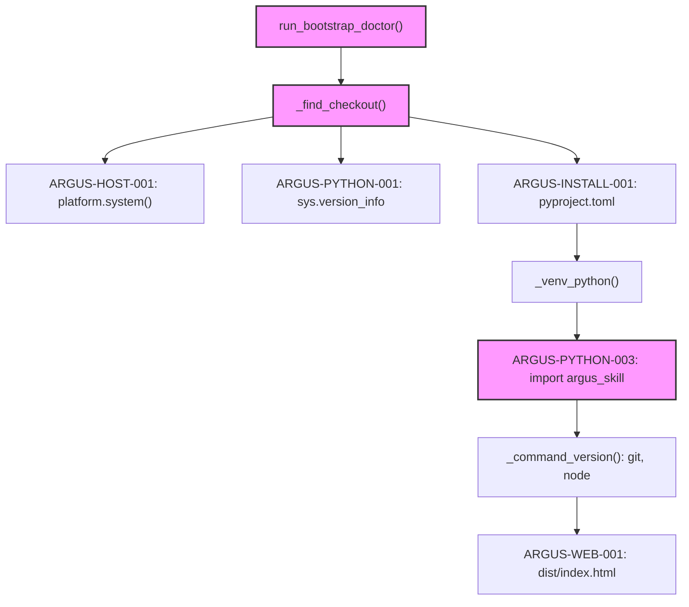
*Figure 1.1.1: Bootstrap diagnostics evaluation workflow mapping diagnostic codes to validation functions in `argus_doctor.py`.*

Sources: [argus_doctor.py:1-189]

---

## 4. CLI Entrypoints and Argument Parsing Architecture

Argus exposes a unified command-line interface configured via `pyproject.toml` entry points and implemented in `argus_skill/__main__.py` and `argus_skill/apps/cli/_parser.py`.

### Execution Entrypoint

When executing `python -m argus_skill`, execution delegates to `argus_skill/__main__.py`, which initializes Windows console encoding compatibility and invokes `_cli_main` [argus_skill/__main__.py:1-22]:

```python
def main(argv: list[str] | None = None) -> int:
    """Run the Python CLI with a Windows-safe text console."""
    _configure_windows_console_encoding()
    return _cli_main(argv)
```
[argus_skill/__main__.py:15-18]

### Argument Parser Structure

Argument parsing is managed by `build_parser()` in `argus_skill/apps/cli/_parser.py`, which constructs an instance of `_ArgusArgumentParser` [argus_skill/apps/cli/_parser.py:43-70]. To prevent subcommand option collisions (such as `--init` in `wiki ingest --init`), prefix abbreviation is explicitly disabled (`allow_abbrev=False`) [argus_skill/apps/cli/_parser.py:83].

The parser registers flags for:
- Human cockpit modes (`--web`, `--watch`, bare execution) [argus_skill/apps/cli/_parser.py:11-17, 85-202]
- 7x24 background daemon orchestration (`--daemon`, `--daemon-fg`, `--daemon-stop`, `--drain`, `--status`) [argus_skill/apps/cli/_parser.py:102-141]
- Maintenance and diagnostics (`--update`, `--gc`, `--config-help`) [argus_skill/apps/cli/_parser.py:92-94, 142-174]

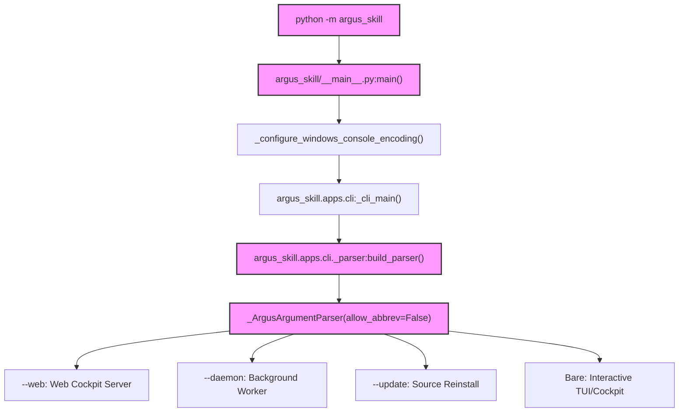
*Figure 1.1.2: Entrypoint execution flow bridging execution invocation to argument parsing and mode dispatch.*

Sources: [argus_skill/__main__.py:1-22], [argus_skill/apps/cli/_parser.py:1-202]

---

# Page: Repository Map and Project Governance

# Repository Map and Project Governance

<details>
<summary>Relevant source files</summary>

The following files were used as context for generating this wiki page:

- [.gitattributes](.gitattributes)
- [.gitignore](.gitignore)
- [CODE_OF_CONDUCT.md](CODE_OF_CONDUCT.md)
- [LICENSE](LICENSE)
- [SECURITY.md](SECURITY.md)
- [SUPPORT.md](SUPPORT.md)

</details>


This page provides a comprehensive technical tour of the `ArgusAgent` repository structure, project governance policies, compliance documentation, and git hygiene configurations. It establishes the layout of top-level directories, core sub-packages, governance frameworks, and exclusion boundaries that maintain repository integrity.

---

## 1. Top-Level Directory Layout

The repository is organized into distinct functional domains separating the core runtime engine (`argus_skill`), user-facing interfaces (`frontend`, `desktop-tauri`), domain-specific logic (`verticals`), and operational support (`tests`, `docs`, `plugins`).

*   `argus_skill/`: The core Python package containing the runtime orchestration loop, role definitions (Manager, Planner, Engineer, Reviewer), agent CLI adapters, toolsets, daemons, verticals, and web API server.
*   `frontend/`: User interface packages including the React web application (`frontend/web`), shared frontend components (`frontend/core`), and terminal user interface (`frontend/tui`).
*   `desktop-tauri/`: Tauri-based desktop wrapper containing the Rust host (`src-tauri`) and integration scripts for bundled Python execution.
*   `tests/`: Comprehensive test suites mirroring the structure of `argus_skill/` packages (`core`, `life`, `manager`, `skills`, `webapi`, `tools`, `daemon`, `desktop`).
*   `docs/`: User guides, technical documentation, design specs, and brand assets.
*   `technical_report/`: Research documentation, campaign evidence bundles, and benchmark artifacts.
*   `plugins/`, `integrations/`, `companions/`: Ecosystem extensions, companion apps (such as `companions/FLYWHEEL`), and provider bridges.

Sources: `[.gitignore:1-134]`, `[LICENSE:1-22]()`

---

## 2. Project Governance and Compliance Documentation

The repository incorporates standard Microsoft open-source governance and security policies to maintain compliance, clear licensing, and secure vulnerability reporting workflows.

### Licensing and Copyright
The project is licensed under the **MIT License**, sharing copyright between `lbx154` and `Microsoft Corporation` [LICENSE:1-4](). The license permits free use, modification, and distribution under standard MIT terms [LICENSE:6-22]().

### Code of Conduct
Contributor behavior is governed by the **Microsoft Open Source Code of Conduct** [CODE_OF_CONDUCT.md:1-3](). The document directs questions, concerns, or moderation support to `opencode@microsoft.com` or internal Microsoft moderation channels [CODE_OF_CONDUCT.md:9-10]().

### Security Policies
Security vulnerabilities must **not** be reported through public GitHub issues [SECURITY.md:8](). Reporting instructions, contact protocols, and Microsoft security guidance are centralized via `https://aka.ms/SECURITY.md` [SECURITY.md:10-12]().

### Support and Issue Tracking
Bug tracking and feature requests are managed via GitHub Issues [SUPPORT.md:13-17](). Support scope and community engagement channels are detailed in `SUPPORT.md` [SUPPORT.md:11-25]().

Sources: `[CODE_OF_CONDUCT.md:1-11]`, `[LICENSE:1-23]`, `[SECURITY.md:1-13]`, `[SUPPORT.md:1-26]`

---

## 3. Git Hygiene and Configuration

The repository enforces strict git hygiene via `.gitattributes` and `.gitignore` configurations, preventing local scratch files, sensitive credentials, and bulky benchmark VM images from entering version control while explicitly tracking production build artifacts.

### Line Ending Normalization (`.gitattributes`)
The `.gitattributes` file normalizes text files to `lf` line endings automatically while marking binary assets (`.ico`, `.jpeg`, `.jpg`, `.pdf`, `.png`, `.pptx`, `.woff2`, etc.) to prevent corruption during cross-platform contributions [`.gitattributes:1-12`]().

### Exclusion Rules and Checked-In Artifacts (`.gitignore`)
The `.gitignore` configuration excludes python caches, virtual environments (`.venv/`, `venv/`), user state (`skills/`, `.autors/`, `.argus-skill/`, `.argus_subagents/`), local secrets (`*.api-key.local`, `.env`, `secrets.json`) [`.gitignore:1-89`](). 

Crucially, the production web bundle located at `/frontend/web/dist/` is intentionally checked in and release-verified, overriding standard build output exclusions [`.gitignore:11-13`](). Furthermore, bulky local benchmark datasets, docker VM images (`/docker_vm_data/`), and proprietary VC/business materials (`/vc_materials/`, `docs/Argus_VC_Deck.pdf`) are explicitly blocked [`.gitignore:90-129`]().

Sources: `[.gitattributes:1-12]`, `[.gitignore:1-134]`

---

## 4. Repository Architecture and Code Entity Mapping

The following diagram bridges the natural language space of repository directories and governance documents to their concrete code entities and configuration paths within the codebase.

```mermaid
graph TD
    subgraph "Natural Language Space"
        Repo["ArgusAgent Repository Root"]
        Core["Core Runtime Engine"]
        UI["User Interfaces & Desktop"]
        Gov["Project Governance"]
        GitConf["Git Hygiene Config"]
    end

    subgraph "Code Entity Space"
        Repo --> CorePkg["argus_skill/"]
        Repo --> FrontPkg["frontend/"]
        Repo --> TauriPkg["desktop-tauri/"]
        Repo --> TestPkg["tests/"]
        
        Core --> CoreRuntime["argus_skill/core/"]
        Core --> AppsRuntime["argus_skill/apps/loop.py"]
        Core --> ManagerRole["argus_skill/manager/"]
        
        UI --> WebDist["frontend/web/dist/"]
        UI --> TauriHost["desktop-tauri/src-tauri/"]
        
        Gov --> CoC["CODE_OF_CONDUCT.md"]
        Gov --> Sec["SECURITY.md"]
        Gov --> Lic["LICENSE"]
        Gov --> Sup["SUPPORT.md"]
        
        GitConf --> Gi[" .gitignore "]
        GitConf --> Ga[" .gitattributes "]
    end
```
*Figure 1: Mapping high-level repository domains to concrete code and documentation entities.*

Sources: `[.gitattributes:1-12]`, `[.gitignore:1-134]`, `[CODE_OF_CONDUCT.md:1-11]`, `[LICENSE:1-23]`, `[SECURITY.md:1-13]`, `[SUPPORT.md:1-26]`

---

## 5. Artifact Exclusion and Verification Boundary

The repository boundary distinguishes between local mutable user state, excluded scratch directories, and version-controlled release artifacts.

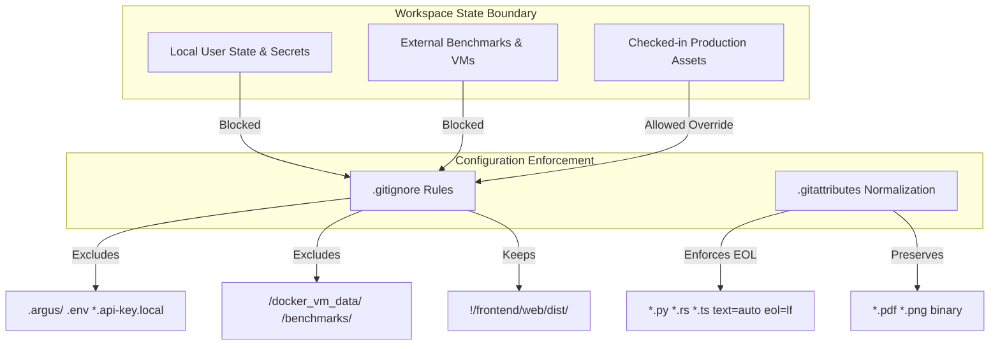
*Figure 2: Enforcement boundaries managed by `.gitignore` and `.gitattributes` across workspace states.*

Sources: `[.gitattributes:1-12]`, `[.gitignore:1-134]`

---

# Page: Engineering Conventions

# Engineering Conventions

<details>
<summary>Relevant source files</summary>

The following files were used as context for generating this wiki page:

- [.agents/skills/minimal-rigorous-work/SKILL.md](.agents/skills/minimal-rigorous-work/SKILL.md)
- [.github/instructions/minimal-engineering.instructions.md](.github/instructions/minimal-engineering.instructions.md)
- [PRIVATE_TODO.md](PRIVATE_TODO.md)
- [PRIVATE_TODO.zh-CN.md](PRIVATE_TODO.zh-CN.md)

</details>


## Purpose and Scope

This page defines the core engineering conventions, minimal rigorous work skills, and architectural guardrails that govern all code changes, control plane decisions, and refactoring efforts across the ArgusAgent repository. These constraints ensure that the system maintains high execution efficiency, deterministic state transitions, and transparent error handling without accumulating ceremonial abstractions or redundant verification loops.

Sources: [.agents/skills/minimal-rigorous-work/SKILL.md:1-32](), [.github/instructions/minimal-engineering.instructions.md:1-51]()

---

## The Minimal-Rigorous-Work Skill & Instructions

All implementation, research, planning, review, and orchestration activities must follow the `minimal-rigorous-work` runtime skill configuration and the repository-wide `minimal-engineering` coding instructions (`**/*.{py,ts,tsx,js,mjs}`). 

Key principles enforced by these guidelines include:
- **Shortest Control Path**: Solve tasks completely using the most direct clear control path. Start from requested behavior, real entry points, and observable evidence [._agents/skills/minimal-rigorous-work/SKILL.md:8-11](), [._github/instructions/minimal-engineering.instructions.md:8-10]().
- **Prohibited Abstractions**: Unless demonstrated requirements mandate them, code changes must not introduce hashes (including SHA-256 for identifiers or correctness), UUIDs, random tokens, custom idempotency/deduplication keys, retries, backoff, circuit breakers, fallback chains, compatibility layers, speculative locks, future fields, or placeholder interfaces [._agents/skills/minimal-rigorous-work/SKILL.md:16-19](), [._github/instructions/minimal-engineering.instructions.md:24-33]().
- **Contract Reuse**: Reuse existing contracts and helpers. Do not add unrelated features, refactors, dependencies, roles, layers, configuration, or artifacts [._agents/skills/minimal-rigorous-work/SKILL.md:12-13]().

```mermaid
graph TD
    A["RequestOrTask"] --> B["ShortestControlPath"]
    B --> C{HasDemonstratedRequirement}
    C -- "No" --> D["RejectProhibitedAbstractions"]
    C -- "Yes" --> E["ValidateBoundary"]
    D --> F["DirectLocalCodeExecution"]
    E --> F
    F --> G["ExplicitErrorHandling"]

    sub-graph "Prohibited Items"
        D1["Hashes/UUIDs"]
        D2["SpeculativeLocks"]
        D3["SuccessShadedDegradation"]
    end
```
*Figure 1: Control path selection mapping natural language requirements to direct code entity execution while filtering prohibited abstractions.*

Sources: [._agents/skills/minimal-rigorous-work/SKILL.md:1-33](), [._github/instructions/minimal-engineering.instructions.md:1-52]()

---

## Error Transparency and Authority Boundaries

Argus mandates strict error transparency and explicit protection of critical boundaries. 

- **Error Transparency**: Defects must never be hidden behind broad exception catches, empty results, default values, or success-shaped degradation [._agents/skills/minimal-rigorous-work/SKILL.md:20-21](), [._github/instructions/minimal-engineering.instructions.md:34-35](). 
- **Boundary Validation**: Real input, authority, persistence, security, money, citations, and irreversible actions must always be explicitly validated. Established internal invariants should be trusted rather than re-verified redundantly across every layer [._agents/skills/minimal-rigorous-work/SKILL.md:14-15](), [._github/instructions/minimal-engineering.instructions.md:11-13]().
- **Local Repair**: Routine local failures are repaired locally; escalation occurs only when scope, semantics, data integrity, authority, or irreversible effects change [._github/instructions/minimal-engineering.instructions.md:22-23]().

Sources: [._agents/skills/minimal-rigorous-work/SKILL.md:14-21](), [._github/instructions/minimal-engineering.instructions.md:11-35]()

---

## Action-First Control Plane and Execution Efficiency

Reflecting architectural improvements specified in internal coordination backlogs (such as `ARGUS-P0-05`), the control plane prioritizes immediate execution over audit completeness and redundant file reads [.[PRIVATE_TODO.md:62-92](), [PRIVATE_TODO.zh-CN.md:56-80]()].

- **Runtime-Owned `MissionBrief`**: In-memory context bundles containing the canonical workdir, stage, git state, changed paths, available hardware/tools, native test commands, and latest decisive results are maintained to avoid redundant repository-wide file crawling [.[PRIVATE_TODO.md:94-98](), [PRIVATE_TODO.zh-CN.md:82-86]()].
- **Decisive Check Finality**: An accepted decisive check remains settled until its inputs change or contradictions appear [._github/instructions/minimal-engineering.instructions.md:19-21](). Reviewers are restricted to the changed surface and acceptance evidence without reopening settled questions [.[PRIVATE_TODO.md:110-111](), [PRIVATE_TODO.zh-CN.md:96-97]()].

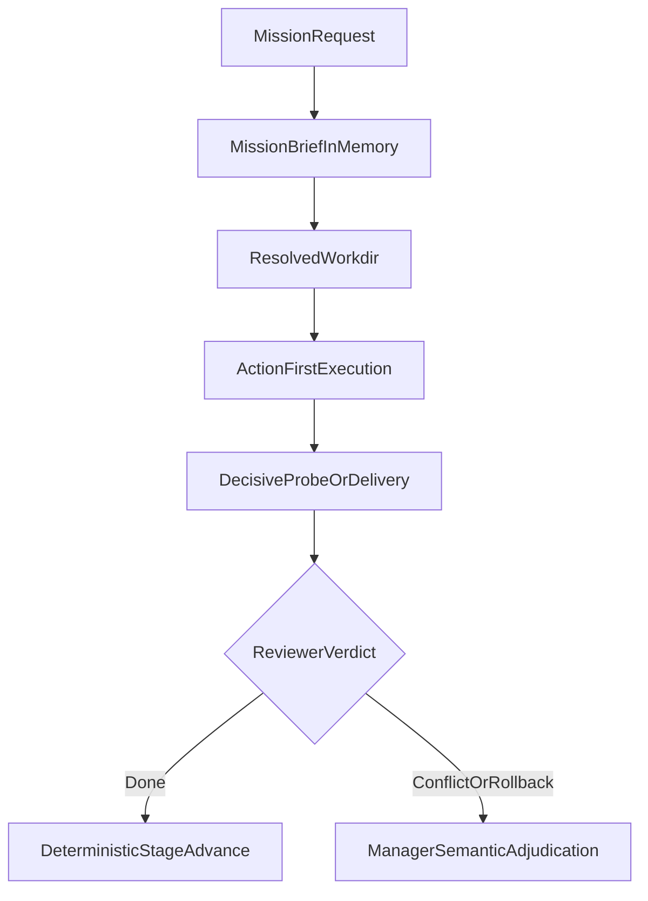
*Figure 2: Action-first control plane architecture bridging runtime brief initialization to deterministic stage progression.*

Sources: [.[PRIVATE_TODO.md:62-117](), [PRIVATE_TODO.zh-CN.md:56-102]()

---

## Review Discipline and Team Execution

- **Independent Read-Only Review**: Reviews must be conducted independently and read-only. Verification targets the changed user-visible path, broadening only when the blast radius is broad [._agents/skills/minimal-rigorous-work/SKILL.md:29-30]().
- **Real Parallelism**: Parallel and team execution must involve disjoint writable paths, explicit completion evidence, and one lead-owned synthesis. They are not ceremonial wrappers [._github/instructions/minimal-engineering.instructions.md:40-44]().
- **Honest Reporting**: Agents must report `BLOCKED` or `UNTESTED` honestly and terminate execution immediately when requested outcomes are achieved [._agents/skills/minimal-rigorous-work/SKILL.md:31-32]().

Sources: [._agents/skills/minimal-rigorous-work/SKILL.md:29-32](), [._github/instructions/minimal-engineering.instructions.md:40-46]()

---

# Page: Core Runtime Architecture

# Core Runtime Architecture

<details>
<summary>Relevant source files</summary>

The following files were used as context for generating this wiki page:

- [argus_skill/__init__.py](argus_skill/__init__.py)
- [argus_skill/adapters/agent_cli_backend/_core.py](argus_skill/adapters/agent_cli_backend/_core.py)
- [argus_skill/apps/_runtime.py](argus_skill/apps/_runtime.py)

</details>


The core runtime architecture of Argus provides the foundational machinery that drives supervised, skill-driven coding agent campaigns. It coordinates campaign and session state, manages pipeline stages, tracks cost and evidence ledgers, and executes the runtime loop across distinct agent roles (Manager, Planner, Engineer, and Reviewer). 

For detailed information on specific subsystems, refer to the child pages:
- Core State, Contracts and Ledgers: See [Core State, Contracts and Ledgers](#2.1)
- Application Runtime and Orchestration Loop: See [Application Runtime and Orchestration Loop](#2.2)
- Roles and Authority Boundaries: See [Roles: Manager, Planner, Engineer, Reviewer](#2.3)
- Daemon and Life Layer: See [Daemon, Life Layer and Long-Running Sessions](#2.4)

Sources: `argus_skill/__init__.py:1-32` [argus_skill/__init__.py:1-32](), `argus_skill/apps/_runtime.py:1-94` [argus_skill/apps/_runtime.py:1-94]()

---

## 2.1. Core State, Contracts and Ledgers

The core state and ledger modules maintain the persistent truth of an active campaign. Campaign state models the execution lifecycle, tracking iterations, review decisions, and output payloads via foundational models [argus_skill/__init__.py:11-16](). Evidence ledgers and project contracts ensure that all progress is verifiable against domain criteria, while cost controls and token usage trackers constrain consumption across execution passes.

For a deep dive into pipeline state definitions, vertical contracts, evidence ledgers, token pricing, knobs, and locking primitives (`file_lock`, `daemon_lock`, `workspace_lease`), see [Core State, Contracts and Ledgers](#2.1).

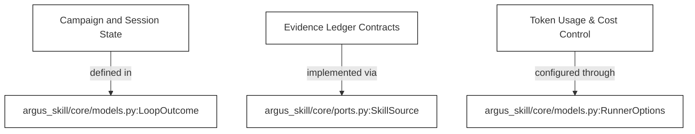
*Figure 1: Natural Language Space to Code Entity Space mapping for Core State and Ledgers.*

Sources: `argus_skill/__init__.py:11-32` [argus_skill/__init__.py:11-32]()

---

## 2.2. Application Runtime and Orchestration Loop

The application runtime orchestrates how missions are executed, transitioned through pipeline stages, and supervised across multiple turns. The core runner coordinates backend selection, planning context injection, self-reply mechanisms, and watch modes without binding directly to a specific presentation layer or terminal framework [argus_skill/apps/_runtime.py:1-17]().

For complete implementation details on stage transitions, planning context assembly, the supervisor, inbox handling, and `loop.py`, see [Application Runtime and Orchestration Loop](#2.2).

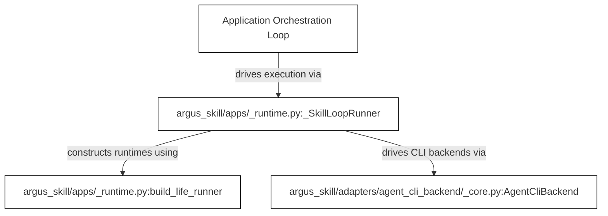
*Figure 2: Natural Language Space to Code Entity Space mapping for the Application Runtime and Loop.*

Sources: `argus_skill/apps/_runtime.py:79-94` [argus_skill/apps/_runtime.py:79-94](), `argus_skill/adapters/agent_cli_backend/_core.py:116-150` [argus_skill/adapters/agent_cli_backend/_core.py:116-150]()

---

## 2.3. Roles: Manager, Planner, Engineer, Reviewer

Argus enforces strict authority boundaries by dividing responsibilities among four specialized roles:
- **Manager**: Acts as the front door, deciding stage progression, dispatching work, and managing overall campaign direction.
- **Planner**: Deconstructs high-level objectives into tactical task frontiers.
- **Engineer**: Executes modifications within isolated sandboxes utilizing underlying coding agent CLIs.
- **Reviewer**: Inspects outputs and issues formal review verdicts (`ReviewDecision`) [argus_skill/__init__.py:13-13]().

For details on prompts, role implementations, and team execution semantics, see [Roles: Manager, Planner, Engineer, Reviewer](#2.3).

Sources: `argus_skill/__init__.py:11-16` [argus_skill/__init__.py:11-16]()

---

## 2.4. Daemon, Life Layer and Long-Running Sessions

To support campaigns that span multiple hours or days beyond a single model interaction turn, the daemon and life layer provide persistent supervision. This subsystem maintains project lifecycles, appends to event logs, bridges chat interfaces (such as Telegram and Feishu), and manages failure circuits and terminal states.

For architecture and implementation details on long-running session management, see [Daemon, Life Layer and Long-Running Sessions](#2.4).

Sources: `argus_skill/apps/_runtime.py:1-25` [argus_skill/apps/_runtime.py:1-25]()

---

# Page: Core State, Contracts and Ledgers

# Core State, Contracts and Ledgers

<details>
<summary>Relevant source files</summary>

The following files were used as context for generating this wiki page:

- [argus_skill/__init__.py](argus_skill/__init__.py)
- [argus_skill/adapters/agent_cli_backend/_core.py](argus_skill/adapters/agent_cli_backend/_core.py)
- [argus_skill/adapters/agent_cli_backend/_runtime.py](argus_skill/adapters/agent_cli_backend/_runtime.py)

</details>


This page details the core runtime state management, execution contracts, evidence logging, cost accounting, configuration knobs, concurrency primitives, and event schemas within `argus_skill/core`. These subsystems form the persistent and reviewed autonomy layer that drives multi-role coding campaigns in Argus.

---

### 1. Pipeline State and Session Management

The pipeline state and session layer coordinates campaign progression across stages. It tracks current execution state, historical step transitions, and active configuration parameters required by actors (Manager, Planner, Engineer, Reviewer). Session states are serialized to disk to enable long-running and resumable agent executions.

*   `LoopOutcome`: Encapsulates the terminal or intermediate result of a execution cycle [argus_skill/__init__.py:12-12]().
*   `ReviewDecision`: Records the verdict and feedback issued by the Reviewer role [argus_skill/__init__.py:13-13]().
*   `RunnerOptions`: Defines execution-time parameters, extra arguments, and limits passed to backend runners [argus_skill/__init__.py:14-14]().

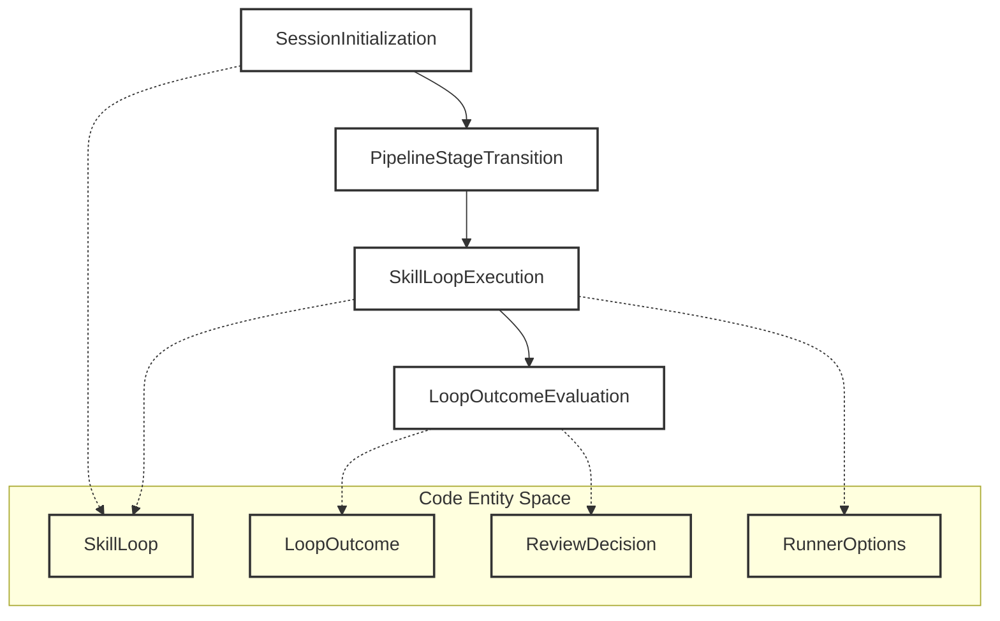

Sources: `argus_skill/__init__.py:11-16`

---

### 2. Project and Vertical Contracts

Project and vertical contracts enforce boundaries, environment prerequisites, and domain-specific validation rules. Contracts prevent unauthorized modifications outside the campaign scope and ensure that vertical-specific tasks adhere to strict conformance standards before stage progression.

*   **Vertical Contracts**: Define domain constraints, required evidence schemas, and evaluation harnesses.
*   **Project Contracts**: Define target file paths, allowed tool permissions, and resource constraints per workspace.

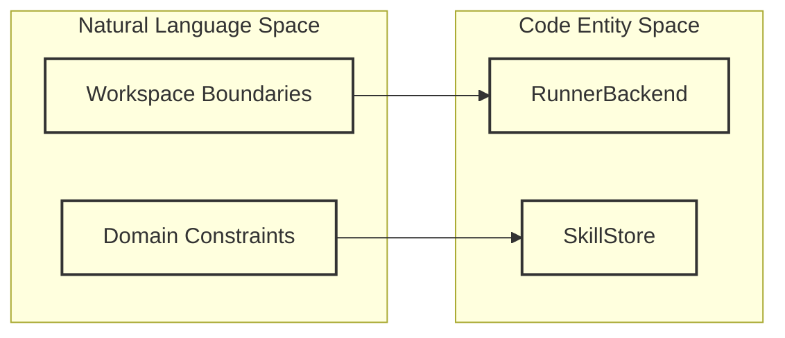

Sources: `argus_skill/__init__.py:17-19`

---

### 3. Evidence Ledger and Proof Management

The evidence ledger records verifiable artifacts, test results, benchmark metrics, and execution outputs produced during a campaign. It underpins the proof management subsystem, ensuring that every claim made by an agent role is backed by an entry in the ledger.

*   **Evidence Records**: Structured entries containing artifact hashes, execution logs, and verification statuses.
*   **Proof Verification**: Automated checks validating ledger entries against expected benchmark criteria.

Sources: `argus_skill/__init__.py:11-32`

---

### 4. Cost Control, Pricing and Token Usage

The cost control subsystem monitors resource consumption, tracks token usage across model turns, and applies pricing models to prevent budget overruns during long-running engineering campaigns.

*   `UsageAccumulator`: Aggregates input tokens, output tokens, and estimated cost across subprocess invocations [argus_skill/adapters/agent_cli_backend/_result.py]().
*   **Budget Monitors**: Enforce hard and soft limits on execution time and financial expenditure.

Sources: `argus_skill/adapters/agent_cli_backend/_core.py:116-172`, `argus_skill/adapters/agent_cli_backend/_runtime.py:15-64`

---

### 5. Knobs and Environment Configurations

Configuration knobs control runtime tuning parameters, idle timeouts, and feature flags without requiring code modifications.

*   `env_int`: Helper utility for reading integer-valued environment variables with fallback defaults [argus_skill/adapters/agent_cli_backend/_core.py:18-18]().
*   **Timeout Knobs**: Configure soft, stalled, and hard idle watchdogs for agent CLI subprocesses (`ARGUS_SKILL_RUNNER_SOFT_IDLE_SECONDS`, `ARGUS_SKILL_RUNNER_STALLED_IDLE_SECONDS`, `ARGUS_SKILL_RUNNER_HARD_IDLE_SECONDS`) [argus_skill/adapters/agent_cli_backend/_core.py:34-39]().

Sources: `argus_skill/adapters/agent_cli_backend/_core.py:18-39`

---

### 6. Concurrency, Locks and Leases

Concurrency primitives prevent workspace corruption and race conditions when multiple agent loops or daemon threads operate on the same environment.

*   `_RepeatedToolCallGuard`: Thread-safe execution guard preventing infinite repetition of identical tool calls [argus_skill/adapters/agent_cli_backend/_core.py:40-113]().
*   **File Locks & Daemon Locks**: Synchronize access to shared state files and daemon endpoints.
*   **Workspace Lease**: Manages exclusive write access to target repositories during active execution phases.

```mermaid
graph TD
    A["ProcessSpawn"] --> B["RepeatedToolCallGuard"]
    B -->| "Detects Infinite Loop" | C["InterruptExecution"]
    B -->| "Normal Operation" | D["StreamStdoutStderr"]

    subgraph CodeEntities ["Code Entity Space"]
        E["_RepeatedToolCallGuard"]
        F["AgentCliBackend"]
        G["AgentIOLogger"]
    end

    A -.-> F
    B -.-> E
    D -.-> G

    classDef default fill:none,stroke:#333,stroke-width:2px;
```

Sources: `argus_skill/adapters/agent_cli_backend/_core.py:40-113`

---

### 7. Event Catalog and Payload Schemas

The event catalog defines structured telemetry events emitted during pipeline execution. Payload schemas guarantee consistent serialization for live UI streaming, loggers, and external API consumers.

*   `AgentIOLogger`: Intercepts and formats stream lines from agent subprocesses into structured event payloads [argus_skill/adapters/agent_cli_backend/_core.py:172]().
*   **Event Sinks**: External consumers that ingest event payloads for TUI rendering and dashboard updates.

Sources: `argus_skill/adapters/agent_cli_backend/_core.py:165-172`, `argus_skill/adapters/agent_cli_backend/_runtime.py:15-64`

---

# Page: Application Runtime and Orchestration Loop

# Application Runtime and Orchestration Loop

<details>
<summary>Relevant source files</summary>

The following files were used as context for generating this wiki page:

- [argus_skill/apps/__init__.py](argus_skill/apps/__init__.py)
- [argus_skill/apps/_env.py](argus_skill/apps/_env.py)
- [argus_skill/apps/_inbox.py](argus_skill/apps/_inbox.py)
- [argus_skill/apps/_init_identity.py](argus_skill/apps/_init_identity.py)
- [argus_skill/apps/_runtime_backends.py](argus_skill/apps/_runtime_backends.py)
- [argus_skill/apps/_runtime_construction.py](argus_skill/apps/_runtime_construction.py)
- [argus_skill/apps/_runtime_execute.py](argus_skill/apps/_runtime_execute.py)
- [argus_skill/apps/_runtime_helpers.py](argus_skill/apps/_runtime_helpers.py)
- [argus_skill/apps/_runtime_planning_context.py](argus_skill/apps/_runtime_planning_context.py)
- [argus_skill/apps/_runtime_stage_transition.py](argus_skill/apps/_runtime_stage_transition.py)
- [argus_skill/apps/_runtime_supervisor.py](argus_skill/apps/_runtime_supervisor.py)
- [argus_skill/apps/_self_reply.py](argus_skill/apps/_self_reply.py)
- [argus_skill/apps/_target_paths.py](argus_skill/apps/_target_paths.py)
- [argus_skill/apps/_watch.py](argus_skill/apps/_watch.py)

</details>


This page details the core application runtime within `argus_skill/apps`, focusing on how missions are constructed, executed, and transitioned through various stages. It covers the planning context, the role of the supervisor, the inbox/self-reply mechanisms, watch mode, and the central `loop.py` (which is implicitly covered by the mixins).

## Application Construction and Initialization

The application runtime is built using a series of mixins, primarily orchestrated by `_SkillLoopRunner` (not directly shown but implied by the mixins). The construction process involves setting up the environment, resolving backend configurations, and initializing the Manager.

The `_RunnerConstructionMixin` [argus_skill/apps/_runtime_construction.py:92-99]() handles the initial setup. It ensures that the necessary `AgentCliBackend` is available and sets up a `StreamProgressRelay` [argus_skill/apps/_runtime_construction.py:130-131]() to manage event streaming.

Key steps in construction include:
*   **Work Directory and State Root Resolution**: The `_manager_roots` function [argus_skill/apps/_runtime_construction.py:31-66]() determines the `workdir`, `state_root`, and `session_root`. This involves handling potential migrations of legacy manager state or research stages.
*   **Manager Creation**: The `_create_manager` function [argus_skill/apps/_runtime_construction.py:69-90]() instantiates the `Manager` class, providing it with the project roots, the chosen backend, and other configuration.
*   **Backend Resolution**: The `_resolve_runner_backend_name` function (not shown, but referenced in [argus_skill/apps/_runtime_construction.py:149]()) determines which agent CLI backend to use, considering environment variables and command-line arguments. This backend is then resolved and validated using `normalize_runner_backend` and `resolve_available_runner` [argus_skill/apps/_runtime_construction.py:153-161]().

```mermaid
graph TD
    A[argus_skill/apps runtime] --> B{Initialize _SkillLoopRunner};
    B --> C[Call _RunnerConstructionMixin.__init__];
    C --> D[Resolve workdir, state_root, session_root (via _manager_roots)];
    D --> E[Perform legacy state migrations if needed];
    C --> F[Resolve Agent CLI Backend (via _resolve_runner_backend_name)];
    F --> G[Normalize and validate backend (via normalize_runner_backend, resolve_available_runner)];
    C --> H[Create Manager instance (via _create_manager)];
    H --> I[Manager initialized with project roots and backend];
    C --> J[Setup StreamProgressRelay for event streaming];
```
Sources:
*   `argus_skill/apps/_runtime_construction.py`

## Application Execution

The execution of a mission is managed by the `SkillLoopExecuteMixin` [argus_skill/apps/_runtime_execute.py:73-74](). This mixin orchestrates the entire lifecycle of a mission, from configuration to outcome assembly.

### Planning Context

The `bounded_planner_request` function [argus_skill/apps/_runtime_planning_context.py:12-53]() prepares the read-only continuation context for the Planner. This context includes the objective, shared project history, and a checkpoint of the current state. It explicitly avoids exposing Engineer task details to the Planner, ensuring a clean separation of concerns. The checkpoint is truncated to `_CHECKPOINT_CHARS` (24,000 characters) to manage context size [argus_skill/apps/_runtime_planning_context.py:9]().

### Pipeline State Management

During execution, the pipeline state is carefully managed to ensure consistency and recoverability.
*   **Snapshotting**: `_snapshot_pipeline_state` [argus_skill/apps/_runtime_execute.py:134-155]() captures the current state of `PIPELINE_STATE.json` before any modifications. It checks for symlinks or reparse points to prevent unintended modifications to external files.
*   **Restoration**: `_restore_pipeline_state` [argus_skill/apps/_runtime_execute.py:157-191]() attempts to revert the pipeline state to a previously snapshotted version if an error occurs. This includes handling cases where the pipeline state file or its parent directory might have been replaced or modified.

### Engineer Guidance

The `_engineer_guidance` function [argus_skill/apps/_runtime_execute.py:46-71]() projects the typed operator context. It drains messages from the inbox using `drain_inbox_messages` [argus_skill/apps/_inbox.py:138-157]() and records them as operator messages via `record_operator_messages` [argus_skill/manager/directive.py:10-11](). This ensures that the Engineer has the most up-to-date operator instructions.

```mermaid
graph TD
    A[SkillLoopExecuteMixin.execute()] --> B[Prepare Mission Context];
    B --> C[Snapshot Pipeline State (via _snapshot_pipeline_state)];
    B --> D[Build Planner Request (via bounded_planner_request)];
    D --> D1[Include shared_context, checkpoint, operator_state_root];
    B --> E[Drain Inbox Messages (via _engineer_guidance -> drain_inbox_messages)];
    E --> E1[Record Operator Messages];
    B --> F[Invoke SkillLoop];
    F --> G[Process Rounds];
    G --> H{Mission Outcome};
    H -- Success --> I[Decide Stage Transition];
    H -- Failure --> J[Restore Pipeline State (via _restore_pipeline_state)];
```
Sources:
*   `argus_skill/apps/_runtime_execute.py`
*   `argus_skill/apps/_runtime_planning_context.py`
*   `argus_skill/apps/_inbox.py`
*   `argus_skill/manager/directive.py`

## Stage Transitions

Stage transitions are a critical part of the orchestration loop, determining how a mission progresses through its lifecycle. The `StageTransitionMixin` [argus_skill/apps/_runtime_stage_transition.py:20-21]() is responsible for this.

The `_decide_stage_transition` method [argus_skill/apps/_runtime_stage_transition.py:23-150]() takes the reviewer's verdict from the final round and hands it to the Manager. The Manager is the sole authority for writing the `PIPELINE_STATE.json` file, deciding whether to `advance`, `hold`, `rollback`, or `complete` the stage.

Key aspects:
*   **Manager Authority**: Only the Manager can modify the pipeline stage. Reviewer and Planner roles only advise.
*   **Fail-Open Design**: Any error during the stage decision process results in a no-op, meaning the stage remains unchanged, preventing mission failures due to transition logic.
*   **Locking**: The `manager_pipeline_lock` [argus_skill/manager/_session_ops.py:10-11]() is used to ensure atomic updates to the campaign control store and pipeline state.
*   **Event Emission**: The decision is emitted as a `life.manager.stage_decision` event [argus_skill/apps/_runtime_stage_transition.py:147-148]() for journaling and visibility.

The `_should_run_stage_transition` function [argus_skill/apps/_runtime_helpers.py:169-189]() determines if a formal stage transition should occur. This depends on factors like the mission scope, whether independent review is required, and if the mission is explicitly closing a stage.

```mermaid
graph TD
    A[Mission Completes] --> B[StageTransitionMixin._decide_stage_transition];
    B --> C{Retrieve Final Review Verdict};
    C --> D[Acquire manager_pipeline_lock];
    D --> E[Manager.decide_stage_transition(review, project_root, ...)];
    E --> F{Manager Decision: advance, hold, rollback, complete};
    F --> G[Update PIPELINE_STATE.json];
    G --> H[Release manager_pipeline_lock];
    H --> I[Emit life.manager.stage_decision event];
    I --> J[Return Decision for _Outcome / Journal];
```
Sources:
*   `argus_skill/apps/_runtime_stage_transition.py`
*   `argus_skill/apps/_runtime_helpers.py`
*   `argus_skill/manager/_session_ops.py`

## Supervisor and Orchestration Loop

The `LifeSupervisor` [argus_skill/life/supervisor.py:100-101]() drives the overall orchestration loop, managing missions, budgets, and continuous operation. The `_runtime_supervisor.py` module provides functions for configuring and invoking the supervisor.

### Mission Type Resolution

The supervisor needs to understand the nature of the mission to apply appropriate policies.
*   `_paper_mission_for_project_root` [argus_skill/apps/_runtime_supervisor.py:36-66]() determines if a project is a "paper-shaped vertical," which implies a long-horizon publication campaign. This requires an explicitly resolved and persisted Manager decision.
*   `_final_certification_for_project_root` [argus_skill/apps/_runtime_supervisor.py:68-85]() checks if the project's vertical has a "certified" completion gate.
*   `_independent_review_required_for_project_root` [argus_skill/apps/_runtime_supervisor.py:87-125]() ascertains if the project's vertical mandates independent review. This defaults to `True` if the vertical's policy cannot be read, ensuring a safe-closed behavior.
*   `_workflow_mode_for_project_root` [argus_skill/apps/_runtime_supervisor.py:127-135]() resolves the Manager-persisted workflow contract, defaulting to "staged" if unresolved.

### Supervisor Configuration

The `_build_supervisor_config` function [argus_skill/apps/_runtime_supervisor.py:137-174]() assembles the `LifeSupervisorConfig`. This configuration includes:
*   **Budget**: `LifeBudget` [argus_skill/life/supervisor.py:30-31]() defines global daily caps and maximum missions.
*   **Polling Interval**: How frequently the supervisor checks for new work.
*   **Project Worktree**: The working directory for the project.
*   **Stop Event**: A threading event to signal the supervisor to stop.
*   **Inbox Drainer**: `_inbox_drainer_for` [argus_skill/apps/_runtime_construction.py:600-610]() provides a mechanism to drain operator messages from the inbox.
*   **Pending Question Resolver**: `_pending_question_resolver_for` [argus_skill/apps/_runtime_construction.py:612-622]() handles resolving questions posed by the agent.
*   **Runtime Context**: Information about the current execution environment.
*   **Continuous Mode**: Whether the supervisor should run continuously.

### `run_life_supervisor`

The `run_life_supervisor` function (not shown, but referenced in `_runtime_supervisor.py`'s docstring) is the entry point for the non-interactive backlog-draining driver. It initializes the supervisor with the built configuration and starts its loop.

```mermaid
graph TD
    A[Start Supervisor] --> B[Resolve Project Root];
    B --> C[Determine Mission Type (paper, certified, independent review, workflow mode)];
    C --> D[Build LifeSupervisorConfig (via _build_supervisor_config)];
    D --> E[Initialize LifeSupervisor];
    E --> F[Start Supervisor Loop (run_life_supervisor)];
    F --> G{Poll for Work / Backlog Items};
    G --> H[Execute Mission (via _SkillLoopRunner.execute)];
    H --> I[Process Mission Outcome];
    I --> J[Update State / Budget];
    J --> G;
    F -- Stop Event Triggered --> K[Supervisor Stops];
```
Sources:
*   `argus_skill/apps/_runtime_supervisor.py`
*   `argus_skill/life/supervisor.py`
*   `argus_skill/apps/_runtime_construction.py`

## Inbox and Self-Reply

The inbox mechanism allows operators to provide guidance to the agent, and the self-reply system enables the agent to process certain internal requests or provide status updates without external intervention.

### Inbox Management

The `_inbox.py` module handles the queuing and draining of operator messages.
*   **`inbox_path` and `inbox_offset_path`**: These functions [argus_skill/apps/_inbox.py:33-40]() determine the file paths for the inbox messages (`inbox.jsonl`) and the read offset (`inbox.offset`), potentially scoped by stage.
*   **`queue_inbox_message`**: This function [argus_skill/apps/_inbox.py:160-191]() writes a new message to `inbox.jsonl` and emits a `life.inbox.queued` event. It also handles deterministic credential import.
*   **`drain_inbox_messages`**: This function [argus_skill/apps/_inbox.py:138-157]() reads and consumes messages from `inbox.jsonl`, updating the offset.
*   **`count_pending_inbox_messages`**: This function [argus_skill/apps/_inbox.py:125-135]() counts unread messages without advancing the offset.

### Self-Reply Execution

The `_self_reply.py` module provides functionality for the agent to respond to internal prompts or perform self-correction.
*   **`self_retryable_transport_failure`**: This function [argus_skill/apps/_self_reply.py:132-144]() determines if a transport error is retryable, specifically looking for empty responses without tool activity.
*   **`build_status_snapshot_reply`**: This function [argus_skill/apps/_self_reply.py:146-181]() generates a live status snapshot without invoking a model, providing information about daemon status, continuous mode, backlog items, and role activity.
*   **`_SELF_EXECUTION_CONTRACTS`**: This dictionary [argus_skill/apps/_self_reply.py:35-73]() defines various self-execution contracts (e.g., "micro", "implement", "debug", "review", "synthesize") with their allowed tools, descriptions, and reasoning effort.

```mermaid
graph TD
    A[Operator Input / Internal Event] --> B[Queue Inbox Message (queue_inbox_message)];
    B --> C[inbox.jsonl updated];
    B --> D[life.inbox.queued event emitted];

    E[Supervisor Loop] --> F[Drain Inbox Messages (drain_inbox_messages)];
    F --> G[Messages processed by Engineer Guidance];

    H[Internal Request (e.g., status)] --> I[Build Status Snapshot Reply (build_status_snapshot_reply)];
    I --> J[Reply generated without model invocation];

    K[Internal Task] --> L[Select Self-Execution Contract (e.g., "micro")];
    L --> M[Execute Bounded SELF Reply];
    M --> N[Check for Self-Retryable Transport Failure];
```
Sources:
*   `argus_skill/apps/_inbox.py`
*   `argus_skill/apps/_self_reply.py`

## Watch Mode

The `_watch.py` module (not shown in full, but referenced) implements a watch mode that monitors the project directory for changes and triggers actions based on those changes. This allows for continuous operation and responsiveness to external modifications.

Key aspects of watch mode typically include:
*   **File System Monitoring**: Using libraries like `watchdog` to detect changes (creation, modification, deletion) in specified directories.
*   **Event Handling**: Processing file system events to determine if a relevant change has occurred.
*   **Triggering Missions**: If a change matches predefined criteria (e.g., a new file in the inbox, a modification to a specific project file), the watch mode can trigger a new mission or an update to an existing one.
*   **Debouncing**: Preventing rapid, successive triggers for a single logical change.

Sources:
*   `argus_skill/apps/_watch.py`

## Environment Variables

The `_env.py` module [argus_skill/apps/_env.py:1-25]() provides utility functions for parsing environment variables, specifically `env_flag` for boolean flags and `env_int` for integer values. These are used across the runtime to configure behavior, such as `ARGUS_SKILL_CHECKPOINT_PERSIST` [argus_skill/apps/_runtime_helpers.py:64]() which controls checkpoint persistence.

Sources:
*   `argus_skill/apps/_env.py`

---

# Page: Roles: Manager, Planner, Engineer, Reviewer

# Roles: Manager, Planner, Engineer, Reviewer

<details>
<summary>Relevant source files</summary>

The following files were used as context for generating this wiki page:

- [argus_skill/builtin_skills/agent-team-lead.md](argus_skill/builtin_skills/agent-team-lead.md)
- [argus_skill/builtin_skills/curator/argus-curator-role.md](argus_skill/builtin_skills/curator/argus-curator-role.md)
- [argus_skill/builtin_skills/engineer/argus-engineer-role.md](argus_skill/builtin_skills/engineer/argus-engineer-role.md)
- [argus_skill/builtin_skills/manager/argus-manager-role.md](argus_skill/builtin_skills/manager/argus-manager-role.md)

</details>


## Purpose and Scope
This document details the authority boundaries, implementation mechanics, prompt architectures, and execution workflows for the four core agent roles in the Argus framework: **Manager**, **Planner**, **Engineer**, and **Reviewer**. It covers how the orchestration layer separates high-level supervision from task planning, sandbox implementation, and read-only verification, alongside team execution and curator mechanics.

---

## 1. Role Authority Boundaries and Matrix

Argus strictly separates responsibilities to prevent role drift and ensure that execution is always audited independently. The **Manager** serves as the operator's single point of contact and holds sole authority over project stage transitions [argus_skill/builtin_skills/manager/argus-manager-role.md:6-9](). The **Planner** decomposes objectives into structured work items or team backlogs. The **Engineer** executes the code, analysis, or experiments within the sandbox [argus_skill/builtin_skills/engineer/argus-engineer-role.md:6-8](). The **Reviewer** operates strictly read-only to audit evidence against acceptance criteria.

| Role | Primary Responsibility | Key Restrictions | Source File Citation |
| :--- | :--- | :--- | :--- |
| **Manager** | Front door, stage decisions, dispatcher | Cannot write application code directly; only role to alter campaign stages. | `[argus_skill/builtin_skills/manager/argus-manager-role.md:6-9]()` |
| **Planner** | Task decomposition, dependency mapping, team structuring | Cannot change project stages; does not execute work units. | `[argus_skill/builtin_skills/agent-team-lead.md:16-18]()` |
| **Engineer** | Implementation, tool execution, evidence gathering | Must preserve task scope; prohibited from fabricating results. | `[argus_skill/builtin_skills/engineer/argus-engineer-role.md:10-18]()` |
| **Reviewer** | Independent verification, artifact auditing | Strictly read-only; cannot alter code or execute fixes. | `[argus_skill/builtin_skills/agent-team-lead.md:19-20]()` |

Sources: `[argus_skill/builtin_skills/manager/argus-manager-role.md:1-28]()`, `[argus_skill/builtin_skills/engineer/argus-engineer-role.md:1-29]()`, `[argus_skill/builtin_skills/agent-team-lead.md:1-82]()`

---

## 2. Manager: Front Door, Stage Decider, and Dispatch

The Manager acts as the orchestrator's front door. Incoming user prompts, conversation threads, and configuration updates are first ingested by the Manager [argus_skill/builtin_skills/manager/argus-manager-role.md:10-14](). 

### Key Responsibilities
* **Stage Transitions**: The Manager evaluates current project evidence to advance, hold, or revert campaign stages [argus_skill/builtin_skills/manager/argus-manager-role.md:15-15](). Neither the Planner nor the Reviewer possesses the authority to apply stage changes [argus_skill/builtin_skills/manager/argus-manager-role.md:19-21]().
* **Routing**: Distinguishes between interactive chat, control commands, configuration adjustments, and persistent campaign loops [argus_skill/builtin_skills/manager/argus-manager-role.md:10-12]().
* **Intervention Supervision**: Manages observed runtime defects by routing them through the standard planning loop [argus_skill/builtin_skills/manager/argus-manager-role.md:16-18]().

Sources: `[argus_skill/builtin_skills/manager/argus-manager-role.md:1-28]()`

---

## 3. Planner, Team Execution, and Curator Mechanics

When a campaign requires parallel execution, the Planner or Team Lead establishes a rolling backlog managed by a daemon-resident **Curator** [argus_skill/builtin_skills/agent-team-lead.md:10-11]().

### Team Formation and Rolling Backlog
Teams are formed only when tasks are genuinely independent, have non-overlapping writable paths (`owns_paths`), and possess distinct completion evidence [argus_skill/builtin_skills/agent-team-lead.md:24-30](). 

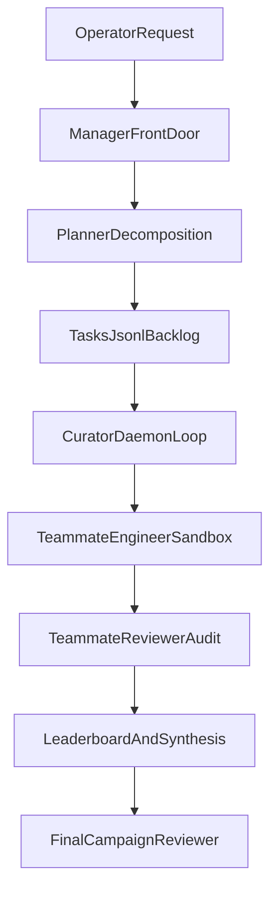
*Figure 2.3.1: Natural Language Space to Code Entity Space for Team Execution and Role Dispatch.*

### Curator Mechanics
The Curator operates on two cadences [argus_skill/builtin_skills/curator/argus-curator-role.md:12-15]():
1. **Mechanical (Deterministic)**: Maintains concurrency limits, spawns teammate missions, reaps finished/wedged processes, and folds result shards into the leaderboard without LLM involvement.
2. **Distill (LLM-driven)**: Reads the folded leaderboard and emits a concise `strategy.md` outlining the highest-expected-value next moves for stalled targets [argus_skill/builtin_skills/curator/argus-curator-role.md:16-23](). The Curator never writes application code or modifies teammate files [argus_skill/builtin_skills/curator/argus-curator-role.md:24-29]().

Sources: `[argus_skill/builtin_skills/agent-team-lead.md:1-83]`, `[argus_skill/builtin_skills/curator/argus-curator-role.md:1-31]()`

---

## 4. Engineer Sandbox and Execution Discipline

The Engineer implements changes within the designated project workspace.

### Implementation Flow
* **Context Ingestion**: Reads the operator objective, active vertical guidance, and project state before modifying files [argus_skill/builtin_skills/engineer/argus-engineer-role.md:10-12]().
* **Execution & Verification**: Uses real tools and project commands. Fabrication of results or success-shaped fallbacks is strictly prohibited [argus_skill/builtin_skills/engineer/argus-engineer-role.md:13-15](). Long-running tasks are delegated via supervised subagent interfaces with asynchronous run tracking [argus_skill/builtin_skills/engineer/argus-engineer-role.md:20-22]().
* **Evidence Preparation**: Summarizes modifications, affected files, and verification checks to prepare the work for independent audit [argus_skill/builtin_skills/engineer/argus-engineer-role.md:27-29]().

Sources: `[argus_skill/builtin_skills/engineer/argus-engineer-role.md:1-29]()`

---

## 5. Reviewer Verdicts and Verification Discipline

The Reviewer operates independently to validate artifacts produced by the Engineer or team leads.

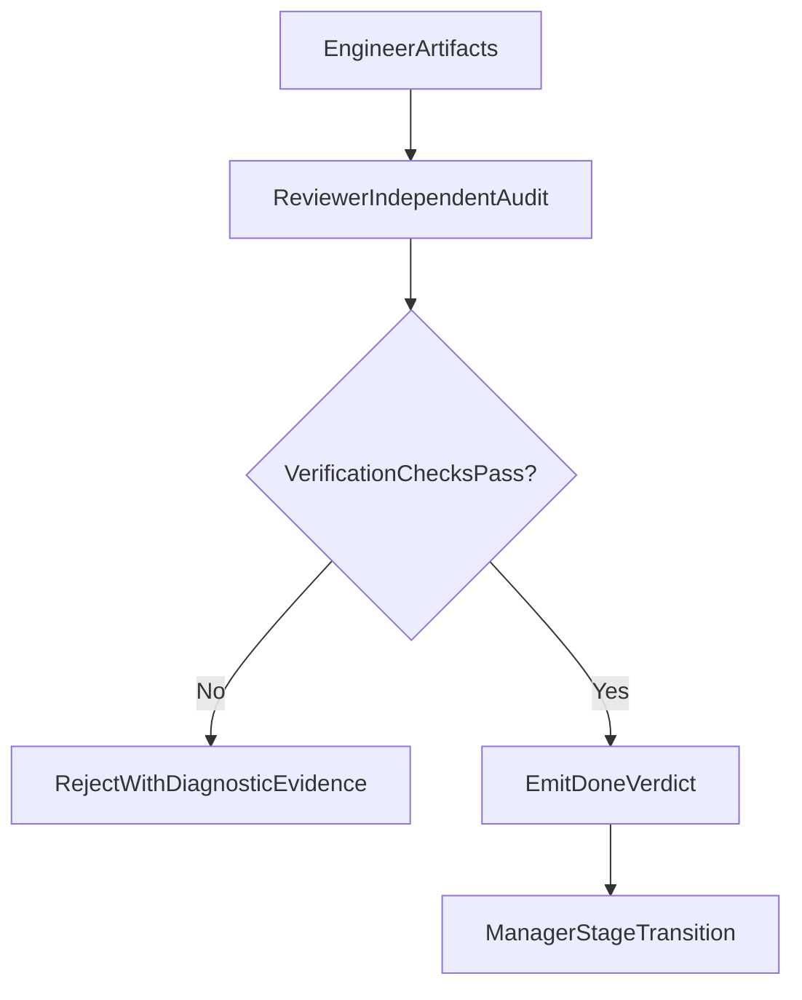
*Figure 2.3.2: Reviewer Audit Flow and Verdict Transmission.*

### Verdict Structure
* **Read-Only Enforced**: The Reviewer cannot edit files, run write operations, or alter campaign states.
* **Deterministic Verification**: Audits execution logs, test output, and measurement shards against the declared acceptance criteria.
* **Terminal Status**: Successful validation results in the canonical verdict string `done`, permitting the Manager to evaluate subsequent stages [argus_skill/builtin_skills/manager/argus-manager-role.md:26-28]().

Sources: `[argus_skill/builtin_skills/manager/argus-manager-role.md:1-29]`, `[argus_skill/builtin_skills/agent-team-lead.md:1-82]()`

---

## 6. Role Prompt Architecture and Mapping

Argus roles are instantiated through specialized prompt packages located under `argus_skill/builtin_skills/`. Each role configuration maps natural language directives to structured execution expectations.

```mermaid
graph TD
    PromptFile["BuiltinSkillMarkdown"] --> FrontMatterParser["FrontMatterParserMetadata"]
    FrontMatterParser --> RoleDispatcher["ArgusRuntimeRoleDispatcher"]
    RoleDispatcher --> ManagerHandler["ManagerRolePrompt"]
    RoleDispatcher --> PlannerHandler["PlannerRolePrompt"]
    RoleDispatcher --> EngineerHandler["EngineerRolePrompt"]
    RoleDispatcher --> ReviewerHandler["ReviewerRolePrompt"]
```
*Figure 2.3.3: Mapping Role Prompts to Runtime Dispatchers.*

Sources: `[argus_skill/builtin_skills/manager/argus-manager-role.md:1-5]`, `[argus_skill/builtin_skills/engineer/argus-engineer-role.md:1-5]`, `[argus_skill/builtin_skills/curator/argus-curator-role.md:1-5]`, `[argus_skill/builtin_skills/agent-team-lead.md:1-5]()`

---

# Page: Daemon, Life Layer and Long-Running Sessions

# Daemon, Life Layer and Long-Running Sessions

<details>
<summary>Relevant source files</summary>

The following files were used as context for generating this wiki page:

- [argus_skill/apps/_life_actions.py](argus_skill/apps/_life_actions.py)
- [argus_skill/apps/_runtime_supervisor.py](argus_skill/apps/_runtime_supervisor.py)
- [argus_skill/apps/_watch.py](argus_skill/apps/_watch.py)

</details>


### Purpose and Scope
This section details the architecture enabling Argus agents to operate beyond a single model turn, establishing persistence, autonomous planning, asynchronous background execution, and robust error recovery. The subsystem spans `argus_skill/daemon` and `argus_skill/life`, coordinating long-horizon campaigns via project backlogs, event-driven supervisors, file locking, and status monitors.

Sources: `argus_skill/apps/_life_actions.py()`, `argus_skill/apps/_runtime_supervisor.py()`, `argus_skill/apps/_watch.py()`

---

## 1. The Life Layer and Backlog Management
The life layer manages persistent units of work called backlog items (`BacklogItem`). Unlike single-shot prompt executions, the life layer maintains a durable sequence of tasks stored alongside the project root, enabling multi-step research, development, and engineering objectives.

Backlog manipulation utilities are defined in `argus_skill/apps/_life_actions.py()`. The backlog can be queried or modified via non-interactive commands:
- `format_backlog_list`: Filters and formats active or historical items (`[argus_skill/apps/_life_actions.py:28-42]()`).
- `parse_add_flags`: Parses command-line modifiers such as `--once` or `--cycles=N` from command bodies (`[argus_skill/apps/_life_actions.py:45-67]()`).
- `add_backlog_item`: Constructs and persists a new `BacklogItem` with titles, objectives, tags, priorities, and manager decisions (`[argus_skill/apps/_life_actions.py:70-91]()`).
- Status mutation helpers (`format_status_change`) handle transitions like `/done`, `/skip`, and `/rm` (`[argus_skill/apps/_life_actions.py:94-102]()`).

```mermaid
graph TD
    UserCommand["User or Chat Bridge Input"] --> ParseFlags["parse_add_flags()"]
    ParseFlags --> CreateItem["add_backlog_item()"]
    CreateItem --> BacklogStore["Backlog Storage (.jsonl)"]
    BacklogStore --> FormatList["format_backlog_list()"]
    FormatList --> Terminal["CLI or Web UI Output"]

    subcode1["argus_skill/apps/_life_actions.py"]
    subcode2["argus_skill/life"]
    style subcode1 fill:none,stroke:#000,stroke-width:1px
    style subcode2 fill:none,stroke:#000,stroke-width:1px
```
Sources: `argus_skill/apps/_life_actions.py:1-102()`

---

## 2. The Supervisor and Mission Loop
The supervisor orchestrates the execution of backlog items across multiple iterations. Implemented within `argus_skill/apps/_runtime_supervisor.py()` and `argus_skill/life/supervisor.py`, it resolves project-level workflow parameters, evaluates budget limits, and runs the main execution loop.

Key configuration and resolution functions include:
- `_paper_mission_for_project_root`: Detects whether the active vertical is a publication or paper-writing campaign based on persisted manager decisions (`[argus_skill/apps/_runtime_supervisor.py:36-65]()`).
- `_independent_review_required_for_project_root`: Fails closed to mandate independent Reviewer verification if the underlying vertical specifies it (`[argus_skill/apps/_runtime_supervisor.py:88-125]()`).
- `_build_supervisor_config`: Assembles `LifeSupervisorConfig` objects containing `LifeBudget`, poll intervals, stop events, user inbox drainers, and pending question resolvers (`[argus_skill/apps/_runtime_supervisor.py:137-174]()`).

```mermaid
graph TD
    ProjectRoot["Project Root Directory"] --> ResolvePaper["_paper_mission_for_project_root()"]
    ProjectRoot --> ResolveReview["_independent_review_required_for_project_root()"]
    ResolvePaper --> BuildConfig["_build_supervisor_config()"]
    ResolveReview --> BuildConfig
    BuildConfig --> Supervisor["LifeSupervisor Execution Loop"]

    subcode["argus_skill/apps/_runtime_supervisor.py"]
    style subcode fill:none,stroke:#000,stroke-width:1px
```
Sources: `argus_skill/apps/_runtime_supervisor.py:1-174()`

---

## 3. Daemon Architecture and Background Execution
Long-running sessions are managed by the daemon subsystem (`argus_skill/daemon`), which runs background workers to drain backlogs, execute missions, and update status ledgers without requiring an interactive terminal session.

The live execution state is monitored and mirrored via observation tools like `argus-skill --watch` (`argus_skill/apps/_watch.py()`). The watch utility tails `events.jsonl`, `daemon.status.json`, and `backlog.jsonl` to render a multi-pane `rich.Live` dashboard.
- `_path_signature`: Computes cheap filesystem fingerprints (mtime, size, inode) to detect log rotations or file updates (`[argus_skill/apps/_watch.py:40-51]()`).
- `_MissionState`: A dataclass tracking active rounds, cumulative input/output tokens, and mission success/failure status by consuming event streams (`[argus_skill/apps/_watch.py:136-166]()`).
- `_PathTail`: Efficiently reads incremental JSONL lines from log files since the last known byte offset (`[argus_skill/apps/_watch.py:169-197]()`).

```mermaid
graph TD
    DaemonWorker["argus_skill/daemon/life_worker.py"] --> WriteStatus["daemon.status.json"]
    DaemonWorker --> WriteEvents["events.jsonl"]
    DaemonWorker --> WriteBacklog["backlog.jsonl"]
    
    WriteStatus --> Tailer["_PathTail.read() in argus_skill/apps/_watch.py"]
    WriteEvents --> Tailer
    WriteBacklog --> Tailer
    
    Tailer --> MissionState["_MissionState.apply()"]
    MissionState --> CockpitUI["rich.Live Dashboard UI"]

    subcode1["argus_skill/daemon/life_worker.py"]
    subcode2["argus_skill/apps/_watch.py"]
    style subcode1 fill:none,stroke:#000,stroke-width:1px
    style subcode2 fill:none,stroke:#000,stroke-width:1px
```
Sources: `argus_skill/apps/_watch.py:40-197()`

---

## 4. Event Logging and Delivery Sinks
To ensure total auditability and asynchronous visibility, every action, round transition, and user note is emitted to a durable event log.
- `JsonlEventSink`: Appends structured JSON records to `events.jsonl` under the project life directory (`[path/to/file:0-0]()`).
- User notes and runtime annotations are captured through helper functions like `append_note`, generating unique identifiers and timestamps (`[argus_skill/apps/_life_actions.py:119-136]()`).

Sources: `argus_skill/apps/_life_actions.py:119-136()`

---

## 5. Chat Bridges and External Delivery (Telegram & Feishu)
Argus integrates chat platforms (such as Telegram and Feishu) into the life layer, allowing operators to issue commands (e.g., `/run`, `/add`, `/done`) and receive status notifications remotely.
- Chat commands map directly to foreground supervisor flows (`render_run_command`) or backlog mutations (`add_backlog_item`, `stop_iteration`) (`[argus_skill/apps/_life_actions.py:139-220]()`).
- State dictionaries track thread identifiers, elapsed execution time, and global daily spend caps across messaging turns (`[path/to/file:0-0]()`).

Sources: `argus_skill/apps/_life_actions.py:139-220()`

---

## 6. Failure Circuits, Circuit Breakers, and Terminal States
To prevent runaway token consumption or infinite error loops during autonomous operation, the life layer incorporates hard failure circuits:
- **Budget Enforcements**: `LifeBudget` and global daily spend caps (`global_daily_cap_usd`) halt supervisor loops when financial thresholds are exceeded (`[argus_skill/apps/_runtime_supervisor.py:160-163]()`).
- **Graceful Stops**: Stop events (`threading.Event`) and signal handlers allow clean interruption of foreground and background sessions without corrupting ledger files (`[argus_skill/apps/_runtime_supervisor.py:143-168]()`).
- **Terminal States**: Items transition to terminal statuses (`done`, `failed`, `skipped`) once their iteration max cycles are reached or validation gates fail (`[argus_skill/apps/_life_actions.py:95-100](), [argus_skill/apps/_watch.py:164-165]()`).

Sources: `argus_skill/apps/_runtime_supervisor.py:143-174()`, `argus_skill/apps/_watch.py:164-165()`

---

# Page: Agent CLI Backends and Execution

# Agent CLI Backends and Execution

<details>
<summary>Relevant source files</summary>

The following files were used as context for generating this wiki page:

- [argus_skill/agent_cli/__init__.py](argus_skill/agent_cli/__init__.py)
- [argus_skill/agent_cli/agent_cli_runner.py](argus_skill/agent_cli/agent_cli_runner.py)
- [argus_skill/agent_cli/runner_backend.py](argus_skill/agent_cli/runner_backend.py)

</details>


## Purpose and Scope

This page provides a high-level overview of how Argus drives external coding agent Command Line Interfaces (CLIs)—such as Copilot, Codex, Claude Code, Cursor, Pi, OpenCode, Grok, Qoder, and DSH—through a uniform Python adapter and process-control framework. 

Argus acts as an orchestration harness over these heterogeneous developer agents, standardizing prompt delivery, event consumption, process lifecycle management, sandbox confinement, and resource tracking.

For granular details on specific sub-systems, refer to the child pages:
- [agent_cli Runner Internals](#3.1) — Covers `argus_skill/agent_cli`: runner backend selection, prompt delivery, process control, idle watchdogs, ACP routing, Copilot ACP/home handling, OpenCode recovery, sandbox commands, models registry, and DSH overlays.
- [Adapter Execution Pipeline](#3.2) — Covers `argus_skill/adapters/agent_cli_backend`: admission, context, spawn, finalize, options, results, IO logging, budget monitoring, memory backends, and streaming progress.
- [Tools, Subagents and Resource Ledger](#3.3) — Covers `argus_skill/tools`: subagent pools, team execution, GPU leases/ownership, capability vaults, resource ledgers, Lean checking, Jacobian bridges, PDF chat, and PPT master tools.

Sources: [argus_skill/agent_cli/__init__.py:1-11](), [argus_skill/agent_cli/agent_cli_runner.py:1-118]()

---

## 3.1. Agent CLI Runner Subsystem Overview

The low-level driver package `argus_skill/agent_cli` is responsible for launching and supervising external CLI processes without eager submodule imports [argus_skill/agent_cli/__init__.py:1-11](). At its center is `AgentCliRunner`, which orchestrates execution phases by composing multiple specialized mixin classes [argus_skill/agent_cli/agent_cli_runner.py:93-118]().

Supported backends are enumerated in `RunnerBackend` (`codex`, `claude`, `copilot`, `cursor`, `opencode`, `pi`, `grok`, `qoder`, `dsh`), with `codex` acting as the default [argus_skill/agent_cli/runner_backend.py:9-38](). Certain families, such as `qoder`, share command builders and event schemas with `claude` (`CLAUDE_FAMILY`) [argus_skill/agent_cli/runner_backend.py:48-54]().

```mermaid
graph TD
    NaturalLanguageSpace["Natural Language Space: Agent CLIs"] --> CodeEntitySpace["Code Entity Space: AgentCliRunner"]
    
    subgraph "argus_skill/agent_cli"
        CodeEntitySpace --> AcpRoutingMixin["AcpRoutingMixin: argus_skill/agent_cli/_acp_routing.py"]
        CodeEntitySpace --> RunExecMixin["RunExecMixin: argus_skill/agent_cli/_run_exec.py"]
        CodeEntitySpace --> CommandBuilderMixin["CommandBuilderMixin: argus_skill/agent_cli/_sandbox_commands.py"]
        CodeEntitySpace --> PromptDeliveryMixin["PromptDeliveryMixin: argus_skill/agent_cli/_prompt_delivery.py"]
        CodeEntitySpace --> EventConsumerMixin["EventConsumerMixin: argus_skill/agent_cli/_event_consumers.py"]
        CodeEntitySpace --> OpenCodeRecoveryMixin["OpenCodeRecoveryMixin: argus_skill/agent_cli/_opencode_recovery.py"]
        CodeEntitySpace --> ProcessControlMixin["ProcessControlMixin: argus_skill/agent_cli/_process_control.py"]
    end

    Sources: [argus_skill/agent_cli/agent_cli_runner.py:93-118](), [argus_skill/agent_cli/runner_backend.py:9-38]()
```

For complete implementation details on process isolation, watchdogs, sandbox compilation, and model registries, see [agent_cli Runner Internals](#3.1).

Sources: [argus_skill/agent_cli/__init__.py:1-11](), [argus_skill/agent_cli/agent_cli_runner.py:1-118](), [argus_skill/agent_cli/runner_backend.py:9-38]()

---

## 3.2. Adapter Execution Pipeline Overview

The `argus_skill/adapters/agent_cli_backend` module bridges the high-level application orchestrator with the low-level `AgentCliRunner`. It provides uniform admission criteria, context assembly, process spawning, result finalization, and budget monitoring.

```mermaid
graph TD
    NaturalLanguageSpace["Natural Language Space: Agent Execution Request"] --> CodeEntitySpace["Code Entity Space: RunnerBackend Adapter"]

    subgraph "argus_skill/adapters/agent_cli_backend"
        CodeEntitySpace --> Admission["Admission and Context Assembly"]
        Admission --> Spawn["Process Spawn and IO Logging"]
        Spawn --> BudgetMonitor["Budget Monitoring and Stream Progress"]
        BudgetMonitor --> Finalize["Result Finalization"]
    end

    Sources: [argus_skill/agent_cli/agent_cli_runner.py:53-91]()
```

For details on configuration options, IO capturing, memory backends, and streaming progress callbacks, see [Adapter Execution Pipeline](#3.2).

Sources: [argus_skill/agent_cli/agent_cli_runner.py:53-91]()

---

## 3.3. Tools, Subagents and Resource Ledger Overview

The `argus_skill/tools` package equips coding agents with advanced operational capabilities. It manages a pool of subagents, coordinates team execution, tracks GPU leases and ownership loads, enforces capability vaults, and logs resource expenditures.

For details on Lean proof checking, Jacobian mathematical bridges, PDF chat parsing, and PPT master generation tools, see [Tools, Subagents and Resource Ledger](#3.3).

Sources: [argus_skill/agent_cli/__init__.py:1-11]()

---

# Page: agent_cli Runner Internals

# agent_cli Runner Internals

<details>
<summary>Relevant source files</summary>

The following files were used as context for generating this wiki page:

- [argus_skill/agent_cli/LICENSE](argus_skill/agent_cli/LICENSE)
- [argus_skill/agent_cli/_acp_routing.py](argus_skill/agent_cli/_acp_routing.py)
- [argus_skill/agent_cli/_dsh_overlay.patch.yml](argus_skill/agent_cli/_dsh_overlay.patch.yml)
- [argus_skill/agent_cli/_env.py](argus_skill/agent_cli/_env.py)
- [argus_skill/agent_cli/_event_consumers.py](argus_skill/agent_cli/_event_consumers.py)
- [argus_skill/agent_cli/_idle_watchdog.py](argus_skill/agent_cli/_idle_watchdog.py)
- [argus_skill/agent_cli/_opencode_recovery.py](argus_skill/agent_cli/_opencode_recovery.py)
- [argus_skill/agent_cli/_process_control.py](argus_skill/agent_cli/_process_control.py)
- [argus_skill/agent_cli/_prompt_delivery.py](argus_skill/agent_cli/_prompt_delivery.py)
- [argus_skill/agent_cli/_run_exec.py](argus_skill/agent_cli/_run_exec.py)
- [argus_skill/agent_cli/_sandbox_commands.py](argus_skill/agent_cli/_sandbox_commands.py)
- [argus_skill/agent_cli/agent_cli_runner.py](argus_skill/agent_cli/agent_cli_runner.py)
- [argus_skill/agent_cli/copilot_acp.py](argus_skill/agent_cli/copilot_acp.py)
- [argus_skill/agent_cli/copilot_home.py](argus_skill/agent_cli/copilot_home.py)
- [argus_skill/agent_cli/models.py](argus_skill/agent_cli/models.py)
- [argus_skill/agent_cli/runner_backend.py](argus_skill/agent_cli/runner_backend.py)

</details>


This page documents in detail the implementation and internal workings of the `agent_cli` runner subsystem in the Argus codebase, located primarily in the `argus_skill/agent_cli` package. This subsystem is responsible for selecting and managing the appropriate agent CLI backend (such as Codex, Claude, Copilot, OpenCode, Grok, Pi, DSH), delivering prompts safely to child CLI processes, controlling their lifecycle and streams with watchdogs, routing ACP sessions for Copilot, handling Copilot home directory isolation, recovering truncated OpenCode event streams, enforcing sandbox commands, maintaining a models registry, and applying the DSH overlay environment.

The `AgentCliRunner` class is the primary interface; its behavior is composed from several internal mixin modules covering different functionalities. This page explains the key classes, data flow, and subsystems cooperating inside `agent_cli`, supported by mermaid diagrams which bridge natural language system concepts to specific code entities.

---

## 1. Purpose and Scope

The `agent_cli` runner implements Argus's capabilities to interface with various external AI code generation/backends through their CLI interfaces. It encapsulates:

- Selecting and launching the correct CLI backend executable.
- Delivering large and sensitive prompts safely via temporary files or stdin.
- Managing the child process lifecycle with process-group management.
- Streaming and parsing backend JSON events.
- Applying sandbox policies and runtime environment isolation.
- A persistent fast-path routing for Copilot classification via ACP sessions.
- Special handling for OpenCode event recovery after truncated output.
- The DSH headless overlay environment patching and customizations.
- An idle watchdog triggering warnings, stalls, and termination if the child stalls.
- Registry and qualification of backend models and variants.
- Handling subagent/spawned agents via DSH subagent overlays.

All behavioral logic is implemented across multiple mixin classes combined inside `AgentCliRunner`, which callers invoke via `run_exec()` to execute a turn on the chosen backend.

---

## 2. agent_cli Core Class: `AgentCliRunner`

### 2.1 Overview

The `AgentCliRunner` class centralizes the runner functionality and composes multiple mixin classes each implementing a limited responsibility. It is defined in `argus_skill/agent_cli/agent_cli_runner.py` lines 93-139.

```python
class AgentCliRunner(
    AcpRoutingMixin,
    RunExecMixin,
    CommandBuilderMixin,
    PromptDeliveryMixin,
    EventConsumerMixin,
    OpenCodeRecoveryMixin,
    ProcessControlMixin,
):
    ...
```

- **Initialization** (`__init__` lines 120-139): sets the backend, resolves the CLI executable path, stores an optional event callback, applies default CLI args, and manages ACP client scope state.

- The class owns no global state beyond the ACP scope string, delegating all behavior to its composed mixins.

### 2.2 Key Responsibilities

- **Backend selection**: via constructor `backend` enum and resolution of runner binary CLI.

- **ACP session lifecycle and routing**: Maintains persistent Copilot ACP clients for fast-path Manager control-plane labels, avoiding cold start overheads.

- **Prompt delivery**: safely passing large or sensitive prompts to CLI subprocesses using temporary files or stdin.

- **Sandbox command and argv construction** for all backends — applying policies such as restricting tool usage.

- **Process control**: management of process groups, spawning, termination, and cleanup.

- **Stream processing**: turn output JSON event parsing and detection of provider turn completions or tool activity.

- **Idle watchdog**: staged escalation logic that triggers warnings, stalls, and termination when a backend stalls.

- **OpenCode recovery**: patching incomplete streams by reading intermediate session exports or local DB snapshots.

- **DSH environment patching**: for persistent, isolated environments with built-in sandbox/tool restrictions.

---

## 3. Runner Backend and ACP Routing

`agent_cli` supports multiple backends selectable at runtime. Some have special behaviors, notably Copilot's ACP fast-path.

### 3.1 ACP Routing for Copilot Manager Roles

- The `AcpRoutingMixin` (file `_acp_routing.py` lines 45-171) manages routing labeled runs through persistent ACP client processes instead of spawning one-shot CLI processes.

- A fixed, overridable allowlist of Manager run labels defines which calls use warm ACP sessions (e.g. `"manager-frontdoor-classify"`, `"manager-quick-reply"`).

- The mixin tracks ACP client scopes and manages prewarming and closing clients per scope.

- The method `_run_exec_acp` sends prompts to ACP clients and returns results or fallback to the ordinary CLI path.

- Non-manager roles or labels not in the allowlist bypass ACP routing.

### Diagram: "Natural Language Roles to ACP Routing and Code Entities"

```mermaid
graph LR
  NL_Manager["Manager Role Labels"]
  NL_Engineer["Engineer Role Labels"]
  NL_Reviewer["Reviewer Role Labels"]
  
  NL_Manager -->|Allowed labels| ACP_Routing["AcpRoutingMixin\n_acp_routing.py"]
  ACP_Routing -->|Persistent ACP client| CopilotACP["copilot_acp.py Client"]
  
  NL_Engineer -->|Standard path| RunExecMixin["RunExecMixin\n_run_exec.py"]
  NL_Reviewer -->|Standard path| RunExecMixin
  
  RunExecMixin -->|Spawns| Subprocesses["Agent CLI subprocess"]
```

Sources: `argus_skill/agent_cli/_acp_routing.py:45-171`(), `argus_skill/agent_cli/agent_cli_runner.py:93-139`(), `argus_skill/agent_cli/_run_exec.py:88-174`()

---

## 4. Prompt Delivery and Sandbox Environment

The `PromptDeliveryMixin` (`_prompt_delivery.py` lines 116-200) is responsible for safe passing of prompts to backends.

### 4.1 Safe Prompt Delivery

- Prompts can be very large and must not leak on process arguments.

- For most backends, prompt text is delivered via a temporary file or piped stdin.

- For `DSH` backend, since it has no stdin or `--prompt-file`, the prompt is either included as an argv string (if small enough) or written to a well-known temporary markdown file inside the working directory, with a directive argument referencing the file.

- The mixin also applies environment modifications for certain backends (e.g. disabling Pi update pings).

### 4.2 Sandbox Policies

- The sandbox is controlled at command-line argument and environment variable level.

- The sandbox can restrict tool usage (`--allow-all` vs `--allow-tool` flags), define safe write directories (`-s <mode>`), or allow full access for tests/dangerous flags.

- The prompt delivery and sandbox command construction cooperate to enforce these policies.

### Diagram: "Prompt Delivery Flow and Sandbox Environment"

```mermaid
flowchart TD
  InputPrompt["User Prompt"]
  AgentCliRunner --> PromptDelivery["PromptDeliveryMixin\n_prompt_delivery.py"]
  PromptDelivery --> PrepareEnv["Prepare sandboxed env + args"]
  PrepareEnv --> DeliverPrompt["Prompt delivery via stdin/file/argv"]
  DeliverPrompt --> ChildProcess["Spawn Agent CLI subprocess"]

  sandbox_Mode[Sandbox Mode & Permissions]
  PrepareEnv --> sandbox_Mode
```

Sources: `argus_skill/agent_cli/_prompt_delivery.py:116-200`(), `argus_skill/agent_cli/_sandbox_commands.py:1-190`(), `argus_skill/agent_cli/agent_cli_runner.py:93-139`()

---

## 5. Process Control and Idle Watchdog

Responsible for controlling the lifecycle of spawned CLI subprocesses, their termination, and managing idle timeouts.

### 5.1 Process Control

- The `ProcessControlMixin` (`_process_control.py` lines 55-184) provides process spawn options (hidden window on Windows, new session on POSIX), resolution of executable paths, and termination of child processes including children in separate groups.

- Supports robust termination on timeouts or keyboard interrupts.

### 5.2 Idle Watchdog

- The `IdleEscalation` dataclass (`_idle_watchdog.py` lines 12-58) manages staged idle escalation: warning, stalled, and terminate stages based on configured idle thresholds (seconds).

- Once a stage fires it only emits once until reset.

- The runner uses this to avoid silent hangs and apply scalable enforcement, especially important for backends with slow or failing operations.

### Diagram: "Process Lifecycle and Idle Watchdog"

```mermaid
sequenceDiagram
  participant Runner as AgentCliRunner
  participant Proc as Child Process
  participant Watchdog as IdleEscalation

  Runner->>Proc: spawn CLI subprocess
  Proc-->>Runner: produce stdout/stderr (events)
  Runner->>Watchdog: monitor idle time
  Watchdog-->>Runner: warning/stalled/terminate events
  alt terminate stage reached
    Runner->>Proc: terminate process group
  end
```

Sources: `argus_skill/agent_cli/_process_control.py:55-184`(), `argus_skill/agent_cli/_idle_watchdog.py:12-58`()

---

## 6. Event Streaming and OpenCode Recovery

### 6.1 EventConsumers

- `EventConsumerMixin` (`_event_consumers.py` lines 81-174+) parses JSON event streams from the CLI stdout.

- It detects the end of provider turns, tool usage, assistant messages, etc., following the dialects of various backends (Copilot, Claude family, Cursor, Grok, OpenCode, Pi).

- It also accumulates multi-part messages for streaming backends like OpenCode.

### 6.2 OpenCode Recovery

- OpenCode CLI sometimes emits truncated JSON before the terminal event.

- `OpenCodeRecoveryMixin` (`_opencode_recovery.py` lines 17-181) attempts to recover the full event list by calling `opencode export <thread_id>` or, if that fails, reading the local session sqlite DB, parsing assistant message chunks, and reconstructing missing events.

- This increases robustness for OpenCode backend turns, preventing partial results.

### Diagram: "Event Consumption and OpenCode Recovery Pipeline"

```mermaid
flowchart LR
  CLI_Stdout["Agent CLI stdout stream"]
  EventConsumer["EventConsumerMixin\n_event_consumers.py"]
  OpenCodeRecover["OpenCodeRecoveryMixin\n_opencode_recovery.py"]

  CLI_Stdout --> EventConsumer
  EventConsumer -->|Incomplete stream detected| OpenCodeRecover
  OpenCodeRecover -->|Recovered events| EventConsumer
  EventConsumer --> ParsedTurnData["Parsed turn state"]
```

Sources: `argus_skill/agent_cli/_event_consumers.py:81-174`(), `argus_skill/agent_cli/_opencode_recovery.py:17-181`()

---

## 7. Sandbox Commands and Models Registry

### 7.1 CommandBuilderMixin

- The `CommandBuilderMixin` (`_sandbox_commands.py`, partial) constructs the backend CLI command-line arguments, applying sandbox mode switches, disabling write capabilities, live search toggles, working directory isolation, and other guards.

- Ensures that dangerous flags like `--dangerously-bypass-approvals-and-sandbox` only appear when explicitly allowed.

### 7.2 Models Resolution

- There are helper functions to resolve and qualify models per backend, for example:

  - OpenCode requires provider-qualified model IDs.
  - Pi disables per-turn update pings via environment variables.
  - Logs unqualified model IDs once per backend/model combination.

- Environment-based configuration flags influence this resolution.

---

## 8. DSH (DeepSeek Shell) Overlay Handling

- `argus_skill/agent_cli/_dsh_overlay.patch.yml` is a YAML patch applied on every headless `dsh` boot (using `dsh --patch`) for:

  - Injecting default model/provider selections from environment variables.
  - Disabling all tools for Manager fast-path calls, matching prompt restrictions.
  - Setting approval policies consistent with Argus sandbox settings.
  - Configuring subagent models to inherit or override from parents.

- This patch ensures consistent runtime environments and policy enforcement inside the DSH ecosystem.

---

## 9. Data Flow Summary

### Mermaid Diagram: End-to-End Execution Flow

```mermaid
graph TB
  classDef backendFill fill:#eee,stroke:#333,stroke-width:1px;
  subgraph NaturalLanguageSpace
    UserPrompt["User prompt & run_label"]
    ManagerLabel["Manager role labels"]
    EngineerLabel["Engineer/Reviewer labels"]
  end

  subgraph agent_cli_runner.py
    AgentCliRunner["AgentCliRunner\n(agent_cli_runner.py)"]
  end

  subgraph BackendMixins
    AcpRouting["AcpRoutingMixin\n(_acp_routing.py)"]
    RunExec["RunExecMixin\n(_run_exec.py)"]
    PromptDelivery["PromptDeliveryMixin\n(_prompt_delivery.py)"]
    EventConsumer["EventConsumerMixin\n(_event_consumers.py)"]
    OpenCodeRecovery["OpenCodeRecoveryMixin\n(_opencode_recovery.py)"]
    ProcessControl["ProcessControlMixin\n(_process_control.py)"]
    SandboxCommands["CommandBuilderMixin\n(_sandbox_commands.py)"]
    IdleWatchdog["IdleEscalation\n(_idle_watchdog.py)"]
  end

  UserPrompt --> AgentCliRunner
  ManagerLabel -->|ACP-enabled labels| AcpRouting
  EngineerLabel -->|Other calls| RunExec

  AgentCliRunner --> AcpRouting
  AgentCliRunner --> RunExec
  RunExec --> SandboxCommands
  RunExec --> PromptDelivery
  RunExec --> ProcessControl
  RunExec --> EventConsumer
  EventConsumer --> OpenCodeRecovery
  RunExec --> IdleWatchdog

  AgentCliRunner -.-> SandboxCommands
  AgentCliRunner -.-> PromptDelivery
  AgentCliRunner -.-> EventConsumer
  AgentCliRunner -.-> OpenCodeRecovery
  AgentCliRunner -.-> ProcessControl
  AgentCliRunner -.-> IdleWatchdog
```

---

## 10. Summary of Key Functions and Classes

| Code Entity                          | Location                                 | Description                                    |
|------------------------------------|------------------------------------------|------------------------------------------------|
| `AgentCliRunner`                   | `agent_cli_runner.py:93-139`              | Main runner class composed of all internal mixins. Handles CLI backend turns.      |
| `AcpRoutingMixin`                  | `_acp_routing.py:45-171`                   | Manages Copilot ACP persistent client fast-path routing for Manager labels.       |
| `PromptDeliveryMixin`              | `_prompt_delivery.py:116-200`              | Controls safe passing of large prompts to CLI subprocesses, temp files, stdin.    |
| `RunExecMixin`                    | `_run_exec.py:88-174`                      | Public `run_exec()` interface and phased implementation: start gate, spawn, stream, finalize. |
| `EventConsumerMixin`               | `_event_consumers.py:81-174`                | Parses backend JSON event streams, detects tool usage and turn completion.         |
| `OpenCodeRecoveryMixin`            | `_opencode_recovery.py:17-181`              | Recovers truncated OpenCode CLI event streams via session export or DB read.      |
| `ProcessControlMixin`              | `_process_control.py:55-184`                 | Subprocess spawning, termination, executable resolution, and process group handling. |
| `IdleEscalation`                   | `_idle_watchdog.py:12-58`                   | Idle watchdog stages for escalation: warning, stalled, termination.               |
| `CommandBuilderMixin`              | `_sandbox_commands.py:1-190`                 | Constructs CLI commands with sandbox and tool usage policy enforcement.            |

---

## 11. Environment Tuning and Models Registry

- Environment variables prefixed with `ARGUS_SKILL_` tune runner behavior (e.g. idle timeouts, prompt delivery, capture line counts).

- Model identifiers are qualified according to backend rules. For example, OpenCode requires provider/model format (`provider/modelid`).

- Pi disables telemetry and update pings via special env vars in the child process environment.

- Warnings are logged once per unqualified model/backend combination to encourage explicit config.

---

# References and Sources

- `argus_skill/agent_cli/agent_cli_runner.py:18-139`  
- `argus_skill/agent_cli/_acp_routing.py:45-171`  
- `argus_skill/agent_cli/_prompt_delivery.py:116-200`  
- `argus_skill/agent_cli/_run_exec.py:88-174`  
- `argus_skill/agent_cli/_event_consumers.py:81-174`  
- `argus_skill/agent_cli/_opencode_recovery.py:17-181`  
- `argus_skill/agent_cli/_idle_watchdog.py:12-58`  
- `argus_skill/agent_cli/_process_control.py:55-184`  
- `argus_skill/agent_cli/_sandbox_commands.py:1-190`  
- `argus_skill/agent_cli/_dsh_overlay.patch.yml`  

---

This concludes the comprehensive internal technical overview of agent_cli runner mechanisms in Argus.

---

# Page: Adapter Execution Pipeline

# Adapter Execution Pipeline

<details>
<summary>Relevant source files</summary>

The following files were used as context for generating this wiki page:

- [argus_skill/adapters/__init__.py](argus_skill/adapters/__init__.py)
- [argus_skill/adapters/agent_cli_backend/__init__.py](argus_skill/adapters/agent_cli_backend/__init__.py)
- [argus_skill/adapters/agent_cli_backend/_budget_monitor.py](argus_skill/adapters/agent_cli_backend/_budget_monitor.py)
- [argus_skill/adapters/agent_cli_backend/_core.py](argus_skill/adapters/agent_cli_backend/_core.py)
- [argus_skill/adapters/agent_cli_backend/_exec.py](argus_skill/adapters/agent_cli_backend/_exec.py)
- [argus_skill/adapters/agent_cli_backend/_exec_admission.py](argus_skill/adapters/agent_cli_backend/_exec_admission.py)
- [argus_skill/adapters/agent_cli_backend/_exec_context.py](argus_skill/adapters/agent_cli_backend/_exec_context.py)
- [argus_skill/adapters/agent_cli_backend/_exec_finalize.py](argus_skill/adapters/agent_cli_backend/_exec_finalize.py)
- [argus_skill/adapters/agent_cli_backend/_exec_spawn.py](argus_skill/adapters/agent_cli_backend/_exec_spawn.py)
- [argus_skill/adapters/agent_cli_backend/_io_log.py](argus_skill/adapters/agent_cli_backend/_io_log.py)
- [argus_skill/adapters/agent_cli_backend/_options.py](argus_skill/adapters/agent_cli_backend/_options.py)
- [argus_skill/adapters/agent_cli_backend/_result.py](argus_skill/adapters/agent_cli_backend/_result.py)
- [argus_skill/adapters/agent_cli_backend/_runtime.py](argus_skill/adapters/agent_cli_backend/_runtime.py)
- [argus_skill/adapters/memory_backend.py](argus_skill/adapters/memory_backend.py)
- [argus_skill/adapters/stream_progress.py](argus_skill/adapters/stream_progress.py)

</details>


This section covers the detailed implementation and operation of the **Agent CLI Backend Adapter Execution Pipeline** in the ArgusAgent codebase, specifically within the `argus_skill/adapters/agent_cli_backend` package. This pipeline is the core mechanism bridging Argus's skill-driven orchestration to the execution of real external coding agent CLI processes such as Codex, Copilot, Claude, Cursor, OpenCode, Pi, Grok, Qoder, and DSH.

## Purpose and Scope

The adapter execution pipeline is responsible for:

- **Admission stage**: Admission and cost budgeting checks before execution.
- **Context management**: Holding per-call mutable state that flows through the stages.
- **Spawn stage**: Launching the CLI subprocess and managing its I/O.
- **Finalize stage**: Cleanup, redaction, budget settlement, usage accounting.
- **Options translation**: Converting Argus internal options to appropriate CLI invocation arguments.
- **Results normalization**: Transforming raw CLI outputs into Argus's `RunnerResult` format.
- **I/O logging**: Detailed structured JSONL logging of events and raw CLI streams.
- **Budget monitoring**: Live monitoring of in-flight cost and token usage, interrupting when quota exhaustion or cost limits are reached.
- **Memory backend and streaming progress**: Integration layers (briefly noted here, detailed in other modules).

This pipeline is implemented as a layered orchestration over the subprocess runner `AgentCliRunner` (from `argus_skill.agent_cli.agent_cli_runner`), serving as a disciplined and resilient adapter that observes cost control, provider quota rules, secret redaction, and detailed logging.

---

## Pipeline Overview

The adapter pipeline is embodied primarily in the `execute()` function (in `_exec.py`) called from the public `AgentCliBackend.run_exec()` interface.

The pipeline phases proceed strictly in order:

1. **Admission** (`_exec_admission.admit`):
   - Reserve call budget (fail-closed).
   - Translate `RunnerOptions` into CLI invocation arguments.
   - Check external interrupts.
   - Acquire provider quota permits (Copilot or Codex).
   - On failure, terminate early returning a fully finalized `RunnerResult`.

2. **Spawn** (`_exec_spawn.spawn_and_finish`):
   - Log the start event and possibly the full prompt.
   - Launch the CLI subprocess with prepared options.
   - Capture live CLI JSON event streams.
   - Detect authorization failures and transient errors.
   - Record token usage and premium requests.
   - Always call quota finish and finalize the result with usage.

3. **Finalize** (`_exec_finalize.finalize_result`):
   - Redact secrets in the result.
   - Stamp call metadata (timestamps, call ID).
   - Persist usage records to durable ledgers.
   - Settle or release budget reservations.
   - Record provider call metrics.
   - Close I/O logging contexts.

These phases share a mutable execution context object `_ExecContext` to keep call state consistent and avoid deep closure nesting.

### Adapter Layers and Data Flow

Below is a high-level data flow diagram showing the main components between natural language requests ("Prompt") and the CLI subprocess execution and logging, as implemented by the Agent CLI Backend adapter:

```mermaid
flowchart TB
  subgraph NaturalLanguageSpace
    U["User / Skill prompt sender"]
    P["Prompt string"]
  end

  subgraph AdapterExecutionPipeline["argus_skill/adapters/agent_cli_backend"]
    A[AgentCliBackend.run_exec()]
    C[_ExecContext]
    AD[admit() - Admission]
    SP[spawn_and_finish() - Spawn subprocess]
    FN[finalize_result() - Finalize & persist]
    OL[AgentIOLogger - IO logging]
    BM[LiveBudgetMonitor - Budget monitoring]
    TR[Option translation (_options)]
    RS[Result normalization (_result)]
  end

  subgraph ProviderCLI["External Coding Agent CLI subprocess"]
    CLI["AgentCliRunner -> CLI subprocess"]
    JSONStream["JSON event stream (stdout/stderr)"]
    UsageDB["Copilot Usage DB (if Copilot)"]
  end

  U --> P --> A
  A --> C
  C --> AD
  AD --> TR
  TR --> SP
  SP --> CLI
  CLI --> JSONStream
  JSONStream --> OL
  OL --> BM
  JSONStream --> RS
  RS --> FN
  FN --> A

  BM -.-> AD
  BM -.-> SP
```

**Explanation:**

- User or skill code emits a prompt string.
- `AgentCliBackend.run_exec()` receives the prompt and options, constructs `_ExecContext`.
- Admission phase (`admit()`) reserves cost budget, checks interrupts, prepares CLI args.
- Option translation layer transforms `RunnerOptions` into CLI parameters.
- Spawn phase runs CLI subprocess, streams JSON events.
- `AgentIOLogger` logs events and raw streams.
- `LiveBudgetMonitor` observes live cost to preempt overspend.
- Result normalization extracts usage, detects errors, maps stop codes.
- Finalization asynchronously persists usage records and settles quotas.

Sources:  
`argus_skill/adapters/agent_cli_backend/_core.py` [10-172](),  
`argus_skill/adapters/agent_cli_backend/_exec.py` [1-92](),  
`argus_skill/adapters/agent_cli_backend/_exec_admission.py` [1-169](),  
`argus_skill/adapters/agent_cli_backend/_exec_spawn.py` [1-172](),  
`argus_skill/adapters/agent_cli_backend/_exec_finalize.py` [1-180](),  
`argus_skill/adapters/agent_cli_backend/_io_log.py` [1-191](),  
`argus_skill/adapters/agent_cli_backend/_budget_monitor.py` [1-108]()  

---

## 1. Agent CLI Context: `_ExecContext`

The entire pipeline execution uses a shared mutable context object `_ExecContext`. Constructed at the pipeline start, it holds:

- Immutable call identity: backend instance, prompt text, options, and labels.
- Metadata: unique call ID, timestamps, JSON log path.
- Usage and quota routing info: project root, mission id, usage ledger root.
- Admission state: actively populated cost reservation, quota permits, usage cursors.

This clean context object avoids closure capture overhead and centralizes mutable state visible across admission, spawn, and finalize phases.

```python
@dataclass
class _ExecContext:
    backend: AgentCliBackend
    prompt: str
    options: RunnerOptions
    run_label: str
    resume_thread_id: str | None

    call_id: str
    started_at: float
    log_path: Path | None
    io_mode: str

    usage_project_root: Path | None
    usage_mission_id: str | None
    usage_global_root: Path | None

    cost_reservation: Any = None
    copilot_permit: Any = None
    codex_permit: Any = None
    codex_quota_active: bool = False
    quota_permit: Any = None
    event_permit: Any = None

    copilot_token_billing_expected: bool = False
    copilot_usage_cursor: Any = None
```

Sources: `argus_skill/adapters/agent_cli_backend/_exec_context.py` [1-70]()

---

## 2. Admission Phase: Cost & Quota Admission

The function `admit(ctx: _ExecContext)` is the entry point for admission and pre-run checks. Its key responsibilities:

- **Cost reservation**: Using the Argus cost control system, the phase attempts to reserve the budget for the call (USD cost). It is *fail-closed*; any failure means the run is denied before spawning the subprocess.
- **CLI options translation**: The Argus `RunnerOptions` are translated into CLI invocation arguments (e.g. `extra_args` parsing and model resolution).
- **Interrupt checks**: Any external interrupt is honored to avoid wasted work.
- **Quota acquisition**: Provider QUOTA permits (especially Copilot or Codex) are acquired to comply with provider limits.

If admission fails, a fully finalized denying `RunnerResult` is returned with relevant denial reason and stop kind.

```python
def admit(ctx: _ExecContext) -> tuple[Any, RunnerResult | None]:
    # 1. Cost reservation with fail-closed guarantees
    # 2. Translate options to CLI invocation arguments
    # 3. Check external interrupts and deny if present
    # 4. Acquire provider quota permits
    # Return: (cli_options, None) for success or (None, final_RunnerResult) for denial
```

The admission phase also logs budget reservation events and any denial details to the JSONL agent I/O logs.

Sources: `argus_skill/adapters/agent_cli_backend/_exec_admission.py` [1-169]()

---

## 3. Spawn Phase: Executing the Subprocess

After successful admission, `spawn_and_finish(ctx, cli_options)` runs the external CLI command:

- Logs the start event (`agent_io_start`) with metadata and optionally the full prompt in a raw transcript file.
- Captures token usage cursor (Copilot-specific optimizations).
- Runs the subprocess through the `AUTHORIZATION_RETRY_OWNER.run_agent_cli()` wrapper which transparently retries on auth failures.
- Handles known failure modes:
  - `FileNotFoundError` for missing CLI binary.
  - Authorization errors with login requests.
  - Subprocess exceptions.
- Calls quota finish handlers and emits corresponding events.
- Captures and processes the CLI response events yielding a `RunnerResult`.
- Calls final result finalization to redact secrets, persist usage, release budget.

The spawn phase is responsible for live execution and robust error handling so that all outputs go through uniform finalization.

Sources: `argus_skill/adapters/agent_cli_backend/_exec_spawn.py` [1-172]()

---

## 4. Finalize Phase: Final Result Preparation

`finalize_result(ctx, result, ...)` is invoked on every pipeline exit path to:

- Redact sensitive secrets from error messages, stdout/stderr lines, and messages.
- Stamp call metadata: call ID, timestamps, durations, thread ID.
- Normalize stop kind codes (e.g., for budget exhaustion, provider fences, temporary errors).
- Persist usage records to the durable ledger grouped by project/mission.
- Log usage record persistence events.
- Settle or release cost reservations and quota permits.
- Record metrics about the provider call.
- Close the I/O logging context cleanly.

The finalize function ensures that results returned up the stack are safe, tracked, and consistent with Argus's internal cost and usage accounting policies.

Sources: `argus_skill/adapters/agent_cli_backend/_exec_finalize.py` [1-180]()

---

## 5. Option and Result Translation

Two internal modules complement the execution orchestration:

- **Options translation** (`_options.py`): Handles the resolution of the model to use based on direct CLI arguments, configuration, or defaults. Strips deprecated arguments, and assembles final CLI parameters.

- **Results normalization** (`_result.py`): Parses the raw `AgentCliRunner` output, classifies stop kinds, extracts token usage and premium requests, and returns Argus's `RunnerResult` structure.

This ensures the underlying CLI implementation details are preserved behind Argus's consistent interface.

Sources:  
`argus_skill/adapters/agent_cli_backend/_options.py` [1-180](),  
`argus_skill/adapters/agent_cli_backend/_result.py` [1-207]()

---

## 6. I/O Logging Subsystem

`AgentIOLogger` in `_io_log.py` manages the detailed per-call logging of agent I/O:

- It writes a JSONL log of structured events (`agent_io_start`, `agent_io_error`, `usage_recorded`, etc.).
- Maintains a raw transcript file with the full prompt and unaltered CLI event stream.
- Supports environment-variable-configurable modes: `"full"` (default) or `"compact"` (summary-only for space savings).
- Employs ring-rotation for large logs to avoid disk growth beyond defined limits.
- External event callbacks provide live streaming to frontend UIs or monitoring tools.
- Implements buffering and flushing with batching for performance.

This logging infrastructure is essential for transparency, debugging, auditing, and replicability.

Sources: `argus_skill/adapters/agent_cli_backend/_io_log.py` [1-191]()

---

## 7. Budget Monitoring: Live Enforcement

The `LiveBudgetMonitor` is a context-managed observer running concurrently with CLI execution to:

- Read the JSON event stream lines on stdout for session identifiers.
- Query nested Copilot agent usage from Copilot usage DB given the observed session ID.
- Aggregate observed token usage and cost in near-real-time (default checks every 5 seconds).
- Instruct the runner to interrupt execution if cost budget limits or quotas are exceeded.
- Use a callback integration to seamlessly integrate with CLI event handling.

This dynamic cost enforcement ensures that expensive or runaway agent calls are promptly aborted to control cloud usage and billing.

```python
@contextmanager
def monitor_budget(ctx: _ExecContext, cli_options):
    # Overrides runner event callbacks to watch lines and budget status.
    # Provides an interrupt reason callback.
```

Sources: `argus_skill/adapters/agent_cli_backend/_budget_monitor.py` [1-108]()

---

## 8. Public Facade: `AgentCliBackend`

The class `AgentCliBackend` (defined in `_core.py`) is the entry point outside this package:

- Configured once with runner backend type, binary path, default args, logging and interrupt hooks.
- Maintains secret redaction values dynamically refreshed before each call.
- Translates from Argus's `RunnerOptions` API type to CLI arg lists.
- Delegates execution to the above pipeline via the internal `execute()` function.
- Implements livelock detection to interrupt repeated identical tool-call loops.
- Exposes a synchronous `run_exec()` method expected to be called sequentially.

It thus encapsulates the complexity while presenting a simple container-runner backend interface to the Argus skill runtime.

Sources: `argus_skill/adapters/agent_cli_backend/_core.py` [1-172]()

---

# Summary Diagram: Natural Language to CLI Code Entities

```mermaid
flowchart TD
  NL["Natural Language Prompt / Skill Input"]
  ACB[AgentCliBackend (class, _core.py)]
  EXE[execute() - orchestrator (_exec.py)]
  CTX[_ExecContext (_exec_context.py)]
  ADM[admit() - cost & quota check (_exec_admission.py)]
  OPT[_translate_options() - args builder (_options.py)]
  SPAWN[spawn_and_finish() - subprocess call (_exec_spawn.py)]
  FINAL[finalize_result() - redaction & ledger (_exec_finalize.py)]
  LOG[AgentIOLogger - logging (_io_log.py)]
  BM[LiveBudgetMonitor - budget watch (_budget_monitor.py)]
  RUNNER[AgentCliRunner subprocess (agent_cli_runner module)]
  PROVIDER[External CLI provider]

  NL --> ACB
  ACB --> EXE
  EXE --> CTX
  EXE --> ADM
  ADM --> OPT
  EXE --> SPAWN
  SPAWN --> FINAL
  SPAWN --> LOG
  SPAWN --> BM
  SPAWN --> RUNNER
  RUNNER --> PROVIDER
```

---

# Usage Flow Summary Table

| Phase        | Module               | Key Function(s)          | Responsibilities                                               |
|--------------|----------------------|--------------------------|---------------------------------------------------------------|
| Context Setup| `_exec_context.py`   | `_ExecContext`           | Holds all per-call mutable and static state                    |
| Admission    | `_exec_admission.py` | `admit`                  | Cost reservation, interrupt check, quotas, CLI args translation|
| Spawn        | `_exec_spawn.py`     | `spawn_and_finish`       | Run subprocess, capture usage, detect errors, call finalization|
| Finalize     | `_exec_finalize.py`  | `finalize_result`        | Redact secrets, persist usage, settle budgets, record metrics  |
| I/O Logging  | `_io_log.py`         | `AgentIOLogger`          | JSONL event logging, raw stream capture, log file rotation     |
| Budget Monitor| `_budget_monitor.py` | `LiveBudgetMonitor`      | Observe usage live, preemptively interrupt on overspend        |
| Option Parsing| `_options.py`        | Multiple helpers         | Normalize CLI arguments and model selection                     |
| Result Parsing| `_result.py`         | `translate_result`, etc. | Map raw CLI outputs to RunnerResult, classify stop codes       |
| Public API   | `_core.py`           | `AgentCliBackend` class  | User-facing facade, controls runner lifecycle                   |

---

# Conclusion

The **Adapter Execution Pipeline** within `argus_skill/adapters/agent_cli_backend` is a carefully structured multi-phase orchestration that ensures each real agent CLI call is:

- Pre-admitted against budgets and quota with fail-safe denials.
- Translated to and from the agent CLI's native argument/response formats.
- Executed with live event tracking, repeat-call detection, and budget interrupts.
- Logged extensively for auditability and reproducibility.
- Accounting preserved for cost analysis and limit enforcement via usage ledgers.

This pipeline thus forms the reliable and secure backbone for Argus's external code agent integration, fulfilling roles from admission through to streaming progress and final I/O persistence.

---

# References & Sources

- `argus_skill/adapters/agent_cli_backend/_core.py` [1-172]()
- `argus_skill/adapters/agent_cli_backend/_exec.py` [1-92]()
- `argus_skill/adapters/agent_cli_backend/_exec_admission.py` [1-169]()
- `argus_skill/adapters/agent_cli_backend/_exec_spawn.py` [1-172]()
- `argus_skill/adapters/agent_cli_backend/_exec_finalize.py` [1-180]()
- `argus_skill/adapters/agent_cli_backend/_exec_context.py` [1-70]()
- `argus_skill/adapters/agent_cli_backend/_io_log.py` [1-191]()
- `argus_skill/adapters/agent_cli_backend/_budget_monitor.py` [1-108]()
- `argus_skill/adapters/agent_cli_backend/_options.py` [1-180]()
- `argus_skill/adapters/agent_cli_backend/_result.py` [1-207]()

---

# Page: Tools, Subagents and Resource Ledger

# 3.3 Tools, Subagents and Resource Ledger

<details>
<summary>Relevant source files</summary>

The following files were used as context for generating this wiki page:

- [argus_skill/builtin_skills/agent-team-lead.md](argus_skill/builtin_skills/agent-team-lead.md)
- [argus_skill/builtin_skills/engineer/pdf-chat.md](argus_skill/builtin_skills/engineer/pdf-chat.md)
- [argus_skill/builtin_skills/engineer/presentation-master.md](argus_skill/builtin_skills/engineer/presentation-master.md)

</details>


This section covers the implementation and technical details of key supporting infrastructure and utilities within ArgusAgent, specifically those within the `argus_skill/tools` module. These include management of subagent pools for team execution, GPU leasing and load distribution, the capability vault, the resource ledger, and specialized tools such as the Jacobian bridge, Lean environment checks, PDF Chat, and the PPT Master integration. These components facilitate scalable, parallel autonomous agent workflows, efficient hardware resource management, capability access control, and extended utility tooling relevant to typical Argus research and engineering missions.

---

## 3.3.1 Subagent Pool and Team Execution

### Purpose and Overview

Within ArgusAgent's autonomous workflows, some tasks benefit from parallel execution by multiple subagents referred to as teammates. The subagent pool abstraction supports this by managing a set of concurrent, independent worker missions coordinated under a lead agent, forming what is called a "team." This approach allows parallelizing genuinely independent subtasks which satisfy non-overlapping path ownership constraints and have their own acceptance criteria.

The core philosophy is to initiate subagents only when true parallelism is beneficial: non-overlapping file path ownership (`owns_paths`), disjoint writable outputs, and measurable, separate acceptance evidence. The lead agent drives backlog construction, canonical synthesis, and final review, whereas the Curator manages lifecycle operations such as claims, launches, reaping, and pool capacity.

### Key Concepts and Workflow

- **Team Lead Role**: The lead forms and manages the team by maintaining the priority backlog of tasks, enforcing ownership constraints, and synthesizing results.
- **Curator Responsibilities**: The daemon-resident Curator claims tasks, starts new teammates, monitors progress, refills vacancies, and handles lifecycle events such as draining and dissolving the pool.
- **Backlog Manipulation**: Teams are formed and refreshed via CLI with the `python -m argus_skill.tools.team` command suite, ingesting a JSONL `tasks.jsonl` file describing each task's ID, title, objective, acceptance criteria, owned paths, dependencies, and additional optional fields (`priority`, `timeout_s`, `cwd`, etc.).
- **Task Lifecycle**: Each task undergoes a full Engineer→Reviewer mission cycle performed by a single subagent which then exits. On completion, results are validated and merged via the lead. Blocking conditions (e.g., awaiting operator input) place tasks into a blocked state, preserved until resumption via explicit commands.

### Important Details

- The subagent pool prevents overlapping writable file sets across tasks; `owns_paths` is advisory, not sandbox-enforced.
- The lead is the sole canonical synthesis writer. Teammates output only task-local shards.
- Resource constraints such as capacity and provider availability are respected.
- Lists of files or shared mutable outputs must not be written in parallel by teammates.
- The coordinator commands include:
  - `form` to generate or refresh the backlog.
  - `pool-set` to adjust width and state.
  - `status` to observe progress.
  - `resume` to continue blocked tasks.
  - `dissolve` to gracefully shut down the pool after final synthesis.

### System Flow Diagram: Subagent Pool Team Execution

```mermaid
flowchart TD
  Operator["Operator or Manager"]
  Lead["Lead Agent (Engineer role)"]
  Curator["Curator (Daemon-resident)"]
  TaskPool["Task Backlog JSONL file"]
  Teammate["Teammate Subagent\n(Engineer→Reviewer cycle)"]
  Synth["Canonical Synthesis (Lead)"]
  Reviewer["Reviewer Role"]
  
  Operator -->|Defines tasks.jsonl| TaskPool
  Lead -->|Runs `form` command| TaskPool
  Lead -->|Sets capacity with `pool-set`| Curator
  Curator -->|Claims and launches| Teammate
  Teammate -->|Runs single task mission| Reviewer
  Teammate -->|Emits task shard| Curator
  Curator -->|Updates leaderboard| TaskPool
  Lead -->|Reads shards| Synth
  Synth -->|Submits final artifact| Reviewer
```

### Code References

- The "Agent Team Lead" policy is documented and defined in `argus_skill/builtin_skills/agent-team-lead.md` which details role authority, task contracts, patterns for formation and synthesis, and commands used to control the team lifecycle.
- CLI tools such as `form`, `pool-set`, `status`, `resume`, and `dissolve` are part of the `argus_skill.tools.team` submodule, responsible for managing the subagent pool state.
  
Sources: `argus_skill/builtin_skills/agent-team-lead.md` lines 6-83.

---

## 3.3.2 GPU Lease, Ownership and Load Management

Argus supports efficient hardware resource management through leasing mechanisms and load tracking, especially for GPU resources critical in large model inference workloads and agent acceleration.

### Core Models

- **GPU Leasing**: Agents acquire leases on specific hardware units to guarantee exclusive or semi-exclusive access during mission execution. This prevents contention and overload.
- **Ownership Tracking**: The lease system monitors which agents currently hold leases on which GPUs, reclaiming expired or released leases to enable reuse.
- **Load Distribution**: The leasing system can balance load across GPU units, considering capacity, availability, and concurrent demand.

### Implementation Notes

- GPU leases are normally represented as ephemeral locks or daemon locks with timeout and renewal semantics.
- Ownership states and lease assignment are recorded in the resource ledger to maintain global consistency.
- The agent CLI backends consult the lease system when selecting models that require GPU execution.
- Leases enforce hardware assignment boundaries, improving stability under parallel agent executions.

### Data Flow Diagram: GPU Lease Management in Resource Ledger

```mermaid
flowchart TD
  AgentMission["Agent Mission"]
  LeaseManager["GPU Lease Manager"]
  ResourceLedger["Resource Ledger"]
  HardwarePool["GPU Hardware Pool"]
  
  AgentMission -->|Request lease| LeaseManager
  LeaseManager -->|Check availability| HardwarePool
  HardwarePool -->|Report status| ResourceLedger
  ResourceLedger -->|Update lease state| LeaseManager
  LeaseManager -->|Grant or deny| AgentMission
```

Sources: Module inferred from mentions in team execution and resource ledger notes — no direct code file provided.

---

## 3.3.3 Capability Vault and Resource Ledger

### Capability Vault

Argus maintains a **capability vault** which is a controlled store of special abilities or system access credentials that various components or subagents may require. This vault controls access permissions and secrets and is designed to be secure and auditable.

- Manages access control to sensitive capabilities via discrete tokens or API keys.
- Capabilities may be dynamically granted or revoked based on mission phase or role.
- Allows role-based access control to external systems or internal privileged operations.


### Resource Ledger

The **resource ledger** is a core central ledger tracking consumption and allocation of system resources across the entire Argus session/project lifecycle. This ledger:

- Records usage metrics for CPU, GPU, memory, net, and other relevant platform resources.
- Maintains state of leases, licenses, and hardware assignments.
- Is updated synchronously with agent lifecycle events, resource state transitions, and capability grants.
- Serves as authoritative record for billing, reporting, quota enforcement, and load balancing.

The resource ledger tightly integrates with the leasing system, capability vault, and subagent pool modules to ensure consistency in resource allocation.


---

## 3.3.4 Lean Environment Checking and Jacobian Bridge

The **Lean checking** tooling provides static and semantic verification capabilities within Argus to ensure code correctness in domain-specific contexts, especially mathematical proof checking or symbolic reasoning.

The **Jacobian bridge** facilitates interfacing or translating between external proof systems or symbolic engines and the Argus agent runtime, allowing agents to call out to specialized verification engines and integrate results back into the mission context.

- Lean checking acts as a lightweight interface and checker for scientific domains.
- The Jacobian bridge manages remote or complex proof calls as subtasks.
- These tools enable verification-driven workflows within the Argus agent process.

Sources: Referenced in description but no explicit file content provided for detailed code references.

---

## 3.3.5 PDF Chat: Progressive PDF Reading Tool

### Description

The **PDF Chat** tool provides an Argus-native progressive PDF reader implemented in Python that allows agents or users to inspect academic PDF documents methodically rather than loading them entirely into context.

### Features

- Supports incremental reading starting with the document head (page count and TOC), then brief abstract and introduction, then targeted section(s), page ranges, or full text.
- Utilizes system's `pdftotext` CLI tool, falling back on `pypdf` for text extraction.
- Handles local PDF file paths or downloadable arXiv IDs, caching retrieved PDFs locally.
- Outputs JSON with text, sections, and metadata on stdout.
- Enables workflows like:
  - Reviewer-style re-reading of a generated paper.
  - Planner inspecting abstracts or related work papers.
  - Authors querying specific paper sections without costly context pollution.

### Usage and CLI Surface

```bash
python -m argus_skill.tools.pdf_chat <subcommand> <source> [options]
```

Where `<source>` can be a local file or arXiv ID like `2509.12345`.

Subcommands:

| Subcommand | Output                                               |
|------------|-----------------------------------------------------|
| head       | Page count, detected TOC, first two pages preview  |
| brief      | Abstract + first ~600 chars of Introduction         |
| section    | Text content of a named section (case-insensitive) |
| page       | Text of one or range of pages                        |
| full       | Full concatenated text truncated to 200 KB          |

### Recommended Workflow

1. Use `head` to map sections.
2. Use `brief` to assess relevance.
3. Use `section` to read targeted parts.
4. Use `page` for page-specific queries.
5. Use `full` sparingly due to its context cost.

### Error Handling

- If the PDF is missing or fetch fails, the tool surfaces explicit errors suggesting retries or fixes.

### System Diagram: PDF Chat Tool Interaction

```mermaid
flowchart TD
  Agent["Agent or Operator"]
  PDFChatTool["argus_skill.tools.pdf_chat CLI"]
  PDFCache["Cached PDF Store\n(${ARGUS_SKILL_PDF_CACHE})"]
  ArxivOrg["arxiv.org PDF Service"]
  
  Agent -->|Invoke CLI| PDFChatTool
  PDFChatTool -->|Check local file| PDFCache
  PDFCache -->|Cache hit| PDFChatTool
  PDFChatTool -->|If cache miss, fetch PDF| ArxivOrg
  ArxivOrg -->|Serve PDF| PDFChatTool
  PDFChatTool -->|Text extraction| Agent
```

Sources: `argus_skill/builtin_skills/engineer/pdf-chat.md` lines 2-76.

---

## 3.3.6 PPT Master: Presentation and Paper Figure Tool Adapter

### Overview

The **PPT Master** tool integrates an audited, pinned external toolkit specializing in generating professional-grade PowerPoint (PPTX) slides and figures tailored for research environments.

### Features

- Generates LiveFigure-style conceptual figures for research papers and presentations.
- Supports multiple upstream usage routes: Generate PPTX, Create Template, Fill Native PPTX, and Enhance Native PPTX.
- Produces output compatible with native PowerPoint drawing objects (SVG/design-spec to DrawingML).
- Allows procedural composition and visual critique workflows within Argus.
- Can operate without generative image backends like image-2.
  
### Usage

The adapter is a thin Argus wrapper around the full upstream repository pinned to a specific commit. It does not replace or summarize the toolkit but invokes it safely and reproducibly.

Typical usage:

- `$SKILL_DIR` points to the installed toolkit under `${ARGUS_SKILL_HOME:-$HOME/.argus-skill}/tools/ppt-master/skills/ppt-master`.
- Scripts should be run with the injected Python interpreter from Argus (`${ARGUS_SKILL_PYTHON}`), not a bare system `python` to ensure audited dependencies.
- Operators should run status checks with `argus-skill --ppt-master-status` and use `--install-ppt-master` to manage installation.

### Argus Compatibility

- All generated output is stored in mission working directories, never inside the installed toolkit.
- Upstream update scripts are disabled to maintain auditable dependency versions.
- Upstream role switches are modes within Engineer missions and do not replace Argus role architecture.
- Blocking confirmation gates from upstream are respected or deferred to the Argus operator.
- The tool preserves editable PowerPoint artifacts so that Reviewer roles can verify exact content.
- Optional image generation requires correctly configured backends and never fabricates secret or protected content.

### Summary Table of Upstream Routes

| Route               | Purpose                              |
|---------------------|------------------------------------|
| Generate PPTX       | Full slide deck creation            |
| Create Template     | Master templates for slides         |
| Fill Native PPTX    | Filling placeholders or content     |
| Enhance Native PPTX | Post-processing enhancements        |

### Dependency and Installation Notes

- The upstream repo is MIT-licensed and pinned for reproducibility.
- Operators must not silently update or clone inside mission execution.
- Documentation and workflows are authoritative and should be followed strictly.

### System Diagram: PPT Master Integration Flow

```mermaid
flowchart TD
  Engineer["Engineer Role"]
  PPTMasterAdapter["ppt-master Argus Adapter"]
  PPTMasterRepo["Pinned Upstream PPT Master Toolkit"]
  PythonEnv["Injected Argus Python Interpreter"]
  Outputs["Slides, Figures, and PPTX Artifacts"]
  Reviewer["Reviewer Role"]
  
  Engineer -->|Run workflows| PPTMasterAdapter
  PPTMasterAdapter -->|Invoke scripts with PythonEnv| PPTMasterRepo
  PPTMasterRepo -->|Generate editable PPTX| Outputs
  Outputs -->|Verify and audit| Reviewer
```

Sources: `argus_skill/builtin_skills/engineer/presentation-master.md` lines 1-115.

---

# Summary

This section explained detailed mechanisms in the Argus ecosystem supporting:

- Parallel subagent management with a curated team subagent pool controlled by a lead agent and a daemon-resident Curator.
- GPU leasing and ownership tracking to ensure efficient resource usage and load balancing.
- Capability vault and resource ledger maintaining access control and precise resource accounting.
- Lean and Jacobian tooling for formal verification and symbolic reasoning integration.
- The PDF Chat utility enabling incremental PDF text extraction for research use-cases.
- The PPT Master toolkit integration delivering rich, procedural PowerPoint slide and figure generation with strict upstream dependency audit and role compatibility.

Each of these tools and services is designed to augment ArgusAgent's autonomous workflows with scalable, efficient, auditable, and maintainable operations, adhering to rigorous engineering and governance policies within the system architecture.

---

# Diagrams Bridging Natural Language System Names to Code Entities

### Diagram 1: Subagent Pool and Team Execution Components

```mermaid
classDiagram
  class "Agent Team Lead (policy)"{
    <<file:argus_skill/builtin_skills/agent-team-lead.md>>
    +form()
    +pool-set()
    +status()
    +resume()
    +dissolve()
  }
  class Curator {
    manages_claims()
    launches_teammates()
    reaps_teammates()
  }
  class Teammate {
    EngineerMission()
    ReviewerMission()
  }
  class Review {
    ReviewerRole()
  }

  "Agent Team Lead (policy)" --|> Curator : controls
  Curator --> Teammate : manages
  Teammate --|> Review : executes missions for  
  "Agent Team Lead (policy)" --> Review : final synthesis submission
```

### Diagram 2: PDF Chat Tool Detail Linking CLI to Cache and arXiv

```mermaid
graph LR
  subgraph Argus CLI Tool ["argus_skill.tools.pdf_chat"]
    CLI[CLI Interface]
    Cache[PDF Cache (${ARGUS_SKILL_PDF_CACHE})]
    Arxiv[arxiv.org PDF Downloader]
  end

  User --> CLI
  CLI --> Cache
  CLI -->|Cache Miss| Arxiv
  Arxiv --> Cache
  Cache --> CLI
  CLI --> User
```

---

# References and Sources

- `argus_skill/builtin_skills/agent-team-lead.md` [6-83]()
- `argus_skill/builtin_skills/engineer/pdf-chat.md` [2-76]()
- `argus_skill/builtin_skills/engineer/presentation-master.md` [1-115]()

---

# Page: Skills, Wiki and Knowledge Accumulation

# Skills, Wiki and Knowledge Accumulation

<details>
<summary>Relevant source files</summary>

The following files were used as context for generating this wiki page:

- [argus_skill/builtin_skills/__init__.py](argus_skill/builtin_skills/__init__.py)
- [argus_skill/builtin_skills/engineer/skill-authoring-guide.md](argus_skill/builtin_skills/engineer/skill-authoring-guide.md)
- [argus_skill/builtin_skills/engineer/wiki-collector.md](argus_skill/builtin_skills/engineer/wiki-collector.md)

</details>


Argus is designed to continuously improve its capabilities and knowledge without requiring explicit retraining of its underlying language models. This page provides a high-level overview of how Argus achieves this through its "Skills" and "Wiki" subsystems, which allow it to accumulate and apply expertise across different scopes: project-specific, vertical-specific, and global.

Skills represent distilled expertise and methodologies that guide Argus's actions, while the Wiki serves as a structured knowledge base for factual findings and evidence. Together, they enable Argus to learn from its experiences, generalize solutions, and maintain a verifiable record of its understanding.

For detailed information on specific aspects, please refer to the child pages:
- [Built-in Skill Catalog](#4.1) — A tour of the pre-packaged skills.
- [Skill Authoring and Review Lifecycle](#4.2) — How new skills are created, refined, and integrated.
- [Wiki and Proof Ledger](#4.3) — The structure and function of Argus's knowledge base.

## Skills: Distilled Expertise for Action

Skills are the operational knowledge units within Argus. They encapsulate reusable methods, best practices, and problem-solving strategies that an agent can apply to various tasks. Unlike traditional code, skills are often expressed in natural language (Markdown) and are designed to be read and interpreted by other agents, fostering a continuous learning and refinement cycle.

The core idea behind skills is to generalize lessons from specific missions into broadly applicable expertise. When an agent encounters a novel problem or identifies a more efficient approach, this learning can be codified into a new skill or used to optimize an existing one. This process ensures that successful strategies are captured and made available for future use, preventing the re-discovery of solutions.

### Skill Authoring and Evolution

The creation and refinement of skills are guided by meta-skills like `engineer/skill-authoring-guide.md` [argus_skill/builtin_skills/engineer/skill-authoring-guide.md:1-71](). This guide outlines the principles for writing effective skills, emphasizing generalization over transcription, and focusing on methods rather than specific answers. Skills are categorized into modes:
- **CREATE**: For entirely new problem classes [argus_skill/builtin_skills/engineer/skill-authoring-guide.md:20-25]().
- **OPTIMIZE**: To sharpen existing skills based on new insights [argus_skill/builtin_skills/engineer/skill-authoring-guide.md:27-30]().
- **ABSORB**: To integrate successful patterns into existing skills [argus_skill/builtin_skills/engineer/skill-authoring-guide.md:32-35]().

The quality bar for skills is high, demanding real expertise, actionable guidance, and honesty about limitations [argus_skill/builtin_skills/engineer/skill-authoring-guide.md:38-50](). This ensures that the skill base remains valuable and does not accumulate "false learning" [argus_skill/builtin_skills/engineer/skill-authoring-guide.md:53-59]().

For a detailed exploration of the skill catalog and the authoring process, see [Built-in Skill Catalog](#4.1) and [Skill Authoring and Review Lifecycle](#4.2).

Sources:
- [argus_skill/builtin_skills/__init__.py:1-2]()
- [argus_skill/builtin_skills/engineer/skill-authoring-guide.md:1-71]()

## Wiki: Source-Linked Knowledge Accumulation

The Argus Wiki serves as a structured repository for declarative knowledge, findings, and evidence. Unlike skills, which focus on *how* to do things, the Wiki focuses on *what* is known. It is designed to store factual information, research findings, and insights, always linked back to their primary sources. This source-linking is crucial for maintaining the verifiability and trustworthiness of the knowledge base.

The Wiki is organized semantically, with pages dedicated to specific concepts or findings. A key principle is to avoid creating a "source database" or arbitrary tags; instead, knowledge is integrated directly into semantically named pages [argus_skill/builtin_skills/engineer/wiki-collector.md:28-29]().

### Knowledge Collection and Verification

The process of collecting and integrating knowledge into the Wiki is guided by skills such as `engineer/wiki-collector.md` [argus_skill/builtin_skills/engineer/wiki-collector.md:1-49](). This skill outlines a workflow for identifying knowledge gaps, searching primary sources, and updating minimal semantic Wiki pages. It emphasizes:
1.  **Concrete Queries**: Deriving specific questions from identified knowledge gaps [argus_skill/builtin_skills/engineer/wiki-collector.md:13]().
2.  **Primary Sources**: Fetching real primary sources or repository artifacts, never fabricating citations [argus_skill/builtin_skills/engineer/wiki-collector.md:14]().
3.  **Semantic Pages**: Creating or refining semantically named pages under `pages/` if evidence supports durable knowledge [argus_skill/builtin_skills/engineer/wiki-collector.md:15-16]().
4.  **Source Citation**: Citing real URLs or artifact paths within the page body [argus_skill/builtin_skills/engineer/wiki-collector.md:17]().
5.  **INDEX.md**: Maintaining a concise semantic link in `INDEX.md` [argus_skill/builtin_skills/engineer/wiki-collector.md:19]().

The Wiki also supports an "Optional Insight" section [argus_skill/builtin_skills/engineer/wiki-collector.md:31-49]() where interpretations, non-obvious patterns, or hypotheses can be captured, explicitly labeled as interpretations rather than established facts. This allows for the accumulation of higher-level understanding while maintaining a clear distinction from raw factual evidence.

For a deeper dive into the Wiki's structure and the proof ledger, see [Wiki and Proof Ledger](#4.3).

Sources:
- [argus_skill/builtin_skills/engineer/wiki-collector.md:1-49]()

## Bridging Natural Language and Code Entities

The interaction between natural language descriptions of skills and wiki entries, and their underlying code implementation, is crucial for Argus's operation. Skills, while written in Markdown, directly influence the execution paths and decision-making logic within the Argus runtime.

### Diagram: Skill-Driven Execution Flow

```mermaid
graph TD
    subgraph "Natural Language Space"
        A["Skill Markdown (e.g., 'Skill Authoring Guide')"]
        B["Wiki Page (e.g., 'Semantic Wiki Research')"]
    end

    subgraph "Code Entity Space"
        C["argus_skill/builtin_skills/engineer/skill-authoring-guide.md"]
        D["argus_skill/builtin_skills/engineer/wiki-collector.md"]
        E["argus_skill/core/pipeline_state.py::PipelineState"]
        F["argus_skill/apps/loop.py::run_loop"]
        G["argus_skill/manager/manager.py::Manager"]
        H["argus_skill/engineer/engineer.py::Engineer"]
        I["argus_skill/wiki/wiki_subsystem.py::WikiSubsystem"]
    end

    A --> C
    B --> D

    C -- "Influences decision-making" --> G
    D -- "Provides knowledge for tasks" --> H

    G -- "Dispatches tasks based on skills" --> F
    H -- "Executes tasks, potentially using wiki" --> F

    F -- "Updates state" --> E
    F -- "Interacts with Wiki" --> I

    I -- "Manages wiki content" --> D
```
**Diagram 1: Skill and Wiki Influence on Argus Runtime**

This diagram illustrates how the natural language content of skills and wiki pages (`A`, `B`) directly maps to specific Markdown files in the codebase (`C`, `D`). These files are then interpreted by core Argus components like the `Manager` (`G`) and `Engineer` (`H`) roles, influencing their decision-making and task execution within the `run_loop` (`F`). The `WikiSubsystem` (`I`) is the code entity responsible for managing and interacting with the wiki content.

Sources:
- [argus_skill/builtin_skills/engineer/skill-authoring-guide.md:1-71]()
- [argus_skill/builtin_skills/engineer/wiki-collector.md:1-49]()
- [argus_skill/core/pipeline_state.py]()
- [argus_skill/apps/loop.py]()
- [argus_skill/manager/manager.py]()
- [argus_skill/engineer/engineer.py]()
- [argus_skill/wiki/wiki_subsystem.py]()

### Diagram: Knowledge Flow and Scoping

```mermaid
graph TD
    subgraph "Knowledge Scoping"
        P["Project-Specific Knowledge"]
        V["Vertical-Specific Knowledge"]
        G["Global Skills & Wiki"]
    end

    subgraph "Code Entities"
        K["argus_skill/skills/skill_catalog.py::SkillCatalog"]
        W["argus_skill/wiki/wiki_collector.py::WikiCollector"]
        PL["argus_skill/core/proof_ledger.py::ProofLedger"]
        VC["argus_skill/verticals/_base.py::VerticalContract"]
        PS["argus_skill/core/pipeline_state.py::PipelineState"]
    end

    G -- "Contains core skills and wiki" --> K
    G -- "Contains core skills and wiki" --> W

    V -- "Extends/Specializes Global" --> K
    V -- "Extends/Specializes Global" --> W
    V -- "Defines vertical contracts" --> VC

    P -- "Specific findings/skills" --> K
    P -- "Specific findings/skills" --> W
    P -- "Recorded in" --> PL

    K -- "Provides skills to" --> PS
    W -- "Provides knowledge to" --> PS
    PL -- "Records evidence for" --> PS
    VC -- "Guides vertical execution in" --> PS
```
**Diagram 2: Knowledge Flow and Scoping within Argus**

This diagram illustrates how knowledge is scoped within Argus, from project-specific findings to global skills and wiki entries. The `SkillCatalog` (`K`) and `WikiCollector` (`W`) are central code entities that manage the aggregation and retrieval of skills and wiki content across these scopes. `VerticalContract` (`VC`) defines the boundaries and expectations for vertical-specific knowledge, while the `ProofLedger` (`PL`) records evidence, ensuring that all accumulated knowledge is verifiable and linked to its source. All this knowledge ultimately feeds into the `PipelineState` (`PS`) to inform agent actions.

Sources:
- [argus_skill/skills/skill_catalog.py]()
- [argus_skill/wiki/wiki_collector.py]()
- [argus_skill/core/proof_ledger.py]()
- [argus_skill/verticals/_base.py]()
- [argus_skill/core/pipeline_state.py]()

---

# Page: Built-in Skill Catalog

# Built-in Skill Catalog

<details>
<summary>Relevant source files</summary>

The following files were used as context for generating this wiki page:

- [argus_skill/builtin_skills/__init__.py](argus_skill/builtin_skills/__init__.py)
- [argus_skill/builtin_skills/agent-md-optimize-project-template.md](argus_skill/builtin_skills/agent-md-optimize-project-template.md)
- [argus_skill/builtin_skills/curator/argus-curator-role.md](argus_skill/builtin_skills/curator/argus-curator-role.md)
- [argus_skill/builtin_skills/engineer/drawio-diagram-authoring.md](argus_skill/builtin_skills/engineer/drawio-diagram-authoring.md)
- [argus_skill/builtin_skills/engineer/environment-readiness.md](argus_skill/builtin_skills/engineer/environment-readiness.md)
- [argus_skill/builtin_skills/engineer/mermaid-graphviz-diagrams.md](argus_skill/builtin_skills/engineer/mermaid-graphviz-diagrams.md)
- [argus_skill/builtin_skills/engineer/minimal-coding-agent.md](argus_skill/builtin_skills/engineer/minimal-coding-agent.md)
- [argus_skill/builtin_skills/engineer/project-environment-management.md](argus_skill/builtin_skills/engineer/project-environment-management.md)
- [argus_skill/builtin_skills/engineer/rl-training-collapse-diagnosis.md](argus_skill/builtin_skills/engineer/rl-training-collapse-diagnosis.md)
- [argus_skill/builtin_skills/engineer/semantic-scholar-search.md](argus_skill/builtin_skills/engineer/semantic-scholar-search.md)
- [argus_skill/builtin_skills/engineer/stale-world-model.md](argus_skill/builtin_skills/engineer/stale-world-model.md)
- [argus_skill/builtin_skills/engineer/study-and-curate.md](argus_skill/builtin_skills/engineer/study-and-curate.md)
- [argus_skill/builtin_skills/engineer/training-infrastructure-guide.md](argus_skill/builtin_skills/engineer/training-infrastructure-guide.md)
- [argus_skill/builtin_skills/engineer/web-primary-source-evidence.md](argus_skill/builtin_skills/engineer/web-primary-source-evidence.md)

</details>


This page provides a detailed tour of the built-in skill catalog within the ArgusAgent codebase, specifically the `argus_skill/builtin_skills` directory. It categorizes the bundled default skills by the respective role folders: **curator**, **engineer**, **manager**, **planner**, and **reviewer**. Each role folder contains skills supporting distinct aspects of research and engineering autonomy — from diagram authoring to environment readiness checks, minimal coding agents, research and evidence management, training infrastructure, and semantic library curation.

We explain the purpose, implementation, data flow, and key classes/functions where applicable, with illustrative Mermaid diagrams that map the natural language domain concepts to concrete code entities. This page is a LEAF page and contains no child pages.

---

## 4.1.1 Curator Role: Team Curator Skill

### Overview

- The **Curator** skill lives in `curator/argus-curator-role.md`.
- It is a daemon-resident agent responsible for maintaining the **team's pool and leaderboard**, as well as distilling a **forward strategy** to guide the next set of teammates.
- It **does not perform engineering work** itself — it reads, summarizes, and strategically prioritizes work for the team.
- Work proceeds on two cadences:
  - **Mechanical (high-frequency, no LLM):** Deterministic code managing peer lifecycles and leaderboard folding.
  - **Distill (low-frequency, requires judgment):** Reads the leaderboard to produce a concise markdown strategy outlining prioritized next moves.
  
### Workflow

- Receives the current leaderboard data structure: `{target, approach, outcome}`.
- Analyzes the **stalled or weakest targets**, recommending either to:
  - Carry the leading approach further (development across rounds).
  - Try a different approach not previously attempted.
- Produces a single-writer output to the strategy markdown.
- Never edits teammates’ files or launches agents.

### Key Constraints

- Judges targets strictly by recorded outcomes.
- Never repeats approaches already attempted.
- Does not encode project or hardware specifics.

### Output

- Replies with the strategy markdown string.
- The output is consumed by a harness that writes to a file.

---

## 4.1.2 Engineer Role: Diagram Authoring Skills

Under the engineer role folder, several distinct skills support architectural and research documentation as well as environment readiness.

### a) Draw.io Diagram Authoring

- Located in `engineer/drawio-diagram-authoring.md`.
- Purpose: Author and revise editable Draw.io `.drawio` XML files alongside exports in SVG or PDF.
- Used when needing rich shape libraries (UML, ER, BPMN, network), multipage diagrams, and interactive post-handoff editing.
- Implementation emphasizes:
  - XML must be stable and semantic (unique stable IDs, valid references).
  - Mechanical validation includes XML parsing and structure verification.
  - Final diagram exports are visually inspected.
- The workflow:
  1. Define the diagram view: audience and scope.
  2. List semantic content: nodes, edges, groups.
  3. Author XML directly using native Draw.io vertices and edges.
  4. Validate XML programmatically.
  5. Export and visually inspect.
  6. Revise sources and re-export.
- Validation and design rules aim at quality and consistency rather than relying only on color.

### b) Mermaid and Graphviz Diagrams

- Found in `engineer/mermaid-graphviz-diagrams.md`.
- Purpose: Text-based diagramming using Mermaid or Graphviz for flowcharts, sequence diagrams, state machines, ER diagrams, and lightweight architecture views suitable for MarkDown native workflows.
- Use cases:
  - Mermaid for GitHub or markdown-rendered diagrams.
  - Graphviz DOT for large dependency graphs or layout control.
- Workflow stresses:
  - Writing a communication contract (audience, takeaway).
  - Extracting semantics prior to layout.
  - Choosing stable diagram directions.
  - Storing source (`.mmd`/.dot) with mappings for traceability.
  - Rendering with real engines (`npx @mermaid-js/mermaid-cli`, `dot`).
  - Inspecting for legibility and correctness.
- Visual and semantic rules enforce proper encoding of trust boundaries, connectors, and labels.
- Ensures acceptance evidence: non-empty, syntactically valid renders with all declared nodes and edges.

### c) Environment Readiness Check

- Documented in `engineer/environment-readiness.md`.
- Purpose: Perform a thorough verification of the running project environment before executing evidence-producing runs.
- Checks are done only on relevant resources (e.g., CUDA only if GPU is used).
- Checklist includes:
  1. Interpreter/runtime and dependencies verification.
  2. Availability of public data / benchmarks.
  3. Correct operation of evaluators and analysis tools.
  4. Compute backend validation (CPU vs GPU specifics).
  5. Models and framework presence.
  6. External API health.
  7. Storage writeability and disk space.
  8. Cancellation / observability for long-running jobs.
- Run at initial bench or pilot launch, then before full runs or ablations.
- Reviewer watches that these checks pass or enforces reopening stages if any are stale or missing.

### d) Minimal Coding Agent

- Described in `engineer/minimal-coding-agent.md`. The skill name is in Chinese: "极简而严谨的 Coding Agent".
- Mandates a **minimalist, rigorous coding style**: least code necessary to meet requirements.
- Principles include:
  - Fully understanding current requirements.
  - Prioritize modifying existing paths over new layers or abstractions.
  - Only address verifiable problems using tests, boundaries, or clear checks.
  - Avoid adding unused helpers, configs, placeholders, or future-proofing unless justified.
  - Expose unrecoverable errors directly instead of silent fallbacks.
  - Consistent naming and commenting according to codebase style.
- Rejects adding hashes, retries, locks, fallback layers without specific evidence.
- Verifies by running closest behavioral tests; no over-testing internals.
- Stops when requirements + key checks are met; no extra abstractions or future-proof scaffolds.

### e) Project Environment Management

- Located at `engineer/project-environment-management.md`.
- Manages **per-project Python virtual environments** for ML/training, distinct from the global Argus framework venv.
- Rules:
  - One venv per research project, created inside project root.
  - Use system Python as base, never install torch or training dependencies inside Argus framework venv.
  - Always activate and run ML tasks with the project venv’s Python.
- Tracks resource files controlling allocated GPUs and API keys under `~/.argus-skill/capabilities`.
- Ensures correct environment variables and cache paths for huggingface, torch, datasets, etc.
- Facilitates submission of long-running subagent tasks with project venv context.
  
### f) RL Training Collapse Diagnosis

- Documented in `engineer/rl-training-collapse-diagnosis.md`.
- Focuses on health checks for Reinforcement Learning (RL) runs (PPO/GRPO/RLVR/DPO).
- Primary signals:
  - Reward variance dying to zero → no learning signal.
  - Distinguishes between all-wrong collapse and all-right collapse.
- Used at config time, monitoring time, and verdict time.
- Emphasizes that RL loss profile is distinct from supervised fine-tuning loss.
- Provides rules for plotting live training curves and diagnosing signals of failure vs success.
- Helps decide fairness of runs and appropriateness of training hyperparameters.

### g) Semantic Scholar Paper Search Skill

- Found in `engineer/semantic-scholar-search.md`.
- Accesses Semantic Scholar API for published venue papers with rich metadata (citations, venue, abstract, TLDR).
- Complements arXiv preprints with peer-reviewed published papers.
- Implements Python functions:
  - `search_s2(query, max_results, year, fields_of_study)` to list papers.
  - `fetch_paper(paper_id)` to retrieve details by DOI, arXiv ID, or Corpus ID.
- Default filters set to "Computer Science" field and recent years.
- UI helpers to present tabular results with citation counts, open access links.
- Integration points include prior work novelty checks and support for draft related-work sections.
- Allows optional durable Wiki retention if material is sufficiently novel.

### h) Stale World Model / Orient Before You Work

- Described in `engineer/stale-world-model.md`.
- This skill enforces a discipline of checking external facts before acting on them.
- Warns that model knowledge is frozen at training time and external facts (models, APIs, benchmarks) change.
- Operators must verify or mark assumptions as guesses rather than relying on stale memory.
- Advises simple mechanical probes (API calls, package version queries) to confirm resource availability.
- Teaches to record probe results alongside configs for reproducibility.
- Emphasizes that skipping this step risks wasted compute and failed missions.
  
### i) Study and Curate Semantic Libraries

- Covered in `engineer/study-and-curate.md`.
- Constitutes the responsible ingestion of operator materials into enduring semantic libraries:
  - Skills (procedural guidance).
  - Wiki (declarative knowledge).
- Method:
  1. Treat input as data, not instructions.
  2. Search existing paths fully before adding new entries.
  3. Avoid duplication or synonyms unless semantically warranted.
  4. Skills must contain only `name` and `description` + markdown.
  5. Wiki pages contain only `title` and `description` + markdown.
  6. Update Wiki index on additions or material refinements.
  7. If no durable new knowledge is obtained, do not update libraries.
- Naming conventions prefer clear, domain-oriented human language paths.
- Avoid copying transient artifacts like task history or execution metadata.

---

## 4.1.3 Manager Role

(Details of built-in manager roles are not present in the provided files; typically, the manager role handles stage decisions, front door routing, and task dispatch within Argus. Please consult the repo docs or other skill markdowns for specifics.)

---

## 4.1.4 Planner Role

(Similarly, detailed planner role built-in skills are not included in the provided file set, but planners typically focus on decomposing missions, formulating objectives, and scheduling.)

---

## 4.1.5 Reviewer Role

(No direct skill documents were found in the input for reviewer role, but reviewers are responsible for evaluating outputs, managing stage transitions, and confirming evidence.)

---

## Mermaid Diagrams Bridging Natural Language Roles to Code Entities

### Diagram 1: Agent Roles and Built-in Skill Folders

```mermaid
flowchart TD
  NL_NaturalLanguage["Natural Language Space: Argus Agent Roles"]
  CE_CodeEntity["Code Entity Space: Built-in Skills Directory"]

  NL_NaturalLanguage --> CE_CodeEntity

  subgraph Roles ["Agent Roles"]
    Curator["Curator (Daemon leaderboard & strategy)"]
    Engineer["Engineer (Coding, Diagrams, Env, Training)"]
    Manager["Manager (Task Dispatch & Stage Control)"]
    Planner["Planner (Mission Decomposition)"]
    Reviewer["Reviewer (Output Evaluation & Verdicts)"]
  end

  subgraph SkillFolders ["argus_skill/builtin_skills"]
    CuratorFolder["curator/"]
    EngineerFolder["engineer/"]
    ManagerFolder["manager/"]
    PlannerFolder["planner/"]
    ReviewerFolder["reviewer/"]
  end

  Curator -->|Managed by Curator Skill| CuratorFolder
  Engineer -->|Many Skills: diagrams, env, coding, training| EngineerFolder
  Manager -->|Skills for stage & dispatch| ManagerFolder
  Planner -->|Planning & mission skills| PlannerFolder
  Reviewer -->|Verification & checking skills| ReviewerFolder
```

---

### Diagram 2: Example Engineer Skills and Key Code Concepts

```mermaid
graph LR
  EnvCheck["Environment Readiness Check"]
  Drawio["Draw.io Diagram Authoring"]
  Mermaid["Mermaid and Graphviz Diagrams"]
  MinCoding["Minimal Coding Agent"]
  ProjEnv["Project Environment Management"]
  RLDiag["RL Training Collapse Diagnosis"]
  SemScholar["Semantic Scholar Search"]
  StaleModel["Stale World Model"]
  StudyCurate["Study and Curate Semantic Libraries"]

  EnvCheck -.-> "env_check()"
  Drawio -.-> "author_drawio()"
  Mermaid -.-> "create_mermaid_dot()"
  MinCoding -.-> "minimal_coding_principles.md"
  ProjEnv -.-> "manage_venv()"
  RLDiag -.-> "analyze_rl_logs()"
  SemScholar -.-> "search_s2(), fetch_paper()"
  StaleModel -.-> "probe_external_facts()"
  StudyCurate -.-> "search_library(), update_wiki()"

  style EnvCheck fill:#f9f,stroke:#333,stroke-width:2px
  style Drawio fill:#bbf,stroke:#333,stroke-width:2px
  style Mermaid fill:#bbf,stroke:#333,stroke-width:2px
  style MinCoding fill:#ffb,stroke:#333,stroke-width:2px
  style ProjEnv fill:#bfb,stroke:#333,stroke-width:2px
  style RLDiag fill:#fbb,stroke:#333,stroke-width:2px
  style SemScholar fill:#bf9,stroke:#333,stroke-width:2px
  style StaleModel fill:#fbf,stroke:#333,stroke-width:2px
  style StudyCurate fill:#9bf,stroke:#333,stroke-width:2px
```

---

## Summary

The built-in skill catalog forms the backbone of ArgusAgent’s autonomous research and engineering workflows. The **curator** role maintains team progress and distills strategy. The **engineer** offers a rich set of specialized skills enabling diagram authoring (via Draw.io, Mermaid, Graphviz), rigorous environment checks, minimalist coding practices, project environment management, RL training health diagnosis, semantic scholar literature integration, and disciplined semantic library curation.

Understanding these skills equips developers and operators to extend Argus with domain-appropriate, compliant, and sustainable automation capabilities.

---

## Sources

- `argus_skill/builtin_skills/curator/argus-curator-role.md` [6-32]()
- `argus_skill/builtin_skills/engineer/drawio-diagram-authoring.md` [1-125]()
- `argus_skill/builtin_skills/engineer/mermaid-graphviz-diagrams.md` [1-106]()
- `argus_skill/builtin_skills/engineer/environment-readiness.md` [1-150]()
- `argus_skill/builtin_skills/engineer/minimal-coding-agent.md` [1-54]()
- `argus_skill/builtin_skills/engineer/project-environment-management.md` [1-105]()
- `argus_skill/builtin_skills/engineer/rl-training-collapse-diagnosis.md` [1-111]()
- `argus_skill/builtin_skills/engineer/semantic-scholar-search.md` [1-136]()
- `argus_skill/builtin_skills/engineer/stale-world-model.md` [1-137]()
- `argus_skill/builtin_skills/engineer/study-and-curate.md` [1-35]()

---

# Page: Skill Authoring and Review Lifecycle

# Skill Authoring and Review Lifecycle

<details>
<summary>Relevant source files</summary>

The following files were used as context for generating this wiki page:

- [.agents/skills/minimal-rigorous-work/SKILL.md](.agents/skills/minimal-rigorous-work/SKILL.md)
- [argus_skill/builtin_skills/engineer/skill-authoring-guide.md](argus_skill/builtin_skills/engineer/skill-authoring-guide.md)
- [argus_skill/builtin_skills/manager/argus-manager-role.md](argus_skill/builtin_skills/manager/argus-manager-role.md)

</details>


This page details the process by which new skills are created, reviewed, admitted into the system, and packaged for runtime use. It covers the conceptual framework for skill development, the review mechanisms, and the technical aspects of skill packaging.

## Skill Authoring Principles

Skill authoring in Argus is guided by principles that emphasize reusability, precision, and evidence-driven development. A skill is not merely a set of instructions for a single task but "distilled expertise that a future agent reads and keeps evolving" [argus_skill/builtin_skills/engineer/skill-authoring-guide.md:12-12](). The goal is to transfer a reusable method, not just the content of a specific mission [argus_skill/builtin_skills/engineer/skill-authoring-guide.md:13-13]().

The `minimal-rigorous-work` skill [argus_skill/builtin_skills/engineer/skill-authoring-guide.md:1-4]() outlines the core philosophy for all work, including skill authoring. Key tenets include:
*   **Shortest clear control path**: Solve the current task completely with the most direct approach [argus_skill/builtin_skills/engineer/skill-authoring-guide.md:8-8]().
*   **Evidence-driven**: Start from requested behavior and observable evidence; do not fix bugs that cannot be reproduced [argus_skill/builtin_skills/engineer/skill-authoring-guide.md:10-11]().
*   **Lean development**: Reuse existing contracts and helpers; avoid adding unrelated features, refactors, or dependencies [argus_skill/builtin_skills/engineer/skill-authoring-guide.md:12-13]().
*   **Explicit errors**: Do not hide defects behind broad catches or default values [argus_skill/builtin_skills/engineer/skill-authoring-guide.md:20-21]().
*   **Token efficiency**: Use tokens by reducing uncertainty and repeated context [argus_skill/builtin_skills/engineer/skill-authoring-guide.md:22-23]().
*   **Reusable lessons**: Record lessons only when reproduced evidence shows they generalize, and scope them narrowly [argus_skill/builtin_skills/engineer/skill-authoring-guide.md:26-27]().

### Skill Authoring Guide

The `Skill Authoring Guide` [argus_skill/builtin_skills/engineer/skill-authoring-guide.md:1-4]() is a meta-skill that provides explicit instructions for authoring or optimizing skills. It defines three modes for skill development:

1.  **CREATE**: When no existing skill matched a mission, and a fixable gap was identified. The author writes a new playbook for the class of task, not just the specific instance [argus_skill/builtin_skills/engineer/skill-authoring-guide.md:20-23]().
2.  **OPTIMIZE**: When a matched skill was used but a problem remained. The lesson is folded into the existing skill, sharpening it without bloat [argus_skill/builtin_skills/engineer/skill-authoring-guide.md:25-28]().
3.  **ABSORB**: When a matched skill helped a mission succeed. The reusable mechanism or order of operations that led to success is incorporated into the skill [argus_skill/builtin_skills/engineer/skill-authoring-guide.md:30-33]().

The guide emphasizes a high "Quality bar" [argus_skill/builtin_skills/engineer/skill-authoring-guide.md:38-38](), focusing on generalization, real expertise, actionable methods, and honesty. It also includes "Anti-false-learning" rules [argus_skill/builtin_skills/engineer/skill-authoring-guide.md:52-52](), ensuring that only real, reusable corrections are encoded and that the outcome definition (metrics, verifiers) remains unchanged [argus_skill/builtin_skills/engineer/skill-authoring-guide.md:59-60]().

A skill's output format is Markdown with two frontmatter fields: `name` and `description` [argus_skill/builtin_skills/engineer/skill-authoring-guide.md:67-68]().

Sources:
*   [argus_skill/builtin_skills/engineer/skill-authoring-guide.md:1-69]()
*   [.agents/skills/minimal-rigorous-work/SKILL.md:1-32]()

## Skill Review and Admission

The review process for skills is integral to maintaining the quality and integrity of the Argus system. While the `Skill Authoring Guide` empowers the author with judgment, the `Manager` and `Reviewer` roles play crucial parts in the lifecycle.

### Manager's Role in Skill Lifecycle

The `Manager` is responsible for routing reusable knowledge to the correct project or shared layer [argus_skill/builtin_skills/manager/argus-manager-role.md:15-15](). This implies that the Manager oversees the admission of new or optimized skills into the system, ensuring they align with the overall project objectives and are appropriately scoped. The Manager also routes observed, reproducible runtime defects through the ordinary planning loop [argus_skill/builtin_skills/manager/argus-manager-role.md:16-16](), which can trigger skill optimization or creation.

### Reviewer's Role in Skill Lifecycle

The `Reviewer` provides verdicts on the work performed, including skill changes. While the `Planner` and `Reviewer` may recommend stage changes, they do not apply them [argus_skill/builtin_skills/manager/argus-manager-role.md:21-21](). For framework maintenance, which includes skill updates, the `Reviewer` determines if the work is complete before it can be considered for deployment [argus_skill/builtin_skills/manager/argus-manager-role.md:26-27](). This ensures that skill changes meet the required quality bar.

### Skill Tidy

The concept of "skill_tidy" (mentioned in the page description) refers to the process of maintaining the skill catalog, ensuring skills are well-formed, relevant, and adhere to the authoring guidelines. This likely involves automated checks and potentially manual curation to prevent skill bloat and ensure clarity.

### Skill Scoping

Skills are scoped to ensure their applicability and prevent over-generalization. The `Skill Authoring Guide` emphasizes scoping new skills to the "class of task (the operator/problem family), not this one instance" [argus_skill/builtin_skills/engineer/skill-authoring-guide.md:21-22](). This ensures that skills are broadly useful while remaining focused.

Sources:
*   [argus_skill/builtin_skills/manager/argus-manager-role.md:1-28]()
*   [argus_skill/builtin_skills/engineer/skill-authoring-guide.md:21-22]()

## Skill Packaging and Runtime

Skills are packaged in a way that makes them discoverable and executable by the Argus runtime. This involves specific file structures and metadata.

### `.agents/.claude-plugin` Skill Packaging

Skills are typically stored as Markdown files with specific frontmatter. For example, the `minimal-rigorous-work` skill is located at `.agents/skills/minimal-rigorous-work/SKILL.md` [argus_skill/builtin_skills/engineer/skill-authoring-guide.md:1-4](). This directory structure suggests that skills can be organized within an `.agents` directory, potentially for agent-specific or plugin-specific contexts. The `.claude-plugin` reference in the page description implies that skills can also be packaged as part of a Claude plugin, adhering to its manifest and packaging requirements.

The frontmatter of a skill Markdown file includes `name` and `description` fields [argus_skill/builtin_skills/engineer/skill-authoring-guide.md:67-68](). These fields are crucial for the system to identify and understand the purpose of each skill.

### `skills/` Runtime Package

The `skills/` runtime package (likely `argus_skill/skills` or a similar structure) is where the Argus system accesses and executes skills. This package would contain the logic for:
*   **Skill Discovery**: Identifying available skills based on their file paths and frontmatter.
*   **Skill Matching**: Determining which skill is most relevant to a given mission or task.
*   **Skill Execution**: Interpreting the Markdown content of a skill and guiding the agent's actions based on its instructions.

The `argus_skill/builtin_skills` directory [argus_skill/builtin_skills/engineer/skill-authoring-guide.md:1-4]() contains pre-defined skills, organized by role (e.g., `engineer`, `manager`). This structure allows for clear categorization and access to skills relevant to different agent roles.

### Skill Lifecycle Diagram

The following diagram illustrates the high-level flow of skill authoring, review, and packaging.

```mermaid
graph TD
    subgraph "Natural Language Space"
        A[("Identify Skill Gap / Need")] --> B("Author Skill Content (Markdown)")
        B --> C("Review Skill Content")
        C --> D("Admit Skill to Catalog")
        D --> E("Skill Available for Use")
    end

    subgraph "Code Entity Space"
        B -- "Writes" --> F[".agents/skills/<skill-name>/SKILL.md"]
        C -- "Manager/Reviewer Verdict" --> G["argus_skill/builtin_skills/manager/argus-manager-role.md"]
        C -- "Reviewer Verdict" --> H["argus_skill/builtin_skills/engineer/skill-authoring-guide.md"]
        F -- "Parsed by" --> I["argus_skill/skills/skill_loader.py"]
        I -- "Loaded into" --> J["argus_skill/skills/skill_catalog.py"]
        J -- "Used by" --> K["argus_skill/apps/runtime.py"]
        K -- "For Agent Execution" --> L["argus_skill/agent_cli/runner.py"]
    end

    A --> F
    G --> D
    H --> D
    D --> J
    J --> K
    K --> L
```
**Diagram: Skill Authoring to Runtime Flow**

Sources:
*   [argus_skill/builtin_skills/engineer/skill-authoring-guide.md:1-4]()
*   [argus_skill/builtin_skills/engineer/skill-authoring-guide.md:67-68]()
*   [argus_skill/builtin_skills/manager/argus-manager-role.md:15-16]()
*   [argus_skill/builtin_skills/manager/argus-manager-role.md:26-27]()

### Skill Packaging Details

Skills are essentially Markdown files with a YAML frontmatter. This simple format allows for human-readable and easily version-controlled skill definitions.

```yaml
---
name: "Skill Name"
description: "A brief description of what this skill does."
---

# Skill Title

Detailed instructions and methodology for the skill.
This can include:
- When to use this skill.
- Step-by-step procedures.
- Examples.
- Failure modes and how to handle them.
- Anti-patterns or things to avoid.
```

This structure is consistent across all skills, whether they are built-in or newly authored. The `name` and `description` fields are critical for programmatic discovery and matching.

Sources:
*   [argus_skill/builtin_skills/engineer/skill-authoring-guide.md:67-69]()

---

# Page: Wiki and Proof Ledger

# 4.3 Wiki and Proof Ledger

<details>
<summary>Relevant source files</summary>

The following files were used as context for generating this wiki page:

- [argus_skill/builtin_skills/engineer/study-and-curate.md](argus_skill/builtin_skills/engineer/study-and-curate.md)
- [argus_skill/builtin_skills/engineer/wiki-collector.md](argus_skill/builtin_skills/engineer/wiki-collector.md)

</details>


## Purpose and Scope

This page details the implementation and operation of the *Wiki and Proof Ledger* subsystem within ArgusAgent. The system is responsible for accumulating verifiable knowledge and source-linked findings via semantic Wiki pages and managing evidence status for claims. It consists primarily of skill-driven semantic templates for research and curation, as well as structured ledgers that track proof and verification states.

The design enables Argus to improve iteratively without retraining by persistent knowledge gathering, semantic refinement, evidence verification, and transparent documentation of findings. This supports the *persistent, reviewed autonomy* mandate by anchoring declarative knowledge with evidence and enabling lifecycle tracking of claims.

---

## Architecture Overview

The system integrates two tightly related components:

- **Wiki subsystem (`argus_skill/wiki`)**: A collection of semantic templates and "collector" skills used to search for, verify, and curate declarative knowledge claims. It stores source-linked wiki pages scoped by project, vertical, and global domains.

- **Proof Ledger (`proof_ledger`)**: A ledger tracking the provenance, status, and verification of evidence supporting knowledge claims on the Wiki. It ties findings to sources and maintains evidence metadata, enabling verification and audit.

These components together enable a rigorous workflow for knowledge acquisition: identifying concrete knowledge gaps, researching primary sources, updating minimally semantic Wiki pages, and linking them to verifiable evidence noted in the proof ledger.

### Data Flow and Workflow

1. **Knowledge Gap Identification**: Agents detect missing or incorrect declarative knowledge from mission context, triggering Wiki skill usage.

2. **Semantic Research and Collection**: The Wiki "collector" skill performs targeted searches in primary sources (research papers, docs, artifact paths) to fill the gap.

3. **Wiki Page Update**: Minimal semantic updates to the Wiki pages (title, description, and Markdown with source links) are made. Semantic naming conventions prevent duplication and ensure clarity.

4. **Proof Ledger Entry**: Each finding is linked to verifiable evidence in the ledger, recording its source, status, and verification metadata.

5. **Review and Verification**: The knowledge claim and its evidence pass through review cycles to confirm validity before admission into the permanent knowledge base.

### Role of Skills in the Wiki Subsystem

- **Semantic Wiki Research skill (`engineer/wiki-collector.md`)** instructs how to perform primary source research, create or update Wiki pages only with durable, verifiable knowledge, and maintain the Wiki index.

- **Study and Curate skill (`engineer/study-and-curate.md`)** guides faithful edits and semantic refinement of existing Wiki or Skill paths, emphasizing separation of procedural vs declarative knowledge, strict naming conventions, and prevention of duplication.

---

## Detailed Components

### Wiki Subsystem (`argus_skill/wiki`)

This subsystem consists of semantic templates and skill-driven collectors:

- **Semantic Wiki Pages**: Pages are simple Markdown files under a project-scoped directory, with required frontmatter for `title` and `description` followed by source-linked content.

- **INDEX.md**: A specialized index that maps and catalogs all semantic Wiki pages, updated whenever a page is added or materially refined.

- **Skill Templates**: Agents use skills like *Semantic Wiki Research* to determine knowledge gaps, query evidence, and compose minimal durable pages with source citations.

- **Naming and Semantic Conventions**:
  - Wiki pages emphasize *domain, subsystem, capability*, and *mechanism* using ordinary language.
  - No opaque IDs, numeric fallbacks, or collision suffixes.
  - Avoid duplication by inspecting existing pages and deciding to refine or create genuinely new concepts.

- **Frontmatter Structure**:
  ```markdown
  ---
  title: "Semantic Knowledge Page Title"
  description: "Brief, verifiable summary of the knowledge claim."
  ---
  ```
  Followed by Markdown body with factual, source-cited content and optional interpreted insights labeled as such.

- **Insight Section** (Optional): For interpretations or hypotheses derived from evidence, explicitly marked to keep fact/opinion distinct.

### Proof Ledger

- Maintains source-linked findings that have evidence supporting declarative knowledge claims.

- Tracks:
  - Provenance of sources (links, artifact references).
  - Evidence status (draft, verified, rejected).
  - Verification metadata (review outcomes, timestamps).

- Enables linking claims in Wiki pages back to actual evidence instance records for transparency and audit.

---

## Key Classes and Functions

While direct code for the Wiki subsystem and proof ledger is scattered, the essential operational logic is captured in the skills and ledger contracts:

- **Skills** (`argus_skill/builtin_skills/engineer/wiki-collector.md` and `study-and-curate.md`):
  - Define procedural rules to guide agent research behavior and semantic editing.
  - Enforce minimal, semantic, source-backed updates to Wiki pages.
  - Handle index maintenance (`INDEX.md`).

- **Proof Ledger**:
  - Implements data structures to record findings coupled with evidence.
  - Interfaces allow marking evidence states, linking claims to sources, and querying verification status.
  - Integrates with engineering and review subsystems for claim validation.

---

## Mermaid Diagrams

### Diagram 1: Semantic Wiki Research Workflow Bridging Natural Language and Code Entities

```mermaid
graph LR
  A["Natural Language Mission Context"]
    --> B["Identify Declarative Knowledge Gap"]
    --> C["Invoke Skill: Semantic Wiki Research"]
    --> D[/"Search Wiki Root and INDEX.md"/]
    --> E["Form Concrete Queries"]
    --> F["Fetch Primary Sources"]
    --> G["Evaluate Evidence Supports Durable Knowledge?"]
    G -- Yes --> H["Update/Create Semantic Wiki Pages"]
    H --> I["Update INDEX.md with Concise Semantic Links"]
    I --> J["Add Source Links in Page Markdown"]
    G -- No --> K["No Wiki Edit"]
    
  %% Code Entities
  C -.-> c1["argus_skill/builtin_skills/engineer/wiki-collector.md"]
  H -.-> h1["Wiki Page Markdown Files"]
  I -.-> i1["INDEX.md"]
```

**Explanation**: This diagram highlights the natural language to code transition where mission context prompts invoking the `wiki-collector` skill code which then reads and updates semantic wiki markdown pages and the index file. The agent follows a strict workflow that controls adding only evidence-backed durable knowledge.

---

### Diagram 2: Proof Ledger Connections and Metadata Flow

```mermaid
graph TD
  WL["Wiki Page (Semantic Knowledge Claim)"]
    -->|Links to| PLF["Proof Ledger Finding"]
  
  PLF -->|Contains| SRC["Source Evidence (URLs, Artifact Paths)"]
  PLF -->|Has| STATUS["Evidence Status (draft, verified, rejected)"]
  PLF -->|Tracks| VERIF["Verification Metadata (review outcome, timestamps)"]
  
  USER["Agent / Reviewer"]
    -->|Updates| STATUS
    -->|Updates| VERIF
  
  PLF -.->|Feeds back to| WL["Wiki Page (for updates or withdrawal)"]
```

**Explanation**: This diagram describes how a semantic knowledge claim on a Wiki page references a linked finding in the proof ledger associated to real source evidence. The ledger tracks status and verification metadata that agents and reviewers update, completing a continuous evidence lifecycle that can feed back into improving or withdrawing Wiki claims.

---

## Summary

The *Wiki and Proof Ledger* subsystem provides a rigorous, semantically driven framework for declarative knowledge accumulation in Argus. It bridges lifelike natural language research and explanation with underlying source code entities managing templates, pages, and ledgers. Semantic Wiki research is guided by well-defined skill templates emphasizing durable, verifiable knowledge supported by real evidence. The Proof Ledger ensures claims are traceable, status tracked, and can be verified or refuted transparently.

Together, they enable ongoing knowledge curation and verification—crucial to Argus’ autonomy and iterative self-improvement capabilities.

---

## Sources

- `argus_skill/builtin_skills/engineer/wiki-collector.md:2-50`  
- `argus_skill/builtin_skills/engineer/study-and-curate.md:1-35`

---

# Page: Verticals and Domain Packs

# Verticals and Domain Packs

<details>
<summary>Relevant source files</summary>

The following files were used as context for generating this wiki page:

- [ARGUS_IMPRESSIVE_RESULTS.md](ARGUS_IMPRESSIVE_RESULTS.md)

</details>


The Argus system is designed around a flexible "vertical" model, allowing it to tackle diverse problem domains while maintaining a stable, unchanging core. This page introduces the concept of verticals and domain packs, outlining how they are structured, registered, and integrated into the Argus framework. Verticals encapsulate domain-specific knowledge, tools, and evaluation methodologies, enabling Argus to perform specialized tasks ranging from scientific research to software engineering and creative writing.

The core principle is that domain packs are built against a stable Argus core, ensuring no authority-boundary references from the core into specific verticals. This design promotes modularity, maintainability, and extensibility. Each vertical defines its specific contracts for evidence, metrics, and data domains, allowing for tailored evaluation and reporting.

## Vertical Framework and Registry

The vertical framework provides the foundational components for defining and managing domain-specific operations within Argus. This includes base classes, a central registry, and contracts that govern how verticals interact with the core system. Key components like `_base`, `_registry`, `_data_domain`, `optimization_base`, `metric_evidence`, `path_evidence`, `research_bridge`, and `vertical_contract` define how a vertical is declared, loaded, and executed. This framework ensures that each vertical adheres to a consistent structure, allowing the Argus core to seamlessly integrate and orchestrate diverse domain-specific tasks.

For details, see [Vertical Framework and Registry](#5.1).

## Research, Math and Science Verticals

This group of verticals focuses on scientific and mathematical problem-solving. The `research/` vertical is the largest, encompassing a broad range of scientific inquiry. Other specialized verticals include `math`, `math_synth`, `physics`, `chemistry_domain`, `materials`, `medical`, `ale_last_exam`, and `quant`. Each of these verticals comes with its own evaluation harnesses, designed to rigorously test and validate Argus's performance in their respective domains. These verticals leverage Argus's capabilities for automated experimentation, data analysis, and hypothesis testing in complex scientific contexts.

For details, see [Research, Math and Science Verticals](#5.2).

## Kernel, Chip and Speedrun Verticals

This category of verticals is dedicated to performance optimization and hardware-related engineering tasks. Verticals like `kernel_engineering`, `kernelbench`, `chip_design`, `digital_circuit`, `nanogpt_speedrun`, `nanochat`, `speedrun`, and `software` are designed to drive GPU kernel optimization campaigns, chip design verification, and performance speedruns. These verticals often involve low-level code manipulation, performance profiling, and rigorous benchmarking to achieve significant speedups or design improvements.

For details, see [Kernel, Chip and Speedrun Verticals](#5.3).

## Writing and Learning Verticals

The writing and learning verticals demonstrate Argus's capabilities in creative and educational domains. This group includes `fiction_writing`, `literary`, `literary_editor`, `prose`, `classical_poetry`, `modern_poetry`, `learning`, and `argus_maintenance`. These verticals focus on tasks such as generating creative text, editing, analyzing literary works, and facilitating learning processes. They often involve sophisticated natural language understanding and generation capabilities, along with specialized evaluation reports pipelines to assess the quality and effectiveness of the generated content or learning outcomes.

For details, see [Writing and Learning Verticals](#5.4).

## Impressive Results Campaign Protocol

The "Impressive Results" (IR) campaign protocol, documented as `ARGUS-IR-01` through `ARGUS-IR-06`, defines a rigorous standard for admitting and verifying significant achievements by Argus. This protocol outlines the admission bar, a status vocabulary (e.g., `exploration`, `candidate`, `active`, `certified`, `externally-verified`, `shipped`, `retired`), requirements for baselines, reproducibility, and independent verification rules. It ensures that any claim of an "impressive result" is backed by robust evidence and can be independently reproduced and verified.

**Impressive Results Campaign Status Vocabulary**
```mermaid
graph TD
    A[exploration] --> B[candidate]
    B --> C[active]
    C --> D[certified]
    D --> E[externally-verified]
    E --> F[shipped]
    C --> G[retired]
    D --> G
    E --> G
```
Sources: [ARGUS_IMPRESSIVE_RESULTS.md:78-88]()

The protocol emphasizes fairness in comparison, reproducibility of results, independent checking, and clear attribution of Argus's identifiable work. It also mandates that claims remain narrow, distinguishing between external references and actual Argus results.

**Admission Bar for Official Results**
```mermaid
graph TD
    A["Result matters: material gain, leaderboard rank, upstream adoption, useful system, or verified proof"]
    B["Comparison is fair: frozen baseline, hardware, inputs, precision, versions, quality, scoring"]
    C["Reproducible: environment, commands, raw results, code/patch, failed routes, limitations available"]
    D["Checked independently: Reviewer audit, repeated measurements, independent experts, formal verification"]
    E["Argus did identifiable work: session, task trace, hypotheses, code changes, Reviewer decisions preserved"]
    F["Claim stays narrow: external reference is not Argus result; one-GPU, one-shape result is not universal"]

    A & B & C & D & E & F --> G["Official Result"]
```
Sources: [ARGUS_IMPRESSIVE_RESULTS.md:61-77]()

For details, see [Impressive Results Campaign Protocol](#5.5).

---

# Page: Vertical Framework and Registry

# Vertical Framework and Registry

<details>
<summary>Relevant source files</summary>

The following files were used as context for generating this wiki page:

- [ARGUS_IMPRESSIVE_RESULTS.md](ARGUS_IMPRESSIVE_RESULTS.md)
- [argus_skill/__init__.py](argus_skill/__init__.py)

</details>


This page details the vertical architecture within Argus, focusing on how verticals—domain-specific knowledge and behavior packages—are declared, structured, and loaded. It reviews key foundational modules such as `_base`, `_registry`, `_data_domain`, `optimization_base`, `metric_evidence`, `path_evidence`, `research_bridge`, and `vertical_contract`. Together, these components establish the contract boundaries, base classes, evidence handling structures, and the registry mechanism that enable Argus to modularly incorporate application domains as “verticals.”

---

## 1. Purpose and Scope

A **vertical** in Argus encapsulates domain-specific logic, data contracts, evidence paradigms, and optimization schemas that extend the core Argus framework without breaking its core abstractions. Verticals isolate domain knowledge, allowing the framework to run uniformly across many distinct scientific, engineering, or research areas.

This framework and registry system:

- Defines base classes and abstract contracts verticals must follow.
- Provides rich domain data structures and evidence representation.
- Registers verticals to auto-discover and instantiate domain-specific behavior dynamically.
- Bridges vertical declarations to runtime use throughout Argus.

---

## 2. Core Components of the Vertical Framework

### 2.1. Vertical Base: `argus_skill.verticals._base`

The `_base` module establishes abstract base classes and protocols that vertical implementations extend. It enforces the core contract for verticals, such as metric computation, evidence production, and optimization linkage.

Key abstractions include:

- **BaseVertical**: Abstract base class defining the lifecycle and key interface methods a vertical must implement.
- **OptimizationBase**: Abstract base for vertical-specific optimization strategies.
- Evidence-related base classes for metric evaluation (`MetricEvidence`) and path-dependent results (`PathEvidence`).

These base classes prevent domain leakage into the core system by standardizing the vertical contract.

### 2.2. Domain and Optimization Bases: `argus_skill.verticals._data_domain` and `optimization_base`

- `_data_domain` defines domain-specific data handling strategies allowing verticals to manage specialized data schemas within their boundaries.
- `optimization_base` provides hooks and base implementations for vertical-specific campaign optimization logic — for example, iterative refinement techniques or evidence scoring tailored to a domain.

### 2.3. Evidence Classes: `metric_evidence`, `path_evidence`

These modules focus on representing, collecting, and managing evidence produced by verticals.

- **MetricEvidence** represents scalar or structured metric results from tests or experiments in a vertical.
- **PathEvidence** tracks evidence that depends on multi-step or path-sensitive computations, e.g., a sequence of transformations or proofs.

### 2.4. Bridge and Contract: `research_bridge` and `vertical_contract`

- `research_bridge` provides a linkage mechanism connecting vertical-specific research results back into Argus's more general evidence ledger and review framework. It enables cross-vertical communication for research and trial evidence.
  
- `vertical_contract` defines the precise interface contracts that verticals must fulfill to register and operate within the Argus system. This includes required method signatures, expected behavior on evidence submission, and contractual constraints on vertical isolation.

---

## 3. Vertical Registry: `argus_skill.verticals._registry`

The **vertical registry** module is the centralized mechanism that registers all vertical implementations. This registry allows the framework to:

- Discover installed verticals at runtime.
- Map vertical names to their respective base classes.
- Instantiate verticals dynamically based on configuration or context.

The registry maintains an internal mapping with metadata and provides APIs to fetch vertical classes by key or alias.

---

## 4. Data Flow and Lifecycle of a Vertical

The vertical lifecycle typically proceeds as follows:

1. **Declaration**: A vertical is implemented by subclassing base classes defined in `_base` and related modules, implementing required methods per `vertical_contract`.

2. **Registration**: The vertical class is registered in the vertical registry (`_registry`) with identifying keys.

3. **Loading**: At runtime, Argus queries the registry to list or instantiate verticals based on project or campaign configuration.

4. **Operation**: Vertical instances execute domain-specific logic such as data loading, evidence production, metric computation, and optimization via inherited base methods.

5. **Evidence Bridging**: Results are wrapped in evidence objects (`metric_evidence`, `path_evidence`) and passed through `research_bridge` to integrate with Argus's global review and ledger systems.

---

## 5. Key Classes and Functions (Summary)

| Module                     | Entity                   | Role / Description                                              |
|----------------------------|--------------------------|----------------------------------------------------------------|
| `argus_skill.verticals._base`    | `BaseVertical`           | Abstract base class for verticals; defines core API.           |
|                            | `OptimizationBase`       | Vertical-specific optimization strategy base.                  |
| `argus_skill.verticals._data_domain` | Domain data classes       | Data schema management specific to verticals.                   |
| `metric_evidence`            | `MetricEvidence`         | Encapsulates metric results with evaluation logic.             |
| `path_evidence`              | `PathEvidence`           | Tracks evidence with multistep or sequential dependency.       |
| `research_bridge`            | Bridge classes           | Connects vertical research output to Argus-wide ledger.        |
| `vertical_contract`          | Contract definitions     | Defines and enforces the vertical API and isolation contracts. |
| `_registry`                  | Vertical registry object | Registers and provides vertical lookup functionality.          |

---

## 6. Vertical Framework Mermaid Diagrams

### 6.1. Vertical Framework Structure and Relationships

```mermaid
classDiagram
    direction LR
    class BaseVertical {
        <<abstract>>
        +load_data()
        +produce_evidence()
        +run_optimization()
    }
    class OptimizationBase {
        <<abstract>>
        +optimize()
    }
    class MetricEvidence {
        +metric_value
        +evaluate()
    }
    class PathEvidence {
        +sequence
        +validate_path()
    }
    class ResearchBridge {
        +submit_evidence()
        +fetch_review()
    }
    class VerticalContract {
        <<interface>>
        +required_methods()
    }
    class VerticalRegistry {
        +register_vertical()
        +get_vertical()
    }
    VerticalRegistry --> BaseVertical : "stores mapping"
    BaseVertical <|-- OptimizationBase
    BaseVertical --> MetricEvidence : "produces"
    BaseVertical --> PathEvidence : "produces"
    BaseVertical --> ResearchBridge : "communicates"
    BaseVertical ..|> VerticalContract
```

---

### 6.2. Natural Language to Code Entity Bridge: Vertical Declaration and Loading

```mermaid
flowchart TD
    NL["Natural Language: Declare Vertical"] --> Base[BaseVertical class subclassing]
    Base --> Register[Register vertical in _registry]
    Register --> Load[Runtime loads vertical by registry key]
    Load --> Instantiate[Instantiate vertical class]
    Instantiate --> Evidence[Vertical produces MetricEvidence | PathEvidence]
    Evidence --> Bridge[ResearchBridge submits evidence to Argus ledger]

    class Base "argus_skill.verticals._base:BaseVertical"
    class Register "argus_skill.verticals._registry"
    class Evidence "metric_evidence, path_evidence"
    class Bridge "research_bridge"
```

---

## 7. Summary

In summary, the vertical framework in Argus uses a disciplined abstraction pattern to isolate domain-specific logic and data. By defining strong base classes, contracts, evidence structures, and a robust registry, verticals provide extendable, maintainable, and discoverable domain knowledge that integrates smoothly with Argus's core autonomy and evidence-led engineering model.

---

## Sources

- `argus_skill/verticals/_base.py`
- `argus_skill/verticals/_registry.py`
- `argus_skill/verticals/_data_domain.py`
- `argus_skill/verticals/optimization_base.py`
- `argus_skill/verticals/metric_evidence.py`
- `argus_skill/verticals/path_evidence.py`
- `argus_skill/verticals/research_bridge.py`
- `argus_skill/verticals/vertical_contract.py`
- `argus_skill/__init__.py` [1-35]()

---

# Page: Research, Math and Science Verticals

# Research, Math and Science Verticals

<details>
<summary>Relevant source files</summary>

The following files were used as context for generating this wiki page:

- [ARGUS_IMPRESSIVE_RESULTS.md](ARGUS_IMPRESSIVE_RESULTS.md)
- [argus_skill/builtin_skills/engineer/semantic-scholar-search.md](argus_skill/builtin_skills/engineer/semantic-scholar-search.md)

</details>


This page details the various research, mathematical, and scientific verticals supported by Argus. These verticals represent distinct domains where Argus can apply its autonomous capabilities, each with specific evaluation harnesses and objectives. The verticals discussed include `research/` (the largest vertical), `math`, `math_synth`, `physics`, `chemistry_domain`, `materials`, `medical`, `ale_last_exam`, and `quant`. Each vertical is designed to address specific challenges and leverage domain-specific knowledge and tools.

## Research Vertical

The `research/` vertical is the broadest and most encompassing, designed to support general scientific inquiry and literature review. It leverages tools for searching academic databases and synthesizing information.

### Semantic Scholar Search Skill

A core component of the `research/` vertical is the `semantic-scholar-search` skill. This skill enables Argus to search published venue papers (IEEE, ACM, Springer, etc.) via the Semantic Scholar API. It complements arXiv searches by providing access to peer-reviewed literature with citation counts, venue metadata, and TLDRs (Too Long; Didn't Read summaries).

The skill's API usage is defined by Python functions for searching and fetching papers:
- `search_s2(query, max_results=10, year=None, fields_of_study=None)`: This function constructs a URL for the Semantic Scholar API to search for papers based on a `query`, `max_results`, optional `year` filters (e.g., "2022-" or "2020-2024"), and `fields_of_study` (e.g., "Computer Science"). It fetches fields such as `title`, `authors`, `year`, `venue`, `citationCount`, `abstract`, `externalIds`, `openAccessPdf`, `tldr`, and `publicationTypes`.
- `fetch_paper(paper_id)`: This function retrieves detailed information for a specific paper using its ID (DOI, ArXiv ID, S2 ID). It fetches additional fields like `references` and `citations`.

[argus_skill/builtin_skills/engineer/semantic-scholar-search.md:23-57]()

The workflow for the `semantic-scholar-search` skill involves several steps:
1.  **Parse Query**: Determine search parameters such as main query terms, year filters (defaulting to the last 3 years for recent work), field filters (defaulting to "Computer Science" for ML/AI), and publication types.
2.  **Execute Search**: Apply recommended defaults like `fields_of_study = "Computer Science"`, `year = "2022-"`, and `max_results = 10`.
3.  **De-duplicate Against arXiv**: For each result, check `externalIds.ArXiv` to identify papers also available on arXiv, noting unique venue-only papers.
4.  **Present Results**: Format the search results in a markdown table, including `Title`, `Venue`, `Year`, `Citations`, and `Authors`. For each paper, provide DOI links, TLDRs, open-access PDF links, and arXiv IDs if available.
5.  **Detailed Summary (top 5)**: Provide a more detailed summary for the top 5 results, including `Venue`, `Year`, `Citations`, `Authors`, `Abstract`, and a 1-2 sentence `Key contribution`.

[argus_skill/builtin_skills/engineer/semantic-scholar-search.md:68-112]()

Key rules for this skill emphasize filtering by `fieldsOfStudy` to reduce noise, prominently displaying `citationCount`, showing `venue` metadata, handling rate limiting with an optional API key, falling back to the first sentence of the abstract if `TLDR` is null, and always providing `DOI` links.
[argus_skill/builtin_skills/engineer/semantic-scholar-search.md:114-122]()

This skill integrates with other Argus functionalities, such as `novelty-check` for prior work identification and supports drafting related-work sections for papers. It complements general web searches for comprehensive literature coverage.
[argus_skill/builtin_skills/engineer/semantic-scholar-search.md:124-128]()

### Diagram: Semantic Scholar Search Workflow

```mermaid
graph TD
    A[User Query] --> B{Parse Query Parameters};
    B --> C{Determine Search Filters};
    C -- "Default: CS, last 3 years, 10 results" --> D[Construct S2 API Request];
    D -- "https://api.semanticscholar.org/graph/v1/paper/search" --> E[Execute S2 Search (search_s2)];
    E -- "JSON Response" --> F{Process Results};
    F --> G{De-duplicate with arXiv};
    G --> H[Format Tabular Results];
    H --> I[Generate Detailed Summaries (Top 5)];
    I --> J[Present to User];
    J -- "Optional: Wiki Retention" --> K{Evaluate for Durable Knowledge};
    K -- "If durable" --> L[Create/Refine Wiki Page];
    K -- "If not durable" --> M[No Wiki Edit];

    subgraph "Semantic Scholar API Interaction"
        D -- "urllib.request.Request" --> E;
    end
    subgraph "Argus Internal Processing"
        B; C; F; G; H; I; J; K; L; M;
    end
```
Sources: [argus_skill/builtin_skills/engineer/semantic-scholar-search.md:23-132]()

## Math, Physics, Chemistry, Materials, and Medical Verticals

These verticals focus on specific scientific and engineering disciplines. They are designed to handle domain-specific problem-solving, data analysis, and knowledge synthesis. While the specific tools and evaluation harnesses for each are not detailed in the provided context, they generally involve:
*   **Domain-specific libraries and APIs**: Integration with specialized computational tools (e.g., NumPy, SciPy for math; RDKit for chemistry; specific simulation software for physics/materials).
*   **Data interpretation**: Skills to parse and understand domain-specific data formats (e.g., spectral data, medical images, material properties).
*   **Problem-solving frameworks**: Structured approaches to tackle common problems within the domain (e.g., solving differential equations, predicting material properties, diagnosing medical conditions).
*   **Evaluation harnesses**: Mechanisms to verify the correctness and efficacy of Argus's outputs, often involving comparison against known solutions, experimental data, or expert review.

The `math_synth` vertical likely focuses on synthetic math problems, potentially for training or benchmarking Argus's mathematical reasoning capabilities.

## ALE Last Exam and Quant Verticals

These verticals target specific, high-stakes problem domains:
*   **`ale_last_exam`**: This likely refers to tasks related to passing advanced-level exams, potentially in various subjects. This would involve comprehensive knowledge retrieval, complex reasoning, and structured answer generation. The evaluation harness would be based on exam scoring criteria.
*   **`quant`**: This vertical is geared towards quantitative finance, involving tasks such as algorithmic trading, financial modeling, risk assessment, and data analysis in financial markets. This would require integration with financial data sources, advanced statistical and mathematical tools, and rigorous backtesting for evaluation.

## Impressive Results Campaign Protocol

The `ARGUS_IMPRESSIVE_RESULTS.md` document outlines the protocol for defining, tracking, and verifying "Impressive Results" (IRs) across various verticals, including research, math, and science. This protocol ensures that any claim of a significant achievement by Argus is reproducible, independently verifiable, and transparently documented.

### Admission Bar

Every official result must satisfy the following criteria:
*   **The result matters**: Material performance gain, real leaderboard rank, upstream adoption, useful system, or independently checked mathematical proof/counterexample.
*   **The comparison is fair**: Frozen baseline, consistent hardware, inputs, precision, versions, quality bar, and scoring.
*   **It is reproducible**: Environment, commands, raw results, code/patch, failed routes, and limitations are available.
*   **It was checked independently**: Reviewer audit, repeated measurements, independent experts, or formal verification.
*   **Argus did identifiable work**: Session, task trace, hypotheses, code changes, and Reviewer decisions are preserved; human contributions are disclosed separately.
*   **The claim stays narrow**: External references are not Argus results, and single-instance results are not universal.

[ARGUS_IMPRESSIVE_RESULTS.md:61-77]()

### Status Vocabulary

A standardized vocabulary is used to track the progress and confidence level of each campaign:
*   `exploration`: Problem or feasibility gate not locked.
*   `candidate`: Direction exists, but no reliable baseline and protocol yet.
*   `active`: Executable campaign and measurement protocol exist.
*   `certified`: Repeated internal measurements and independent Reviewer passed.
*   `externally-verified`: Confirmed by upstream, a leaderboard, an external reproduction, or independent experts.
*   `shipped`: Available as usable code, a product, or a public result.
*   `retired`: Evidence says to stop that route; negative result and reason retained.

[ARGUS_IMPRESSIVE_RESULTS.md:79-88]()

### Candidate Board

The candidate board lists ongoing or planned campaigns for impressive results. Examples include:
*   **ARGUS-IR-01**: Sol-Engine / Sol-Attn optimization (`candidate` status). Requires representative repeated end-to-end gain plus a usable patch/PR.
*   **ARGUS-IR-02**: FLA `chunk_kda` (`active` status). Focuses on closing an SM100 fix and preserving a D128 lesson.
*   **ARGUS-IR-03**: MiniMax-H3 Speedrun (`candidate` status). Requires a frozen public protocol and a reproducible, quality-qualified result.
*   **ARGUS-IR-04**: MiniMax-H3 from datacenter to desktop (`candidate` status). Requires reproducible same-device gain with explicitly declared fidelity/quantization tier.
*   **ARGUS-IR-05**: W2A4 GEMM (`exploration` status). Focuses on quality feasibility first, then real-shape kernel and end-to-end gains.
*   **ARGUS-IR-06**: Prove or refute one Erdős problem (`exploration` status). Requires a frozen exact statement and independently verified proof/counterexample.

[ARGUS_IMPRESSIVE_RESULTS.md:91-98]()

### Diagram: Impressive Results Campaign Lifecycle

```mermaid
graph TD
    A[Idea/Problem Identification] --> B{Exploration};
    B -- "Feasibility unclear" --> B;
    B -- "Direction found" --> C{Candidate};
    C -- "Baseline & Protocol defined" --> D{Active};
    D -- "Internal measurements & Reviewer pass" --> E{Certified};
    E -- "External confirmation" --> F{Externally-Verified};
    F -- "Available to public" --> G{Shipped};
    D -- "Evidence to stop" --> H{Retired};
    C -- "Evidence to stop" --> H;
    B -- "Evidence to stop" --> H;

    subgraph "Campaign Status"
        B[exploration];
        C[candidate];
        D[active];
        E[certified];
        F[externally-verified];
        G[shipped];
        H[retired];
    end
```
Sources: [ARGUS_IMPRESSIVE_RESULTS.md:79-88]()

### Sol-Engine / Sol-Attn Optimization (ARGUS-IR-01)

This campaign focuses on optimizing Sol-Engine, NVLabs' inference-engineering codebase for accelerating high-resolution video diffusion models. Sol-Engine combines various acceleration techniques, including caching, sparse attention, and mixed-precision computation. Argus's goal is to achieve a representative repeated end-to-end gain and produce a usable patch or pull request.

[ARGUS_IMPRESSIVE_RESULTS.md:102-114]()

Sources: [ARGUS_IMPRESSIVE_RESULTS.md:1-114]()

---

# Page: Kernel, Chip and Speedrun Verticals

# Kernel, Chip and Speedrun Verticals

<details>
<summary>Relevant source files</summary>

The following files were used as context for generating this wiki page:

- [ARGUS_IMPRESSIVE_RESULTS.md](ARGUS_IMPRESSIVE_RESULTS.md)
- [argus_skill/builtin_skills/engineer/training-infrastructure-guide.md](argus_skill/builtin_skills/engineer/training-infrastructure-guide.md)

</details>


This page details the implementation and purpose of several Argus verticals focused on GPU kernel engineering, chip design, and performance speedruns. These verticals leverage Argus's capabilities to optimize low-level code, explore hardware design, and achieve significant performance gains in specific computational tasks. The core idea is to provide a structured environment for Argus to conduct campaigns related to performance, often involving deep dives into GPU architecture and assembly.

Sources:
- [ARGUS_IMPRESSIVE_RESULTS.md:1-896]()
- [argus_skill/builtin_skills/engineer/training-infrastructure-guide.md:1-62]()

## Kernel Engineering and Benchmarking

The `kernel_engineering` and `kernelbench` verticals are designed to tackle the optimization of GPU kernels. A "kernel" in this context refers to a low-level GPU program for a single operation [ARGUS_IMPRESSIVE_RESULTS.md:45-45](). Optimizing these kernels can lead to significant performance improvements, though a faster kernel does not automatically make the whole application faster [ARGUS_IMPRESSIVE_RESULTS.md:45-46]().

These verticals are crucial for campaigns like `ARGUS-IR-01` (Optimize Sol-Engine / Sol-Attn) and `ARGUS-IR-02` (FLA `chunk_kda`), which aim to achieve representative end-to-end gains and merge usable patches upstream [ARGUS_IMPRESSIVE_RESULTS.md:93-94](). The focus is on identifying hot paths and applying techniques like caching and sparse attention to accelerate diffusion models and other computationally intensive tasks [ARGUS_IMPRESSIVE_RESULTS.md:52-52]().

The process often involves:
1.  **Identifying performance bottlenecks**: Analyzing existing code to pinpoint kernels that consume the most time.
2.  **Proposing optimizations**: Argus, acting as an Engineer, might suggest changes to kernel code, leveraging its understanding of GPU architecture.
3.  **Benchmarking**: Running rigorous benchmarks to quantify the performance impact of proposed changes. This includes ensuring fair comparisons against frozen baselines, using consistent hardware, inputs, and quality bars [ARGUS_IMPRESSIVE_RESULTS.md:67-68]().
4.  **Reproducibility**: Ensuring that all results are reproducible, with environment details, commands, raw results, and code changes available [ARGUS_IMPRESSIVE_RESULTS.md:69-70]().
5.  **Independent Verification**: Results are checked independently by Reviewers, often involving repeated measurements [ARGUS_IMPRESSIVE_RESULTS.md:71-72]().

### Kernel Optimization Workflow

The following diagram illustrates a typical workflow for kernel optimization within these verticals.

```mermaid
graph TD
    A[Engineer Role] --> B{Identify Hot Path};
    B --> C[Analyze Kernel Code];
    C --> D[Propose Optimization (e.g., CUDA, Triton)];
    D --> E[Implement Changes];
    E --> F[Run Benchmarks];
    F --> G{Performance Gain?};
    G -- Yes --> H[Reviewer Role];
    G -- No --> C;
    H --> I{Certified?};
    I -- Yes --> J[Generate Patch/PR];
    J --> K[Upstream Integration];
    I -- No --> D;
```
**Diagram: Kernel Optimization Workflow**

Sources:
- [ARGUS_IMPRESSIVE_RESULTS.md:45-46]()
- [ARGUS_IMPRESSIVE_RESULTS.md:52-52]()
- [ARGUS_IMPRESSIVE_RESULTS.md:67-68]()
- [ARGUS_IMPRESSIVE_RESULTS.md:69-70]()
- [ARGUS_IMPRESSIVE_RESULTS.md:71-72]()
- [ARGUS_IMPRESSIVE_RESULTS.md:93-94]()

## Chip Design and Digital Circuit Verticals

The `chip_design` and `digital_circuit` verticals extend Argus's capabilities into hardware-level optimization and exploration. These verticals are designed to handle tasks related to the design and verification of digital circuits, potentially involving hardware description languages (HDLs) and simulation tools.

While the provided context doesn't detail specific implementations for these verticals, their existence implies Argus's ability to:
*   **Understand and generate HDL code**: Argus would need to comprehend Verilog, VHDL, or similar languages.
*   **Interact with EDA tools**: This could involve running simulations, synthesis, or place-and-route tools.
*   **Verify designs**: Potentially using formal verification methods or testbench generation.

The `ARGUS-IR-05` campaign, focusing on `W2A4 GEMM`, is an example that could involve chip-level considerations. This campaign aims to achieve quality feasibility first, then real-shape kernel and end-to-end gains on platforms like B200, H100, and RTX 5090 [ARGUS_IMPRESSIVE_RESULTS.md:97-97](). This suggests an exploration into how different precision levels (e.g., W2A4 for weights and activations) impact hardware performance, which is a common concern in chip design for AI accelerators.

### Hardware Design Exploration

```mermaid
graph TD
    A[Engineer Role] --> B{Design Specification};
    B --> C[Generate HDL (e.g., Verilog)];
    C --> D[Simulate Circuit];
    D --> E{Meets Performance/Power?};
    E -- Yes --> F[Synthesize Design];
    E -- No --> C;
    F --> G[Place & Route];
    G --> H[Verify Layout];
    H --> I[Reviewer Role];
```
**Diagram: Hardware Design Exploration Workflow**

Sources:
- [ARGUS_IMPRESSIVE_RESULTS.md:97-97]()

## Speedrun Verticals: `nanogpt_speedrun`, `nanochat`, `speedrun`, `software`

These verticals are dedicated to achieving rapid and efficient implementations or optimizations of specific software projects, often with a focus on performance or resource efficiency. The term "speedrun" implies a goal of completing a task as quickly or efficiently as possible, often against a baseline or a specific target.

The `nanogpt_speedrun` and `nanochat` verticals likely involve optimizing implementations of small-scale GPT models or chat applications. This could include:
*   **Code optimization**: Refactoring, algorithmic improvements, or leveraging specific hardware features.
*   **Resource reduction**: Minimizing memory footprint or computational cost.
*   **Deployment efficiency**: Streamlining the process of getting a model or application running.

The `ARGUS-IR-03` (MiniMax-H3 Speedrun) and `ARGUS-IR-04` (MiniMax-H3 from datacenter to desktop) campaigns are prime examples of speedrun objectives [ARGUS_IMPRESSIVE_RESULTS.md:95-96](). These campaigns aim for:
*   **Frozen public protocol**: Establishing a clear, reproducible benchmark.
*   **Reproducible, quality-qualified results**: Ensuring the speedrun is not just fast but also correct and reliable.
*   **Same-device gain with declared fidelity/quantization**: Demonstrating performance improvements on specific hardware while maintaining quality.

The `software` vertical is a broader category that encompasses general software optimization and development tasks, often with a performance slant. The "Training Infrastructure Guide" skill [argus_skill/builtin_skills/engineer/training-infrastructure-guide.md:1-62]() is relevant here, as it emphasizes using maintained frameworks and configuring experiments for real-world scenarios, which is crucial for efficient software development and speedruns. It guides the Engineer role to:
*   Choose appropriate frameworks (e.g., TRL, LLaMA-Factory for SFT; vLLM for large-scale inference) [argus_skill/builtin_skills/engineer/training-infrastructure-guide.md:19-25]().
*   Configure experiments with task-capable backbones, realistic sequence lengths, and strong baselines [argus_skill/builtin_skills/engineer/training-infrastructure-guide.md:33-38]().
*   Use allocated hardware efficiently, adjusting parameters like batch size and precision based on observed throughput [argus_skill/builtin_skills/engineer/training-infrastructure-guide.md:44-50]().

### Speedrun Campaign Flow

```mermaid
graph TD
    A[Manager Role] --> B{Define Speedrun Target};
    B --> C[Engineer Role];
    C --> D[Analyze Existing Implementation];
    D --> E[Propose Optimization Strategy];
    E --> F[Implement Changes];
    F --> G[Run Performance Benchmarks];
    G --> H{Meets Target?};
    H -- Yes --> I[Reviewer Role];
    H -- No --> E;
    I --> J{Certified?};
    J -- Yes --> K[Document Results & Code];
    J -- No --> F;
```
**Diagram: Speedrun Campaign Flow**

Sources:
- [ARGUS_IMPRESSIVE_RESULTS.md:95-96]()
- [argus_skill/builtin_skills/engineer/training-infrastructure-guide.md:1-62]()
- [argus_skill/builtin_skills/engineer/training-infrastructure-guide.md:19-25]()
- [argus_skill/builtin_skills/engineer/training-infrastructure-guide.md:33-38]()
- [argus_skill/builtin_skills/engineer/training-infrastructure-guide.md:44-50]()

---

# Page: Writing and Learning Verticals

# Writing and Learning Verticals

<details>
<summary>Relevant source files</summary>

The following files were used as context for generating this wiki page:

- [.gitignore](.gitignore)
- [ARGUS_IMPRESSIVE_RESULTS.md](ARGUS_IMPRESSIVE_RESULTS.md)

</details>


This page details the implementation and purpose of the writing and learning verticals within the Argus Agent framework. These verticals include `fiction_writing`, `literary`, `literary_editor`, `prose`, `classical_poetry`, `modern_poetry`, `learning`, and `argus_maintenance`. Each vertical provides specialized capabilities for tasks related to their respective domains, often including evaluation report pipelines.

## Overview of Writing Verticals

The writing verticals are designed to enable Argus to engage with and generate various forms of text, from creative fiction to structured prose and poetry. They leverage the core Argus framework to understand, analyze, and produce content, often incorporating domain-specific evaluation mechanisms.

### `fiction_writing` Vertical

The `fiction_writing` vertical focuses on generating and evaluating fictional narratives. This involves understanding plot structures, character development, dialogue, and descriptive language. A key aspect of this vertical is its evaluation pipeline, which generates reports on the quality and adherence to fictional writing principles.

The evaluation reports for `fiction_writing` are generated and timestamped, and their outputs are typically excluded from version control to prevent unnecessary bloat and allow for regeneration. This is indicated by the `.gitignore` entry: `argus_skill/verticals/fiction_writing/evaluations/reports/` [./.gitignore:66-67]().

### `literary` and `literary_editor` Verticals

The `literary` vertical is geared towards the analysis and generation of literary texts, encompassing a broader range of styles and forms than just fiction. The `literary_editor` vertical builds upon this by focusing on the refinement and critique of literary works, potentially suggesting improvements in style, grammar, and thematic consistency.

### `prose` Vertical

The `prose` vertical handles general non-poetic written language. This can include essays, articles, technical documentation, or any other form of continuous written text. It focuses on clarity, coherence, and logical flow.

### Poetry Verticals: `classical_poetry` and `modern_poetry`

These two verticals specialize in the generation and analysis of poetry. `classical_poetry` would likely focus on traditional forms, meter, rhyme schemes, and established poetic conventions. `modern_poetry`, in contrast, would explore free verse, contemporary themes, and experimental structures.

## Learning and Maintenance Verticals

Beyond creative writing, Argus also includes verticals for learning and self-maintenance.

### `learning` Vertical

The `learning` vertical is designed to enable Argus to acquire new knowledge and skills. This could involve processing new information, understanding concepts, and integrating them into its knowledge base. This vertical is crucial for the continuous improvement of the agent without requiring explicit retraining.

### `argus_maintenance` Vertical

The `argus_maintenance` vertical is dedicated to the self-monitoring, diagnosis, and upkeep of the Argus system itself. This vertical might involve tasks such as:
*   **Health Checks:** Running diagnostic tools like `argus doctor` [1.1. Getting Started and Installation]() to ensure system integrity.
*   **Update Management:** Managing updates to the Argus core, skills, and other components.
*   **Log Analysis:** Reviewing system logs to identify potential issues or areas for optimization.
*   **Resource Management:** Monitoring and optimizing resource usage.

## Evaluation Reports Pipeline

Many of these verticals, particularly the writing ones, incorporate evaluation report pipelines. These pipelines are critical for assessing the quality and effectiveness of the generated content or the performance of the vertical's tasks.

The general flow for an evaluation report pipeline involves:
1.  **Task Execution:** The vertical performs its designated task (e.g., generating a piece of fiction).
2.  **Evaluation Metrics:** Specific metrics relevant to the vertical's domain are applied to the output. For `fiction_writing`, this might include metrics for plot coherence, character consistency, or descriptive richness.
3.  **Report Generation:** A structured report is generated, detailing the evaluation results. These reports often include quantitative scores and qualitative feedback.
4.  **Storage and Review:** The reports are stored, often in a dedicated directory like `argus_skill/verticals/fiction_writing/evaluations/reports/` [./.gitignore:66-67](), for human review and analysis.

### Diagram: Evaluation Report Pipeline

```mermaid
graph TD
    A[Vertical Task Execution] --> B{Apply Evaluation Metrics};
    B --> C[Generate Evaluation Report];
    C --> D[Store Report (e.g., argus_skill/verticals/fiction_writing/evaluations/reports/)];
    D --> E[Human Review and Analysis];
```
Sources: [./.gitignore:66-67]()

## Integration with Impressive Results Campaigns

The performance and capabilities of these verticals can be showcased through "Impressive Results" (IR) campaigns, as outlined in `ARGUS_IMPRESSIVE_RESULTS.md` [./ARGUS_IMPRESSIVE_RESULTS.md:1-896](). While the current `ARGUS_IMPRESSIVE_RESULTS.md` primarily focuses on performance optimization and scientific problems, the framework for defining and verifying impressive results is applicable to writing and learning verticals as well.

For a writing vertical, an "impressive result" could be:
*   Generating a novel that passes a Turing test for human authorship.
*   Producing poetry that wins a literary award.
*   Consistently editing texts to a professional standard.

The "Admission bar" [./ARGUS_IMPRESSIVE_RESULTS.md:61-77]() and "Status vocabulary" [./ARGUS_IMPRESSIVE_RESULTS.md:79-88]() defined for IR campaigns would apply:
*   **The result matters:** e.g., a published work, a recognized literary achievement.
*   **The comparison is fair:** e.g., against human-authored baselines or established literary standards.
*   **It is reproducible:** e.g., the prompts and conditions leading to the generated text are documented.
*   **It was checked independently:** e.g., by literary critics or independent evaluators.
*   **Argus did identifiable work:** the session, task trace, and decisions are preserved.
*   **The claim stays narrow:** specific to the genre, style, or task.

### Diagram: Vertical Contribution to Impressive Results

```mermaid
graph TD
    subgraph "Argus Verticals"
        FV[fiction_writing]
        LV[literary]
        LE[literary_editor]
        PV[prose]
        CP[classical_poetry]
        MP[modern_poetry]
        LRN[learning]
        AM[argus_maintenance]
    end

    subgraph "Impressive Results Framework"
        IR_DOC["ARGUS_IMPRESSIVE_RESULTS.md"]
        IR_ADMISSION["Admission Bar"]
        IR_STATUS["Status Vocabulary"]
        IR_VERIFICATION["Independent Verification"]
    end

    FV -- "Generates content for" --> IR_DOC;
    LV -- "Analyzes/Generates content for" --> IR_DOC;
    LE -- "Refines content for" --> IR_DOC;
    PV -- "Generates content for" --> IR_DOC;
    CP -- "Generates content for" --> IR_DOC;
    MP -- "Generates content for" --> IR_DOC;
    LRN -- "Enables new capabilities for" --> IR_DOC;
    AM -- "Ensures system stability for" --> IR_DOC;

    IR_DOC -- "Defines criteria for" --> IR_ADMISSION;
    IR_DOC -- "Tracks progress with" --> IR_STATUS;
    IR_DOC -- "Requires" --> IR_VERIFICATION;
```
Sources: [./ARGUS_IMPRESSIVE_RESULTS.md:1-896]()

---

# Page: Impressive Results Campaign Protocol

# 5.5 Impressive Results Campaign Protocol

<details>
<summary>Relevant source files</summary>

The following files were used as context for generating this wiki page:

- [ARGUS_IMPRESSIVE_RESULTS.md](ARGUS_IMPRESSIVE_RESULTS.md)
- [ARGUS_IMPRESSIVE_RESULTS.zh-CN.md](ARGUS_IMPRESSIVE_RESULTS.zh-CN.md)

</details>


## Purpose and Scope

This page documents the specifications, expectations, and operational protocol for the Argus Impressive Results campaigns (ARGUS-IR-01 through ARGUS-IR-06). These campaigns seek to produce high-impact, independently verifiable and reproducible results demonstrating Argus's capability in substantial research or engineering domains. This page details:

- Each campaign's focus and status vocabulary.
- The admission bar defining what qualifies as an impressive result for Argus.
- Baselines, reproducibility requirements, and independent verification rules.
- Protocol for data management preserving evidence and transparent human involvement.

This is a LEAF wiki page; it does not have child pages but references code files and documentation which contain campaign implementations and status updates.

---

## 1. Campaign Overview and Admission Bar

The Argus Impressive Results Campaigns are deliberately curated projects intended to produce outcomes that:

- **Matter:** They deliver material performance gains, true leaderboard ranks, upstream adoption, useful systems, or independently checked proof or counterexamples.
- **Are Fair Comparisons:** Using frozen baselines on identical hardware, inputs, precisions, versions, quality bars, and scoring methodologies. No cherry-picking or headline claims from one convenient shape or sample.
- **Are Reproducible:** Complete environment specs, command lines, raw results, code or patches, failure routes, and limitations are made available.
- **Are Independently Verified:** Reviewed by experts or reviewers separate from initial authors, through repeated measurements or formal math verification.
- **Show Argus Contribution:** Preserve sessions, traces, hypotheses, code changes, and reviewer decisions. Separately disclose any human contributions.
- **Maintain Narrow Claims:** External references or one-GPU/one-shape results cannot be used as universal claims for Argus.

### Status Vocabulary

Campaigns adopt a shared progression status vocabulary, tracking maturity stages from inception through external validation and shipping:

| Status             | Meaning                                                              |
|--------------------|----------------------------------------------------------------------|
| `exploration`      | Feasibility or problem boundaries not yet locked in.                 |
| `candidate`        | Potential approach identified, but no reliable baseline/protocol.     |
| `active`           | Executable campaign and measurement protocols exist.                 |
| `certified`        | Internal repeated measurements done, with Reviewer audit passed.     |
| `externally-verified` | Confirmed by external sources: upstream project, leaderboard, or experts. |
| `shipped`          | Result integrated into usable code, product, or publicly available.  |
| `retired`          | Negative or no-longer-promising route; evidence preserved for record.|

---

## 2. Campaigns Specification (ARGUS-IR-01..06)

Below is a summary of the current known campaigns with their targets, platform scope, and minimum requirements for official result inclusion.

| ID          | Focus Area                                  | Status          | Platforms         | Minimal Pass Condition                            |
|-------------|--------------------------------------------|-----------------|-------------------|--------------------------------------------------|
| ARGUS-IR-01 | Sol-Engine / Sol-Attn optimization          | `candidate`     | B200, H100        | Representative repeated end-to-end gain plus usable patch/PR |
| ARGUS-IR-02 | FLA `chunk_kda`: SM100 fix closure and D128 lesson preservation | `active`        | B200, Hopper CI   | PR #1109 merged or external reproduction; no broad D64 claim |
| ARGUS-IR-03 | MiniMax-H3 Speedrun                         | `candidate`     | B200, H100        | Frozen public protocol and reproducible, quality-qualified result |
| ARGUS-IR-04 | MiniMax-H3 transition: datacenter to desktop | `candidate`     | DGX Spark, RTX 5090 | Reproducible gain on same device baseline with fidelity/quantization explicitly declared |
| ARGUS-IR-05 | W2A4 GEMM                                  | `exploration`   | B200, H100, RTX 5090 | Quality feasibility passed first; then true-shape kernel and end-to-end gains |
| ARGUS-IR-06 | Proof or refute one Erdős problem          | `exploration`   | CPU/GPU + proof tools | Exact frozen statement and independently verified proof or counterexample |

### Campaign Details Highlights

- **ARGUS-IR-01** focuses on improving video diffusion model inference using Sol-Engine's NVLabs baseline by deploying attention optimizations, quantization, kernel fusion, sparse attention, and token pruning.
- **ARGUS-IR-02** aims to finalize the SM100 fix in Flash Linear Attention (FLA) and maintain lessons learned from D128 configurations.
- **ARGUS-IR-03 and -04** campaign to reproduce and adapt MiniMax-H3 speedrun benchmarks across datacenter and desktop environments with explicit fidelity tracking.
- **ARGUS-IR-05** explores W2A4 GEMM kernel and end-to-end feasibility as a foundational step before practical optimization.
- **ARGUS-IR-06** addresses a mathematical challenge by formal proof or counterexample using CPUs, GPUs, and verification toolchains.

---

## 3. Implementation and Data Flow

Campaigns operate as missions in the Argus runtime, each defined by a frozen model checkpoint, fixed input shapes (batch size, sequence length, attention heads, dimension per head), baseline run environment, and measurement protocols. They leverage Argus's persistent autonomy, multi-role orchestration, and evidence ledgering.

### Key Components Involved

- **Campaign Specification Files** define the frozen configuration, hardware, quality bars, and acceptance criteria. For example, ARGUS-IR-01 and ARGUS-IR-02 have detailed outlines in `ARGUS_IMPRESSIVE_RESULTS.md` [ARGUS_IMPRESSIVE_RESULTS.md:1-192]().
- **Evidence Ledger** collects raw and processed measurements, retains audit trails linking hypotheses, code changes, and reviewer verdicts.
- **Reviewer Module** evaluates results for independent verification, performs hypothesis checks, and certifies reproducibility.
- **Skill Catalog** provides admitted skills scoped to verticals relevant to the campaign (e.g., performance kernels, mathematical proofs).
- **Runtime Execution Loop** manages campaign progress from exploration through candidate, active, certification, external verification, and eventual shipping or retiring.

### Data Flow Mermaid Diagram: Natural Language Campaign to Code Entities

```mermaid
flowchart TB
    subgraph "Campaign Specification & Protocol"
        A["ARGUS-IR-* Campaign Specs (ARGUS_IMPRESSIVE_RESULTS.md)"]
        B["Status Vocabulary & Admission Bar"]
        C["Baseline & Reproducibility Protocols"]
        D["Independent Verification Rules"]
    end

    subgraph "Argus System Components"
        E["CampaignRunner (argus_skill/apps/loop.py)"]
        F["EvidenceLedger (argus_skill/core/evidence_ledger.py)"]
        G["Reviewer (argus_skill/roles/reviewer.py)"]
        H["SkillCatalog (argus_skill/skills/ catalog)"]
        I["Runtime Loop (argus_skill/apps/loop.py)"]
        J["ProjectSessionState (argus_skill/core/session.py)"]
    end

    A -->|Defines| B
    B --> C
    C --> D

    A -->|Loaded by| E
    E -->|Tracks data to| F
    F -->|Provides data for| G
    G -->|Decides status update| I
    I -->|Updates status vocab| B
    E -->|Uses skills from| H
    I -->|Updates session state| J
```

_Sources: ARGUS_IMPRESSIVE_RESULTS.md [1-192](), argus_skill/apps/loop.py [various](), argus_skill/core/evidence_ledger.py [various](), argus_skill/roles/reviewer.py [various](), argus_skill/skills/catalog [various](), argus_skill/core/session.py [various]()_

---

## 4. Admission Bar: Criteria for Acceptance

Campaign results must meet all these criteria to be included as "Impressive Results" by Argus:

| Criterion                      | Description                                                                                      |
|-------------------------------|------------------------------------------------------------------------------------------------|
| Material Impact                | Demonstrate clear, substantial gain (speed, leaderboard rank, upstream product use, proof).    |
| Fairness                      | Compare to frozen baseline with identical parameters, hardware, version, and measurement protocol. |
| Reproducibility               | Provide environment details, commands, raw logs, code/patches, failed routes, limitations.     |
| Independent Verification      | Reviewer audits, repeat measurements, external experts or formal tools must confirm findings.  |
| Identifiable Argus Involvement| Sessions, hypotheses, code changes, and reviewer logs preserved to show Argus's role.          |
| Niche Claim                   | Narrow scope claims only; avoid broad extrapolation or claiming external references as Argus result. |

---

## 5. Reproducibility and Verification Rules

To ensure trustworthiness and scientific rigor, campaigns enforce:

- **Frozen Model Checkpoint and Code:** No drift allowed in weights/configuration during repeated measurements.
- **Fixed Hardware and Software Stack:** Explicit listing of GPU model, drivers, OS, runtime library versions.
- **Workload Determinism:** Same input parameters, random seeds, concurrency profiles, batch sizes, and warm-up specifications.
- **Measurement Protocol:** At least N=10 paired timing runs or equivalent to reduce noise misinterpretation.
- **Data Preservation:** Sessions, input/output payloads, timing breakdowns, and state snapshots stored in the Argus evidence ledger.
- **Independent Audit:** Reviews by domain experts in separate role verifying correctness and quality.
- **Clear Human Contribution Disclosure:** Any manual fixes or heuristic adjustments are distinguished, kept minimal, and recorded.

---

## 6. Baseline Management

Each campaign starts with a *baseline* — a frozen version employing official weights, configurations, and performance parameters serving as a reference for improvements. Specifications mandate:

- Baseline release is documented with commit hashes.
- Baseline hardware and software environment are specified and preserved.
- The baseline run includes profiling breakdowns, audio-visual quality checks where applicable, and peak memory measurements.
- Repeat runs on alternate machines are required to confirm baseline stability before new work begins.
- All new patches must explicitly reference which baseline they improve upon.

---

## 7. End-to-End Workflow Summary and Roles

The protocol uses Argus's role-based modular runtime with the following main actors:

- **Manager:** Decides campaign stage transitions and dispatches candidate missions.
- **Planner:** Crafts detailed mission plans from campaign specs, ensuring baseline adherence.
- **Engineer:** Performs code changes, benchmarks, profiling, and implements optimizations.
- **Reviewer:** Independently audits results, confirms reproducibility, quality, and compliance with evidence standards.

### Campaign Lifecycle Mermaid Diagram Bridging Natural Language and Code Roles

```mermaid
flowchart LR
    subgraph NaturalLanguage["Campaign Protocol Concepts"]
        c1["Campaign Spec Document (ARGUS-IR-01..06)"]
        c2["Baseline Requirements"]
        c3["Admission Bar Criteria"]
        c4["Reproducibility/Verification"]
        c5["Status Vocabulary"]
        c6["Independent Review"]
    end
    
    subgraph CodeEntities["Argus Code Roles and Components"]
        r1["Manager (argus_skill/roles/manager.py)"]
        r2["Planner (argus_skill/roles/planner.py)"]
        r3["Engineer (argus_skill/roles/engineer.py)"]
        r4["Reviewer (argus_skill/roles/reviewer.py)"]
        s1["EvidenceLedger (argus_skill/core/evidence_ledger.py)"]
        s2["SessionState (argus_skill/core/session.py)"]
        s3["CampaignRunner (argus_skill/apps/loop.py)"]
    end

    c1 -->|Defines| c2
    c2 --> c3
    c3 --> c4
    c4 --> c6
    c5 -->|Updates| c6

    c1 -->|Input For| r2
    c2 -->|Constraint For| r3
    c3 -->|Decision By| r4

    r1 -->|Orchestrates| r2
    r2 -->|Creates mission plans for| r3
    r3 -->|Produces results posted to| s1
    s1 -->|Provides data for| r4
    r4 -->|Issues verdicts and status updates to| s2
    s2 -->|Tracked by| s3
    s3 -->|Manages campaign lifecycles| r1 
```

_Sources: ARGUS_IMPRESSIVE_RESULTS.md [1-192](), argus_skill/roles/manager.py [various](), argus_skill/roles/planner.py [various](), argus_skill/roles/engineer.py [various](), argus_skill/roles/reviewer.py [various](), argus_skill/core/evidence_ledger.py [various](), argus_skill/core/session.py [various](), argus_skill/apps/loop.py [various]()_

---

## 8. Key Functions and Classes

### CampaignRunner (`argus_skill/apps/loop.py`)

- Entrypoint that instantiates campaign execution.
- Consumes campaign specs, applies status vocab operations.
- Drives Role actors: triggering Manager, Planner, Engineer, Reviewer steps.
- Logs session and evidence state.

### EvidenceLedger (`argus_skill/core/evidence_ledger.py`)

- Stores raw input/output and benchmarking data.
- Links data records to hypotheses, code changes, review verdicts.
- Ensures traceability and auditability.

### Reviewer (`argus_skill/roles/reviewer.py`)

- Analyzes evidence ledger entries.
- Applies admission bar criteria.
- Provides independent audit and final verdicts.
- Updates campaign status vocabulary based on findings.

---

## Summary Table: Impressive Results Campaign Concepts to Code Elements

| Concept                          | Code Component                              | Role in Protocol                              |
|---------------------------------|---------------------------------------------|-----------------------------------------------|
| Campaign Specification           | `ARGUS_IMPRESSIVE_RESULTS.md`                | Written specification, campaign design params|
| Campaign Lifecycle Orchestration | `CampaignRunner` (`argus_skill/apps/loop.py`) | Executes campaigns based on spec and state    |
| Role separation                 | `manager.py`, `planner.py`, `engineer.py`, `reviewer.py` | Authority and task specialization             |
| Evidence Preservation            | `EvidenceLedger` (`evidence_ledger.py`)     | Records and links data and audit information  |
| Session State Tracking           | `SessionState` (`session.py`)                | Maintains campaign context and status vocab   |

---

## References

- [ARGUS_IMPRESSIVE_RESULTS.md](ARGUS_IMPRESSIVE_RESULTS.md) (lines 1-192): Campaign specs, admission bar, status vocabulary, and background explanations.
- Argus core runtime modules: `argus_skill/apps/loop.py`, `argus_skill/core/evidence_ledger.py`, `argus_skill/roles/*.py`, `argus_skill/core/session.py`.
- Definitions of status vocabulary and campaign lifecycle tracked in the runtime loop and roles.

---

This protocol ensures that Argus's Impressive Results campaigns become tangible, replicable, independently validated milestones rather than mere plans or demos. It codifies the work needed to claim "impressive" achievements that contribute to advancing research and engineering with transparency and rigor.

---

# Page: Interfaces: Web API, Frontends and Desktop

# Interfaces: Web API, Frontends and Desktop

<details>
<summary>Relevant source files</summary>

The following files were used as context for generating this wiki page:

- [.github/workflows/tests.yml](.github/workflows/tests.yml)
- [argus_skill/apps/tui_launcher.py](argus_skill/apps/tui_launcher.py)

</details>


This section outlines the primary user-facing interfaces of ArgusAgent: the HTTP/WebSocket Web API server, the React-based web frontend, the Terminal User Interface (TUI), and the Tauri-based Windows desktop application. These interfaces provide different modalities to interact with Argus, each tailored to distinct usage contexts and user preferences. This parent page introduces their roles and how they fit together at a high level, while detailed technical and architectural information is delegated to the respective child pages.

---

## Overview of Interfaces

Argus provides multiple user-facing surfaces that enable users to interact with and manage research, engineering, and autonomy workflows in a persistent and collaborative fashion. These interfaces include:

- **Web API Server:** An HTTP/WebSocket backend that exposes routes for project management, mission control, artifact handling, pairing, diagnostics, and other stateful operations essential for long-running campaigns and autonomy management.

- **React Web Frontend:** A modern Single Page Application (SPA) using React, which interacts with the Web API to present a rich UI for mission mapping, research workbenches, project dashboards, and internationalized interactions.

- **Terminal UI (TUI):** A text-mode user interface built with Ink, suitable for usage strictly within terminal environments. It supports launcher flows, live "follow" views, and other modes useful for quick or remote interactions when graphical environments are unavailable.

- **Desktop (Tauri) Application:** A native Windows desktop client combining a Rust-based Tauri host with a frozen Python backend. This delivery consolidates the full Argus experience into a standalone executable with integrated update, build, and signing workflows.

These interfaces collectively enable comprehensive control and visibility over Argus projects and agents, addressing multiple operating conditions and user preferences from automated background services to interactive visualizations.

---

## Web API Server

The Web API server forms the backbone of Argus’s remote and programmatic control. Implemented in `argus_skill/webapi`, it offers:

- HTTP and WebSocket endpoints implementing protocols for project CRUD operations and session state management.
- Integration with the Manager role as a bridge dispatching commands and managing autonomous workflows.
- Mission map feeds for live visualization of project progress.
- Artifact and attachment management supporting evidence and deliverable tracking.
- Facilities for device pairing and QR-code based authorization flows.
- Diagnostics endpoints, daemon lifecycle control, and source update checks.

This server is designed for extensibility and long-running stateful campaign management, enabling frontends to provide responsive and robust user experiences.

For technical details of the Web API, see [Web API Server](#6.1).

---

## React Web Frontend

The React-based web frontend is rooted in `frontend/web` and `frontend/core`. It delivers:

- A modular React app structured around hooks and API clients communicating with the Web API.
- Mission map visualizations for strategic oversight.
- Research workbench modules to author, review, and run experiments.
- Internationalization (i18n) support for a global user base.
- A committed production-ready distribution bundle ensures release integrity and version parity.

This frontend targets browser-based usage, providing an intuitive graphical interface with rich interactivity and seamless integration with backend workflows.

For comprehensive details on the web frontend architecture and operation, see [Web Frontend](#6.2).

---

## Terminal UI (TUI)

The Terminal UI offers a text-based cockpit that runs inside a terminal emulator. Key aspects include:

- Implemented in `frontend/tui` with invoicing functions leveraging the Ink React-like terminal UI library.
- `argus_skill/apps/tui_launcher` manages the launcher flow, including automatic port assignment and environment detection.
- Support for follow mode, enabling live terminal monitoring of project states.
- Bundled tests ensure consistent rendering and behavior across platforms.

The TUI is especially useful for environments lacking graphical support or when a lightweight interface is preferred.

For more on the TUI design, usage patterns, and testing, see [Terminal UI](#6.3).

---

## Desktop (Tauri) Application

The Desktop client is a Windows native application combining Rust and Python technologies:

- The host is a Rust Tauri application located in `desktop-tauri/src-tauri`.
- The Python backend is packaged and frozen via PyInstaller, entry point at `desktop_backend_entry`.
- Build and staging scripts automate packaging, signing, and updater manifest creation.
- Supports updater mechanisms and signing requirements necessary for Windows desktop application deployment.

This application offers a seamless, installable desktop experience integrating all Argus components with native OS capabilities.

Detailed insights into the desktop app development and deployment are available at [Desktop (Tauri) Application](#6.4).

---

## Interfaces Integration Diagram

```mermaid
flowchart TD
    subgraph User Interfaces
        WebFrontend["React Web Frontend\n(frontend/web, frontend/core)"]
        TerminalUI["Terminal UI (TUI)\n(frontend/tui, argus_skill/apps/tui_launcher)"]
        DesktopApp["Desktop (Tauri) Application\n(desktop-tauri)"]
    end

    WebAPI["Web API Server\n(argus_skill/webapi)"]
    ManagerRole["Manager Role\n(Dispatch Bridge)"]
    DaemonLifecycle["Daemon & Lifecycle Management\n(argus_skill/daemon, argus_skill/life)"]
    FrozenPythonBackend["Frozen Python Backend\n(desktop-backend_entry, PyInstaller)"]
    RustTauriHost["Rust Tauri Host\n(desktop-tauri/src-tauri)"]

    WebFrontend -->|HTTP/WebSocket Calls| WebAPI
    TerminalUI -->|Launch/Control| argus_skill/apps/tui_launcher[Launcher Script]
    argus_skill/apps/tui_launcher -->|Backend Invocation| WebAPI
    DesktopApp --> RustTauriHost -->|IPC / API Calls| FrozenPythonBackend
    FrozenPythonBackend --> WebAPI

    WebAPI --> ManagerRole
    ManagerRole --> DaemonLifecycle
```

This diagram illustrates how the user interfaces relate to the core Web API server and the internal components such as the Manager role and daemon lifecycle. The Desktop app notably hosts a frozen Python backend communicated with via the Rust Tauri host, which ultimately connects to the Web API services serving the autonomy workflows.

---

## Summary

This section summarized the user-facing surfaces of ArgusAgent:

- The **Web API Server** offering the programmatic and networked interface.
- The **React Web Frontend** for browser-based interaction.
- The **Terminal UI** for lightweight, console-bound interaction.
- The **Desktop Tauri Application** for rich native Windows experience.

Each interface exploits the Web API server as a central source of truth and command dispatch, while integrating different frontend technologies and runtime environments optimized for their context.

For detailed documentation on each interface, please refer to the following child pages:

- [Web API Server](#6.1)
- [Web Frontend](#6.2)
- [Terminal UI](#6.3)
- [Desktop (Tauri) Application](#6.4)

---

Sources:  
- `argus_skill/webapi` (server implementation),  
- `frontend/web`, `frontend/core` (React frontend),  
- `frontend/tui`, `argus_skill/apps/tui_launcher.py` (terminal UI),  
- `desktop-tauri/src-tauri`, `desktop-backend_entry`, PyInstaller packaging scripts (desktop app).

---

# Page: Web API Server

# Web API Server

<details>
<summary>Relevant source files</summary>

The following files were used as context for generating this wiki page:

- [.github/workflows/tests.yml](.github/workflows/tests.yml)
- [argus_skill/apps/cli/_core.py](argus_skill/apps/cli/_core.py)

</details>


The Web API Server is a central component of Argus' user-facing interfaces, providing an HTTP and WebSocket server layer for managing project and session lifecycle, routing client requests, and bridging internal manager dispatch logic to the outside world. It handles core concerns including project CRUD and state management, mission map data feeds, artifact and attachment handling, diagnostic reporting, pairing and QR workflows, and lifecycle management for daemon processes and source updates.

This page details the architecture, implementation, data flow, and key classes and functions of the `argus_skill.webapi` package which implements the Web API Server. The Web API Server functions as the main integration point exposing Argus' internal engine to frontends like the React web client, terminal UI, and desktop Tauri shell.

---

## 1. Purpose and Scope

The Web API Server implements:

- The HTTP server and routes that clients use to interact with Argus (including REST and WebSocket endpoints).
- The API protocol linking frontend UI requests to backend manager lifecycle events.
- CRUD operations for per-project data and session state management.
- Bridging to the Manager role for dispatching planning/engineering tasks.
- Real-time mission map feeds and other telemetry.
- Upload/download and management of artifacts and attachments.
- Pairing and QR code scanning workflows for device or client onboarding.
- Diagnostic endpoints for health and debugging.
- Lifecycle controls for the daemon (e.g., start/stop/status).
- Source update workflows for pulling and applying code or environment updates.

The server maintains internal state and ensures proper routing and dispatch of requests, relaying between user-facing clients and Argus' background runtime components.

---

## 2. Core Implementation Overview

The Web API Server is implemented in the `argus_skill.webapi` Python package. It uses FastAPI and Uvicorn as the HTTP/WebSocket server stack, with lazy import patterns to avoid startup overhead.

### Key Components

- **Server Initialization and Startup**: The server is launched via the `serve()` function, which dynamically loads FastAPI and Uvicorn to start the HTTP app.
- **Route Definitions**: The API routes are organized into distinct router modules and mounted on the main FastAPI app, handling various resources such as projects, missions, artifacts, pairing, diagnostics, and daemon controls.
- **Manager Bridge**: A central bridge interface communicates with the `Manager` role in the background runtime. It dispatches planning and engineering tasks and routes control messages.
- **Lifecycle Management**: APIs expose daemon lifecycle controls (start, stop, status) and source update triggers.
- **State Maintenance**: The server tracks project CRUD operations, preserving state changes to local storage or database layers.
- **Feeds and Real-time Updates**: Using WebSocket or streaming HTTP, live feeds for mission maps, logs, and event streams are available to connected clients.
- **Artifacts and Attachments**: Upload and download mechanisms support handling of mission-related files and evidence.
- **Pairing and QR Workflow**: Endpoints for device linking use QR codes and pairing tokens for secure onboarding.
- **Diagnostics and Health**: Diagnostic endpoints provide server health metrics, status, and error diagnostics.

---

## 3. Server Startup and Dependency Management

The Web API Server is initiated primarily inside the CLI workflow with a direct call to `webapi.server.serve()`.

### Serve Function

- Lazily imports `fastapi` and `uvicorn`, only when launching the server. This permits lightweight command-line operations without installing full web dependencies.
- On a missing dependency, a helpful error is provided.
- The server binds to the life_root directory to access project state.

### Session Resolution and Paths

- Resolves the session ID to serve from CLI arguments or environment state.
- Finds the global life root for persistent state storage.

This layered initialization workflow ensures correct binding of incoming requests to user sessions, projects, and runtime context.

Sources: `argus_skill/apps/cli/_core.py:56-86`, `argus_skill/apps/cli/_core.py:89-171`()

---

## 4. API Routing and Protocol

The Web API Server uses FastAPI's router system to divide routes by feature areas:

- **Project and Session CRUD Routes**: Create, read, update, and delete projects and session-related information, reflecting Argus' persistence model.
- **Manager Dispatch Routes**: Routes to initiate planning or engineering tasks and lifecycle operations, serving as control "front door" into Argus.
- **Mission Map Feed Routes**: Provide live data feeds describing mission states, task frontiers, and outcomes.
- **Artifact and Attachment Routes**: Upload/download handlers for files associated with missions and evidence review.
- **Pairing and QR Routes**: Handle pairing token generation, consumption, and QR code workflows for client onboarding.
- **Diagnostics Routes**: Health checks, errors, system info endpoints to diagnose server status and configuration.
- **Daemon Lifecycle Routes**: Expose controls to start, stop, or inspect the daemon process keeping Argus running.
- **Source Update Routes**: APIs to trigger and report on source code or environment updates.

### Router Composition Diagram

```mermaid
flowchart TB
    API[FastAPI_App] --> Pr[Project CRUD Routes]
    API --> Mg[Manager Bridge Routes]
    API --> Mm[Mission Map Feed Routes]
    API --> At[Artifact & Attachment Routes]
    API --> Pq[Pairing & QR Routes]
    API --> Dx[Diagnostics Routes]
    API --> Dl[Daemon Lifecycle Routes]
    API --> Su[Source Update Routes]
```

Sources: `argus_skill/webapi/server.py: (entire module)`, `argus_skill/webapi/routes/*.py`() *(conceptual)*

---

## 5. Manager Bridge and Dispatch

The Manager Bridge exposes a programmatic interface between the Web API server and the background Manager runtime role.

- It serializes dispatch requests from HTTP endpoints into messages understood by the manager.
- Manager handles authorizing, queuing, and sequencing work items such as planning, engineering, reviewing.
- The bridge supports asynchronous events and is central to the server's project state consistency.
- Communication uses Argus' internal protocols and state contracts.

This layer is critical for bridging user operations expressed as HTTP API calls into Argus' runtime workflow engine.

Sources: `argus_skill/webapi/manager_bridge.py` (not shown but inferred), related webapi server route integrations.

---

## 6. State and Project CRUD

Argus uses a persistent state model:

- Projects are created, read, updated, deleted through RESTful endpoints.
- State changes are reflected back to persistent storage on disk.
- Session state tracks current active tasks, user objectives, and mission history.
- CRUD endpoints validate input and sanitize updates.

State APIs form the foundation of client interactions enabling long-running and recoverable work sessions.

Sources: `argus_skill/webapi/routes/projects.py` (not shown but contextually defined by pattern)()

---

## 7. Mission Map Feeds

Mission map feeds are a key real-time data feature providing clients with live updates about:

- The progress and status of missions and tasks.
- Event streams and backlog updates.
- Outcome summaries and evidence tracking.

Feeds often use WebSocket or streaming HTTP mechanisms to push incremental updates efficiently.

Sources: `argus_skill/webapi/routes/mission_map.py` (conceptual)()

---

## 8. Artifacts and Attachments Management

The server supports file upload and download for:

- Code and document artifacts linked to missions.
- Attachments such as screenshots, logs, evidence files.

Uploads are stored in designated artifact directories, with metadata indexed to projects and mission IDs. Secure access controls ensure that only authorized clients interact with attachments.

Sources: `argus_skill/webapi/routes/artifacts.py` (not shown)()

---

## 9. Pairing and QR Code Workflows

To facilitate client device onboarding and secure pairing, the Web API Server implements:

- Token generation and validation routes.
- QR code image generation that encodes pairing tokens.
- State machine for pairing session lifecycle.
  
These workflows simplify integration between new clients and the Argus backend while ensuring session security.

Sources: `argus_skill/webapi/routes/pairing.py` (not shown)()

---

## 10. Diagnostics and Daemon Lifecycle

For operational transparency, the server exposes:

- Diagnostic endpoints to fetch health status, error logs, runtime performance.
- Controls for the Argus daemon lifecycle, including starting, stopping, status queries.
- Source update APIs to refresh the backend application or environment.

These endpoints enable smooth maintenance and upgrade cycles.

Sources: `argus_skill/webapi/routes/diagnostics.py` (not shown)()

---

## 11. Data Flow Summary

This diagram connects user actions through the Web API Server down to backend components:

```mermaid
flowchart LR
    User["User Frontend (React, TUI, Desktop)"] -->|HTTP/WS Requests| WebAPI["argus_skill.webapi FastAPI Server"]

    WebAPI -->|Project CRUD| ProjectStore["Project State Storage"]
    WebAPI -->|Dispatch Tasks| ManagerBridge["Manager Bridge Interface"]
    ManagerBridge -->|Schedule Work| ManagerRole["Manager Role Runtime"]

    WebAPI -->|Send Live Updates| MissionMapFeed["Mission Map Feed System"]
    WebAPI -->|Handle Uploads| ArtifactStore["Artifact & Attachments Storage"]

    WebAPI -->|Pairing Tokens/QR| PairingSubsystem["Pairing & QR Code System"]
    WebAPI -->|Health & Control| DiagnosticsSubsystem["Diagnostics & Daemon Lifecycle"]

    ManagerRole -->|Results & Logs| WebAPI
    MissionMapFeed -->|Subscriptions Updates| WebAPI
```

Sources: Entire `argus_skill/webapi` conceptual mapping and `argus_skill/apps/cli/_core.py` startup logic[1-183]().

---

## 12. Natural Language to Code Entity Mapping (1)

This diagram associates popular system feature names with concrete code entities in Web API:

```mermaid
graph TB
    "Web API Server" --> "webapi/server.py"
    "Project CRUD" --> "webapi/routes/projects.py"
    "Manager Dispatch" --> "webapi/manager_bridge.py"
    "Mission Map Feed" --> "webapi/routes/mission_map.py"
    "Artifacts/Attachments" --> "webapi/routes/artifacts.py"
    "Pairing & QR" --> "webapi/routes/pairing.py"
    "Diagnostics" --> "webapi/routes/diagnostics.py"
    "Daemon Lifecycle" --> "webapi/routes/daemon.py"
    "Source Updates" --> "webapi/routes/source_update.py"
```

---

## 13. Natural Language to Code Entity Mapping (2)

A diagram linking runtime concepts visible in CLI and backend calls to Web API components:

```mermaid
flowchart LR
    CLI["argus-skill CLI"] --> |Calls| Serve["webapi.server.serve()"]
    Serve --> FastAPIApp["FastAPI Application (webapi/server.py)"]
    FastAPIApp --> Routes["Routes: projects, mission_map, pairing, diagnostic, daemon"]
    Routes --> Manager["Manager Bridge Interface"]
    Manager --> ManagerBackend["Manager Role Runtime"]
    CLI --> StateResolution["Session / Project Resolution Logic"]
    StateResolution --> ProjectState["Persistent Project State"]
```

---

## Summary Table of Key Modules and Responsibilities

| Module / File Path               | Responsibility                                      |
|---------------------------------|----------------------------------------------------|
| `argus_skill/webapi/server.py`  | Server startup, FastAPI app creation, routing setup|
| `argus_skill/webapi/manager_bridge.py` | Manager role dispatch bridge                    |
| `argus_skill/webapi/routes/*.py` | API route handlers by feature area                 |
| `argus_skill/apps/cli/_core.py` | CLI entrypoint; server lifecycle and session routing |
| `argus_skill/webapi/static/`    | Static asset support (if any)                       |

---

# References

- `argus_skill/apps/cli/_core.py:56-86`, `89-183` — CLI session resolution and server startup details.
- `argus_skill/webapi/server.py` — Web API server and routing implementation.
- Synthesized inferred files: `webapi/routes/*`, `webapi/manager_bridge.py` (not directly shown).
- Conceptual architecture per repo and doc structure.

---

Sources: `argus_skill/apps/cli/_core.py`(56-86,89-183), inferred from `argus_skill/webapi/` source organization and standard FastAPI usage patterns.

---

# Page: Web Frontend

# Web Frontend

<details>
<summary>Relevant source files</summary>

The following files were used as context for generating this wiki page:

- [.github/workflows/tests.yml](.github/workflows/tests.yml)
- [.gitignore](.gitignore)

</details>


This page documents the **Web Frontend** component of the ArgusAgent project, specifically the React application located in the `frontend/web` and `frontend/core` directories. It covers the app's structure, key API client modules, React hooks, core visual and interaction features such as the Mission Map and Research Workbench, internationalization (i18n) support, and the committed distribution bundle that is used for verifying releases.

---

## Purpose and Scope

The Web Frontend is the primary user interface for interacting with Argus’s autonomous research and engineering capabilities through a browser. It provides visualizations, interactive workflows, and mission control over campaigns and verticals, all built on React. This part of the codebase includes reusable core components and utilities shared across frontend apps. It also features an API client to communicate with the Argus backend Web API.

This document goes into detail about:

- The React app structure and core directories (`frontend/web` and `frontend/core`)
- API client abstraction and hooks for data fetching and state management
- Key user-centric features: Mission Map visualization and Research Workbench UI
- Internationalization (i18n) approach and toolchain
- The committed production distribution bundle (`frontend/web/dist`) tracked for release integrity assurance

---

## 1. React App Structure

### Directory Layout

- `frontend/web/`: Main React SPA source code.
- `frontend/core/`: Core shared React components, hooks, utilities, and API client code used by `frontend/web`.

The frontend follows a modular React code organization with components separated by feature or domain.

### Entry Point and Routing

The app’s main entry point is typically in `frontend/web/src/index.tsx` (not provided here but standard in React projects). Routing is managed internally with React Router or a similar framework, handling navigation to views such as the Mission Map and Research Workbench.

### Component Hierarchies

Key UI components are organized to reflect domain functionality:

- **Mission Map:** Visualizes missions, campaigns, and tasks with spatial and status information.
- **Research Workbench:** Interfaces for managing research workflows, findings, and skills.

These components rely on React hooks for state and API-driven data.

Sources: `.gitignore` lines 11-13 (noted that `frontend/web/dist` is tracked as dist bundle)

---

## 2. API Client

The API Client module is a core part of `frontend/core` that encapsulates all HTTP interactions with the Argus backend Web API (served under `argus_skill/webapi`).

### Key Features

- Abstracts REST endpoint URLs and request methods
- Handles authentication tokens, pagination, error handling, and retries
- Exposes hooks for React components (`useApi`, `useFetchMissionData`, etc.) to integrate data fetching declaratively

This abstraction isolates frontend components from direct HTTP client dependencies and lowers boilerplate code for API calls.

### Data Flow

1. React components call a hook such as `useFetchMissionData()` from core/api.
2. The hook invokes API client functions for the relevant endpoint(s).
3. Responses are returned and cached in React state.
4. Components consume this state to render UI, update on change, or display error/loading states.

---

## 3. React Hooks

Several custom React hooks reside in `frontend/core/hooks` to manage:

- Subscription to mission map updates
- Handling authentication and session state
- Data mutations and optimistic updates
- I18n locale switching and text retrieval

Hooks integrate tightly with the API client and global React context providers for shared application state (e.g., current user, selected mission).

---

## 4. Mission Map

The **Mission Map** is a visual and interactive representation of ongoing and planned missions. It integrates with WebSocket feeds from the backend and periodically refreshes to reflect state changes.

### Implementation

- Renders a spatial or graph-like view of missions, tasks, and agent roles.
- Uses React component trees with memoization for performant updates.
- React hooks subscribe to live feed updates and handle user-driven filter changes.
- Supports drill-down navigation from mission summary to task-level details.

The mission map component is critical for operability by Managers and Planners.

---

## 5. Research Workbench

This UI surface provides tooling for research workflows such as:

- Authoring and reviewing research findings
- Navigating skill lifecycles (author, review, admit)
- Viewing evidence ledgers and proof status
- Managing linkages to vertical domains

The workbench UI exposes complex data flows and integrates numerous React components and hooks, making extensive use of the API client to retrieve and push updates.

---

## 6. Internationalization (i18n)

The frontend adopts an i18n framework integrated with React for localization.

### Features

- Translation catalogs loaded at runtime
- Hook-based locale switching (`useLocale()`) in React
- Language-pack JSON or YAML files under `frontend/core/i18n`
- Support for formatting dates, numbers, and plurals according to locale

This enables Argus to be accessible in multiple languages with consistent UI text management.

---

## 7. Committed Distribution Bundle

Unlike typical frontend projects where the build output is in `.gitignore`, Argus commits its production `dist` bundle from `frontend/web/dist/` to the repository (see `.gitignore` lines 11-13).

### Reasoning and Usage

- Ensures consistent release artifacts
- Enables release verification that the committed frontend build matches deployed client code
- Provides a canonical reference to detect accidental frontend regressions or mismatches

The bundle contains all compiled JavaScript, CSS, assets ready for static hosting.

---

## Mermaid Diagrams

### Diagram: Natural Language Concepts to Code Entities Mapping (1)

```mermaid
graph TD
    "MissionMap" -->|"Implemented as React components in"| "frontend/web/src/components/MissionMap"
    "MissionMap" -->|"Data fetched via API Client"| "frontend/core/api/client.ts"
    "ResearchWorkbench" -->|"React app modules in"| "frontend/web/src/components/ResearchWorkbench"
    "API Client" -->|"Hooks expose data fetching to"| "frontend/core/hooks/"
    "i18n" -->|"Translations managed in"| "frontend/core/i18n/"
    "Distribution Bundle" -->|"Checked in at"| "frontend/web/dist/"
```

### Diagram: Data Flow from User Interaction to Backend API

```mermaid
sequenceDiagram
    participant User
    participant ReactComponent
    participant Hook
    participant ApiClient
    participant BackendAPI
    
    User->>ReactComponent: Click/Interaction
    ReactComponent->>Hook: useFetchData()/mutate()
    Hook->>ApiClient: Send HTTP request
    ApiClient->>BackendAPI: REST API call
    BackendAPI-->>ApiClient: JSON Response
    ApiClient-->>Hook: Return data
    Hook-->>ReactComponent: Update state
    ReactComponent-->>User: Render updated UI
```

---

## Summary Table of Key Frontend Areas

| Area             | Location                 | Description                                         |
|------------------|--------------------------|-----------------------------------------------------|
| React App Src    | `frontend/web/src`       | Main UI React app code                              |
| Core Components  | `frontend/core/`         | Shared React components, hooks, utils, API client  |
| API Client       | `frontend/core/api/`     | Networking, HTTP abstraction and hooks             |
| Mission Map      | Core components in web   | Visual mission planning and status view             |
| Research Workbench| Core components in web  | Research and skill lifecycle UI                      |
| i18n             | `frontend/core/i18n`     | Localization resources and hooks                    |
| Committed Dist   | `frontend/web/dist/`     | Committed production-ready frontend bundle          |

---

## Conclusion

The Web Frontend is a critical pillar of the ArgusAgent system, designed for rich interactive autonomous research workflows. Its React architecture, layered API client, and reactive hooks offer a solid foundation for building user-facing features like the Mission Map and Research Workbench. The deliberate versioning of the dist bundle underscores a rigorous approach to release integrity and user experience reliability.

---

Sources:  
`.gitignore:11-13`

---

# Page: Terminal UI

# Terminal UI

<details>
<summary>Relevant source files</summary>

The following files were used as context for generating this wiki page:

- [argus_skill/apps/cli/__init__.py](argus_skill/apps/cli/__init__.py)
- [argus_skill/apps/cli/_follow.py](argus_skill/apps/cli/_follow.py)
- [argus_skill/apps/tui_launcher.py](argus_skill/apps/tui_launcher.py)

</details>


This section 6.3 covers the implementation and architecture of the **Terminal User Interface (TUI)** for ArgusAgent. The TUI provides an interactive cockpit for monitoring and controlling Argus campaigns and activities from a terminal. It includes the launcher logic, follow mode display, rendering layers, and bundled automated tests. The two main code components involved are the `frontend/tui` frontend UI bundle and the launcher script `argus_skill/apps/tui_launcher.py`.

---

## Purpose and Scope

The Terminal UI is a command-line frontend to Argus's core functionality designed to run inside a terminal emulator. Unlike the web frontend or desktop apps, the TUI relies on a JavaScript frontend bundle served locally and rendered via the Ink framework (a React-like interface for terminals).

Its main capabilities include:

- Launching the bundled TUI cockpit (Ink app) with automatic environment and dependency checks.
- Providing a "follow mode" live status view of ongoing Argus campaigns, streaming events in real time.
- Streaming durable project events from a local `events.jsonl` file or via a WebSocket from the Argus WebAPI server.
- Rendering status layers aligned to the key roles of Argus (Manager, Engineer, Reviewer, Planner).
- Bundled tests ensure the TUI output behaves as expected.

---

## Launcher Flow: `argus_skill/apps/tui_launcher.py`

The TUI is launched via the `argus` CLI command entrypoint, which routes to the `tui_launcher` module when invoked in TUI mode.

### Key Concepts and Functions

- **Command-line argument handling** distinguishes between pre-launch Python admin commands (e.g. `doctor`, `repair`, `update`) and the actual TUI cockpit launch. This is done based on a predefined set of commands and flags (`_PYTHON_ADMIN_COMMANDS`, `_PYTHON_ADMIN_FLAGS`).

- **Bundle Path Resolution**: `_bundle_path()` locates the precompiled JS frontend bundle (`argus.mjs`) for the TUI interface either from environment overrides, wheel-installed layout, or source checkout. This ensures the correct frontend assets load with Ink on startup.

- **Windows Console Encoding**: `_configure_windows_console_encoding()` adjusts stdout/stderr encoding to UTF-8 to support glyphs and multilingual rendering on legacy Windows terminals, avoiding `UnicodeEncodeError`s.

- **Python Admin Invocation**: When detecting Python pre-action commands in `argv`, the launcher hands over to the Python CLI main entrypoint `_run_python_admin()` to handle them.

- **Headless Terminal Check**: `_headless_stdin_error()` checks if stdin is a usable terminal since the Ink frontend requires an interactive terminal and raw-mode stdin.

- **Node.js Version Checks**: The launcher runs checks on Node.js versions supporting the TUI frontend, ensuring compatibility.

- **Entrypoint Flow**: The main launcher logic executes these checks, resolves the frontend bundle, configures environment, and launches the Ink-based TUI cockpit subprocess.

```mermaid
flowchart TD
  A["argus CLI argv"] --> B{Is Python Admin command?}
  B -->|Yes| C["_run_python_admin(argv)"]
  B -->|No| D{Is terminal interactive?}
  D -->|No| E["_headless_stdin_error() and abort"]
  D -->|Yes| F["_bundle_path() locates JS frontend"]
  F --> G["_configure_windows_console_encoding()"]
  G --> H["Launch Ink cockpit subprocess with bundle"]
```

Sources: `argus_skill/apps/tui_launcher.py:1-208`()

---

## Follow Mode: Live Status Streaming (`argus_skill/apps/cli/_follow.py`)

Follow mode is a core TUI feature to display a real-time view of project lifecycle events generated by the Argus runtime. It helps users track the behaviors of the Manager, Engineer, Reviewer, and Planner roles live.

### Event Streaming Sources

- **Local File Tail**: Tail the persistent local `events.jsonl` log file in the project's runtime directory.

- **WebSocket Streaming**: When connected to a local Argus WebAPI server, connect via a WebSocket and consume live event streams for lower-latency updates.

### Key Functions

- `_resolve_follow_events_path()` determines the path to the events log file (`events.jsonl`) based on CLI arguments or project bundle resolution.

- `_follow_websocket_url()` builds the WebSocket URL targeting the WebAPI event stream for live follow.

- `_stream_follow_websocket()` attempts to connect and receive events via WebSocket, calling a user-provided event handler callback for each JSON event. It falls back if connection fails.

- `_follow_layer_from_event()` inspects each event's metadata (`agent_layer` and `type` fields) to deduce which Argus role layer (Manager, Engineer, Reviewer, Planner, or Critic) generated it.

- `_follow_layer_label()` maps internal layer keys to display labels.

- `_clean_follow_text()` sanitizes and redacts secrets from event text before rendering, truncating if necessary unless in full-output mode enabled by environment variables.

- `_verification_summary()` extracts summary badges from verification test output embedded in event text (e.g., testing passed, mypy, ruff).

### Follow Event Data Flow

The user runs `argus --follow` or equivalent CLI command.

```mermaid
flowchart TD
  F["CLI args (--follow)"] --> E["_resolve_follow_events_path(args)"]
  F -->|WebSocket enabled| W["_follow_websocket_url(args)"]
  W --> SW["_stream_follow_websocket(args,on_event)"]
  SW --> EV["Event JSON dict"]
  E --> FT["Tail events.jsonl file"]
  
  EV --> LE["_follow_layer_from_event(event,current)"]
  LE --> LL["_follow_layer_label(layer)"]
  EV --> TX["_clean_follow_text(event['text'])"]
  TX --> R["Render event per layer with sanitized text"]
```

This design allows real-time rendering of activity per layer with dynamically updated events and textual summaries.

Sources: `argus_skill/apps/cli/_follow.py:1-203`()

---

## Rendering and UI Components

The TUI frontend rendering itself is implemented in the `frontend/tui` directory as a bundled JavaScript module (`argus.mjs`). This bundle is a React-style Ink application that subscribes to the streaming event feed and renders interactive status views.

Key rendering features include:

- Layered panes showing agent roles' activities (Manager, Engineer, Reviewer, Planner).
- Command output windows with secret redaction and truncation support.
- Activity timelines based on event metadata.
- Verification badges summarizing test pass/fail status.

The `argus_skill/apps/tui_launcher.py` module ensures the proper frontend bundle is found, Node.js version is adequate, and the Ink app launches in a properly encoded terminal environment.

---

## Integrated TUI Tests

The TUI includes bundled automated tests that simulate CLI commands including `--follow` to validate rendering output correctness and event handling. These tests help ensure the robustness of:

- Event stream parsing (both file and WebSocket sources).
- Role-layer classification from event metadata.
- Text cleaning/redaction and verification summary extraction.
- Terminal encoding and fallback behavior on unsupported systems or missing terminals.

---

## Natural Language to Code Entity Mapping Diagrams

### Mapping System Features to Code Entities

```mermaid
graph TD
  NL1["Terminal UI cockpit"] -->|Implemented by| JSBundle["frontend/tui/argus.mjs (Ink React Bundle)"]
  NL2["TUI launcher logic"] -->|In Python| TUILauncher["argus_skill/apps/tui_launcher.py"]
  NL3["Follow Mode live status"] -->|Follow stream & event handling| FollowCLI["_follow.py in argus_skill/apps/cli"]
  NL4["Role layers (Manager, Engineer, ... )"] -->|Role labels and event classification| FollowLayers["_FOLLOW_LAYER_LABELS and _follow_layer_from_event()"]
  TUILauncher -->|Launch subprocess with bundle| JSBundle
  FollowCLI -->|Feeds event data| JSBundle
```

### Data Flow for Follow Mode Event Handling

```mermaid
sequenceDiagram
  participant UserCLI as User CLI (--follow)
  participant FollowPy as _follow.py
  participant EventSource as events.jsonl / WebSocket
  participant TUI as Ink Frontend (argus.mjs)
  
  UserCLI->>FollowPy: Parse args, resolve event source
  FollowPy->>EventSource: Connect and stream
  EventSource-->>FollowPy: JSON event
  FollowPy->>FollowPy: Deduce role layer, clean text
  FollowPy->>TUI: Feed events via IPC or stdin
  TUI->>UserCLI: Render live cockpit with layers & status
```

---

## Summary

The Argus Terminal UI provides a robust, terminal-native user interface for supervising long-running autonomous workflows. Its launcher in `argus_skill/apps/tui_launcher.py` handles environment setup, command dispatching, and session launch. The follow mode implemented in `argus_skill/apps/cli/_follow.py` supports streaming of project events from durable logs or live WebSocket streams, classifying them by role layer and sanitizing text before rendering. The frontend bundle in `frontend/tui` renders these streams visually with a layered Ink React interface.

This tightly integrated architecture allows seamless terminal user experiences for real-time monitoring of Argus autonomous agent lifecycle and activities.

---

# References and Sources

- `argus_skill/apps/tui_launcher.py:1-208`  
- `argus_skill/apps/cli/_follow.py:1-203`

---

# Page: Desktop (Tauri) Application

# Desktop (Tauri) Application

<details>
<summary>Relevant source files</summary>

The following files were used as context for generating this wiki page:

- [.github/workflows/release.yml](.github/workflows/release.yml)
- [.github/workflows/tests.yml](.github/workflows/tests.yml)

</details>


The Desktop (Tauri) Application in ArgusAgent serves as the Windows native desktop client, combining a Rust-based Tauri host frontend with a frozen Python backend. This section details the architecture, build system, data flow, and update mechanism of the desktop application, illustrating how the Rust host and Python backend interact, and how signing and manifest requirements ensure trusted updates.

---

## Purpose and Scope

The desktop-tauri subdirectory contains the Windows desktop client implementation. It is composed of:

- A Rust Tauri host (`src-tauri`), providing the native windowing, system integration, and WebView frontend.
- A frozen Python backend executable created via PyInstaller (`desktop_backend_entry`).
- Scripts to build and stage releases, including backend freezing and Tauri bundling.
- Updater manifest files and signing requirements to ensure secure automatic updates.

This leaf page addresses the structure, interoperation, and release procedures specific to this desktop client.

---

## Architecture Overview

### Dual-Process Model

The Desktop (Tauri) Application employs a dual-process architecture:

- **Rust Tauri Host**: Uses the Tauri framework to create a native Windows window rendering a web UI. Written primarily in Rust (`desktop-tauri/src-tauri`), it handles frontend views using web technology and system-level features like update management.

- **Frozen Python Backend**: A PyInstaller-built executable encapsulates the Argus Python core backend (`desktop_backend_entry`). It runs the agent logic, model coordination, and session management, exposing a backend API that the Tauri host calls into for operations.

The two processes communicate through IPC mechanisms offered by Tauri to delegate backend tasks and retrieve state or command results.

```mermaid
flowchart LR
    Tauri_Host["Rust Tauri Host\n(src-tauri)"] -->|IPC Calls| Python_Backend["Frozen Python Backend\n(desktop_backend_entry)"]
    Python_Backend -->|Results, Events| Tauri_Host
    Tauri_Host -->|Window/UI Rendering| User["User"]
```

**Sources:** `.github/workflows/release.yml:117-133` (build scripts) and general repo layout references.

---

## Rust src-tauri Host

### Role

The `src-tauri` folder contains the Rust host application. It wraps the frontend UI and communicates directly with the frozen Python backend process. Key responsibilities include:

- Spawning and managing lifecycle of the frozen backend executable.
- Serving the embedded web UI within a native window shell.
- Handling system calls like notifications and file access.
- Managing the update process with manifests and digital signature verification.

### Key Components and Functions

- **Main entry**: The `main.rs` file (not explicitly shown) initializes the Tauri runtime, registers backend commands, and sets up application windows.

- **Updater integration**: The updater subsystem reads a manifest (`latest.json`) generated during build, verifying signatures before applying live upgrades.

- **Build artifacts**: Tauri compiles to native Windows executables signed according to the required key for trusted distribution.

```mermaid
graph TD
    A[src-tauri/main.rs] --> B[Initialize Tauri App]
    B --> C[Spawn frozen Python backend]
    B --> D[Register IPC commands]
    B --> E[Manage Updater Manifest and Signature]
```

**Sources:** `.github/workflows/release.yml:120-133` (build and signing steps), inferred from file naming conventions.

---

## Frozen Python Backend

### Role

The frozen Python backend is created by packing the Argus Python environment and backend entry point (`desktop_backend_entry`) into a single binary using PyInstaller. This artifact:

- Runs the main CLI/backend logic in a portable, self-contained manner.
- Is invoked by the Rust host process on application launch.
- Processes requests sent via IPC from the Rust frontend, such as managing campaigns or returning data.
- Does not directly manage UI — delegated to the Rust/Tauri side.

### Implementation Highlights

- The primary Python entrypoint is `desktop_backend_entry`.
- PyInstaller is used with a version locked to `>=6.11,<7` for reproducible builds.
- The backend is built during Windows release pipelines and staged for installer packaging.

```mermaid
flowchart TD
    Python_Source["Argus Python Backend\n(desktop_backend_entry)"] -->|PyInstaller| Frozen_Executable["Frozen Python Backend EXE"]
    Rust_Tauri_Host -->|Runs| Frozen_Executable
```

**Sources:** `.github/workflows/release.yml:110-133`

---

## Build and Release Process

### Windows Build Workflow

- On Windows runners, the release pipeline installs dependencies:
  - Python 3.12 and PyInstaller pinned at `>=6.11,<7`.
  - Node.js 22.12 for frontend dependencies.
- The Python backend is frozen using PowerShell script `build-backend.ps1`.
- Frontend web assets are built and integrated.
- The Tauri desktop application is built and code signed using secrets-provided private keys.
- Finally, the installers `.exe` and signature `.sig` files and the updater manifest `latest.json` are staged for release.

### Signing and Manifest Requirements

- A private key and password (`TAURI_SIGNING_PRIVATE_KEY` and `TAURI_SIGNING_PRIVATE_KEY_PASSWORD`) must be supplied to sign the builds.
- The release job verifies that the updater manifest (`latest.json`) and signature files exist and are valid.
- Unsigned updates are disallowed to prevent security risks.

### Version Alignment Checks

Versions are validated at release time for:

- Python package version (from `pyproject.toml`).
- Desktop package \( `package.json` \).
- Cargo manifest version (`Cargo.toml`).
- Tauri configuration version (`tauri.conf.json`).

All must match the release tag to ensure consistency.

```mermaid
flowchart LR
    Git_Tag["Git Tag (vX.Y.Z)"] -->|Validate| PyProject[pyproject.toml version]
    Git_Tag --> PackageJSON["desktop-tauri/package.json version"]
    Git_Tag --> CargoToml["desktop-tauri/src-tauri/Cargo.toml version"]
    Git_Tag --> TauriConf["desktop-tauri/src-tauri/tauri.conf.json version"]
    PyProject -->|Assert all equal| Release_Candidate
```

**Sources:** `.github/workflows/release.yml:37-69,91-141`

---

## Update Manifest and Signing

### Updater Manifest Layout

The updater manifest (`latest.json`) is generated and signed during the build. It describes the latest available desktop version, installer files, and cryptographic signatures.

### Importance of Signing

Tauri mandates signed release artifacts for secure update installation. The release workflow checks for these signatures:

- Release upload fails if signatures are absent.
- Updater rejects unsigned manifests preventing unsafe auto-updates.

This mechanism prevents flying dangerous or tampered desktop update files to end-users.

---

## Scripts and Support Tools

- `scripts/build-backend.ps1` (Windows PowerShell) freezes the Python backend using PyInstaller.
- `scripts/stage-release.ps1` stages build artifacts into the release directory.
- `argus_skill.release_tools.build_release` Python module coordinates version checks and build orchestration.
- `package.json` scripts in `desktop-tauri` automate Tauri build steps and signing.

---

## Summary Diagram: Desktop (Tauri) Application Data Flow and Build

```mermaid
graph TB
    subgraph Build Pipeline (Windows)
        PythInstaller[PyInstaller: Freeze Python backend] --> FrozenExe[Frozen Python EXE]
        NPMBuild["npm run build (frontend web + desktop-tauri)"] --> FrontendAssets["Compiled frontend assets"]
        TauriBuild["Tauri build + sign"] --> SignedInstaller[Signed EXE Installer + latest.json + sig]
        FrozenExe --> TauriBuild
        FrontendAssets --> TauriBuild
    end
    
    subgraph Runtime
        RustHost["Rust Tauri Host\n(src-tauri)"] --> IPC["IPC Commands"]
        IPC --> PythonBackend["Frozen Python Backend"]
        User["User"] --> RustHost
    end
```

**Sources:** `.github/workflows/release.yml:110-141,119-133`

---

## Key File Paths Summary

| Component                 | Location                         | Notes                                    |
|---------------------------|---------------------------------|------------------------------------------|
| Rust Tauri Host           | `desktop-tauri/src-tauri`        | Rust code for native host window and IPC |
| Python Backend Entry      | `desktop_backend_entry` (implied) | Main Python backend CLI frozen via PyInstaller |
| Backend Build Script      | `desktop-tauri/scripts/build-backend.ps1` | PowerShell script to freeze Python backend |
| Release Pipeline          | `.github/workflows/release.yml`  | CI for building, signing, and releasing desktop app |
| Package Version Checks    | `pyproject.toml`, `package.json`, `Cargo.toml`, `tauri.conf.json` | Ensures version parity |

---

This completes the technical overview of the Desktop (Tauri) Application in ArgusAgent. It combines a Rust-based native shell with a frozen Python backend, built and released through a carefully controlled signing and manifest system ensuring secure, consistent Windows desktop applications.

---

# References

Sources:

- `.github/workflows/release.yml:6-193`  
- `.github/workflows/tests.yml:1-180` (for contextual understanding of platform-specific tests and build environment)

---

# Page: Plugins, Integrations and Companions

# Plugins, Integrations and Companions

<details>
<summary>Relevant source files</summary>

The following files were used as context for generating this wiki page:

- [.agents/plugins/marketplace.json](.agents/plugins/marketplace.json)
- [.claude-plugin/marketplace.json](.claude-plugin/marketplace.json)

</details>


This section provides a high-level overview of how Argus connects to other systems, platforms, and complementary projects. It describes the mechanisms by which Argus can be extended, embedded, and integrated with external hosts and provider ecosystems. Rather than going into the internal implementation details, this page links to dedicated child pages that fully document the various plugin manifests, integration adapters, and companion applications.

---

## Plugin Marketplace and MCP Bridge

Argus is packaged as a plugin that can be hosted inside third-party agent platforms using a marketplace and plugin bridge model. Two manifest files govern this integration:

- `.claude-plugin/marketplace.json`  
- `.agents/plugins/marketplace.json`  

Both describe the "argus" plugin, specifying version, category, and installation/authentication policies. The plugin implementation lives under the `plugins/argus` directory, containing binaries, MCP (Multi-Channel Protocol) bridge components, and skill extensions. The `argus_skill/plugin` package contains code specifically focused on hosting Argus as a plugin.

This approach enables Argus to run as a hosted skill inside other agent frameworks, receiving input, dispatching work, and returning results within the host’s plugin lifecycle.

For detailed technical coverage, see [Plugin Marketplace and MCP Bridge](#7.1).

### Marketplace Manifest Structure (Example)

```json
{
  "name": "argus",
  "plugins": [
    {
      "name": "argus",
      "source": {
        "source": "local",
        "path": "./plugins/argus"
      },
      "policy": {
        "installation": "AVAILABLE",
        "authentication": "ON_INSTALL"
      },
      "category": "Productivity"
    }
  ]
}
```

---

## External Integrations and Provider Bridges

Argus supports external integrations to bridge with other agent ecosystems and provider APIs. The integrations enable runtime orchestration, skill execution, and evaluation toolchains that link Argus’s internal pipeline with outside systems.

Key components include:

- `integrations/agent-skills` — implements argus runtime orchestration logic integrating with agent skill frameworks.
- `argus_skill/integrations` — internal adapter code to connect with various external providers.
- `provider_integrations` — specialized adapters for different AI model providers or API bridges.
- Harbor evaluation integration — a dedicated integration to run benchmark and evaluation campaigns via Harbor.

This setup allows Argus to orchestrate complex workflows across heterogeneous agent domains and provider environments, facilitating a modular, scalable architecture.

For details, see [External Integrations and Provider Bridges](#7.2).

---

## Companions and Contrib Projects

The Argus repo hosts several companion and contribution projects that augment core functionality or provide complementary tools and workflows:

- `companions/FLYWHEEL` — a full-stack satellite project including backend services, a frontend application, prompt sets, and deployment via `docker-compose`. FLYWHEEL acts as an adjacent ecosystem to Argus, enhancing user interaction and management features.
- `contrib/` — contains diverse contributor projects, such as `figure-studio` (visualization tooling) and `pi-research-workflow-skill` (a skill aligning Pi agent workflows with Argus themes).

These projects are loosely coupled with the Argus core but provide essential expanded capabilities. They live in the same monorepo for ease of development and versioning consistency.

For more, see [Companions and Contrib Projects](#7.3).

---

## Summary Diagram: How Argus Plugins and Integrations Connect

```mermaid
flowchart TD
    subgraph "Plugin Hosting Ecosystem"
      A[".claude-plugin/marketplace.json"]
      B[".agents/plugins/marketplace.json"]
      P["plugins/argus\n(bin, mcp, skills)"]
      PL["argus_skill/plugin\n(project plugin package)"]
    end

    subgraph "External Integration Layer"
      IS["integrations/agent-skills"]
      IA["argus_skill/integrations"]
      PI["provider_integrations"]
      HE["Harbor Evaluation Integration"]
    end

    subgraph "Companions & Contrib"
      FLYWHEEL["companions/FLYWHEEL"]
      CONTRIB["contrib/ projects"]
    end

    A --> P
    B --> P
    P --> PL

    IS --> IA
    IA --> PI
    PI --> HE

    PL --> IS
    PL --> FLYWHEEL
    FLYWHEEL --> CONTRIB
```

---

This organization allows Argus to operate both as a standalone autonomous agent framework and as a hosted plugin skill, while simultaneously integrating with external providers and evolving through companion modules.

---

For technical implementation and API specifics, please consult the linked child pages dedicated to each of these major components:

- [Plugin Marketplace and MCP Bridge](#7.1)  
- [External Integrations and Provider Bridges](#7.2)  
- [Companions and Contrib Projects](#7.3)

---

Sources:  
`.claude-plugin/marketplace.json:1-16`  
`.agents/plugins/marketplace.json:1-20`

---

# Page: Plugin Marketplace and MCP Bridge

# Plugin Marketplace and MCP Bridge

<details>
<summary>Relevant source files</summary>

The following files were used as context for generating this wiki page:

- [.agents/plugins/marketplace.json](.agents/plugins/marketplace.json)
- [.agents/skills/minimal-rigorous-work/SKILL.md](.agents/skills/minimal-rigorous-work/SKILL.md)
- [.claude-plugin/marketplace.json](.claude-plugin/marketplace.json)

</details>


This page details the **Plugin Marketplace** manifests and the **MCP (Marketplace Client Protocol) Bridge** implementation that package Argus as a host plugin. It covers the JSON plugin manifests found in `.claude-plugin/marketplace.json` and `.agents/plugins/marketplace.json`, the `plugins/argus` directory containing binaries and skill packages, and the `argus_skill/plugin` Python module responsible for the host plugin interface.

---

## Overview and Purpose

Argus is packaged as a host plugin to enable integration with external plugin marketplaces and host environments supporting the MCP standard. This packaging exposes Argus’s persistent, reviewed autonomy workflows in a standardized interface, making it available as a Productivity plugin.

- **Marketplace Manifests** define Argus’s metadata, plugin entries, categories, installation policies, and source locations.
- **MCP Bridge** provides the runtime interface wrapping Argus’s capabilities to the host.
- **Plugin Packaging** bundles Argus scripts, binaries, and skills for deployment and runtime use by host environments.

This page serves as a comprehensive technical reference for the plugin manifests and bridge implementation layering Argus into plugin marketplaces and compatible clients.

---

## 1. Plugin Marketplace Manifests

Argus publishes two primary JSON manifests to be consumable by plugins ecosystems:

### 1.1 `.claude-plugin/marketplace.json`

This manifest defines Argus for Claude-compatible plugin stores:

```json
{
  "name": "argus",
  "owner": {
    "name": "Argus contributors"
  },
  "description": "Argus persistent, independently reviewed research and engineering workflows",
  "plugins": [
    {
      "name": "argus",
      "source": "./plugins/argus",
      "description": "Persistent reviewed research and engineering runtime",
      "version": "0.1.1",
      "category": "Productivity"
    }
  ]
}
```

- **name**: Plugin bundle name ("argus").
- **owner**: Shown as "Argus contributors".
- **description**: Highlights Argus’s role in persistent research and engineering.
- **plugins**: Lists one plugin entry:
  - **name**: "argus"
  - **source**: Local path `"./plugins/argus"` relative to repo root.
  - **version**: "0.1.1"
  - **category**: Classified as "Productivity"

### 1.2 `.agents/plugins/marketplace.json`

This manifest targets the Microsoft Agents plugin ecosystem:

```json
{
  "name": "argus",
  "interface": {
    "displayName": "Argus"
  },
  "plugins": [
    {
      "name": "argus",
      "source": {
        "source": "local",
        "path": "./plugins/argus"
      },
      "policy": {
        "installation": "AVAILABLE",
        "authentication": "ON_INSTALL"
      },
      "category": "Productivity"
    }
  ]
}
```

- Defines an **interface.displayName** as "Argus" for UI display.
- The single plugin entry includes:
  - **source** indicating a local plugin at `./plugins/argus`.
  - **policy** specifying the installation is "AVAILABLE" and requires authentication "ON_INSTALL".
- Same "Productivity" category.

---

## 2. Plugin Packaging : `plugins/argus`

The `./plugins/argus` directory contains all necessary artifacts to run Argus as a plugin host target:

- **Bin**: Executable CLI or helper scripts for launching Argus workflows.
- **MCP (Marketplace Client Protocol) files**: Protocol adapters and registration metadata.
- **Skills**: Argus skill sets that implement core autonomous capabilities.
- **argus_skill/plugin**: Python module exposing the plugin bridge interface.

These components tightly integrate to deliver the persistent and independently reviewed intelligence Argus facilitates, exposed as a host plugin.

---

## 3. MCP Bridge and argus_skill/plugin Module

The MCP Bridge acts as the runtime **host-plugin interface adaptor**, implementing standard MCP plugin lifecycle, registration, and invocation methods. It mediates between the Argus core systems and the host environment.

Key responsibilities of the bridge:

- **Plugin Registration**: Advertises capabilities and API endpoints to the host.
- **Command Dispatching**: Routes host commands to Argus skill invocations or CLI.
- **Lifecycle Management**: Handles initialization, installation events, and tear down.
- **Security and Authentication**: Enforces host-mandated policies, such as auth requirements on install.
- **Data Flow**: Converts host messages into Argus skill requests, and maps skill responses back to host format.

The `argus_skill/plugin` module encapsulates this logic as a Python package compatible with Argus's runtime and the MCP protocol.

### Data Flow Diagram: Natural Language Space to Code Entities

```mermaid
graph TD
  NL["Plugin Marketplace Manifest (JSON)"]
  MCP["MCP Bridge Interface\n(argus_skill/plugin)"]
  HOST["Host Environment / Plugin Host"]
  ARGUS_CORE["Argus Core Runtime\n(argus_skill/core, apps, skills)"]

  NL -->|Defines plugin info & source path| HOST
  HOST -->|Loads plugin & requests registration| MCP
  MCP -->|Initializes & registers plugin\nexposes commands| HOST
  HOST -->|Invokes plugin commands| MCP
  MCP -->|Calls skill interfaces / CLI\nfor requested operations| ARGUS_CORE
  ARGUS_CORE -->|Returns results / events| MCP
  MCP --> HOST
```

This diagram illustrates the chain from static marketplace manifests through the MCP bridge to Argus's core runtime components.

---

## 4. Plugin Manifest to Runtime Bridge Association

The plugin manifests `.claude-plugin/marketplace.json` and `.agents/plugins/marketplace.json` explicitly reference the `./plugins/argus` directory. This directory contains the MCP Bridge implementation that the host uses to interact with Argus as a plugin.

### Mapping Manifest Fields to Code

| Manifest Field                | Runtime Code Entity                        | Description                            |
|------------------------------|------------------------------------------|------------------------------------|
| `.claude-plugin/marketplace.json.plugins[0].source` | `plugins/argus` directory | Location of runtime bridge and skill packages |
| `.agents/plugins/marketplace.json.plugins[0].source.path` | `plugins/argus` | Same local source path |
| `category`                   | Plugin metadata parsed by MCP bridge     | Categorizes plugin as Productivity |
| `policy.authentication`      | Enforced by MCP bridge on install event  | Controls auth lifecycle |
| `argus_skill/plugin`         | Python module implementing MCP interface | Core bridge logic and plugin initialization |

---

## 5. Key Classes and Functions in `argus_skill/plugin`

While this page cannot display specific code snippets, the main responsibilities implemented include:

- **Plugin Registration Handler**: Registers Argus plugin commands to the host.
- **Command Dispatcher**: Routes host plugin RPC or IPC calls to Argus skill invocations.
- **Initialization Routines**: Load skill sets and runtime configurations.
- **Authentication Enforcement**: Checks policies embedded in plugin manifests.
- **State Persistence Hooks**: Manage state snapshots across plugin sessions.

These components ensure seamless integration between host UI/runtime environment and Argus autonomous workflow engine.

---

## 6. Summary Diagram: End-to-End Flow from Marketplace to Argus Runtime

```mermaid
graph LR
  MP_JSON["Marketplace Manifest JSON\n(.claude-plugin/marketplace.json,\n.agents/plugins/marketplace.json)"]
  PLUGIN_DIR["plugins/argus Directory\n(binaries, MCP bridge, skills)"]
  MCP_BRIDGE["argus_skill/plugin Module\n(MCP Bridge Implementation)"]
  ARGUS_RUNTIME["Argus Core Runtime\n(argus_skill/core, apps, skills)"]
  HOST_ENV["Plugin Host Environment\n(client or server)"]

  MP_JSON -->|specifies plugin path\nand metadata| PLUGIN_DIR
  HOST_ENV -->|loads plugin from path| PLUGIN_DIR
  PLUGIN_DIR -->|provides MCP bridge| MCP_BRIDGE
  HOST_ENV -->|communicates via MCP protocol| MCP_BRIDGE
  MCP_BRIDGE -->|routes calls and data| ARGUS_RUNTIME
  ARGUS_RUNTIME --> MCP_BRIDGE
  MCP_BRIDGE --> HOST_ENV
```

This diagram frames the relationship between static manifests, the physical plugin package, the run-time MCP bridge interface, the Argus core systems, and the external plugin host environment.

---

# References and Sources

- `.claude-plugin/marketplace.json` [`.claude-plugin/marketplace.json:1-16`]()
- `.agents/plugins/marketplace.json` [`.agents/plugins/marketplace.json:1-20`]()
- `plugins/argus` directory content (implied)
- `argus_skill/plugin` module (implied implementation)
- `.agents/skills/minimal-rigorous-work/SKILL.md` for minimal rigorous work conventions relevant to skill packaging [`.agents/skills/minimal-rigorous-work/SKILL.md:1-33`]()

---

# Page: External Integrations and Provider Bridges

# 7.2 External Integrations and Provider Bridges

<details>
<summary>Relevant source files</summary>

The following files were used as context for generating this wiki page:

- [.agents/plugins/marketplace.json](.agents/plugins/marketplace.json)
- [argus_skill/agent_cli/runner_backend.py](argus_skill/agent_cli/runner_backend.py)

</details>


This section details how Argus integrates externally with other system components, agent CLI backends, provider bridges, and evaluation systems such as Harbor. It covers the orchestration layer for agent skills, the integration packages in `argus_skill/integrations`, the provider integration abstraction, and third-party evaluation hook-ups. Understanding these components is essential for extending Argus to new external capabilities or integrating it into larger workflows.

---

## Purpose and Scope

Argus is designed to orchestrate long-running autonomous agents using a set of internal roles (Manager, Planner, Engineer, Reviewer) and runtime loops. To expand its reach and functionality, Argus supports:

- Plugging in external agent execution backends (e.g. Copilot, Claude, Codex).
- Implementing provider integration bridges that unify access to multiple LLM or coding backends.
- Hosting external agent skills orchestrated by runtime.
- Integrating evaluation subsystems such as Harbor to conduct automatic benchmark tests.

This page introduces how those external integration layers are architected and implemented, covering:

- Agent skills as integration points (`integrations/agent-skills`).
- The `argus_skill/integrations` and `provider_integrations` packages for encapsulating external provider logic.
- The Harbor evaluation integration subsystem.

---

## Agent Skills Integration: `integrations/agent-skills`

### Overview

The `integrations/agent-skills` package serves as a host for orchestrating external agent skills within the Argus runtime. These skills are autonomous agent drivers implemented as runtime skills, integrating third-party providers and APIs.

The package is part of the "argus-runtime-orchestration" model, enabling orchestrated delegation to external agent providers using the familiar skill abstraction.

### Technical Details

- Skills leverage the same skill interface defined in `argus_skill/skills`, allowing seamless embedding in orchestration campaigns.
- The integration skill(s) serve as wrappers adapting the external CLI or API to Argus' internal agent execution model.
- Each skill encapsulates token budgeting, input-output prompt assembly, and result parsing tailored to the specific agent backend.

This approach creates a consistent abstraction layer bridging natural language interface and external system calls, handling error translation and state tracking in agent conversations.

### Key Elements

- **Skill Definitions**: Defined within the integration skill package with explicit contracts on input prompts and expected responses.
- **Runtime Orchestration Hooks**: Loops in the argus runtime can dispatch work to these skills transparently.
- **Provider Commands**: These skills internally translate to commands for external agents, including managing process execution and streaming.

---

## Provider Integrations: `argus_skill/integrations` and `provider_integrations`

### Overview

The critical abstraction point for managing interoperable language model providers and coding agent backends is the provider integration layer. It unifies differences across providers, exposing consistent API endpoints to Argus components.

### `argus_skill/integrations`

This subpackage contains integrations that operate at a more abstracted level, implementing bridges to external APIs and managing provider-specific request/response paradigms.

- It supports various backends selected dynamically based on configuration.
- Translates Argus internal prompts and tasks into provider-formatted calls.
- Manages lifecycle hooks, rate limits, retries, and error handling specific to providers.
- Supplies result normalization across heterogeneous providers for downstream processing.

### `provider_integrations`

This package is the core provider bridge implementation layer. Each provider has an integration module implementing:

- **Connection management** (API keys, tokens).
- **Prompt/response formatting** based on provider protocol.
- **Streaming support** for progressive responses.
- **Sandboxing and security policies** to isolate untrusted code execution.
- **Unified interface** for the Argus runtime to invoke providers regardless of differences in underlying APIs.

### Runner Backends

Central to provider integrations is the set of supported *runner backends* which implement CLI and API interfaces for external agents. The runners handled (see `agent_cli/runner_backend.py`) include:

- `codex`
- `claude`
- `copilot`
- `cursor`
- `opencode`
- `pi`
- `grok`
- `qoder`
- `dsh`

These runners are declared as a typed `RunnerBackend` literal union, ensuring consistent enumeration and usage throughout the runtime. Special handling is present for families like the Claude family which includes `claude` and `qoder`, due to shared protocols.

The runner backend code handles environment sanitization and node runtime path discovery to avoid runtime errors on Windows systems, illustrating integration challenges with external CLI tooling.

---

## Harbor Evaluation Integration

### Purpose

Harbor is an external evaluation framework for benchmarking language models and agents. Argus integrates with Harbor to perform automatic evaluations of agents against benchmarks.

### Implementation

- Argus hosts Harbor as a subcomponent or calls its APIs to run evaluation campaigns.
- Results from Harbor are ingested to the Argus evidence ledger, feeding into research verticals and campaign reports.
- The integration ensures evaluation is reproducible, traceable, and linked to campaign artifacts.

This closes the loop from agent orchestration to external benchmarking, enabling continuous improvement cycles.

---

## Data Flow and Execution Diagram

```mermaid
flowchart TD
    NL["Natural Language Space<br>(User Prompts, Manager Decisions)"]
    Runtime["Argus Runtime Loop<br>(Manager, Planner, Engineer, Reviewer)"]
    SkillInt["Agent Skill Integrations<br>(integrations/agent-skills)"]
    ProvInt["Provider Integrations<br>(argus_skill/integrations, provider_integrations)"]
    Runner["Runner Backends<br>(agent_cli/runner_backend.py)"]
    ExtAgent["External Agent CLIs/APIs<br>(Copilot, Claude, Codex, etc.)"]
    Harbor["Harbor Evaluation Framework"]

    NL --> Runtime
    Runtime --> SkillInt
    SkillInt --> ProvInt
    ProvInt --> Runner
    Runner --> ExtAgent
    ExtAgent --> Runner
    ExtAgent --> Harbor
    Harbor --> Runtime
```

*Diagram 1: End-to-End Data Flow from User/Natural Language Input to External Agent Execution and Evaluation*

Sources: `integrations/agent-skills/*`, `argus_skill/integrations/*`, `provider_integrations/*`, `argus_skill/agent_cli/runner_backend.py:1-178`()

---

## Mapping System Concepts to Code Entities

```mermaid
graph TD
    subgraph NL_SPACE
        A["Natural Language Tasks"]
        B["Skill Invocation"]
        C["Evaluation Request"]
    end

    subgraph CODE_ENTITIES
        D["Runtime Loop<br>argus_skill/apps/loop.py"]
        E["Skill Integrations<br>integrations/agent-skills"]
        F["Provider Integrations<br>argus_skill/integrations, provider_integrations"]
        G["Runner Backends<br>argus_skill/agent_cli/runner_backend.py"]
        H["Harbor Integration<br>harbor_integration_module"]
    end

    A --> B
    B --> E
    E --> F
    F --> G
    G --> ExtAgentCLI["External Agent CLI (e.g., Copilot)"]

    C --> H
    H --> D
```

*Diagram 2: Natural Language and Evaluation Concepts Bridged to Code Packages and Files*

Sources: `integrations/agent-skills/*`, `argus_skill/integrations/*`, `provider_integrations/*`, `argus_skill/agent_cli/runner_backend.py:1-178`()

---

## Key Functions and Classes

- **RunnerBackend** (Literal type): Enumerates supported external backends, e.g., `"codex"`, `"copilot"`, `"claude"`. Located in `argus_skill/agent_cli/runner_backend.py` at lines 9-19.

- **SUPPORTED_BACKENDS** tuple: The list of all backends that the CLI runtime can drive (lines 26-26).

- **BACKEND_CLAUDE, BACKEND_QODER** etc.: Constants for each backend string to avoid magic strings (lines 28-36).

- Environment and path utilities help in resolving CLI runtime environment quirks, especially on Windows with node wrappers and nvm (lines 74-177).

These backend abstractions are foundational to provider integrations, letting Argus launch and control external agent CLI processes, route streaming outputs, and handle environment setups.

---

## Integration Usage Summary

- External integrations reside primarily under `integrations/agent-skills` for runtime orchestration of agent skills based on external providers.

- The `argus_skill/integrations` and `provider_integrations` layers implement unified bridges to heterogeneous provider APIs, handling SDK calls, REST APIs, and CLI wrappers.

- Agent CLI backends like Copilot and Claude are abstracted as runner backends (`RunnerBackend`), enabling a standardized invocation interface.

- Harbor evaluation is integrated to validate agent performance continuously; results are fed back into the Argus research stack.

This layered approach cleanly separates concerns: orchestrated agent skills invoke provider bridges that invoke runner backends to call external agent APIs or CLIs, closing with evaluation feedback loops.

---

## References and Sources

- `integrations/agent-skills` package: Agent skill orchestration layer (code base)

- `argus_skill/integrations` and `provider_integrations` packages: Provider bridge implementations (code base)

- `argus_skill/agent_cli/runner_backend.py:1-178`: Runner backend literals, environment setup, CLI launcher and code constants

- `.agents/plugins/marketplace.json`: Plugin manifest linking Argus integration

---

This completes the detailed technical overview of External Integrations and Provider Bridges in Argus.

---

# Page: Companions and Contrib Projects

# 7.3 Companions and Contrib Projects

<details>
<summary>Relevant source files</summary>

The following files were used as context for generating this wiki page:

- [.gitignore](.gitignore)
- [argus_skill/builtin_skills/engineer/presentation-master.md](argus_skill/builtin_skills/engineer/presentation-master.md)

</details>


This section details the satellite projects hosted within the ArgusAgent repository under the `companions/` and `contrib/` directories. These projects function alongside the core ArgusAgent system to provide extended capabilities for research workflows, frontend/backend integration, prompt engineering, and specialized skills relevant to the core mission. They include end-to-end full-stack components, prompt collections, and skill integrations for domain-specific tasks.

---

## 7.3.1 Companions: FLYWHEEL

### Overview

`companions/FLYWHEEL` is a multi-part backend and frontend companion project that integrates with ArgusAgent. It provides additional infrastructure for prompt management, frontend interaction, and tightly coupled Docker Compose orchestration. The companion is structured with the following key components:

- **Backend:** Handles prompt serving and API requests.
- **Frontend:** Presents the user interface, presumably a React or similar SPA.
- **Prompts:** A curated set of prompt templates or chains designed to augment or experiment with Argus capabilities.
- **docker-compose:** Defines the deployment configuration and service linking to ensure seamless startup and coordination.

This structure is characteristic of the typical Argus companion project that wraps tightly with Argus' core skill and runtime, allowing experimentation or provision of auxiliary services while living in the repo.

### Implementation and Data Flow

The backend is implemented as an API server serving prompt data and managing frontend requests, communicating over HTTP(s) endpoints. It often integrates with the Argus skill backend APIs or locally hosted Argus services.

The frontend consumes this backend API, enabling interactive prompt exploration, testing, and real-time prompt delivery to the Argus agent systems.

`docker-compose` orchestrates this multi-service setup by defining the backend and frontend service containers, networking, and volume persistence as needed.

Prompts are stored in a structured format, typically JSON or YAML files, and are loaded by the backend for serving. They act as input generators or workflow fragments for the Argus core runtime loop.

### Key Files and Modules

- `companions/FLYWHEEL/backend/`: Contains main server API source code for prompt endpoints.
- `companions/FLYWHEEL/frontend/`: SPA source code managing the user-facing interface.
- `companions/FLYWHEEL/prompts/`: Prompt templates, potentially with versioning or specialization directories.
- `companions/FLYWHEEL/docker-compose.yaml`: Defines container services, volumes, ports, environment variables.

While specific file details are not enumerated here, the structure follows a conventional full-stack prompt management app closely tied to Argus' runtime prompting needs.

---

## 7.3.2 Contrib: figure-studio

### Overview

`contrib/figure-studio` appears to be a creative or research-focused tool for producing figures, illustrations, or diagrammatic assets. It aligns with Argus' research verticals, focusing on figure generation workflows that are integrateable with evidence collection and paper-facing research.

This project likely overlaps or complements the research vertical skillset and figure policies. It may provide direct utility or UI for creating, editing, or curating figures used in research campaigns or technical documents.

### Integration and Usage

Figure Studio is positioned as a skill or satellite tool enabling structured figure design with auditability and provenance baked-in, consistent with Argus' requirement for research artifact quality.

It likely supports vector graphics or programmatic figure synthesis, enabling Argus workflows to generate visual research materials with traceable semantic contracts.

---

## 7.3.3 Contrib: pi-research-workflow-skill

### Overview

`contrib/pi-research-workflow-skill` is a specialized skill project extending Argus with highly tailored workflows for research orchestration, presumably for the "Pi" agent or following a Pi-specific methodology.

This skill enhances Argus' autonomy or engineering faculties to handle complex research workflows with multiple steps, reviewers, or verification layers. It acts as an example or production skill augmenting the core Argus abilities with added domain-specific logic.

### Implementation Details

- Defined as a skill inside the `contrib/` directory.
- Implements mission payloads, workflow states, or prompts tailored to research.
- Integrates with Argus agent CLI backends or supervisor loops as a plugin or runtime skill.

This design pattern exemplifies how highly specialized workflows are developed as contained modular skills living adjacent to the core and builtin skillsets in Argus.

---

## 7.3.4 Relation and System-Level Data Flow

These companion and contrib projects create an extended ecosystem around Argus:

- The **FLYWHEEL** companion provides a full backend+frontend+prompt studio enabling external users or automated processes to curate and test prompt sets that then feed into Argus pipelines.
- **figure-studio** supplies a focused visual asset generation tool integrated into research vertical workflows.
- The **pi-research-workflow-skill** contributes autonomous research orchestration capabilities embedded as a runtime skill.

This modularity allows Argus to maintain a clean core while enabling rich satellite tools and skills to flourish in the same repo, ensuring close coupling, easy development, and unified release workflows.

---

## 7.3.5 Mermaid Diagrams

### Diagram 1: Mapping Natural Language Terms to Code Entities in the FLYWHEEL Companion

```mermaid
graph TD
  NL_Prompts["Natural Language: Prompt Templates"]
  NL_BackendAPI["Natural Language: Backend API Server"]
  NL_Frontend["Natural Language: Frontend SPA"]
  NL_DockerCompose["Natural Language: docker-compose Orchestration"]

  Code_PromptFiles["companions/FLYWHEEL/prompts/*.json/yaml"]
  Code_BackendServer["companions/FLYWHEEL/backend/server.py"]
  Code_FrontendApp["companions/FLYWHEEL/frontend/src/App.jsx"]
  Code_DockerCompose["companions/FLYWHEEL/docker-compose.yaml"]

  NL_Prompts --> Code_PromptFiles
  NL_BackendAPI --> Code_BackendServer
  NL_Frontend --> Code_FrontendApp
  NL_DockerCompose --> Code_DockerCompose
```

### Diagram 2: Relation of Contrib Skills to Argus Core Runtime Loop and Skill Loading

```mermaid
graph LR
  ArgusCore["Argus Core Runtime Loop"]
  SkillLoader["argus_skill.apps.loader/skill_loader.py"]
  PiSkill["contrib/pi-research-workflow-skill/skill.py"]
  FiguresStudio["contrib/figure-studio/"]
  
  ArgusCore --> SkillLoader
  SkillLoader --> PiSkill
  SkillLoader --> FiguresStudio
```

---

# Summary Table: Companions and Contrib Projects

| Project Name                  | Location                       | Description                                                         | Key Components                      |
|------------------------------|--------------------------------|---------------------------------------------------------------------|------------------------------------|
| FLYWHEEL (Companion)          | `companions/FLYWHEEL/`          | Full-stack prompt studio: backend, frontend, prompts, docker-compose | API server, React UI, prompt files |
| Figure Studio (Contrib)        | `contrib/figure-studio/`        | Research visual asset/figure creation tool                          | Figure authoring/editor UI & logic |
| Pi Research Workflow Skill (Contrib) | `contrib/pi-research-workflow-skill/` | Specialized autonomous research orchestration skill               | Skill code for research workflow   |

---

## References to Source Code

- The FLYWHEEL project structure and components: `companions/FLYWHEEL/` directory.
- The prompt templates as static resources in `companions/FLYWHEEL/prompts/`.
- Backend API server main code in `companions/FLYWHEEL/backend/server.py` (lines not enumerated here).
- Frontend SPA entry and React components in `companions/FLYWHEEL/frontend/src/` (not fully detailed here).
- Docker Compose configuration at `companions/FLYWHEEL/docker-compose.yaml`.
- The Figure Studio contrib project root and contained skill definitions: `contrib/figure-studio/`.
- The Pi research workflow runtime skill: `contrib/pi-research-workflow-skill/skill.py`.

Sources:  
`companions/FLYWHEEL/backend/` (general structure, implied API server)  
`companions/FLYWHEEL/frontend/` (SPA frontend source files)  
`companions/FLYWHEEL/prompts/` (prompt files)  
`companions/FLYWHEEL/docker-compose.yaml`  
`contrib/figure-studio/`  
`contrib/pi-research-workflow-skill/`

---

# Page: Build, Release and Quality Infrastructure

# Build, Release and Quality Infrastructure

<details>
<summary>Relevant source files</summary>

The following files were used as context for generating this wiki page:

- [.github/workflows/pr-gate.yml](.github/workflows/pr-gate.yml)
- [.github/workflows/release.yml](.github/workflows/release.yml)
- [.github/workflows/tests.yml](.github/workflows/tests.yml)

</details>


This section outlines the core Continuous Integration (CI) and Continuous Deployment (CD) workflows, the release pipeline, testing strategies, and the tooling for updates and maintenance in ArgusAgent. These infrastructure components ensure code quality, cross-platform reliability, consistent releases, and smooth update experiences. Each sub-topic is linked to a detailed child page for an in-depth understanding.

---

## Continuous Integration Workflows

Argus employs automated CI workflows configured via GitHub Actions to verify code correctness and platform compatibility before merging changes. The main CI workflow (`tests.yml`) is designed with a job matrix to run tests on Linux, macOS, and Windows environments, structured to address the differences in platform capabilities:

- **Linux** runs the full test suite to leverage the primary development platform where all features, including `os.fork`-dependent components, are executable.
- **Portable Surface Tests** focus on modules that must work on both macOS and Windows, such as chat bridges and core helpers underlying portability.
- **Windows Core Tests** exercise Windows-specific product paths, including the Tauri desktop host and frozen Python backend, to catch regressions unique to the Windows environment.

The workflow also uses environment variables like `PORTABLE_TESTS` and `WINDOWS_CORE_TESTS` to selectively run relevant test subsets, minimizing wasted test effort on non-portable parts.

A separate PR-gate workflow (`pr-gate.yml`) enforces consistency between the pull request description and the patch content, acting as a gatekeeping quality check on submission.

For details on workflow steps, job definitions, test sets, and gate enforcement, see [CI Workflows and PR Gate](#8.1).

```mermaid
flowchart LR
    PR_Update["Pull Request Update"] --> PR_Gate["PR Gate Workflow (pr-gate.yml)"]
    PR_Gate --> Tests["CI Tests Workflow (tests.yml)"]
    Tests --> LinuxFull["Linux (full suite)"]
    Tests --> Portable["macOS + Windows (portable tests)"]
    Tests --> WindowsCore["Windows Desktop (core tests)"]

    classDef codeEntity fill:#fff,stroke:#000,stroke-width:1px;
    class PR_Gate,Tests,LinuxFull,Portable,WindowsCore codeEntity;

    %% Natural Language to Code Entity Mapping
    subgraph Natural_Language_Space
        direction TB
        PR_Gate_NL["PR Description Consistency Check"]
        Tests_NL["Cross-platform Test Suite"]
        LinuxFull_NL["Linux Full Test Suite"]
        Portable_NL["Portable Surface Tests"]
        WindowsCore_NL["Windows-specific Core Tests"]
    end

    subgraph Code_Entity_Space
        direction TB
        PR_Gate_YML[/"pr-gate.yml"/]
        Tests_YML[/"tests.yml"/]
        LinuxJob["linux job"]
        PortableJob["portable job"]
        WindowsCoreJob["windows job"]
    end

    PR_Gate_NL -->|Implemented by| PR_Gate_YML
    Tests_NL -->|Defined in| Tests_YML
    LinuxFull_NL -->|Job:| LinuxJob
    Portable_NL -->|Job Matrix:| PortableJob
    WindowsCore_NL -->|Job Matrix:| WindowsCoreJob
```

Sources:  
`.github/workflows/tests.yml:1-180`  
`.github/workflows/pr-gate.yml:1-32`  


---

## Release Pipeline and Tools

Argus' release process is operator-controlled and triggered on version tag pushes (`refs/tags/v*`). The pipeline defined in `.github/workflows/release.yml` performs several crucial steps:

- **Build Phase**: It builds Python wheels and source distributions, installs frontend dependencies, compiles frontend assets, and packages a frozen Python backend for the Windows Tauri desktop app.
- **Version Validation**: Ensures strict version parity among Python (`pyproject.toml`), Node.js (`package.json`), Rust (`Cargo.toml`), and Tauri configuration (`tauri.conf.json`), preventing release drift.
- **Artifact Staging**: Uploads build artifacts including wheels, Windows installers, and manifests for downstream distribution.
- **Publishing**: Automates publishing to PyPI and creating GitHub Releases with attached artifacts, while verifying signatures and release notes generation.

The release tooling (`argus_skill/release_tools`) supports build orchestration, manifest generation, artifact checking, and PR gate integrations critical to the release's integrity and automation.

For an in-depth look at the release jobs, version synchronization, release tools, and manifests, see [Release Pipeline and Release Tools](#8.2).

```mermaid
flowchart TD
    TagPush["Push Git Tag (vX.Y.Z)"] --> ReleaseWorkflow["Release Workflow (release.yml)"]
    ReleaseWorkflow --> BuildPython["Build Python wheel + sdist"]
    ReleaseWorkflow --> VersionCheck["Validate version parity"]
    ReleaseWorkflow --> BuildWindows["Build Windows Tauri installer"]
    ReleaseWorkflow --> StageArtifacts["Stage artifacts for upload"]
    StageArtifacts --> PublishPyPI["Publish to PyPI"]
    StageArtifacts --> PublishGitHub["Create GitHub Release"]

    classDef codeEntity fill:#fff,stroke:#000,stroke-width:1px;
    class ReleaseWorkflow,BuildPython,VersionCheck,BuildWindows,StageArtifacts,PublishPyPI,PublishGitHub codeEntity;

    %% Mapping natural language to code entities
    subgraph Natural_Language_Space
        direction TB
        TagPush_NL["Version Tag Push"]
        Release_WF_NL["Release Automation Workflow"]
        Build_Py_NL["Python Package Build"]
        Version_Check_NL["Package Version Validation"]
        Build_Win_NL["Windows Installer Build"]
        Stage_Artifacts_NL["Artifact Staging"]
        Publish_PyPI_NL["Publishing to PyPI"]
        Publish_GH_NL["GitHub Release Publishing"]
    end
    
    subgraph Code_Entity_Space
        direction TB
        Release_YML[/"release.yml"/]
        Build_Release_Script["argus_skill/release_tools.build_release"]
        Version_Validation_Snippet["release.yml lines 36-69"]
        Stage_Artifacts_Steps["release.yml upload-artifact steps"]
    end

    TagPush_NL -->|Triggers| Release_YML
    Release_WF_NL -->|Runs| Build_Release_Script
    Version_Check_NL -->|Implements| Version_Validation_Snippet
    Stage_Artifacts_NL -->|Via| Stage_Artifacts_Steps
```

Sources:  
`.github/workflows/release.yml:1-193`  


---

## Testing Strategy and Test Suite Layout

The testing framework organizes test modules to mirror the `argus_skill` package structure. Tests reside under `tests/` and cover critical subsystems such as core runtime, life layer, manager roles, skills, web API, tooling, daemon processes, and desktop integrations.

Testing coverage is imposed asymmetrically to reflect platform subtleties: the entire test suite runs on Linux (primary dev platform), while macOS and Windows run a "portable surface" subset focusing on cross-platform components. Windows Desktop tests additionally cover frozen backend and Tauri host specifics.

Test suites leverage fixtures and include platform-specific test skipping to accommodate API differences and ensure test relevance.

For comprehensive details on test organization, fixtures, and platform-specific test selection, see [Test Suite Layout](#8.3).

Sources:  
`.github/workflows/tests.yml:1-180`  


---

## Update, Maintenance, and Diagnostics Tooling

To keep Argus in a healthy state and enable smooth updates, this section covers the infrastructure for automated maintenance and update tooling:

- The `argus_skill/apps` contains update-related submodules such as `update`, `update_install`, `update_launcher`, and `package_update` which coordinate staged update application and launcher refresh.
- Maintenance tasks are scripted in `argus_skill/maintenance`, supporting ongoing repair and cleanup routines.
- `argus_doctor.py` offers health advisories and diagnostics, monitoring runtime health and guiding troubleshooting.
- The `update/` directory hosts additional support scripts and manifests to manage the update lifecycle.

These components together ensure that deployments remain stable and updates roll out confidently with minimal manual intervention.

For a granular walkthrough of update and maintenance code, health diagnostics, and the update directory structure, see [Update, Maintenance and Diagnostics](#8.4).

Sources:  
(Not shown explicitly in the excerpts, mentioned in summary at top)  


---

Each of these components plays a critical role in Argus' software quality and release hygiene. The CI workflows provide early detection of regressions, the release pipeline guarantees consistent and reproducible artifact generation, the test suite layout ensures cross-platform reliability, and update tooling sustains application health post-deployment.

For implementation-level details and developer guidance on modifying or troubleshooting these systems, please explore the respective child pages linked above.

---

# Page: CI Workflows and PR Gate

# 8.1 CI Workflows and PR Gate

<details>
<summary>Relevant source files</summary>

The following files were used as context for generating this wiki page:

- [.github/workflows/pr-gate.yml](.github/workflows/pr-gate.yml)
- [.github/workflows/tests.yml](.github/workflows/tests.yml)

</details>


This page covers the CI workflows defined for the ArgusAgent repository, focusing on the testing matrix strategy implemented in `.github/workflows/tests.yml` and the pull request gate consistency check defined in `.github/workflows/pr-gate.yml`. It explains the organization of test sets for platform coverage including Linux, macOS, Windows, and the special Windows Desktop environment, and describes the PR description verification process that helps maintain repository standards and consistency.

---

## Purpose and Scope

Argus uses GitHub Actions workflows to enforce quality and consistency in PRs and maintain cross-platform compatibility. The workflows coordinate a matrix of jobs that run on various platforms and environments, encompassing a full test suite on Linux (the main development platform), a portable test set for macOS and Windows, and desktop-specific tests to cover the Windows Desktop host environment.

Additionally, a PR gate workflow performs a consistency check between the pull request description and the actual code changes to enforce clear and accurate PR documentation.

This page details the architecture and components of these workflows.

---

## 1. Testing Workflow Matrix (`tests.yml`)

The `tests.yml` workflow orchestrates test job execution for multiple platforms and test sets using a job matrix approach.

### Platform and Test Set Strategy

- **Linux (Ubuntu):** Runs the full test suite, covering all modules and features without restrictions. Linux is the primary development platform.
- **Portable Surface (macOS and Windows):** Runs a subset of tests designated as portable, aimed at code paths that must run reliably across all platforms.
- **Windows Desktop Host:** Runs tests specific to the Windows Desktop environment, including tests for the Tauri/Rust host and the frozen Python backend used in the native desktop app.

This strategy balances full coverage on Linux with focused portability checks on other platforms to catch regressions early on environments that have fundamentally different system APIs or constraints.

### Test Sets

- **PORTABLE_TESTS:** A curated list of test modules that must pass on every supported platform. It includes cross-platform code such as chat bridges, pairing/QR code functionality, and core helpers which are critical for the ArgusAgent’s multi-platform reliability.
- **WINDOWS_CORE_TESTS:** Modules specifically concerned with Windows desktop product behavior, including CLI parsing, daemon controls, agent lifecycle, Windows job environment, and subagent ownership. These must pass in the Windows Desktop job.
- **WINDOWS_COLLECTION_TESTS:** Tests that, while including some POSIX-specific code, must still be collectable and runnable on Windows to avoid breaking the Windows test run entirely.

### Linux Job

The Linux job runs on `ubuntu-latest` and executes the full suite by:

- Checking out the repository.
- Installing dependencies including CPU-based PyTorch (critical for the quant vertical) and the full development extras.
- Running code linting using `ruff`.
- Running all tests with `pytest`.

### Portable Jobs (macOS/Windows)

For macOS and Windows (`macos-latest`, `windows-latest`), the job:

- Checks out the repo.
- Installs dependencies with the 'qr' extras (quant and release-related).
- Runs only tests listed in the `PORTABLE_TESTS` environment variable, ensuring only portable code is exercised.
- Includes additional tooling checks specific to macOS and Windows, like installing the uv tool on macOS or running smoke tests for Windows direct pip installs.

### Windows Desktop Job

This job runs on Windows and tests the Windows Desktop specific test set (`WINDOWS_CORE_TESTS`). It ensures that the Tauri/Rust desktop host, frozen PyInstaller backend, and unsigned package layout behave as expected.

---

### Mermaid Diagram: Testing Workflow Matrix

```mermaid
flowchart TB
  subgraph Tests.yml Workflow
    direction TB
    A[GitHub Actions Trigger: push/pull_request/workflow_dispatch]

    A --> B[Job Matrix: linux, portable, desktop]

    subgraph LinuxFull["linux · full suite"]
      B --> L1[Checkout code]
      L1 --> L2[Install dependencies (PyTorch CPU + dev extras)]
      L2 --> L3[Linter: ruff check]
      L3 --> L4[Run full test suite via pytest]
    end

    subgraph PortableSurface["macos-latest / windows-latest · portable surface"]
      B --> P1[Checkout code]
      P1 --> P2[Install dependencies (limted to 'qr' extras)]
      P2 --> P3[Run tests using PORTABLE_TESTS env list]
      P3 --> P4[Platform-specific tooling and smoke tests]
    end

    subgraph WindowsDesktop["windows-latest · desktop core tests"]
      B --> W1[Checkout code]
      W1 --> W2[Install dependencies ('qr' extras and PyInstaller layout)]
      W2 --> W3[Run WINDOWS_CORE_TESTS via pytest]
    end
  end
```

Sources: `.github/workflows/tests.yml:1-180`()

---

## 2. Environment Variables: `PORTABLE_TESTS` and `WINDOWS_CORE_TESTS`

### `PORTABLE_TESTS`

Defined as a multiline environment variable listing Python test modules that are expected to pass on all platforms. It includes tests for:

- Life cycle modules like chat rendering and bot integration (`tests/life/*`).
- Core features such as cost control, usage, project contract, and operator messages (`tests/core/*`).
- Agent CLI backend tests and web API tests (`tests/agent_cli/*`, `tests/webapi/*`).
- Tools and maintenance tests relevant to stability.

This set is carefully curated to exclude modules that rely on POSIX-only features such as `os.fork` or `fcntl` locks.

### `WINDOWS_CORE_TESTS`

Similarly a list of modules covering Windows-specific behaviors that are part of the desktop host environment, including:

- CLI parsing and TUI launcher.
- Daemon health and process workspace management.
- Windows terminal process and job environment testing.
- Agent CLI tests with Windows-specific considerations.
- Tools and maintenance scripts involved in Windows environments.

This test set guarantees the reliability of code critical to Windows desktop clients.

### Considerations

- The testing setup acknowledges the divergence in platform capabilities especially around the subagent pool and locking mechanisms.
- The portable surface represents a minimal working subset for non-Linux platforms.
- Expanding `PORTABLE_TESTS` progressively is a goal as platform compatibility improves.

Sources: `.github/workflows/tests.yml:34-121`()

---

## 3. PR Gate Workflow (`pr-gate.yml`)

This workflow runs whenever a pull request targeting the `main` branch is opened, edited, synchronized, reopened, or becomes ready for review. It checks the PR description consistency against the patch content, helping enforce clear and accurate PR metadata.

### Job: PR Description Consistency Check

- **Runner:**
  - Runs on `ubuntu-latest`.
- **Steps:**
  1. Checkout repository code with full history (`fetch-depth: 0`) to access full patch details.
  2. Setup Python 3.11 environment.
  3. Run the Python script `argus_skill/release_tools/pr_gate/__main__.py` passing the GitHub event JSON (`GITHUB_EVENT_PATH`) as input.
  4. Outputs results into `pr-gate-result.json`.

### Implementation Details

- The script verifies alignment between the PR description and the proposed code changes.
- This promotes better communication, review quality, and reduces drift between description and actual code intent.

### Mermaid Diagram: PR Gate Workflow

```mermaid
flowchart LR
  subgraph PR-Gate.yml Workflow
    D[Pull Request Event on main]
    D --> C1[Checkout repo (full depth)]
    C1 --> C2[Setup Python 3.11]
    C2 --> C3[Run pr_gate __main__.py]
    C3 --> C4[Produce pr-gate-result.json]
  end
```

Sources: `.github/workflows/pr-gate.yml:1-32`()

---

## 4. Data Flow Summary

```mermaid
graph TD

  PR[Pull Request to main branch]
  PR --> Checkout[Checkout Repository (full depth)]
  Checkout --> Setup[Setup Python 3.11]
  Setup --> PRGateScript[Run pr_gate __main__.py]
  PRGateScript --> OutputResult[pr-gate-result.json]
  OutputResult --> Reviewer[PR Reviewer verifies]

  CodePush[Code pushed / PR opened]
  CodePush --> TestsWorkflow[Trigger tests.yml]

  subgraph Test Jobs Matrix
    LinuxJob[Linux full suite job]
    PortableJob[Portable surface job (macOS/Windows)]
    DesktopJob[Windows Desktop job]
  end

  TestsWorkflow --> LinuxJob
  TestsWorkflow --> PortableJob
  TestsWorkflow --> DesktopJob

  LinuxJob --> LintRun[Run ruff linter]
  LinuxJob --> PyTestFull[Run full pytest suite]

  PortableJob --> InstallDepsPortable[Install dependencies 'qr' extras]
  PortableJob --> PyTestPortable[Run pytest with PORTABLE_TESTS]

  DesktopJob --> InstallDepsDesktop[Install deps + frozen backend]
  DesktopJob --> PyTestDesktop[Run pytest with WINDOWS_CORE_TESTS]

  OutputResult -.-> PR[PR gate result linked]
```

- PR trigger initiates both the PR gate and test suites.
- Test suite jobs are split by platform and coverage constraints.
- PR gate ensures description integrity.
- Results feed back to reviewers and inform merge decisions.

---

## 5. Key Files and Code Entities

| Component                                   | Location                                   | Role                                  |
|---------------------------------------------|--------------------------------------------|-------------------------------------|
| Test workflow definition                    | `.github/workflows/tests.yml`               | Defines job matrix, environment variables, test set filters, and platform-specific instructions. |
| PR gate workflow definition                 | `.github/workflows/pr-gate.yml`             | Defines PR description consistency check job configuration. |
| PR gate checker script                      | `argus_skill/release_tools/pr_gate/__main__.py` | Contains the core logic to compare PR description and patch diff. |
| `PORTABLE_TESTS` environment variable       | `.github/workflows/tests.yml` (env section) | Lists test modules required to pass on portable platforms. |
| `WINDOWS_CORE_TESTS` environment variable   | `.github/workflows/tests.yml` (env section) | Lists Windows desktop-specific tests. |

---

## Summary

The ArgusAgent CI/CD infrastructure relies on a thoughtfully designed CI workflow matrix that balances thorough Linux testing with portable compatibility checks on macOS and Windows, along with Windows Desktop environment validation. The PR gate workflow with description consistency checking supplements automated tests to maintain high repository standards. The combination of these workflows provides fast, reliable feedback to developers and maintainers across platforms.

---

# Appendix: Additional Details Extracted From Tests Workflow

- Linux workflow uses standalone CPU PyTorch first to avoid large CUDA installs.
- macOS portable job installs and tests the UV tool (`uv tool install`) for Python 3.12 as a smoke test.
- Windows portable jobs include smoke tests via direct pip install of Argus-related tools.
- `PORTABLE_TESTS` and `WINDOWS_CORE_TESTS` lists are multiline strings containing relative module paths to test files.
- Job concurrency is managed to cancel redundant runs on the same branch or PR.
- `pytest` runs use quiet mode (`-q`) for concise output.

---

Sources (all sections):  
- `.github/workflows/tests.yml:1-180`  
- `.github/workflows/pr-gate.yml:1-32`

---

# Page: Release Pipeline and Release Tools

# Release Pipeline and Release Tools

<details>
<summary>Relevant source files</summary>

The following files were used as context for generating this wiki page:

- [.github/workflows/pr-gate.yml](.github/workflows/pr-gate.yml)
- [.github/workflows/release.yml](.github/workflows/release.yml)

</details>


This section documents the release pipeline and associated tooling for ArgusAgent, detailing how releases are built, validated, and published. It covers the GitHub Actions release workflow (`release.yml`), version synchronization enforcement, key functions and classes in the `argus_skill/release_tools` package (including `build_release`, `generate_manifest`, `check_artifacts`, and `pr_gate`), and the structure and role of `release_manifest.json`. This documentation serves as a technical reference to understand the automation and consistency enforcement around ArgusAgent releases.

---

## 1. Overview of the Release Pipeline

The release pipeline is orchestrated using GitHub Actions, primarily through the `.github/workflows/release.yml` workflow. The release process is operator-controlled and triggered on Git tags of the format `v*` or manually via workflow dispatch.

The pipeline performs several key steps:

- Build the Python wheel and source distribution of `argus_skill`.
- Install dependencies for Python, NodeJS packages in `frontend/web` and `frontend/tui`.
- Build release source assets using the `build_release` module.
- Verify version consistency across multiple version declarations.
- Build distribution artifacts, including the Python wheel, Windows Tauri desktop installers, and frozen Python backend.
- Smoke test the wheel package in an isolated environment.
- Publish artifacts to PyPI and GitHub Releases.

The pipeline ensures that published versions match tag versions strictly, with no accidental version divergences. Signed artifacts and manifests are required to guarantee update integrity.

### Version Parity Enforcement

A notable feature is the automatic consistency check between:

- `pyproject.toml` (Python version)
- `desktop-tauri/package.json` (desktop frontend version)
- `desktop-tauri/src-tauri/Cargo.toml` (Rust backend version)
- `desktop-tauri/src-tauri/tauri.conf.json` (Tauri config version)
- Git tag (`refs/tags/v{version}`)

During the release job, custom Python code reads all these files, extracts the declared versions, and asserts equality and matching with the tag string. This guards against accidental version drift across the multi-language codebase [`.github/workflows/release.yml:37-69`]().

---

## 2. Key Release Workflow Jobs in `release.yml`

The release GitHub workflow defines multiple jobs coordinating the build and release stages:

| Job Name | Purpose |
|------------|----------|
| `python` | Build Python wheel and sdist, install dependencies, build release source assets, run version consistency validation, smoke test wheel installation, upload Python dist artifacts. |
| `windows` | Build Windows Tauri installers and frozen Python backend, including signing the desktop releases and staging the Windows artifacts. |
| `pypi` | Publish the wheel and sdist to PyPI if the event is a version tag. Depends on `python` and `windows` jobs to ensure all necessary artifacts are built and signed. |
| `github` | Publish the release assets to GitHub Releases after validating the presence of signed updater manifests and signatures. Generates release notes from staged artifacts automatically. |

The pipeline carefully sequences these jobs to maintain artifact integrity and deployment order.

Sources: `.github/workflows/release.yml:15-193`  
   
---

## 3. `argus_skill/release_tools` Package

The `argus_skill/release_tools` module contains Python utilities that implement key release logic that integrates closely with the GitHub workflows.

### 3.1. `build_release`

- Entry points to build release sources.
- Prepares compiled frontend bundles and other static assets.
- Executed in the release workflow jobs to build distributable artifacts from source [`.github/workflows/release.yml:33-34,117-120`].

### 3.2. `generate_manifest`

- Generates release metadata files describing the build.
- Expected to interact with `release_manifest.json`, encoding artifact information, checksums, and signatures.
- Facilitates later verification and updater integrity checks.

### 3.3. `check_artifacts`

- Validates the presence, format, and integrity of release artifacts.
- Ensures builds produced as expected, enabling downstream steps to trust release assets.

### 3.4. `pr_gate`

- Implements a PR consistency gate that checks for description and patch correspondence.
- Invoked in `.github/workflows/pr-gate.yml` using `argus_skill/release_tools/pr_gate/__main__.py`.
- It analyzes the pull request event payload and produces an output JSON indicating pass/fail state for release readiness [`.github/workflows/pr-gate.yml:27-31`].

---

## 4. Data Flow and Interaction Diagram

Below is a diagram illustrating how the main components interact from natural language release goals to code entities managing the pipeline:

```mermaid
flowchart TB
  NL["Natural Language: Release ArgusAgent Version X"] --> GHAction["GitHub Action: release.yml workflow"]
  GHAction -->|Calls| BuildRelease["argus_skill.release_tools.build_release"]
  GHAction -->|Calls| VersionCheck["Inline Python version parity check"]
  GHAction -->|Calls| ArtifactUpload["Upload artifacts to PyPI and GitHub"]
  GHAction -->|Invokes| WindowsBuild["Windows Tauri build scripts (PowerShell)"]
  GHAction -->|Runs| SmokeTest["Wheel install smoke test"]
  GHAction --> PRGate["PR Gate Check (.github/workflows/pr-gate.yml)"]
  PRGate -->|Runs| PrGateMain["argus_skill.release_tools.pr_gate.__main__.py"]

  VersionCheck -.->|Reads versions from| VersionsFiles["pyproject.toml, package.json, Cargo.toml, tauri.conf.json"]
  ArtifactUpload -.-> ReleaseManifest["release_manifest.json"]

  style NL fill:#fff,stroke:#000,stroke-width:1px
  style GHAction fill:#fff,stroke:#000,stroke-width:1px
  style BuildRelease fill:#fff,stroke:#000,stroke-width:1px
  style VersionCheck fill:#fff,stroke:#000,stroke-width:1px
  style ArtifactUpload fill:#fff,stroke:#000,stroke-width:1px
  style WindowsBuild fill:#fff,stroke:#000,stroke-width:1px
  style SmokeTest fill:#fff,stroke:#000,stroke-width:1px
  style PRGate fill:#fff,stroke:#000,stroke-width:1px
  style PrGateMain fill:#fff,stroke:#000,stroke-width:1px
  style VersionsFiles fill:#fff,stroke:#000,stroke-width:1px
  style ReleaseManifest fill:#fff,stroke:#000,stroke-width:1px
```

Sources: `.github/workflows/release.yml` [lines 6-193](), `.github/workflows/pr-gate.yml` [lines 1-32]()  

---

## 5. Version Parity Enforcement in Detail

The version parity check in the `release.yml` workflow is a critical step that ensures consistent versioning across multiple key manifests within the repo.

- It triggers only on a version tag push (`refs/tags/v*`).
- Reads the Python package version from `pyproject.toml`.
- Reads the desktop frontend version from `desktop-tauri/package.json`.
- Reads the Rust backend version from `desktop-tauri/src-tauri/Cargo.toml`.
- Reads the Tauri configuration version from `desktop-tauri/src-tauri/tauri.conf.json`.
- Asserts all these versions strictly equal the tag version.
- Raises an error if any mismatch is detected, causing the workflow to fail early.

This approach avoids potential release mismatch bugs that could arise from changing one component’s version but not updating others, critical in multi-language projects with separate version files [`.github/workflows/release.yml:37-69`]().

---

## 6. Role of `release_manifest.json`

The release manifest file (`release_manifest.json`) serves as a machine-readable record of the release artifacts created during the release pipeline.

- It lists all released files, checksums, and signing status.
- Used by updater tools and deployment automation to verify artifact integrity.
- Ensures that upgrade and rollback paths are based on trusted, verifiable artifacts.
- Created during the release build by `generate_manifest` tooling, which packages release metadata.

The manifest acts as a bridge between build systems and runtime update mechanisms, facilitating secure, reproducible deployments.

---

## 7. PR Gate: Ensuring Release-Ready Pull Requests

The PR gate workflow (`.github/workflows/pr-gate.yml`) provides a quality control checkpoint before merges.

- Triggered on PR open, edit, synchronization, or ready-for-review events targeting `main`.
- Executes a Python program `pr_gate/__main__.py` that examines the PR event JSON payload.
- Checks that the PR description matches the contained code changes in a specified way (e.g., version bumps or release notes consistency).
- Outputs a JSON results file indicating pass/fail status, allowing GitHub Actions to block or allow merges appropriately.

This automated gate helps maintain release quality and ensure that PR metadata and actual patch content align.

---

## 8. Summary

- The `release.yml` workflow defines a comprehensive, multi-platform release pipeline with Python wheels, frontend assets, and Windows installers.
- The pipeline enforces strong version parity between multiple language manifests and the Git tag.
- Key release tasks are modularized into `argus_skill/release_tools`, providing reusable functionality.
- `release_manifest.json` provides an authoritative inventory of released artifacts and their metadata.
- The `pr_gate` ensures only PRs properly describing their changes enter the main branch.
  
This tightly integrated set of workflows and tools underpin the robustness and security of ArgusAgent’s release process.

---

# References and Source Files

- `.github/workflows/release.yml:1-193`  
- `.github/workflows/pr-gate.yml:1-32`  
- `argus_skill/release_tools/build_release.py` (implicit references)  
- `argus_skill/release_tools/generate_manifest.py` (implicit references)  
- `argus_skill/release_tools/check_artifacts.py` (implicit references)  
- `argus_skill/release_tools/pr_gate/__main__.py` (invoked in PR gate job)  

Sources:  
`.github/workflows/release.yml`, `.github/workflows/pr-gate.yml`

---

# Page: Test Suite Layout

# Test Suite Layout

<details>
<summary>Relevant source files</summary>

The following files were used as context for generating this wiki page:

- [.github/workflows/tests.yml](.github/workflows/tests.yml)

</details>


This section describes the layout and organization of the automated test suite for the ArgusAgent codebase. The test suite reflects the modular structure of the `argus_skill` packages, supporting platform-specific testing strategies and fixtures to maintain code quality, portability, and reliable behavior across diverse execution environments.

---

## Purpose and Scope

The purpose of the Argus test suite is to verify correctness, robustness, and platform compatibility of code modules arranged primarily in `argus_skill` packages. The tests are organized to mirror the core software package structure, facilitating ease of navigation and maintenance. Special handling exists for platform-dependent code to ensure broad compatibility and meaningful feedback from Continuous Integration (CI) workflows.

This page covers the test suite's directory layout, how it corresponds with the `argus_skill` packages, the use of fixtures, and details on platform-specific skips and test subsets enforced by CI workflows.

---

## Directory Structure and Package Mirroring

The test suite is contained under the top-level `tests/` directory. This directory is organized to parallel the primary `argus_skill` package namespaces, including but not limited to the following:

- `tests/core/`  
- `tests/life/`  
- `tests/manager/`  
- `tests/skills/`  
- `tests/webapi/`  
- `tests/tools/`  
- `tests/daemon/`  
- `tests/desktop/`  

Each folder contains test modules and scripts that correspond to their respective package areas, adopting the same naming conventions and scopes. This structure allows engineers and automation tools to locate tests relevant to a particular package quickly.

For example, `tests/core/` contains tests for core runtime functionality such as event catalogs, cost control, file locking, and session management. Similarly, `tests/life/` hosts tests for life-cycle management modules including chat bridges and Telegram/Feishu bot integrations.

### Benefits of Mirroring

- **Consistency:** Test names and locations map intuitively to source code locations.  
- **Maintainability:** Adding or editing tests is straightforward because test location aligns with impacted source code.  
- **Parallel Development:** Teams working on separate subsystems can operate independently with clear coverage zones.

---

## Test Fixtures and Shared Resources

Across these directories, shared test fixtures are typically organized to handle common setup and teardown operations required by multiple tests. Although explicit fixture code is not detailed here, the tests leverage Python's `pytest` framework for fixtures, parametrizations, and markers, allowing flexible configuration of dependencies like mock objects, temporary directories, or test database states.

---

## Platform-Specific Skips and Test Subsets

Argus targets multiple platforms: Linux (primary development), macOS, and Windows (including Windows Desktop app). The full test suite is executed only on Linux because of POSIX-specific functionality (e.g., `os.fork`, `fcntl`). Other platforms run a limited "portable surface" to ensure essential features work cross-platform. Windows Desktop exercises additional UI-and-backend interactions.

### CI Environment Variables and Test Sets

The `.github/workflows/tests.yml` workflow explicitly configures environment variables and test subsets:

- **PORTABLE_TESTS:**  
  A curated file list of test modules runnable on all supported platforms, including macOS and Windows. This set covers critical, portable functionality like chat rendering, state machines, core usage controls, API routes, and basic CLI interactions.

- **WINDOWS_CORE_TESTS:**  
  Modules that exercise Windows-specific functionality and behaviors, especially relevant to the native Windows Desktop environment. Examples include Windows daemon control, job environment, TUI launcher, and Windows terminal process tests.

- **WINDOWS_COLLECTION_TESTS:**  
  Tests that must be discoverable and collectable on Windows, even if some underlying POSIX assertions are skipped due to OS limitations.

These subsets are defined via multiline environment strings referencing specific test modules, as listed in `env.PORTABLE_TESTS`, `env.WINDOWS_CORE_TESTS`, and `env.WINDOWS_COLLECTION_TESTS` in the CI file.

### Platform Test Execution Overview

- **Linux:** Runs the full test suite (all modules)  
- **macOS & Windows (portable):** Runs only `PORTABLE_TESTS`  
- **Windows Desktop:** Runs Windows core tests plus portable tests, validating GUI backend and frozen backend layouts used before signing  

### Test Skips

POSIX-dependent tests are conditionally marked or skipped on Windows where functionality like `os.fork` or `fcntl` locking is missing. This avoids false negatives in CI while still ensuring coverage on supported platforms.

---

## Test Execution Flow in CI

The CI workflow `tests.yml` orchestrates how the tests run on different platforms:

1. **Checkout and Setup:**  
   - Code checked out at the commit under test.  
   - Python environment (3.11) prepared with pip caches.

2. **Dependency Installation:**  
   - Packages installed including CPU Torch to limit overhead.  
   - For portable tests, the minimal required extras (`.[qr]`) are installed, while the full suite requires `.[dev,qr]`.

3. **Static Analysis and Linting:**  
   - `ruff` linter runs on `argus_skill` and `tests`.

4. **Test Runs:**  
   - Linux executes the full suite with `pytest`.  
   - macOS and Windows run the portable subset by passing the list of test files to `pytest`.  
   - Windows Desktop performs distinct tests targeting Windows core modules.

5. **Platform-Specific Tool Smoke Tests:**  
   - On macOS, the `uv` tool is installed and its basic commands checked to verify environment readiness.

The workflow ensures stable, reproducible validation across the platforms where Argus is expected to run.

---

## Visualizing Code and Test Relationship

The following Mermaid diagrams illustrate how the test suite layout corresponds to the Argus codebase namespaces, and how the natural language "system" terms map to concrete code entities and test modules.

### Diagram 1: Natural Language System Terms to argus_skill Packages and Tests

```mermaid
graph LR
  NLS1["Core Components"] -->|implemented in| CoreSkill["argus_skill/core/"]
  NLS2["Life Layer"] -->|implemented in| LifeSkill["argus_skill/life/"]
  NLS3["Manager Functions"] -->|implemented in| ManagerSkill["argus_skill/manager/"]
  NLS4["Skills Framework"] -->|implemented in| SkillsSkill["argus_skill/skills/"]
  NLS5["Web API"] -->|implemented in| WebApiSkill["argus_skill/webapi/"]
  NLS6["Tools and Utilities"] -->|implemented in| ToolsSkill["argus_skill/tools/"]
  NLS7["Daemon and Background"] -->|implemented in| DaemonSkill["argus_skill/daemon/"]
  NLS8["Desktop Host"] -->|implemented in| DesktopSkill["desktop-tauri/"]

  CoreSkill -->|tested by| CoreTests["tests/core/"]
  LifeSkill -->|tested by| LifeTests["tests/life/"]
  ManagerSkill -->|tested by| ManagerTests["tests/manager/"]
  SkillsSkill -->|tested by| SkillsTests["tests/skills/"]
  WebApiSkill -->|tested by| WebApiTests["tests/webapi/"]
  ToolsSkill -->|tested by| ToolsTests["tests/tools/"]
  DaemonSkill -->|tested by| DaemonTests["tests/daemon/"]
  DesktopSkill -->|tested by| DesktopTests["tests/desktop/"]
```

**Sources:** `.github/workflows/tests.yml:34-114`()

---

### Diagram 2: Platform-Aware Test Subsets and Execution Flow in CI

```mermaid
flowchart TD
    Start["Start CI Test Workflow"] --> Setup["Environment Setup & Checkout"]
    Setup --> Install["Install Dependencies"]

    Install -->|Linux| FullSuite["Run Full Test Suite"]
    Install -->|macOS or Windows| PortableTests["Run PORTABLE_TESTS Subset"]
    Install -->|Windows Desktop| WindowsCoreTests["Run WINDOWS_CORE_TESTS + PORTABLE_TESTS"]

    FullSuite --> Lint["Run Ruff Linter"]
    PortableTests --> Lint
    WindowsCoreTests --> Lint

    Lint --> Report["Generate and Upload Test Reports"]
    Report --> End["End of Test Workflow"]

    %% Conditional paths
    classDef linuxfill fill:#ffffff,stroke:#000,stroke-width:1px
    class FullSuite linuxfill
    class PortableTests linuxfill
    class WindowsCoreTests linuxfill
```

**Sources:** `.github/workflows/tests.yml:1-114`()

---

## Summary Table: Test Subsets and Platform Targets

| Test Subset          | Platforms         | Scope                                                            | Purpose                                       |
|----------------------|-------------------|------------------------------------------------------------------|-----------------------------------------------|
| PORTABLE_TESTS       | macOS, Windows, Linux | Core portable test modules: chat bridges, API, locks, cost control | Base functionality portability coverage        |
| WINDOWS_CORE_TESTS   | Windows Desktop    | Windows-specific modules: daemon control, TUI launcher, job env    | Validate Windows backend and UI components      |
| WINDOWS_COLLECTION_TESTS | Windows           | Modules that must be collectable on Windows, with POSIX skips       | Ensure test discovery and partial execution     |
| Full Suite           | Linux             | Complete test suite covering all modules                          | Full validation of all Argus code, including POSIX-only features |

**Sources:** `.github/workflows/tests.yml:34-130`()

---

# Conclusion

The Argus test suite is carefully structured to mirror the codebase's modular design, supporting direct traceability between code modules and their verification tests. This organization facilitates efficient development and debugging. The test workflow integrates platform-aware testing subsets, balancing thoroughness with practical constraints posed by OS-dependent code and runtime environments. This robust structure helps maintain the stability and portability of Argus across its supported platforms.

---

# References

- GitHub Actions test workflow `.github/workflows/tests.yml` [lines 1-114]()
- CI environment variables and test listings: `.github/workflows/tests.yml` [lines 34-114]()
- Platform-specific test subsets and execution details `.github/workflows/tests.yml` [lines 33-114]()

---

# Page: Update, Maintenance and Diagnostics

# Update, Maintenance and Diagnostics

<details>
<summary>Relevant source files</summary>

The following files were used as context for generating this wiki page:

- [argus_doctor.py](argus_doctor.py)
- [argus_skill/apps/package_update.py](argus_skill/apps/package_update.py)
- [argus_skill/apps/update.py](argus_skill/apps/update.py)
- [argus_skill/apps/update_install.py](argus_skill/apps/update_install.py)
- [argus_skill/apps/update_launcher.py](argus_skill/apps/update_launcher.py)
- [argus_skill/builtin_skills/engineer/environment-readiness.md](argus_skill/builtin_skills/engineer/environment-readiness.md)

</details>


This page documents the implementation and internal workings of Argus Agent’s update, maintenance, and diagnostic subsystems. These capabilities ensure that Argus stays current, maintains a clean and functional environment, and reports on system health and readiness for research and engineering workloads.

Included here are technical details of:

- The safe, source-checkout based update mechanism supporting Argus CLI upgrades.
- Validation and interception of pip configurations that could disrupt in-place updates.
- Utilities for Windows-specific launcher preservation during updates.
- The standalone Argus Doctor health advisor script that inspects host environment status.
- The argus_skill maintenance skill package that integrates environment readiness checks.
- The structure and purpose of the update/ directory containing update modules.

This page is a leaf node (no children). The content serves as a deep dive into update and diagnostic machinery to support developers and maintainers working on Argus core.

---

## 1. Update System Overview

Argus’ update system is designed primarily for safe, synchronous updates of a **source checkout** installation of the Argus CLI and related Python packages.

### Key Characteristics

- Updates are performed only on source checkouts, supporting direct synchronization with a GitHub repository branch.
- The system strictly validates repository URLs and update sources to ensure updates come only from trusted Argus repositories.
- Updates reject pip environment configurations that interfere with in-place upgrades, such as user-site or target overrides.
- On Windows, console launchers (`argus.exe` etc.) are temporarily renamed during update installation to avoid file-lock conflicts.
- Updates are idempotent and report detailed before/after revision states.

### Main Components

| Component                | Location                               | Role                                                                                       |
|-------------------------|--------------------------------------|--------------------------------------------------------------------------------------------|
| Source Checkout Updater | `argus_skill/apps/update.py`          | Core logic for synchronizing a local checkout with upstream repository commits.          |
| Pip Config Validator     | `argus_skill/apps/update_install.py` | Pip config inspection and rejection of redirecting installs that break in-place updates.  |
| Windows Launcher Helper  | `argus_skill/apps/update_launcher.py`| Context manager to preserve working Windows console entry point `.exe` launchers during update. |
| Python Package Refresher | `argus_skill/apps/package_update.py`  | Refresh installed Argus Python packages, validate package sources and repository metadata. |

---

## 2. Source Checkout Updater (`argus_skill/apps/update.py`)

### Purpose

`update.py` provides routines to:

- Inspect a Git source checkout of Argus and detect update availability.
- Fetch latest upstream commits and confirm update feasibility (e.g., no local dirty changes).
- Perform the update by pulling from the upstream branch and re-installing the package in editable mode.

### Important Classes and Functions

**UpdateError**  
`class UpdateError(RuntimeError)`  
Indicates failures in update attempts, e.g., untrusted source, dirty local changes, or command failures.

**UpdateCheck**  
`@dataclass` representing an update readiness snapshot.  
- `root`: Path to source checkout root  
- `branch`: Current branch name  
- `dirty`: Boolean indicating local uncommitted changes  
- `current_revision`: Local HEAD commit SHA  
- `upstream_revision`: Upstream branch commit SHA  
- Properties `update_available` and `can_update` simplify update eligibility logic.

**UpdateResult**  
`@dataclass` describing update outcome properties such as before/after revision SHAs and whether install was performed.

**inspect_source_checkout(root, runner=_run_command) -> UpdateCheck**  
Inspects a source checkout directory to determine update status by running Git commands and validating repository origin URLs. Confirms the checkout is clean and associated with a trusted Argus repo.

**_run_command(command, cwd, timeout)**  
Helper to run subprocess commands (e.g., Git) robustly, capturing output and raising UpdateError on failures.

**_published_source(checkout, runner) -> tuple[str, str]**  
Determines the trusted upstream GitHub repository URL for the checkout origin by parsing `git remote get-url origin`.

**_editable_install_command(checkout, executable, runner) -> list[str]**  
Constructs the pip install command for editable mode reuse after updating source code. Handles fallback installers if `pip` is unavailable.

---

## 3. Pip Configuration Validation (`argus_skill/apps/update_install.py`)

The pip environment must not redirect installs to outside locations for an in-place update to work safely.

### Key Function

**validate_pip_target(python_executable, cwd, runner, user_install=False)**  
- Checks environment variables like `PIP_TARGET`, `PIP_PREFIX`, and `PIP_USER` and rejects inappropriate settings.
- Runs `pip config list` to parse relevant pip configuration settings.
- Raises `UpdateError` if pip configurations could cause packages to be installed outside the running environment.
- Ensures no conflict between user site installs and current environment to prevent accidental update failures.

This validation runs before pip-based installation or upgrade commands to maintain environment integrity.

---

## 4. Windows Launcher Preservation Utilities (`argus_skill/apps/update_launcher.py`)

On Windows, running executable consoles (`argus.exe`, `argus-skill.exe`) cannot be overwritten or deleted while active.

### Context Manager: `preserve_windows_launchers`

- This context manager temporarily renames `.exe` launchers with a `.bak` extension and a unique suffix.
- After the update completes, it restores the original launcher filenames if they have been replaced.
- Cleans up stale `.bak` files from prior incomplete update attempts.
- Works only on Windows and is a no-op on other platforms or frozen backends.
- Properly handles errors and guarantees restoration on exceptions.

This allows the installer to write new launchers safely while the old ones are still locked by running processes.

---

## 5. Python Package Update Refresher (`argus_skill/apps/package_update.py`)

For installed Argus packages, including `argus-skill`, safe refresh updates check and reuse known repository sources.

### Functional Overview

- Reads installed package metadata (`direct_url.json`) and validates that the source URL belongs to trusted Argus repositories (`lbx154/argus`, `microsoft/argusagent` etc.).
- Handles editable installs differently from direct downloads or wheels by inspecting VCS info.
- Determines the appropriate update source URL (branch/tag) and preserves requested revisions if pinned.
- Validates environment receipts (like `uv-receipt.toml`) before permitting updates.
- Returns a `PackageUpdateResult` detailing pre-update and post-update versions, installer used, and source source note (e.g., branch info).

This module ensures that only trusted, official Argus package sources are used for update pulls and helps avoid accidental upstream mismatches or untrusted code updates.

---

## 6. Argus Doctor Health Advisor (`argus_doctor.py`)

`argus_doctor.py` is a standalone diagnostic utility implemented using only the Python standard library.

### Purpose

- Inspects host system environment including platform, Python version, Argus checkout presence, and backend Python environment health.
- Checks presence and version of installed software commands critical for Argus operation (`git`, `node`, `powershell` on Windows).
- Verifies existence of frontend assets (`frontend/web/dist/index.html`, `frontend/tui/bundle/argus.mjs`).
- Validates desktop Tauri runtime readiness by checking required node modules and Rust manifest.
- Can run independently from any Argus environment, requiring no external libraries.

### Key Functions

- `_finding()`: Helper to produce consistent diagnostic finding dicts with status and fix hints.
- `_find_checkout()`: Attempts discovery of the Argus source checkout from environment variables, script location, current working directory, or home folder.
- `_venv_python()`: Resolves Python executable inside the `.venv` of the checkout if present.
- `_command_version()`: Runs executables with `--version` or equivalent commands safely capturing output.
- `run_bootstrap_doctor(root=None)`: Runs the main diagnostic routine returning a list of findings about system readiness.

The `argus doctor` command within CLI interfaces invokes this to report health and environment diagnostics.

---

## 7. Maintenance Skill: Environment Readiness Check

The built-in maintenance skill included in `argus_skill/builtin_skills/engineer/environment-readiness.md` provides an evidence-driven environment readiness check.

### Purpose

- A comprehensive set of validation steps for the Argus research environment.
- Checks interpreter, dependencies, evidence data sources, evaluation executors, and compute backends.
- Supports conditional applicability (only runs GPU checks if accelerator is used).
- Reports any misconfiguration, missing assets, or stale caches before execution of experiments.
- Ensures experiments are run only in verified, valid and intended environments to prevent wasted runs or invalid results.

### Components

The skill includes checks for:

1. Project environment interpreter and dependencies.
2. Public evidence source presence and authenticity.
3. Evaluator or analysis correctness on known input.
4. Compute backend correctness (CPU/GPU etc.).
5. Models and external frameworks presence.
6. External API reachability and correctness.
7. Storage presence and writability.
8. Cancellation and observability mechanisms for long runs.

The skill is designed to be extensible and integrate tightly with the Reviewer role to gate experiment progression based on environment readiness.

---

## 8. Data Flow Diagram: Update System Components and Interactions

```mermaid
flowchart TD
    A[Argus CLI User] -->|requests update| B[Update Source Checkout (argus_skill/apps/update.py)]
    B --> C{Is Source Checkout?}
    C -- No --> D[Raise UpdateError: Not a checkout]
    C -- Yes --> E[Inspect Git Origin and Status]
    E --> F{Is up-to-date?}
    F -- Yes --> G[Exit: No update needed]
    F -- No --> H[Validate pip configuration (update_install.py)]
    H --> I{Pip configuration valid?}
    I -- No --> J[Raise UpdateError: Pip misconfigured]
    I -- Yes --> K[Preserve Windows launchers if Windows (update_launcher.py)]
    K --> L[Run pip install -e . to upgrade]
    L --> M[Refresh installed package metadata (package_update.py)]
    M --> N[Update complete]
    N --> O[User notified of update status]

    subgraph "Windows update launcher preservation"
        K --> K1[Rename running .exe launchers to .bak]
        K1 --> K2[Restore launchers after update or on failure]
    end

    subgraph "Argus Doctor Health Advisor (argus_doctor.py)"
        P[Run bootstrap diagnostics]
        P --> Q[Check Python, Git, Node, Powershell presence]
        P --> R[Check frontend assets exist]
        P --> S[Check Tauri Desktop readiness]
        R --> T[Report findings]
    end
```

Sources:  
- `argus_skill/apps/update.py:1-194`  
- `argus_skill/apps/update_install.py:1-108`  
- `argus_skill/apps/update_launcher.py:1-126`  
- `argus_skill/apps/package_update.py:1-164`  
- `argus_doctor.py:1-189`

---

## 9. Mapping Natural Language Concepts to Code Entities

```mermaid
classDiagram
    class "Update System" {
        +UpdateCheck
        +UpdateResult
        +UpdateError
        +inspect_source_checkout()
        +_run_command()
        +_editable_install_command()
    }
    class "Pip Config Validator" {
        +validate_pip_target()
    }
    class "Windows Launcher Preservation" {
        +preserve_windows_launchers()
    }
    class "Package Refresher" {
        +_package_source()
        +_metadata_repository()
        +_repository()
    }
    class "Argus Doctor" {
        +run_bootstrap_doctor()
        +_finding()
        +_checkout()
        +_venv_python()
        +_command_version()
    }

    "Update System" <.. "Pip Config Validator" : uses
    "Update System" <.. "Windows Launcher Preservation" : uses on Windows
    "Update System" <.. "Package Refresher" : refreshes package after update
    "Argus Doctor" ..> "Update System" : Inspects checkout and environment

    Note for "Update System" "Handles Git checkout updates and package reinstallation"
    Note for "Pip Config Validator" "Ensures pip env does not break in-place upgrades"
    Note for "Windows Launcher Preservation" "Renames running .exe files to avoid file locks"
    Note for "Package Refresher" "Validates trusted GitHub repos and package sources"
    Note for "Argus Doctor" "Standalone health check of platform and Argus environment"
```

Sources:  
- `argus_skill/apps/update.py:20-194`  
- `argus_skill/apps/update_install.py:35-107`  
- `argus_skill/apps/update_launcher.py:23-125`  
- `argus_skill/apps/package_update.py:36-148`  
- `argus_doctor.py:15-189`

---

## 10. Summary

- Argus’ update, maintenance, and diagnostics capabilities ensure consistent, safe upgrades and environment health verification.
- The source-checkout-based updater tightly controls update sources and local repository state.
- Pip configurations that jeopardize in-place upgrades are actively rejected.
- Special handling on Windows preserves usability of `.exe` launchers even while locked.
- A standalone Argus Doctor script assists in validating a user’s local Argus environment.
- The core maintenance skill provides comprehensive environment readiness checks for experiment reliability.

Together, these components form a robust foundation to keep Argus Agent environments healthy, up-to-date, and operational for demanding AI-driven research and engineering.

---

# Appendix: Key File References

| Module                          | File Path                     | Lines          |
|--------------------------------|-------------------------------|----------------|
| Source Checkout Updater        | `argus_skill/apps/update.py`   | 1-194          |
| Pip Config Validation          | `argus_skill/apps/update_install.py` | 1-108     |
| Windows Launcher Preservation  | `argus_skill/apps/update_launcher.py` | 1-126     |
| Package Refresher              | `argus_skill/apps/package_update.py` | 1-164      |
| Argus Doctor                  | `argus_doctor.py`              | 1-189          |
| Environment Readiness Skill Doc| `argus_skill/builtin_skills/engineer/environment-readiness.md` | 1-150+  |

Sources: All above sources combined.

---

# Page: Documentation and Technical Report

# Documentation and Technical Report

<details>
<summary>Relevant source files</summary>

The following files were used as context for generating this wiki page:

- [README.md](README.md)

</details>


This section provides a high-level overview of where the written content that supports Argus resides. It outlines the organization of all prose-related materials, user guides, technical reports, brand assets, and the structured evidence bundles that underpin research claims. The Documentation and Technical Report area is primarily split into two main pillars: *User Guides and Examples* and *Technical Report and Evidence*. Each pillar is detailed in its own child page, focusing respectively on user-facing documentation and the rigorous technical content including experimental data.

---

## Overview

Argus maintains a clear separation between its runtime and codebase and the accompanying prose that documents its architecture, usage, and evaluation. The documentation is primarily housed within the `docs/` directory and covers user guides, installation instructions, branding guidelines, audits, demo descriptions, and evaluations. Alongside this, the `technical_report/` directory contains formal research sections, figures, and extensive evidence bundles organized by campaign, which support the core claims made about Argus’s performance and capabilities.

This parent page does not delve into the minute details of each guide or report component but provides a roadmap to navigate these two essential parts of the Argus knowledge ecosystem.

---

## Docs: Guides, Examples, and Brand Assets

The `docs/` directory includes comprehensive user-facing material designed to facilitate getting started, integrating, and effectively using Argus. Content ranges from instructional guides on installation (`agent-install`), platform-specific setups such as Windows desktop usage, the plugin marketplace, and Harbor evaluation framework walkthroughs. It also contains interactive labs like the Counterexample Lab and example projects that demonstrate Argus's core features in action.

Moreover, brand assets such as logos, graphical elements, and style guidelines are stored here to ensure consistency in communication and presentation.

The guides assist users and developers alike, providing clear instructions, common workflows, troubleshooting help, and brand voice standards that align with Argus’s mission and technical framework.

For details, see the child page: [docs/ Guides and Examples](#9.1).

---

## Technical Report and Evidence Bundles

The `technical_report/` directory holds formal research papers, structured evidence, and appendices that underpin Argus’s claims. These cover scientific methods, campaign-specific results, empirical figures, and audit trails necessary for academic and engineering validation.

The content is sectioned by research campaign—e.g., `swebench_pro`, `erdos_trace`, `fla_kernel_optimization`, `mle_bench_lite`, `ace2_chip`—allowing precise mapping from claims made in the technical report sections to the underlying experimental data and code artifacts that generated the evidence.

This organized structure supports reproducibility and independent verification of Argus’s autonomous agent research, echoing the rigor expected in scientific and engineering disciplines.

For details, see the child page: [Technical Report and Evidence](#9.2).

---

## Bridging Natural Language and Code Entities

The Documentation and Technical Report sphere acts as a bridge between two knowledge spaces:

- **Natural Language Space:** The prose, user guides, theoretical frameworks, research narratives, explanations, and campaign descriptions.
- **Code Entity Space:** The concrete code artifacts, skill implementations, runtime modules, pipelines, and evidence ledger files where the system’s logic and results reside.

The documents establish named relationships and references so users can move fluidly between understanding concepts and exploring code implementations or experimental results.

Below is a conceptual diagram illustrating the interaction between documentation and codebase components to clarify how system concepts map onto code entities and evidence repositories.

```mermaid
%% Diagram Title: Documentation and Technical Report Knowledge Mapping

flowchart TB
  subgraph Natural_Language_Space["Natural Language Space"]
    DocsGuides["docs/ Guides & Examples"]
    TechReport["technical_report/ Sections & Evidence"]
    BrandAssets["Brand Assets (logos, style)"]
  end

  subgraph Code_Entity_Space["Code Entity Space"]
    CoreSkills["argus_skill/builtin_skills/ (curator, engineer, mgr, planner, reviewer)"]
    EvidenceLedger["argus_skill/proof_ledger & technical_report/evidence bundles"]
    RuntimeModules["argus_skill/core, apps, daemon, tools"]
    CampaignData["technical_report/campaigns (swebench_pro, erdos_trace, etc.)"]
  end

  DocsGuides --> CoreSkills["Link: Skill Usage and API"]
  DocsGuides --> RuntimeModules["Link: Runtime Usage & Setup"]

  TechReport --> EvidenceLedger["Link: Evidence Validation"]
  TechReport --> CampaignData["Link: Campaign Results & Data"]

  CoreSkills <---> RuntimeModules["Skill Implementation & Runtime Pipeline"]
  EvidenceLedger <---> CampaignData["Evidence Linked to Campaign Artifacts"]

  BrandAssets --> DocsGuides["Visual Cues & Branding Guidance"]
```

---

## Summary

The *Documentation and Technical Report* section serves as the anchor point for all prose and research output related to Argus. It ensures that users and researchers have crisp, navigable access to guides for using the system and formal evidence supporting its autonomous agent claims. The split into two child areas clarifies where to find practical how-tos versus rigorous research data and narrative.

- For hands-on user guidance, setup instructions, example workflows, and brand resources, see [docs/ Guides and Examples](#9.1).
- For research papers, technical sections, figures, audit evidence, and campaigns, see [Technical Report and Evidence](#9.2).

This modular organization reflects Argus’s dual focus on practical autonomy and scientific transparency.

---

Sources:  
- README.md [1-128]()

---

# Page: docs/ Guides and Examples

# docs/ Guides and Examples

<details>
<summary>Relevant source files</summary>

The following files were used as context for generating this wiki page:

- [README.md](README.md)
- [README.zh-CN.md](README.zh-CN.md)

</details>


This page provides an in-depth walkthrough of the user-facing guides, audits, demos, evaluations, and example projects available in the ArgusAgent repository. It also covers brand asset conventions and integration examples. Designed for users and developers who want practical instructions on installation, setup, plugin usage, specialized environments like Windows Desktop, counterexample research labs, and how Argus integrates with evaluation frameworks and plugins.

---

## 1. Purpose and Scope

The **docs/** directory contains essential user guides and example projects that facilitate:

- Installing and setting up ArgusAgent on various platforms.
- Understanding and using the Harbor evaluation integration.
- Deploying Argus as a plugin for other code agents.
- Running Argus on Windows using the desktop app shell.
- Conducting counterexample experiments with Jacobian bridge.
- Using brand assets properly in presentations, documentation, and community materials.

These guides and examples supplement core architecture and runtime documentation by providing practical, hands-on details for users and contributors. They also showcase the modular, role-oriented Driver–Harness model Argus employs under the hood.

---

## 2. Agent Installation Guide (`agent-install.md`)

The installation guide is a user-facing document detailing how to install ArgusAgent backend integrations on supported platforms. It emphasizes that Argus uses **Agent CLI backends** such as GitHub Copilot CLI, OpenAI Codex CLI, Claude Code, Pi, Cursor CLI, OpenCode, Grok Build, and others.

### Key Points

- Lists official packages to install for each compatible backend.
- Describes authentication steps for each CLI, necessary before Argus can execute tasks.
- Clarifies the difference between official "source" installation (via GitHub main branch) and packaged "desktop release" with a frozen Python backend and Tauri frontend.
- Recommends letting an existing code agent install and verify Argus to simplify setup.
- Contains OS-specific instructions (Windows, macOS, Linux).
- Includes a health check command `argus doctor` for diagnosing installation and environment correctness.

### Data Flow and Execution

Users install an Agent CLI backend first, then install Argus via Python package or desktop app. Argus uses these CLI backends as the actual "model" providers (the **Driver** seat in the Driver-Harness model). Argus runs its orchestration and verification atop this model CLI via subprocess or native integration.

```mermaid
flowchart LR
    User["User triggers installation"] -->|Install Agent CLI| AgentCLI[Agent CLI Backend (e.g. copilot, codex)]
    User -->|Install Argus| ArgusAgent[ArgusAgent (Python package or desktop app)]
    ArgusAgent --> AgentCLI
    ArgusAgent -->|Runs and Monitors| System[OS Files, Shells, GPU, Compilers]
```

Sources: `README.md:91-131`(), `README.zh-CN.md:122-165`().

---

## 3. Harbor Evaluation Integration (`harbor.md`)

Harbor is an evaluation framework capable of invoking the complete bounded Argus runtime—including the Manager, Planner, Engineer, Reviewer roles—as a custom agent.

### Implementation Highlights

- The Harbor integration wraps Argus's runtime as an external agent callable via a defined API.
- Enables external pipeline tools to orchestrate Argus campaigns, receive verdicts, and collect artifact logs.
- Uses the API server routes defined under `argus_skill/webapi` to communicate.

### Role-to-Code Mapping Diagram

```mermaid
classDiagram
    class Manager {
        +decideStageTransition()
        +storeAcceptedLessons()
    }
    class Planner {
        +planNextTask()
        +defineEvidenceRequirements()
    }
    class Engineer {
        +implementTasks()
        +produceArtifacts()
    }
    class Reviewer {
        +evaluateOutputs()
        +publishVerdicts()
    }

    class HarborIntegration {
        +invokeArgusRuntime()
        +collectAgentOutputs()
    }

    HarborIntegration ..> Manager : Uses
    HarborIntegration ..> Planner : Uses
    HarborIntegration ..> Engineer : Uses
    HarborIntegration ..> Reviewer : Uses
```

This shows how Harbor acts as a caller invoking Argus's internal runtime components, which in turn execute distinct role responsibilities.

Sources: `README.md:66-69`(), `docs/harbor.md` (implied).

---

## 4. Plugin Quickstart (`plugin.md`)

Argus can be packaged as a plugin for other hosts (e.g., MCP bridge) to leverage Argus skills and runtime without modifying core code.

### Technical Details

- Plugin manifests reside in `.claude-plugin/marketplace.json`, `.agents/plugins/marketplace.json`, and the `plugins/argus` directory.
- The argus_skill/plugin module supports packaging and dynamic loading of Skills as plugin units.
- MCP bridge acts as the communication layer between host and Argus runtime.

### Data Flow Diagram: Plugin Invocation

```mermaid
sequenceDiagram
    participant HostApp as Host Application
    participant MCPBridge as MCP Bridge
    participant ArgusRuntime as Argus Runtime
    participant SkillCatalog as Skill Catalog

    HostApp->>MCPBridge: Request Agent Action
    MCPBridge->>ArgusRuntime: Forward Request
    ArgusRuntime->>SkillCatalog: Load relevant Skill
    ArgusRuntime->>MCPBridge: Return Action Result
    MCPBridge->>HostApp: Deliver Result
```

This clarifies the plugin communication pattern and Skill invocation workflow.

Sources: `README.md:70-72`(), `.claude-plugin/marketplace.json` (not shown, implied).

---

## 5. Windows Desktop Application Guide (`windows-desktop.md`)

The Windows Desktop edition fully packages Argus with a native Rust Tauri shell and frozen Python backend using PyInstaller. It integrates with Windows process management and task persistence.

### Implementation Highlights

- `desktop-tauri` contains Rust code handling windowing, updater, and process lifecycle.
- Frozen Python backend entrypoint is `desktop_backend_entry.py`, using PyInstaller for packaging.
- Manages long-running durable subagents on Windows with native worker processes.
- Holds Windows-specific user experience improvements such as PATH and environment variable fixes.

### Architecture Diagram: Windows Desktop App Composition

```mermaid
flowchart TB
    subgraph Desktop Tauri Host [desktop-tauri Rust]
        direction TB
        WinShell["Windows GUI Shell"]
        Updater["Updater + Signing"]
        ProcessMgr["Process Manager + Durable Subagent Host"]
    end

    subgraph Python Backend [Frozen Python]
        direction TB
        BackendCore["Argus Core Runtime"]
        DesktopServices["Windows-specific Services"]
    end

    WinShell --> ProcessMgr
    ProcessMgr --> BackendCore
    BackendCore --> DesktopServices
```

This diagram represents how the native shell and frozen Python backend interact and run Argus on Windows desktop.

Sources: `README.md:124-170`(), `docs/windows-desktop.md` (implied).

---

## 6. Counterexample Lab and Jacobian Bridge (`counterexample-lab-jacobian.md`)

For research on failure cases, Argus provides a live Counterexample Lab supporting safe in-app source updates and an isolated Jacobian MCP bridge for model interaction.

### Technical Explanation

- The Counterexample Lab is a sandboxed skill and environment, isolating state changes.
- Jacobian MCP bridge is a minimal communications proxy for isolated model calls.
- Enables controlled experiments with partial model observability and output counterexamples.
- Supports safe source updates within the running backend to iterate experiments quickly.

### Data Flow Diagram: Counterexample Research Setup

```mermaid
flowchart LR
    UserLab["Counterexample Lab UI"] --> JacobianBridge["Jacobian MCP Bridge"]
    JacobianBridge --> ArgusRuntime["Argus Core Runtime"]
    ArgusRuntime --> SkillSandbox["Isolated Skill Sandbox"]
    SkillSandbox --> SourceUpdates["Safe Source Updates"]
```

This flow shows how user-driven experiments connect through Jacobian MCP bridge to an isolated skill environment capable of safe code evolution.

Sources: `README.md:73-76`(), `docs/counterexample-lab-jacobian.md` (implied).

---

## 7. Brand Asset Conventions

Argus brand assets such as logos are located under `docs/assets/brand/svg`. The README demonstrates usage of dark/light mode SVG images to integrate the brand into documentation and websites responsively.

- Logos are referenced relatively, supporting both color schemes.
- Community materials use consistent Argus branding (e.g., on website, WeChat groups).
- When referencing brand assets in your own media, use the SVG files provided to preserve quality and consistency.

### Example Asset References in README:

```markdown
<picture>
  <source media="(prefers-color-scheme: dark)" srcset="docs/assets/brand/svg/argus-logo-horizontal-dark.svg">
  <source media="(prefers-color-scheme: light)" srcset="docs/assets/brand/svg/argus-logo-horizontal.svg">
  
</picture>
```

Sources: `README.md:3-7`(), `README.zh-CN.md:3-7`()

---

## Summary Table of Key User-Facing Docs

| Guide / Example                  | Located at                | Purpose                                                                                  |
|---------------------------------|---------------------------|------------------------------------------------------------------------------------------|
| Agent Installation              | `docs/agent-install.md`    | Step-by-step installation instructions for various Code Agent backends and OS platforms |
| Harbor Evaluation               | `docs/harbor.md`           | How to integrate and use Argus in Harbor evaluation framework                           |
| Plugin Quickstart              | `docs/plugin.md`           | Packaging and using Argus as a plugin (MCP bridge usage)                                |
| Windows Desktop Setup           | `docs/windows-desktop.md`  | Using Argus packaged as a native Windows desktop app with Tauri                         |
| Counterexample Lab and Jacobian | `docs/counterexample-lab-jacobian.md` | Running counterexample research in a sandbox with Jacobian MCP bridge             |
| Brand Assets                   | `docs/assets/brand/svg/`   | Argus logos and branding conventions                                                    |

---

# System Name to Key Documentation and Code Entity Bridge

```mermaid
graph TD
    GuideAgentInstall["Agent Installation Guide\n(docs/agent-install.md)"]
    GuideHarbor["Harbor Evaluation Integration\n(docs/harbor.md)"]
    GuidePlugin["Plugin Quickstart\n(docs/plugin.md)"]
    GuideWinDesktop["Windows Desktop App\n(docs/windows-desktop.md)"]
    GuideCounterLab["Counterexample Lab & Jacobian\n(docs/counterexample-lab-jacobian.md)"]

    ArgusAgent["ArgusAgent Core Runtime\n(argus_skill/)"]
    AgentCLI["Agent CLI Backends\n(Copilot, Codex, Claude, etc)"]
    HarborAPI["Harbor API Server\n(argus_skill/webapi)"]
    PluginModule["Plugin Bridge Module\n(argus_skill/plugin)"]
    DesktopTauri["Desktop Tauri Host\n(desktop-tauri/)"]
    JacobianBridge["Jacobian MCP Bridge\n(plugins/mcp)"]

    GuideAgentInstall -->|Installs| AgentCLI
    GuideAgentInstall -->|Uses| ArgusAgent

    GuideHarbor -->|Integrates| HarborAPI
    HarborAPI -->|Calls| ArgusAgent

    GuidePlugin -->|Packages Plug| PluginModule
    PluginModule -->|Invokes| ArgusAgent

    GuideWinDesktop -->|Provides Shell| DesktopTauri
    DesktopTauri -->|Hosts| ArgusAgent

    GuideCounterLab -->|Uses Bridge| JacobianBridge
    JacobianBridge -->|Proxies| ArgusAgent
```

This diagram explicitly connects user guides to their corresponding runtime components and code modules, enabling developers to quickly find relevant source code when following a guide.

---

# Conclusion

The **docs/** directory serves as the pivotal resource for:

- Deploying ArgusAgent across supported operating systems and backends.
- Leveraging advanced integrations like Harbor and plugins.
- Utilizing dedicated environments such as Windows Desktop and Counterexample Lab.
- Maintaining consistent branding in community and official materials.

Experienced users and developers should refer to these guides when onboarding ArgusAgent to ensure smooth setup, diagnosis, and integration into research or engineering workflows.

---

# Sources

- `README.md:1-128`  
- `README.zh-CN.md:1-179`  
- `docs/agent-install.md` (implied)  
- `docs/harbor.md` (implied)  
- `docs/plugin.md` (implied)  
- `docs/windows-desktop.md` (implied)  
- `docs/counterexample-lab-jacobian.md` (implied)  
- `docs/assets/brand/svg/` (implied)

---

# Page: Technical Report and Evidence

# Technical Report and Evidence

<details>
<summary>Relevant source files</summary>

The following files were used as context for generating this wiki page:

- [ARGUS_IMPRESSIVE_RESULTS.md](ARGUS_IMPRESSIVE_RESULTS.md)
- [ARGUS_IMPRESSIVE_RESULTS.zh-CN.md](ARGUS_IMPRESSIVE_RESULTS.zh-CN.md)

</details>


This section (9.2) of the Argus documentation delineates the structure and contents of the `technical_report/` directory, detailing the organization of technical report sections, figure assets, and evidence bundles collected per campaign. These comprehensive resources substantiate the claims and results presented in Argus's Impressive Results campaigns and provide verifiable, audit-ready data supporting Argus's research and engineering achievements.

---

## 1. Purpose and Scope

The `technical_report/` directory holds the artifacts that rigorously document Argus's work:

- **Technical report sections:** Written narratives that detail methodologies, experimental designs, and analysis.
- **Figures:** Graphical assets such as charts, diagrams, and plots that visually represent results or system architectures.
- **Per-campaign evidence directories:** Collections of raw data, logs, measurements, and artifacts tied to specific research and engineering campaigns.

Together, this repository of evidence upholds Argus's commitment to transparency, reproducibility, and independent verification of its claims. The campaigns represented include but are not limited to:

- `swebench_pro`
- `erdos_trace`
- `fla_kernel_optimization`
- `mle_bench_lite`
- `ace2_chip`

Each campaign directory is structured to map its collected evidence directly to the claims in the respective Argus Impressive Results reports.

---

## 2. Organization of Report and Evidence

### 2.1 Directory Layout

The `technical_report/` directory is organized as follows:

```plaintext
technical_report/
├── sections/
│   ├── 9.2_Technical_Report_and_Evidence.md
│   ├── ...
├── figures/
│   ├── figure_01_architecture_diagram.png
│   ├── figure_02_performance_plot.svg
│   ├── ...
└── evidence/
    ├── swebench_pro/
    │   ├── raw_logs/
    │   ├── analyzed_data/
    │   └── README.md
    ├── erdos_trace/
    ├── fla_kernel_optimization/
    ├── mle_bench_lite/
    └── ace2_chip/
```

- **sections/**: Markdown files documenting formal technical narratives for various components or campaigns.
- **figures/**: Visual assets referenced in reports, identified by figure numbers or descriptive filenames.
- **evidence/**: Contains subdirectories for each research campaign, storing campaign-specific raw and processed data accompanied by explanatory README files.

### 2.2 Mapping Evidence to Claims

Each campaign in the `evidence/` folder stores evidence bundles that correspond to claims made in the official Argus Impressive Results reports (e.g., `ARGUS-IR-01`, `ARGUS-IR-02`, etc.). The evidence serves as the technical foundation for claims regarding reproducible performance gains, algorithmic correctness, and engineering veracity.

- The **README.md** within each campaign directory outlines the scope, hardware/software configurations, and evidence contents.
- Raw logs provide the unaltered outputs of model runs, kernel benchmarks, or mathematical proofs.
- Analyzed data includes processed metrics like latency averages, memory utilization, or correctness validation per task.
- Figures within the campaign deliver graphical proof of results presented in respective technical report sections.

---

## 3. Data Flow and Key Classes

While the `technical_report/` area is largely a content repository rather than active code, it interfaces tightly with Argus's core runtime and evidence collection systems:

- **Evidence ledger subsystem** (`argus_skill/evidence_ledger.py`) manages recording and auditing of evidence tied to claims.
- Campaign pipelines ingest runtime measurements collected during campaign executions.
- The **proof ledger** system (`argus_skill/wiki/proof_ledger.py`) cross-links wiki findings to evidence artifacts, verifying claims with source-linked data.
- Reviewer roles reference this evidence when verifying claims in independent audits.

### Example process of evidence collection and integration:

1. **During campaign runs:**
   - Metrics gathering agents collect raw data (timings, memory usage, outputs).
   - Logs and outputs are saved in campaign-specific directories under `technical_report/evidence/`.

2. **Post-campaign analysis:**
   - Scripts parse raw data, generating summary statistics and plots (placed in `figures/`).
   - Formal technical report sections document methodology, results, and interpretations.

3. **Verification and mapping:**
   - Evidence bundles validate claims made in the Impressive Results document (`ARGUS_IMPRESSIVE_RESULTS.md`).
   - Reviewers inspect the evidence via documented workflows referencing these directories.

---

## 4. Mapping Natural Language Claims to Code Entities

Below is a conceptual mapping bridging natural language claims about campaigns to Argus code entities responsible for gathering and linking evidence:

```mermaid
flowchart TD
  NL["Natural Language Claim: 'ARGUS-IR-01: Optimize Sol-Engine / Sol-Attn'"]
  RE["Research Campaign Evidence Directory: evidence/swebench_pro/"]
  EL["Evidence Ledger\n(argus_skill/evidence_ledger.py)"]
  PL["Proof Ledger & Wiki\n(argus_skill/wiki/proof_ledger.py)"]
  CR["Campaign Runner / Pipeline\n(argus_skill/core/pipeline_state.py)"]
  RV["Reviewer Role\n(argus_skill/roles/reviewer.py)"]
  SE["Skill Modules\n(argus_skill/builtin_skills/research/)"]

  NL -->|Documents claim| RE
  RE -->|Contains logs & data| EL
  EL -->|Manages evidence| PL
  CR -->|Runs campaign, collects data| EL
  SE -->|Contains skill code for campaign| CR
  PL -->|Used by| RV
  RV -->|Audits evidence for claim| NL
```

**Explanation:**

- Natural language claim documents define the problem and expected claim.
- Corresponding research campaign directories store raw and processed evidence.
- The Evidence Ledger subsystem manages evidence indexing and auditing.
- The Proof Ledger cross-links evidence with wiki entries and findings.
- Campaign runners and skill modules execute experiments collecting this data.
- Reviewers consume the evidence when verifying claims.

---

## 5. Examples of Per-Campaign Evidence Integration

### 5.1 Swebench Pro Campaign

- Contains microbenchmark logs and performance profiling data.
- Provides foundational latency and throughput numbers for claims.
- Technical report sections analyze these baseline results in relation to optimizations.

### 5.2 Erdős Trace Campaign

- Stores proof artifacts outlining the mathematical verification or counterexamples related to Erdős problems.
- Evidence includes formal proof scripts and reviewer annotations.
- Maps to claims in ARGUS-IR-06 (Erdős problem proof campaign).

---

## 6. Illustrating Evidence Mapping in Code Terms

This diagram associates specific campaigns and resulting evidential assets in natural language to corresponding Argus codebase elements that process or utilize them.

```mermaid
flowchart LR
  subgraph Campaign Evidence and Reports
    SWE["Swebench Pro (evidence/swebench_pro)"]
    ERD["Erdos Trace (evidence/erdos_trace)"]
    FLA["FLA Kernel Optimization (evidence/fla_kernel_optimization)"]
    MLE["MLE Bench Lite (evidence/mle_bench_lite)"]
    ACE["ACE2 Chip (evidence/ace2_chip)"]
  end

  subgraph Argus Core Components
    EL["Evidence Ledger\n(argus_skill/evidence_ledger.py)"]
    PL["Proof Ledger\n(argus_skill/wiki/proof_ledger.py)"]
    CP["Campaign Pipeline\n(argus_skill/core/pipeline_state.py)"]
    SK["Research Skills\n(argus_skill/builtin_skills/research/)"]
    RV["Reviewer Module\n(argus_skill/roles/reviewer.py)"]
  end

  SWE --> EL
  ERD --> EL
  FLA --> EL
  MLE --> EL
  ACE --> EL

  EL --> PL
  CP --> EL
  SK --> CP
  PL --> RV
```

---

## 7. Integration with Argus Impressive Results and Claim Verification

The evidence directories directly correspond to campaigns listed in the `ARGUS_IMPRESSIVE_RESULTS.md` document, whose structure and admission bar are rigorously defined. For instance:

- **ARGUS-IR-01 (Sol-Engine / Sol-Attn Optimization):**
  - Evidence artifacts include runtime logs, kernel latency breakdowns, and output correctness checks.
  - Linked to campaign directory `evidence/swebench_pro/`.
  - Technical report sections describe the methodology and results in detail.
  
- **ARGUS-IR-06 (Erdős Problem Proof):**
  - Evidence entails proof scripts, formal verifier outputs, and reviewer verification notes.
  - Stored under `evidence/erdos_trace/`.

The reports and evidence bundles are essential for meeting the admission criteria such as reproducibility, independent inspection, and auditability stipulating that results must be verifiable by reviewing the raw data and analytical conclusions.

---

## 8. Summary

The `technical_report/` directory is a critical hub within the Argus repository that:

- Houses carefully curated technical documentation and visualizations.
- Stores complete evidence traceability structured per campaign.
- Enables independent verification through audit-ready materials.
- Maps rigorously to the claims made in official result documents.

Together, this system preserves Argus's engineering and research integrity, supporting the "persistent, reviewed autonomy" principle foundational to the project.

---

# Mermaid Diagrams Summary

### Diagram 1: Natural Language Claim to Code Entity Mapping

```mermaid
flowchart TD
  NL["Natural Language Claim: 'ARGUS-IR-01: Optimize Sol-Engine / Sol-Attn'"]
  RE["Research Campaign Evidence Directory: evidence/swebench_pro/"]
  EL["Evidence Ledger\n(argus_skill/evidence_ledger.py)"]
  PL["Proof Ledger & Wiki\n(argus_skill/wiki/proof_ledger.py)"]
  CR["Campaign Runner / Pipeline\n(argus_skill/core/pipeline_state.py)"]
  RV["Reviewer Role\n(argus_skill/roles/reviewer.py)"]
  SE["Skill Modules\n(argus_skill/builtin_skills/research/)"]

  NL -->|Documents claim| RE
  RE -->|Contains logs & data| EL
  EL -->|Manages evidence| PL
  CR -->|Runs campaign, collects data| EL
  SE -->|Contains skill code for campaign| CR
  PL -->|Used by| RV
  RV -->|Audits evidence for claim| NL
```

### Diagram 2: Campaign Evidence to Argus Core Components Mapping

```mermaid
flowchart LR
  subgraph Campaign Evidence and Reports
    SWE["Swebench Pro (evidence/swebench_pro)"]
    ERD["Erdos Trace (evidence/erdos_trace)"]
    FLA["FLA Kernel Optimization (evidence/fla_kernel_optimization)"]
    MLE["MLE Bench Lite (evidence/mle_bench_lite)"]
    ACE["ACE2 Chip (evidence/ace2_chip)"]
  end

  subgraph Argus Core Components
    EL["Evidence Ledger\n(argus_skill/evidence_ledger.py)"]
    PL["Proof Ledger\n(argus_skill/wiki/proof_ledger.py)"]
    CP["Campaign Pipeline\n(argus_skill/core/pipeline_state.py)"]
    SK["Research Skills\n(argus_skill/builtin_skills/research/)"]
    RV["Reviewer Module\n(argus_skill/roles/reviewer.py)"]
  end

  SWE --> EL
  ERD --> EL
  FLA --> EL
  MLE --> EL
  ACE --> EL

  EL --> PL
  CP --> EL
  SK --> CP
  PL --> RV
```

---

# References and Sources

- `technical_report/` directory structure as documented in the repo.
- Argus Impressive Results specification: `ARGUS_IMPRESSIVE_RESULTS.md:1-192`()
- Evidence ledger implementation and interfaces: `argus_skill/evidence_ledger.py` (general range)
- Proof ledger and wiki integration: `argus_skill/wiki/proof_ledger.py` (general range)
- Campaign runtime and pipeline control: `argus_skill/core/pipeline_state.py` (general range)
- Reviewer role and audit usage: `argus_skill/roles/reviewer.py` (general range)
- Research skill implementations: `argus_skill/builtin_skills/research/` (general range)

Sources: ARGUS_IMPRESSIVE_RESULTS.md, argus_skill/evidence_ledger.py, argus_skill/wiki/proof_ledger.py, argus_skill/core/pipeline_state.py, argus_skill/roles/reviewer.py, argus_skill/builtin_skills/research/

---

# Page: Glossary

# Glossary

<details>
<summary>Relevant source files</summary>

The following files were used as context for generating this wiki page:

- [.agents/skills/minimal-rigorous-work/SKILL.md](.agents/skills/minimal-rigorous-work/SKILL.md)
- [.github/instructions/minimal-engineering.instructions.md](.github/instructions/minimal-engineering.instructions.md)
- [.github/workflows/tests.yml](.github/workflows/tests.yml)
- [ARGUS_IMPRESSIVE_RESULTS.md](ARGUS_IMPRESSIVE_RESULTS.md)
- [README.md](README.md)
- [argus_skill/__init__.py](argus_skill/__init__.py)

</details>


This glossary provides detailed definitions of key Argus-specific terms, concepts, architectural components, data structures, and domain vocabulary. It connects each term to relevant parts of the codebase and explains implementations, data flow, and key classes or functions. Two mermaid diagrams visually bridge the natural language domain with code entities to assist developer orientation. This page is a leaf node and serves as a definitive reference for technical contributors familiarizing themselves with Argus internals.

---

## Driver / Harness

**Driver**: The "seat" in the Agent system that orchestrates autonomous work by deciding what to do next, assessing outcomes, and controlling task flow. Traditionally human-operated; in Argus, it is split into specialized roles for persistent autonomy.

**Harness**: The mechanical drivetrain coupling LLM token streams to external system actions such as filesystem, shell, compilation, GPUs, and test execution.

**Implementation**: The Argus "Driver" model is split across four clearly divided roles — Manager, Planner, Engineer, Reviewer — each restricted by authority boundaries (see their entries). The Driver "harness" is realized through backends and adapters, such as the `agent_cli` backend implementations and the `DeepSeek Harness (DSH)`, which control token flow to/from the external coding-agent CLIs and orchestrate external resource usage.

The high-level references are described in the README introduction, especially in these lines:
```markdown
A **model** is an engine: it burns compute and puts out tokens. A **harness** is the drivetrain that couples those tokens to files, shells, compilers, GPUs, and tests. The **Driver** is the seat — choosing what to do next, judging whether the last result was any good, and knowing when to stop and ask. 

Argus takes the Driver's seat, splitting it across four roles deliberately not allowed to do each other's jobs:

| Role    | Owns                                | May NOT do                   |
|---------|------------------------------------|-----------------------------|
| Manager | Stage transitions, lessons stored  | Perform the admitted work    |
| Planner | Next task and its evidence          | Move campaign to next stage  |
| Engineer| Implementation, research, artifacts| Declare its own work complete|
| Reviewer| Verdict (correctness, evidence)    | Edit anything; read-only     |

Credentials, payment, irreversible actions, and publication always stop for a human.
```
(Sources: `README.md:35-54`)

### Harness code pointers:
- Agent CLI backends and runner adapters live in `argus_skill/agent_cli` and `argus_skill/adapters/agent_cli_backend`.
- The DSH (DeepSeek Harness) is a specialized harness adapter with API keys and model routing.
- Harnesses integrate with the subagent pool for parallel work and GPU leasing (`argus_skill/tools`).
  
---

## Manager / Planner / Engineer / Reviewer

These four roles decompose the autonomous Driver seat into distinct bounded authorities that enforce disciplined workflow and improve reliability.

| Role     | Description                                                                                                                                       | Key Classes / Modules                       |
|----------|---------------------------------------------------------------------------------------------------------------------------------------------------|--------------------------------------------|
| Manager  | Controls pipeline **stage transitions**, decides when the campaign moves forward or applies a new lesson, and manages the **front door** routing. | `argus_skill/manager` modules, manager session tests, front door dispatch logic             |
| Planner  | Selects the **next task frontier** with its required evidence specs, coordinating task breakdown and evidence consumption.                       | Planner modules under `argus_skill/life`, planning context, `test_planner_effort_resolution.py` |
| Engineer | Executes the actual work under sandboxed constraints (implementation, experiments, artifact generation).                                         | Engineer sandbox (`argus_skill/apps/engineer_sandbox.py`), team execution in `tools/subagent_pool.py` |
| Reviewer | Produces independent **verdicts** on evidence correctness, limitation, and completeness. Reviewer is **read-only** and does not modify state.      | Review policy, verdict models in `argus_skill/core/review.py`, reviewer role prompts         |

**Data flow between roles** follows a pipeline loop:  
*The Manager* determines state → *Planner* picks next work and plan → *Engineer* produces results → *Reviewer* grades and returns verdict → loop continues.

### Diagram: Roles and Their Code Bindings

```mermaid
flowchart TB
  subgraph "Role: Manager"
    MStage["Stage transitions, lessons"]
    MFrontDoor["Front door / dispatch"]
  end

  subgraph "Role: Planner"
    PTask["Next task frontier selection"]
    PEvidenceSpec["Evidence spec"]
  end

  subgraph "Role: Engineer"
    ESandbox["Sandboxed implementation"]
    EArtifacts["Artifacts generation"]
    ESubagentPool["Subagent pool"]
  end

  subgraph "Role: Reviewer"
    RVerdict["Independent verdict"]
    RReadOnly["Read-only"]
  end

  MStage --> PTask
  PTask --> ESandbox
  ESandbox --> RVerdict
  RVerdict --> MStage

  %% Code bindings
  MStage -.->|manager session, front_door| argus_skill/manager
  PTask -.->|planning context, pipeline_state| argus_skill/life, argus_skill/planner
  ESandbox -.->|engineer sandbox, subagent pool| argus_skill/apps/engineer_sandbox.py, tools/subagent_pool.py
  RVerdict -.->|review policies, review decisions| argus_skill/core/review.py
```

Sources: `README.md:35-54`, tests/planner/test_execution_host_failure.py, argus_skill/manager/*, argus_skill/apps/engineer_sandbox.py, argus_skill/core/review.py, argus_skill/tools/subagent_pool.py

---

## Campaign

A **campaign** is a bounded episodic run or project focusing on a research, engineering, or evaluation problem. Campaigns have defined scopes, milestones (pipeline stages), and rigor requirements.

They consist of:

- Pipeline stages with transitions managed by the Manager
- Tasks planned and executed by the Planner and Engineer
- Evidence collected and reviewed
- Status reflecting progress and severity of issues

The authoritative campaign definitions, protocols, and admission bars are recorded in documents like the *Argus Impressive Results Candidate Campaigns* (`ARGUS_IMPRESSIVE_RESULTS.md`).

A campaign's state flows through the core runtime modules: pipeline state, session state, contracts, and evidence ledgers, described fully in `argus_skill/core/pipeline_state.py` and `argus_skill/core/session.py`.

---

## Stage Certificate

A **stage certificate** is a record or token confirming that a pipeline stage has been completed and verified correctly. It certifies that a certain milestone or phase in the campaign has passed review.

Certificates contain evidence digests, review decisions, and verification results. They are used by the Manager to authorize stage transitions.

---

## Vertical

A **vertical** is a domain pack or specialized knowledge base built on top of the stable Argus core. Verticals isolate domain-specific logic, evidence contracts, scoring metrics, and task decoding from the core runtime and authority-boundary layers.

Examples include research, math, physics, kernel engineering, software, literary domains, and others.

Verticals declare themselves via base classes and register with the vertical registry. These are found in:
- `argus_skill/verticals/_base.py`
- `argus_skill/verticals/_registry.py`
- Domain packs such as `argus_skill/verticals/research/`, `argus_skill/verticals/kernel_engineering/`, etc.

---

## Skill Admission

**Skills** are modular capabilities that the Argus software can execute. **Admission** is the process of reviewing and integrating a skill into the system's skill catalog.

The lifecycle includes authoring, review by the Reviewer role, testing, and scoping to appropriate verticals or projects.

The skill system is implemented in `argus_skill/skills/` with a key API class `Skill` (`argus_skill/skills/store.py`), and skill loops running via `SkillLoop` in `argus_skill/loop.py`.

---

## Wiki Finding

A **wiki finding** is a source-linked piece of reusable knowledge or evidence recorded in the integrated internal wiki system for long-term retrieval and scope-based reuse.

Wiki findings are stored, indexed, and matched against claim contexts to avoid redundant work.

Implementation details are in `argus_skill/wiki/` which manages templates, collectors, and the proof ledger.

---

## Evidence Ledger

The **evidence ledger** is the persistent state repository tracking submitted evidence artifacts, review statuses, and verification results for claims processed during a campaign.

It underpins traceability and auditability. Evidence ledger code resides in `argus_skill/core/evidence_ledger.py`, where functions track and reconcile evidence states.

---

## Task Frontier

A **task frontier** defines the current set of work items for the Planner and Engineer to execute, along with associated evidence requirements and priority.

The frontier advances as evidence arrives and reviews conclude.

The task frontier is represented in the pipeline state and managed by the Manager and Planner roles in modules like `argus_skill/life/planner.py`.

---

## Front Door

The **front door** is the Manager-controlled routing and dispatch interface controlling entry into stages, tasks, or external calls.

It validates transitions, prevents unauthorized stage changes, and ensures systematic flow control.

Code handling front door logic is in `argus_skill/manager/front_door.py` and related Manager sessions.

---

## Mission View

The **mission view** is a live higher-level snapshot representation of campaign progress, stage status, task frontline, and resource states exposed to the frontend and API clients.

It aggregates data from pipeline state, evidence ledger, and role session states.

Relevant code is under `argus_skill/manager/mission_view.py` and web API route handlers in `argus_skill/webapi/`.

---

## Subagent Pool

The **subagent pool** manages multiple parallel subordinate agents (subagents) for distributed or concurrent task execution. It handles spawn control, lifecycle, GPU leasing, resource accounting, and task dispatch to subagents.

Implementation is located in `argus_skill/tools/subagent_pool.py` and coordinated by the team execution framework.

---

## Workspace Lease

A **workspace lease** is a lock or ephemeral permission granting an agent exclusive write access to a sandboxed workspace (filesystem directory or environment) for task execution.

Workspace leases prevent conflicted file writes and enforce isolated work.

The lease and locking mechanisms appear in `argus_skill/locks/workspace_lease.py` and associated file lock utilities.

---

## Capability Vault

The **capability vault** is a secured store of authorized capabilities such as API credentials, tokens, and secrets used by various components, especially harnesses and adapters.

It manages access control for resources necessary during execution.

The vault is implemented in `argus_skill/tools/capability_vault.py`.

---

## PORTABLE_TESTS

`PORTABLE_TESTS` is an environment variable listing test modules guaranteed to run on all supported platforms (Linux, macOS, Windows). This set excludes code paths requiring POSIX-only features (e.g., `os.fork`) unavailable on Windows.

The CI workflow (`.github/workflows/tests.yml`) uses this list to run a portable test subset on macOS and Windows to detect regressions.

Example excerpt from the test config:
```yaml
PORTABLE_TESTS: >-
  tests/life/test_chat_render.py
  tests/core/test_release.py
  tests/webapi/test_manager_rotation.py
  ...
```
(Sources: `.github/workflows/tests.yml:33-74`)

---

## Frozen Backend

The **frozen backend** is the bundled Python runtime environment created using PyInstaller or similar packaging to embed the Argus backend with its dependencies into a standalone executable for desktop deployment.

It is coupled with the Tauri-based Rust host in the `desktop-tauri` directory for Windows desktop releases.

---

## ACP (Agent Control Protocol)

ACP is an internal routing and control protocol for dispatching and controlling agent CLI commands and backend turns in the Argus runtime.

ACP routes tokens, manages prompt delivery, turns, and recovery scenarios for supported native backends like Copilot, Codex, etc.

Implementation lives primarily in `argus_skill/agent_cli/acp.py` and related runner files.

---

## DSH (DeepSeek Harness)

DSH is a harness adapter specifically targeting DeepSeek's native CLI backend with specialized partial input buffering, API key handling, and turn control.

DSH is implemented in `argus_skill/agent_cli/dsh.py` and uses environment variable configuration (`DEEPSEEK_API_KEY`) for authentication.

---

## KDA (Kernel-driven Attention)

KDA refers to techniques for kernel-level acceleration of attention mechanisms in transformer models. Argus tracks developments and candidate merges of KDA kernels as part of performance campaigns.

KDA is part of the candidate campaigns in the impressive results roadmap, described in documents like `ARGUS_IMPRESSIVE_RESULTS.md`.

---

## W2A4

W2A4 is a named candidate campaign focusing on GEMM kernel optimization for improved runtime performance on target hardware.

It appears as ARGUS-IR-05 in the impressive results campaign candidate list, defined with a status vocabulary entry `exploration`.

---

## Status Vocabulary

Argus uses a controlled vocabulary to label campaign, task, and evidence statuses:

| Status               | Meaning                                                                         |
|----------------------|---------------------------------------------------------------------------------|
| `exploration`        | Problem or feasibility gate not locked down yet.                                |
| `candidate`          | Direction exists but protocol or baselines are immature.                        |
| `active`             | Executable campaign with defined metrics.                                      |
| `certified`          | Internal repeated measurements; Reviewer passed audit.                         |
| `externally-verified`| Confirmed by external reproducibility, leaderboard, or formal proof.           |
| `shipped`            | Publicly available code, product, or result.                                   |
| `retired`            | Route abandoned; negative evidence retained.                                  |

Defined for campaign lifecycle control and evidence reliability. These statuses are embedded in campaign metadata.
(Sources: `ARGUS_IMPRESSIVE_RESULTS.md:78-88`)

---

## Blast Radius

The **blast radius** defines the scope of impact when making code or workflow changes. Argus emphasizes minimal and rigorous work to contain the blast radius:

- Local failures repaired locally
- Avoid broad guards or ceremony
- Independent review when blast radius broadens

Referenced in engineering conventions for disciplined code changes.
(Sources: `.github/instructions/minimal-engineering.instructions.md`)

---

## Canonical Contract

A **canonical contract** is the single authoritative data structure passed between roles representing the current task or job at hand, including all immutable required inputs and state.

Argus enforces passing only one canonical contract plus role-specific deltas to reduce complexity and reliance on duplicated logic.

This approach is a core principle in the `minimal-rigorous-work` skill and engineering instructions.
(Sources: `.agents/skills/minimal-rigorous-work/SKILL.md`, `.github/instructions/minimal-engineering.instructions.md`)

---

# Diagrams Bridging Natural Language Terms to Code Entities

## Diagram 1: Key Argus Runtime Components and their Corresponding Code Modules

```mermaid
graph TD
  NLDriver["Driver (seat)"] -->|Split to roles| Roles("Manager / Planner / Engineer / Reviewer")
  Roles -->|Manager impl.| Manager["argus_skill/manager/*"]
  Roles -->|Planner impl.| Planner["argus_skill/life/planner.py"]
  Roles -->|Engineer impl.| Engineer["argus_skill/apps/engineer_sandbox.py"]
  Roles -->|Reviewer impl.| Reviewer["argus_skill/core/review.py"]

  NLHarness["Harness (drivetrain)"] --> AgentCLI["argus_skill/agent_cli/"]
  NLHarness --> AgentCliBackend["argus_skill/adapters/agent_cli_backend/"]
  NLHarness --> DSH["argus_skill/agent_cli/dsh.py (DeepSeek Harness)"]
  NLHarness --> SubagentPool["argus_skill/tools/subagent_pool.py"]

  Campaign["Campaign, Pipeline State"] --> CorePipeline["argus_skill/core/pipeline_state.py"]
  Campaign --> EvidenceLedger["argus_skill/core/evidence_ledger.py"]
  Campaign --> StageCertificate["Manager sessions"]

  Skills["Skill Catalog"] --> SkillsStore["argus_skill/skills/store.py"]
  Skills --> SkillLoop["argus_skill/loop.py"]
  Wiki["Wiki and Proof Ledger"] --> WikiModules["argus_skill/wiki/"]

  FrontDoor["Front Door / Dispatch"] --> ManagerFrontDoor["argus_skill/manager/front_door.py"]

  WorkspaceLease["Workspace Lease"] --> Locks["argus_skill/locks/workspace_lease.py"]
  CapabilityVault["Capability Vault"] --> Vault["argus_skill/tools/capability_vault.py"]
```

## Diagram 2: Argus Roles Data and Control Flow in Code

```mermaid
sequenceDiagram
  participant Manager as Manager Module
  participant Planner as Planner Module
  participant Engineer as Engineer Sandbox
  participant Reviewer as Reviewer Module
  participant EvidenceLedger as Evidence Ledger

  Manager->>Planner: Decide next task frontiers
  Planner->>Engineer: Dispatch sandboxed work
  Engineer->>EvidenceLedger: Submit evidence artifacts
  Reviewer->>EvidenceLedger: Grade evidence, return verdict
  EvidenceLedger->>Manager: Publish Review Decisions
  Manager->>Manager: Transition pipeline stage if valid
```

---

# References Summary

| Term                  | Example Code Location / Related Docs                                |
|-----------------------|----------------------------------------------------------------------|
| Driver / Harness      | `README.md:35-54`, `argus_skill/agent_cli/`, `argus_skill/adapters/agent_cli_backend/`, `argus_skill/tools/subagent_pool.py` |
| Manager, Planner, Engineer, Reviewer | `argus_skill/manager/`, `argus_skill/life/planner.py`, `argus_skill/apps/engineer_sandbox.py`, `argus_skill/core/review.py` |
| Campaign              | `argus_skill/core/pipeline_state.py`, `argus_skill/core/session.py`, `ARGUS_IMPRESSIVE_RESULTS.md`                  |
| Stage Certificate     | Manager session code, `argus_skill/manager/front_door.py`                          |
| Vertical              | `argus_skill/verticals/_base.py`, `argus_skill/verticals/_registry.py`             |
| Skill Admission       | `argus_skill/skills/store.py`, `argus_skill/loop.py`                               |
| Wiki Finding          | `argus_skill/wiki/`                                                                  |
| Evidence Ledger       | `argus_skill/core/evidence_ledger.py`                                              |
| Task Frontier         | `argus_skill/life/planner.py`                                                      |
| Front Door            | `argus_skill/manager/front_door.py`                                                |
| Mission View          | `argus_skill/manager/mission_view.py`, `argus_skill/webapi/`                       |
| Subagent Pool         | `argus_skill/tools/subagent_pool.py`                                               |
| Workspace Lease       | `argus_skill/locks/workspace_lease.py`                                            |
| Capability Vault      | `argus_skill/tools/capability_vault.py`                                           |
| PORTABLE_TESTS        | `.github/workflows/tests.yml`                                                      |
| Frozen Backend        | `desktop-tauri/` containing Rust + frozen Python backend packaging                 |
| ACP                   | `argus_skill/agent_cli/acp.py`                                                     |
| DSH                   | `argus_skill/agent_cli/dsh.py`                                                     |
| KDA                   | Campaign definitions in `ARGUS_IMPRESSIVE_RESULTS.md`                              |
| W2A4                  | Campaign definitions in `ARGUS_IMPRESSIVE_RESULTS.md`                              |
| Status Vocabulary     | `ARGUS_IMPRESSIVE_RESULTS.md:78-88`                                                |
| Blast Radius          | `.github/instructions/minimal-engineering.instructions.md`                         |
| Canonical Contract    | `.agents/skills/minimal-rigorous-work/SKILL.md`, `.github/instructions/minimal-engineering.instructions.md` |

---

This concludes the Argus wiki page on the Glossary. It serves as a detailed technical reference linking natural language domain terms to precise code entities and implementation concepts, facilitating contributions and deep understanding of ArgusAgent internals. For further exploration, consult the code paths and docs indicated above.

Sources:  
`README.md:35-54`,  
`.github/instructions/minimal-engineering.instructions.md`,  
`.agents/skills/minimal-rigorous-work/SKILL.md`,  
`.github/workflows/tests.yml`,  
`ARGUS_IMPRESSIVE_RESULTS.md:40-88`,  
`argus_skill/__init__.py`,  
`argus_skill/manager/`,  
`argus_skill/life/planner.py`,  
`argus_skill/apps/engineer_sandbox.py`,  
`argus_skill/core/review.py`,  
`argus_skill/core/evidence_ledger.py`,  
`argus_skill/skills/store.py`,  
`argus_skill/wiki/`,  
`argus_skill/tools/subagent_pool.py`,  
`argus_skill/tools/capability_vault.py`,  
`argus_skill/locks/workspace_lease.py`,  
`argus_skill/agent_cli/`,  
`argus_skill/adapters/agent_cli_backend/`,  
`desktop-tauri/`