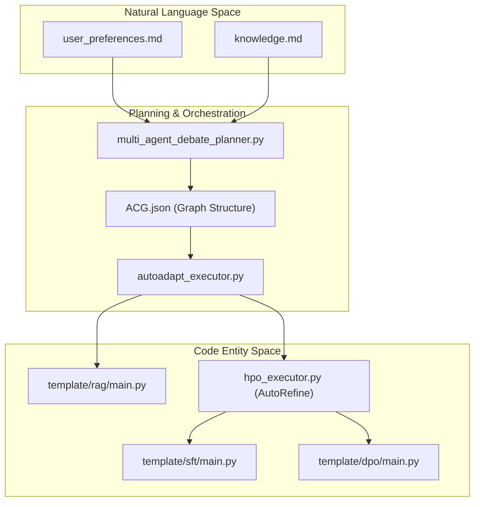
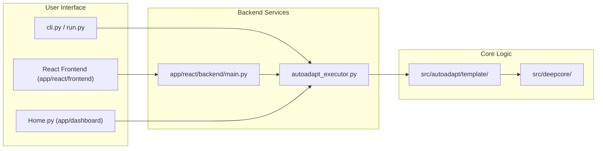

<!-- source: DeepWiki mcp.deepwiki.com · repo microsoft/AutoAdapt · page 1 AutoAdapt Overview · fetched 2026-10-26 -->

# AutoAdapt Overview

Relevant source files

The following files were used as context for generating this wiki page:

- [CODE_OF_CONDUCT.md](CODE_OF_CONDUCT.md)
- [CONTRIBUTING.md](CONTRIBUTING.md)
- [README.md](README.md)
- [SECURITY.md](SECURITY.md)
- [SUPPORT.md](SUPPORT.md)
- [pyproject.toml](pyproject.toml)
- [src/autoadapt/__init__.py](src/autoadapt/__init__.py)
- [src/autoadapt/adapt/__init__.py](src/autoadapt/adapt/__init__.py)

AutoAdapt is an automated end-to-end framework designed for the efficient domain adaptation of Large Language Models (LLMs). It addresses the complexities of manual trial-and-error in LLM fine-tuning by leveraging a multi-agent planning system, curated knowledge bases, and a novel LLM-based hyperparameter optimization (HPO) surrogate called **AutoRefine**.

The system streamlines the transition from general-purpose LLMs to specialized domain experts by automating dataset analysis, strategy selection (SFT, DPO, or RAG), and hyperparameter search under resource constraints.

## Core Value Proposition

*   **Reduced Expert Intervention**: Uses a multi-agent debate system to align user intent with data signals and empirical best practices [README.md:7-7]().
*   **Efficient Optimization**: Replaces costly black-box searches with **AutoRefine**, an LLM-based surrogate that significantly reduces optimization overhead [README.md:7-7]().
*   **Knowledge-Driven Planning**: Integrates curated knowledge bases from literature and open-source resources to inform adaptation strategies [README.md:7-7]().
*   **Data-Centric Pruning**: Incorporates the `deepcore` library for coreset selection, enabling faster HPO trials by training on representative data subsets [README.md:154-154]().

## Key Architectural Pillars

AutoAdapt is built upon four primary functional pillars that govern the lifecycle of an adaptation project.

### 1. Multi-Agent Planning
Before execution, a group of specialized agents (Research, Data, Best Practice, and User Preference) perform a multi-round debate. This process traverses the **Adaptation Configuration Graph (ACG)** to select the most suitable model, method, and hyperparameter bounds.
*   For details, see [Repository Structure and Key Concepts](#1.2).

### 2. AutoRefine (LLM-based HPO)
Instead of standard Bayesian optimization, AutoAdapt uses LLMs as samplers and surrogates within an Optuna-based framework. This allows the system to "reason" about hyperparameter trends based on previous trial results.
*   For details, see [Repository Structure and Key Concepts](#1.2).

### 3. Execution Engine
The `AutoAdaptExecutor` orchestrates the transition from planning to HPO and finally to full-scale training. It manages the environment, handles error recovery via LLM-driven parameter adjustments, and ensures user approval gates are respected [src/autoadapt/adapt/autoadapt_executor.py:1-20]().

### 4. Specialized Templates
AutoAdapt provides standardized execution templates for:
*   **Supervised Fine-Tuning (SFT)**: For instruction following and knowledge injection.
*   **Direct Preference Optimization (DPO)**: For aligning models with human feedback.
*   **Retrieval-Augmented Generation (RAG)**: For grounding models in external dynamic knowledge.

## High-Level System Flow

The following diagram illustrates how the natural language requirements are transformed into executable code entities through the orchestration of the `AutoAdaptExecutor`.

### Adaptation Lifecycle Diagram

**Sources:** [README.md:116-155](), [src/autoadapt/adapt/autoadapt_executor.py:1-20]()

## Navigating the Wiki

This wiki is structured to guide both users and developers through the system:

*   **Setup**: To install the framework and run your first adaptation, see [Getting Started](#1.1).
*   **Architecture**: To understand the file layout and core classes like `AdaptPipeline`, see [Repository Structure and Key Concepts](#1.2).
*   **Advanced Topics**: Subsequent sections cover the Multi-Agent system, the AutoRefine HPO samplers, and the `deepcore` coreset selection logic.

### Entry Points Mapping
AutoAdapt provides multiple interfaces to interact with the core logic, bridging user inputs to the underlying `autoadapt` package.

**Sources:** [README.md:24-93](), [pyproject.toml:15-16](), [README.md:115-160]()

## Next Steps
*   Prepare your environment: [Getting Started](#1.1)
*   Explore the codebase layout: [Repository Structure and Key Concepts](#1.2)

---

