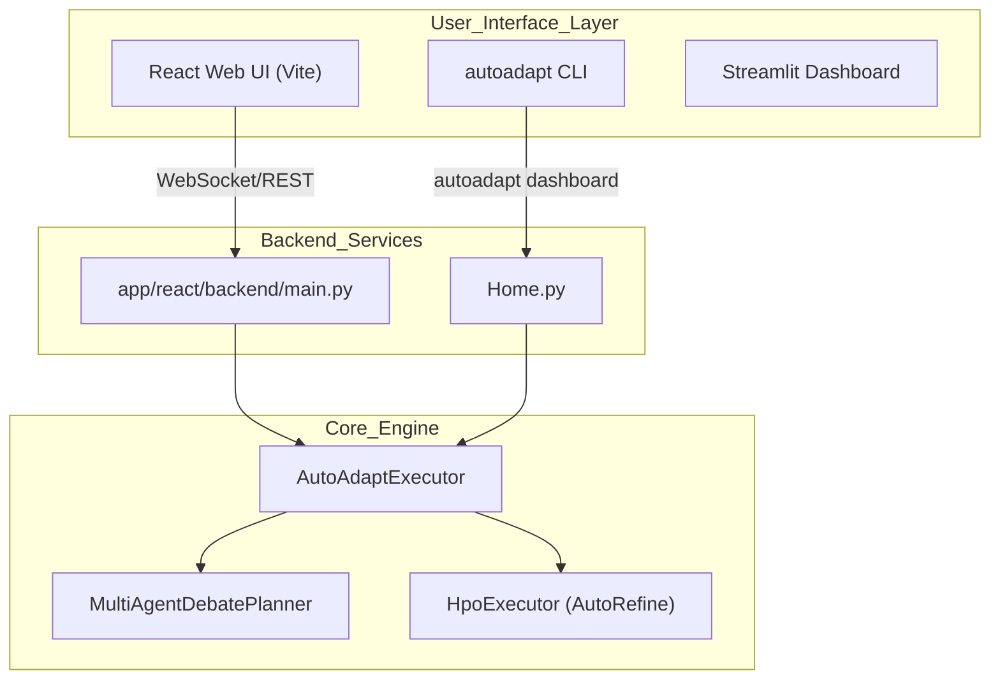
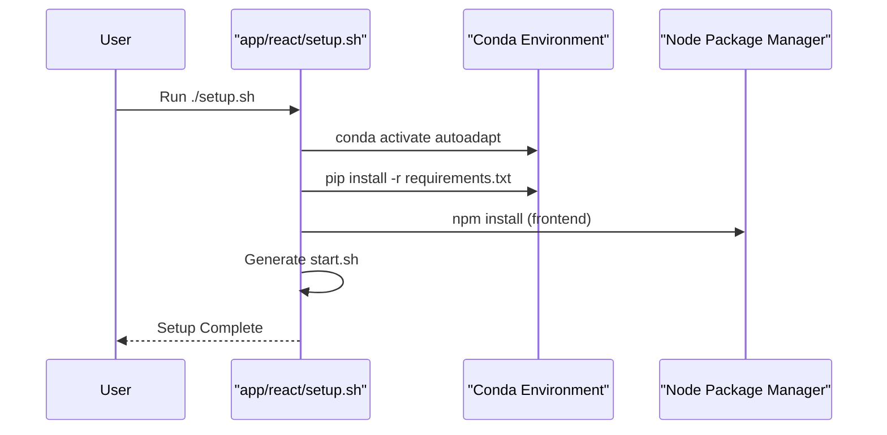

<!-- source: DeepWiki mcp.deepwiki.com · repo microsoft/AutoAdapt · page 1.1 Getting Started · fetched 2026-10-26 -->

# Getting Started

<details>
<summary>Relevant source files</summary>

The following files were used as context for generating this wiki page:

- [MANIFEST.in](MANIFEST.in)
- [app/react/backend/requirements.txt](app/react/backend/requirements.txt)
- [app/react/setup.sh](app/react/setup.sh)
- [app/react/start.sh](app/react/start.sh)
- [pyproject.toml](pyproject.toml)
- [requirements.txt](requirements.txt)
- [src/autoadapt/__init__.py](src/autoadapt/__init__.py)
- [src/autoadapt/adapt/__init__.py](src/autoadapt/adapt/__init__.py)

</details>


This guide provides a step-by-step walkthrough for installing AutoAdapt, configuring the necessary environment variables, and launching the system via its various entry points (CLI, Streamlit, or React UI).

## Installation

AutoAdapt is designed to run in a Python 3.11.4+ environment [pyproject.toml:10-10](). It utilizes a dynamic dependency management system where core requirements are listed in `requirements.txt` and linked via `pyproject.toml` [pyproject.toml:18-19]().

### 1. Environment Setup
It is recommended to use a Conda environment named `autoadapt` as the provided setup scripts specifically look for this name [app/react/setup.sh:25-25]().

```bash
conda create -n autoadapt python=3.11.4
conda activate autoadapt
```

### 2. Install Dependencies
Install the core framework and its dependencies using `pip`:

```bash
pip install -r requirements.txt
pip install -e .
```

The system relies on several high-profile libraries for its core operations [requirements.txt:1-47]():
*   **Orchestration:** `hydra-core`, `pydantic`.
*   **ML/LLM:** `transformers`, `trl`, `peft`, `bitsandbytes`, `vllm`.
*   **Optimization:** `optuna`, `gpytorch`, `cmaes`.
*   **Coreset Selection:** `deepcore`.
*   **RAG/Search:** `chromadb`, `dspy`, `serpapi`, `faiss-cpu`.

Sources: [pyproject.toml:1-19](), [requirements.txt:1-47](), [app/react/setup.sh:23-25]()

---

## Environment Variables

AutoAdapt requires several API keys to facilitate multi-agent planning, web search, and model downloading. These should be set in your shell or a `.env` file.

| Variable | Purpose |
| :--- | :--- |
| `HF_ACCESS_TOKEN` | Required for downloading gated models and datasets from Hugging Face. |
| `API_KEY` | The primary LLM provider key (OpenAI or Azure OpenAI) used by the `ChatCompletionModel`. |
| `SERPAPI_KEY` | Required by the `KnowledgeRetrieverAgent` for live web search via Google/Bing. |

Sources: [requirements.txt:42-43]()

---

## Entry Points

AutoAdapt offers three distinct ways to interact with the framework: the Command Line Interface (CLI), a Streamlit dashboard, and a modern React-based Web UI.

### 1. CLI (autoadapt)
The package registers a console script named `autoadapt` [pyproject.toml:15-16](). This is the primary entry point for headless execution and server management.

```bash
# General help
autoadapt --help

# Launch the Streamlit dashboard
autoadapt dashboard
```

### 2. React Web UI
The React UI provides the most comprehensive visualization of the multi-agent planning process and AutoRefine HPO trials.

#### Automated Setup
The `app/react/setup.sh` script automates the installation of both the FastAPI backend and the Vite-based frontend [app/react/setup.sh:1-60]().

1.  **Backend Setup:** Activates the `autoadapt` conda environment and installs specialized backend requirements like `fastapi` and `uvicorn` [app/react/setup.sh:21-41](), [app/react/backend/requirements.txt:1-8]().
2.  **Frontend Setup:** Runs `npm install` in the frontend directory [app/react/setup.sh:47-57]().
3.  **Start Script:** Generates a `start.sh` file to orchestrate both processes [app/react/setup.sh:61-128]().

#### Running the UI
Execute the generated start script:
```bash
./app/react/start.sh
```
*   **Backend:** http://localhost:5000 (FastAPI) [app/react/start.sh:35-35]()
*   **Frontend:** http://localhost:5173 (Vite/React) [app/react/start.sh:45-45]()

### 3. Streamlit Dashboard
For a lightweight alternative to the React UI, the Streamlit dashboard can be used to monitor project status and launch new instances [requirements.txt:31-31]().

Sources: [pyproject.toml:15-16](), [app/react/setup.sh:1-142](), [app/react/start.sh:1-62](), [app/react/backend/requirements.txt:1-8]()

---

## System Architecture Overview

The following diagram illustrates the data flow from the initial setup and configuration through the different entry points into the core execution engine.

### Data Flow: Entry Points to Core
"This diagram maps the user-facing scripts to the internal execution logic."



Sources: [pyproject.toml:15-16](), [app/react/setup.sh:63-125](), [app/react/backend/requirements.txt:1-2]()

### Environment Initialization
"This diagram describes the setup sequence performed by the installation scripts."



Sources: [app/react/setup.sh:19-60](), [app/react/setup.sh:61-128]()

---

