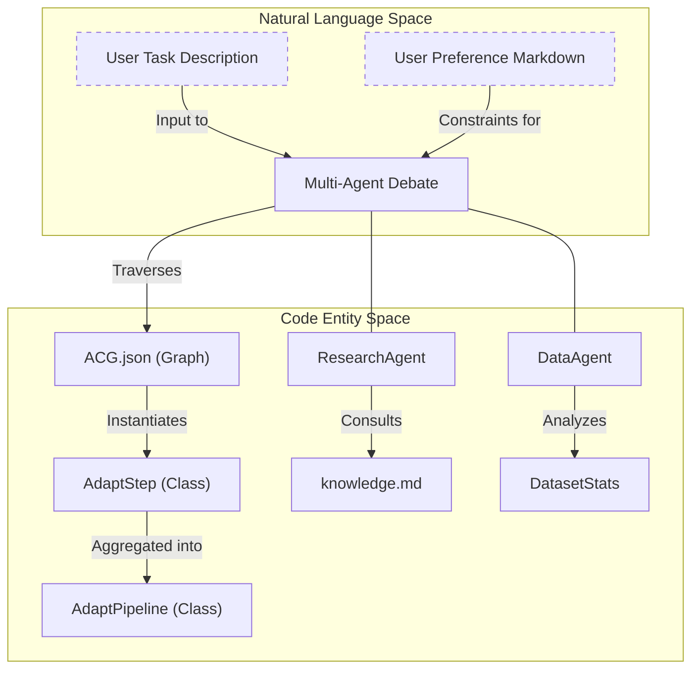
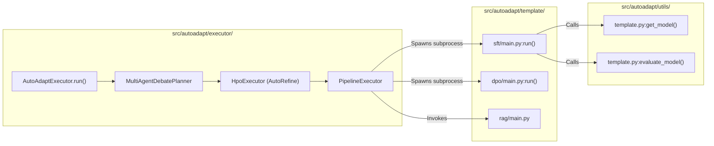

<!-- source: DeepWiki mcp.deepwiki.com · repo microsoft/AutoAdapt · page 1.2 Repository Structure and Key Concepts · fetched 2026-10-26 -->

# Repository Structure and Key Concepts

Relevant source files

The following files were used as context for generating this wiki page:

- [app/react/backend/conf/config_default.yaml](app/react/backend/conf/config_default.yaml)
- [app/sample/conf/config.yaml](app/sample/conf/config.yaml)
- [src/autoadapt/adapt/adapt_pipeline.py](src/autoadapt/adapt/adapt_pipeline.py)
- [src/autoadapt/adapt/adapt_step.py](src/autoadapt/adapt/adapt_step.py)
- [src/autoadapt/adapt/pipeline.py](src/autoadapt/adapt/pipeline.py)
- [src/autoadapt/config/ACG.json](src/autoadapt/config/ACG.json)
- [src/autoadapt/config/knowledge.md](src/autoadapt/config/knowledge.md)
- [src/autoadapt/config/knowledge_hparams.md](src/autoadapt/config/knowledge_hparams.md)
- [src/autoadapt/dashboard/static/config_template.yaml](src/autoadapt/dashboard/static/config_template.yaml)
- [src/autoadapt/template/dpo/main.py](src/autoadapt/template/dpo/main.py)
- [src/autoadapt/template/sft/main.py](src/autoadapt/template/sft/main.py)

This page provides a technical map of the AutoAdapt repository, detailing the directory layout, the execution pipeline, and the core concepts that drive the automated adaptation process.

## Top-Level Directory Layout

The AutoAdapt codebase is organized into three primary pillars: the application layer (`app/`), the core adaptation logic (`src/autoadapt/`), and the data selection engine (`src/deepcore/`).

| Directory | Role | Key Components |
|:---|:---|:---|
| `app/` | User interfaces and project workspaces. | React/FastAPI backend, Streamlit dashboard, and sample project configurations. |
| `src/autoadapt/` | The core execution engine. | Planning agents, HPO executors, and adaptation templates (SFT, DPO, RAG). |
| `src/deepcore/` | Dataset pruning library. | Coreset selection algorithms used to accelerate HPO trials. |

### Directory Detail

*   **`app/react/backend/`**: Contains the FastAPI server that orchestrates project lifecycles, WebSocket communication for real-time logs, and configuration management [app/react/backend/main.py]().
*   **`src/autoadapt/adapt/`**: Defines the fundamental building blocks of an adaptation workflow: `AdaptPipeline` and `AdaptStep` [src/autoadapt/adapt/adapt_pipeline.py:16-17](), [src/autoadapt/adapt/adapt_step.py:17-18]().
*   **`src/autoadapt/executor/`**: Contains the `AutoAdaptExecutor`, which manages the transition between planning, HPO, and final model execution.
*   **`src/autoadapt/template/`**: Provides the entry points (`main.py`) for different adaptation strategies like Supervised Fine-Tuning (SFT), Direct Preference Optimization (DPO), and Retrieval-Augmented Generation (RAG) [src/autoadapt/template/sft/main.py:34-50](), [src/autoadapt/template/dpo/main.py:35-41]().

**Sources:** [app/react/backend/main.py](), [src/autoadapt/adapt/adapt_pipeline.py:16-17](), [src/autoadapt/adapt/adapt_step.py:17-18](), [src/autoadapt/template/sft/main.py:34-50](), [src/autoadapt/template/dpo/main.py:35-41]().

---

## Core Terminology and Entities

### Adaptation Configuration Graph (ACG)
The ACG is a JSON-defined schema (`ACG.json`) that represents the search space of all possible adaptation strategies. It uses node types to guide the multi-agent planner:
*   **`select:1`**: Choose exactly one child (e.g., SFT vs. RAG) [src/autoadapt/config/ACG.json:6-8]().
*   **`parameter`**: A node containing hyperparameters that require optimization (e.g., `learning_rate`, `lora_r`) [src/autoadapt/config/ACG.json:129-131]().
*   **`direct_parameter`**: Fixed configuration settings that do not require HPO [src/autoadapt/config/ACG.json:24-26]().
*   **`executable`**: A terminal node in a branch that triggers a specific training or indexing script [src/autoadapt/config/ACG.json:20]().

### AdaptPipeline and AdaptStep
The system translates a user's task into an `AdaptPipeline`, which is a sequence of `AdaptStep` objects [src/autoadapt/adapt/adapt_pipeline.py:19](). Each step encapsulates a specific configuration and hyperparameter range [src/autoadapt/adapt/adapt_step.py:29-33]().

### AutoRefine (HPO)
AutoRefine refers to the LLM-guided Hyperparameter Optimization process. It uses custom Optuna samplers (like `LLMGPSampler`) to navigate the search space defined in the ACG, aiming to maximize the `hpo_metric` defined in the configuration [app/react/backend/conf/config_default.yaml:148-151]().

### Coreset
During HPO trials, AutoAdapt uses the `deepcore` library to select a representative subset of the training data (a "coreset"). This significantly reduces the time required for each trial while maintaining a signal strong enough for hyperparameter selection [app/react/backend/conf/config_default.yaml:144-146]().

**Sources:** [src/autoadapt/config/ACG.json:6-26](), [src/autoadapt/adapt/adapt_pipeline.py:19](), [src/autoadapt/adapt/adapt_step.py:29-33](), [app/react/backend/conf/config_default.yaml:144-151]().

---

## Data Flow and Architectural Mapping

The following diagrams illustrate how natural language requirements are transformed into executable code entities and how the repository modules interact during execution.

### Concept to Code Mapping: Adaptation Planning
This diagram bridges the gap between the "Natural Language Space" (User Requirements) and the "Code Entity Space" (Agents and Graphs).

**Sources:** [src/autoadapt/config/ACG.json:1-3](), [src/autoadapt/adapt/adapt_pipeline.py:16-19](), [src/autoadapt/adapt/adapt_step.py:17-23](), [src/autoadapt/config/knowledge.md:1-5](), [app/react/backend/conf/config_default.yaml:72-75]().

### Execution Flow: AutoAdaptExecutor Lifecycle
This diagram shows the relationship between the main execution controller and the specialized templates.

**Sources:** [src/autoadapt/template/sft/main.py:34-80](), [src/autoadapt/template/dpo/main.py:35-70](), [src/autoadapt/adapt/adapt_pipeline.py:28-34]().

---

## Adaptation Strategy Templates

AutoAdapt supports three primary adaptation templates, each defined in its own module within `src/autoadapt/template/`.

### 1. Supervised Fine-Tuning (SFT)
*   **Role**: Imitates high-quality reference outputs [src/autoadapt/config/knowledge.md:7-13]().
*   **Implementation**: Uses `trl.SFTTrainer` with support for LoRA and QLoRA [src/autoadapt/template/sft/main.py:18, 142-149]().
*   **Key Logic**: Includes `completion_only_loss` for Question Answering tasks to focus the model on the answer rather than the prompt [src/autoadapt/template/sft/main.py:137]().

### 2. Direct Preference Optimization (DPO)
*   **Role**: Aligns model outputs with human preferences using pairwise data (chosen vs. rejected) [src/autoadapt/config/knowledge.md:15-23]().
*   **Implementation**: Uses `trl.DPOTrainer` [src/autoadapt/template/dpo/main.py:25, 145-153]().
*   **Key Hyperparameter**: Introduces `beta` to control the strength of preference enforcement [src/autoadapt/config/knowledge.md:110-124](), [src/autoadapt/config/knowledge_hparams.md:74-82]().

### 3. Retrieval-Augmented Generation (RAG)
*   **Role**: Augments prompts with external context without changing model weights [src/autoadapt/config/knowledge.md:25-32]().
*   **Implementation**: Utilizes ChromaDB for indexing and vector search [src/autoadapt/config/ACG.json:202-204]().
*   **Key Parameters**: `retriever_top_k` and `embedding_model` [src/autoadapt/config/ACG.json:27-36]().

**Sources:** [src/autoadapt/template/sft/main.py:18-149](), [src/autoadapt/template/dpo/main.py:25-153](), [src/autoadapt/config/knowledge.md:7-32](), [src/autoadapt/config/knowledge_hparams.md:74-82](), [src/autoadapt/config/ACG.json:27-204]().

---

