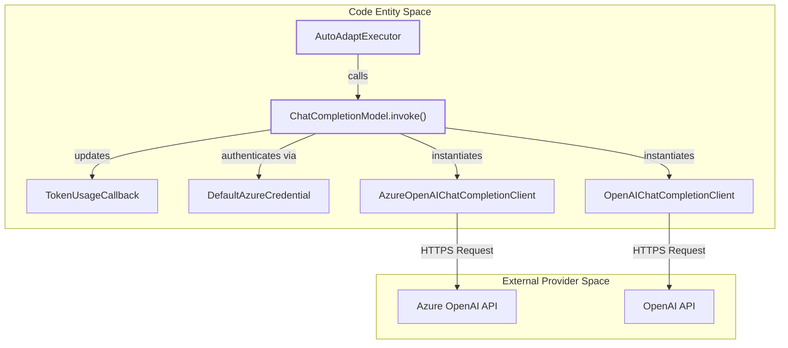
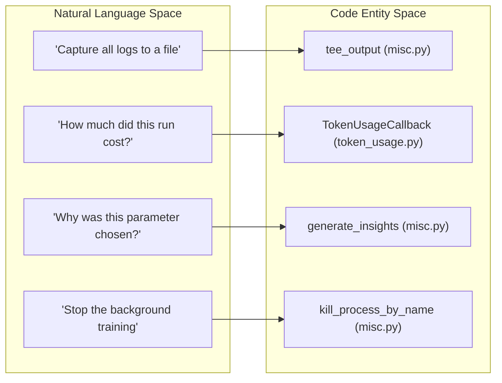

<!-- source: DeepWiki mcp.deepwiki.com · repo microsoft/AutoAdapt · page 10.1 LLM Client and Async Utilities · fetched 2026-10-26 -->

# LLM Client and Async Utilities

Relevant source files

The following files were used as context for generating this wiki page:

- [src/autoadapt/adapt/autoadapt_executor.py](src/autoadapt/adapt/autoadapt_executor.py)
- [src/autoadapt/utils/llm.py](src/autoadapt/utils/llm.py)
- [src/autoadapt/utils/misc.py](src/autoadapt/utils/misc.py)
- [src/autoadapt/utils/token_usage.py](src/autoadapt/utils/token_usage.py)

This section details the infrastructure supporting Large Language Model (LLM) interactions and asynchronous execution within AutoAdapt. It covers the abstraction layer for multi-provider LLM support, managed identity authentication, and utility functions for bridging asynchronous operations into synchronous contexts.

## LLM Client Abstraction

The `ChatCompletionModel` class serves as the primary interface for all LLM interactions in AutoAdapt. It abstracts the underlying implementation details of different providers (OpenAI, Azure OpenAI) and provides a unified `invoke` method for both structured and unstructured completions.

### ChatCompletionModel Implementation
The client is initialized using the global configuration (`DictConfig`) and integrates with a `TokenUsageCallback` to track costs across the system [src/autoadapt/utils/llm.py:43-45]().

Key features include:
*   **Provider Agnosticism**: Supports `OpenAIChatCompletionClient` and `AzureOpenAIChatCompletionClient` via the `autogen` library [src/autoadapt/utils/llm.py:8-10]().
*   **Structured Outputs**: Utilizes Pydantic models (e.g., `PARAMS_PROMPT_ResponseClass`) to enforce JSON schemas on LLM responses [src/autoadapt/utils/llm.py:38-44]().
*   **Managed Identity**: Implements `DefaultAzureCredential` and `get_bearer_token_provider` for secure, keyless authentication when using Azure OpenAI [src/autoadapt/utils/llm.py:21-22, 255-263]().

### LLM Client Data Flow
The following diagram illustrates how a request flows through the `ChatCompletionModel` to the external providers.

**Diagram: LLM Interaction Flow**

Sources: [src/autoadapt/utils/llm.py:43-113](), [src/autoadapt/utils/llm.py:255-270](), [src/autoadapt/adapt/autoadapt_executor.py:43-45]()

## Async Utilities and Thread Bridging

AutoAdapt frequently uses asynchronous LLM calls within synchronous frameworks like Optuna. To resolve this, the system provides a robust bridging mechanism.

### `run_async_in_thread`
This utility allows an `awaitable` to be executed in a dedicated background thread with its own event loop [src/autoadapt/utils/misc.py:115-123](). This is critical for the `LLMSampler` and `LLMGPSampler`, which must perform async LLM reasoning during the synchronous Optuna `sample_relative` step.

Implementation details:
1.  Resets the event loop policy to default to avoid `uvloop` incompatibilities [src/autoadapt/utils/misc.py:132]().
2.  Creates a new `asyncio` event loop specifically for the thread [src/autoadapt/utils/misc.py:133]().
3.  Uses `loop.run_until_complete()` to block the helper thread until the LLM returns [src/autoadapt/utils/misc.py:136]().
4.  Captures results or exceptions in a container to return to the main thread [src/autoadapt/utils/misc.py:145-147]().

Sources: [src/autoadapt/utils/misc.py:115-148]()

## Miscellaneous Utilities

The `misc.py` module contains infrastructure helpers for logging, process management, and status reporting.

### Output Redirection (`tee_output`)
The `tee_output` context manager redirects `stdout`, `stderr`, and logging from various libraries (Transformers, Optuna, logging) to both the console and a specific log file [src/autoadapt/utils/misc.py:165-180](). This ensures that logs generated during HPO trials or training are captured in the project workspace for the UI to stream.

### Process and Status Management
*   **`write_status` / `get_status`**: Simple file-based signaling used to communicate progress between the backend execution engine and the frontend/Streamlit dashboards [src/autoadapt/utils/misc.py:217-230]().
*   **`kill_process_by_name`**: Used during workspace cleanup or when a user cancels a run to ensure no orphaned training processes remain [src/autoadapt/utils/misc.py:233-247]().
*   **`generate_insights`**: An async function that uses the `INSIGHTS_PROMPT_TEMPLATE` to analyze the multi-agent debate and final parameters, producing a human-readable markdown report of why specific configurations were chosen [src/autoadapt/utils/misc.py:35-64]().

### LLM System Entities Mapping
The following diagram maps high-level system requirements to specific code entities in the utilities layer.

**Diagram: Utility Entity Mapping**

Sources: [src/autoadapt/utils/misc.py:165-208](), [src/autoadapt/utils/token_usage.py:5-15](), [src/autoadapt/utils/misc.py:35-42](), [src/autoadapt/utils/misc.py:233-240]()

## Token Usage Tracking

The `TokenUsageCallback` maintains a granular breakdown of consumption [src/autoadapt/utils/token_usage.py:5-15]().

| Metric | Description |
| :--- | :--- |
| `source_usage` | Tracks tokens by the agent or module that initiated the call (e.g., "planner", "insights_generator") [src/autoadapt/utils/token_usage.py:35-39](). |
| `model_usage` | Tracks tokens by specific model name (e.g., "gpt-4o", "o1-mini") [src/autoadapt/utils/token_usage.py:40-41](). |
| `cost_per_token` | Hardcoded dictionary containing price-per-million-tokens for various OpenAI/Azure models [src/autoadapt/utils/token_usage.py:17-25](). |
| `token_usage_report` | Generates a formatted string report including total estimated cost [src/autoadapt/utils/token_usage.py:50-115](). |

Sources: [src/autoadapt/utils/token_usage.py:5-115]()

---

