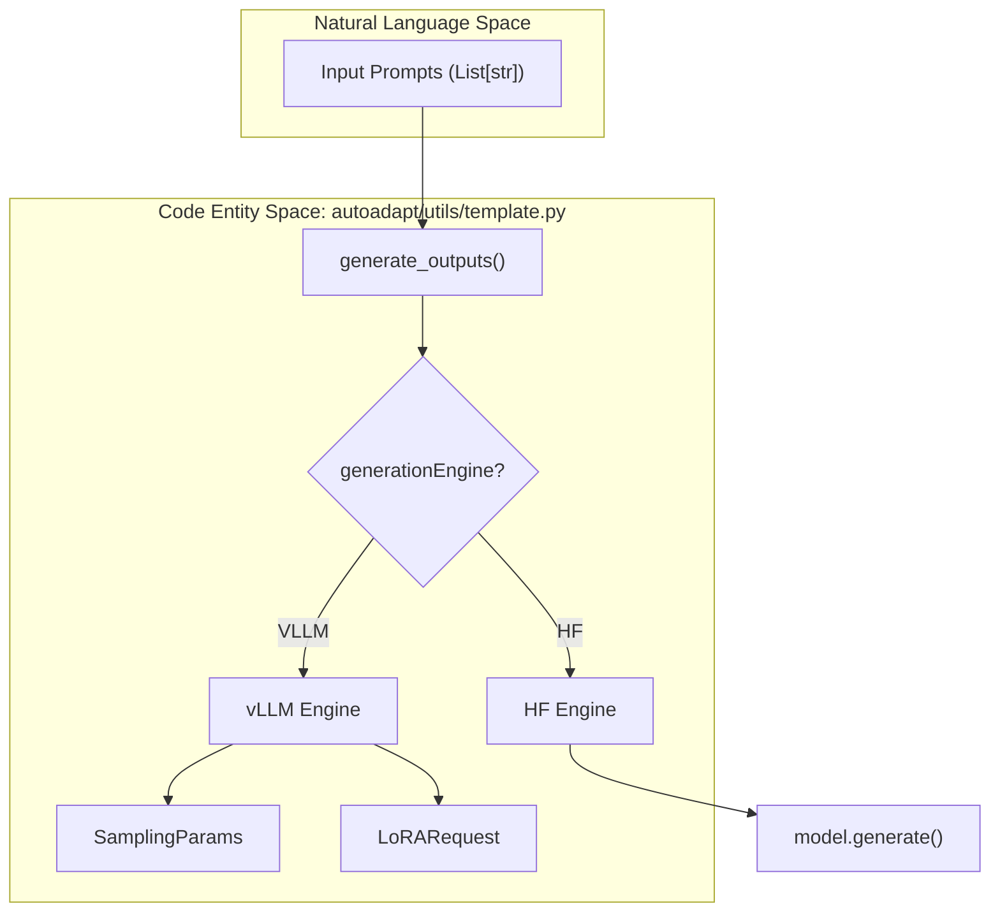
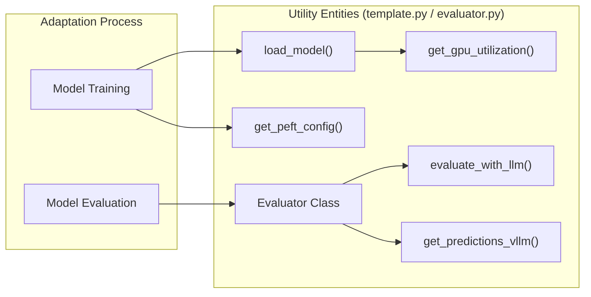

<!-- source: DeepWiki mcp.deepwiki.com · repo microsoft/AutoAdapt · page 10.2 Model Training and Evaluation Utilities · fetched 2026-10-26 -->

# Model Training and Evaluation Utilities

Relevant source files

The following files were used as context for generating this wiki page:

- [src/autoadapt/evaluate/evaluator.py](src/autoadapt/evaluate/evaluator.py)
- [src/autoadapt/utils/log.py](src/autoadapt/utils/log.py)
- [src/autoadapt/utils/template.py](src/autoadapt/utils/template.py)

The **Model Training and Evaluation Utilities** provide the foundational infrastructure for model lifecycle management within AutoAdapt. This module handles the complexities of heterogeneous execution engines (HuggingFace Transformers vs. vLLM), GPU memory management via NVML, Parameter-Efficient Fine-Tuning (PEFT) configurations, and robust dataset ingestion. Additionally, it provides the `Evaluator` class and "LLM-as-a-judge" patterns to quantify model performance.

### Model Loading and Resource Management

AutoAdapt uses a unified interface to load models while dynamically managing GPU resources. The system supports two primary backends: **HuggingFace (HF)** for training and standard inference, and **vLLM** for high-throughput generation.

#### GPU Memory Management
Before loading a model via vLLM, the system uses `pynvml` to query real-time GPU utilization [src/autoadapt/utils/template.py:49-74](). It calculates the available memory and sets the `gpu_memory_utilization` parameter for the vLLM engine, typically reserving a 10% buffer [src/autoadapt/utils/template.py:150-156]().

#### Model Loading Logic
The `load_model` function acts as a factory for model and tokenizer instances [src/autoadapt/utils/template.py:130-148]().
*   **vLLM Path**: Initializes the `LLM` class with support for tensor parallelism across available GPUs and LoRA request handling [src/autoadapt/utils/template.py:149-169]().
*   **HF Path**: Uses `AutoModelForCausalLM` with `device_map="auto"` and `torch_dtype=torch.bfloat16` [src/autoadapt/utils/template.py:170-175]().

### PEFT Configuration
The `get_peft_config` function translates configuration parameters into specific PEFT objects [src/autoadapt/utils/template.py:231-255]():
*   **LoRA**: Returns a `LoraConfig` specifying rank (`r`), `lora_alpha`, `target_modules`, and `dropout` [src/autoadapt/utils/template.py:236-246]().
*   **Prefix Tuning**: Returns a `PrefixTuningConfig` with a specified number of virtual tokens [src/autoadapt/utils/template.py:247-251]().

### Data Ingestion and Splitting
The `load_user_data` function handles multi-format ingestion (JSON, JSONL, CSV) and prepares datasets for the training pipeline [src/autoadapt/utils/template.py:332-355]().

| Feature | Implementation Detail |
| :--- | :--- |
| **Formats** | Supports `.json`, `.jsonl`, and `.csv` [src/autoadapt/utils/template.py:341-352]() |
| **Splitting** | Uses `train_test_split` to create `train`, `test`, and `validation` subsets [src/autoadapt/utils/template.py:359-368]() |
| **Tokenization** | Provides `tokenize_function` to map input/response columns to model-specific tensors [src/autoadapt/utils/template.py:375-394]() |

### Generation and Inference Engines

AutoAdapt abstracts generation through `generate_outputs`, which routes requests to either the HF `.generate()` method or the vLLM engine [src/autoadapt/utils/template.py:75-129]().

#### Model Inference Flow
The following diagram illustrates how the `generate_outputs` utility interacts with different model backends.

**Model Generation Flow**

Sources: [src/autoadapt/utils/template.py:75-129]()

### Evaluation Framework

The evaluation subsystem supports standard NLP metrics and advanced LLM-based judging.

#### The Evaluator Class
The `Evaluator` class manages the end-to-end evaluation lifecycle [src/autoadapt/evaluate/evaluator.py:27-34]().
1.  **Model Preparation**: `_get_model_for_evaluation` loads the model, applying 4-bit/8-bit quantization or LoRA adapters as specified in the `AdaptStep` [src/autoadapt/evaluate/evaluator.py:140-185]().
2.  **Prediction**: `_get_predictions` uses a `DataLoader` to batch inputs and generate responses [src/autoadapt/evaluate/evaluator.py:97-128]().
3.  **Metric Computation**: `evaluate_with_metric` (via `hpo_evaluate`) leverages the HuggingFace `evaluate` library to compute scores [src/autoadapt/evaluate/evaluator.py:63-96]().

#### LLM-as-Judge Pattern
When standard metrics are insufficient, `evaluate_with_llm` uses a high-capacity model (e.g., GPT-4) to grade responses [src/autoadapt/utils/template.py:465-492]().
*   **Prompting**: Uses `LLM_EVALUATION_PROMPT` to provide context and grading criteria [src/autoadapt/utils/template.py:476-480]().
*   **Structured Output**: Utilizes `LLM_EVALUATION_PROMPT_ResponseClass` to ensure the judge returns a parseable score and rationale [src/autoadapt/utils/template.py:481-483]().

### System Architecture: Training to Evaluation

The diagram below bridges the high-level adaptation concepts to the specific utility functions and classes that execute them.

**Training and Evaluation Entity Map**

Sources: [src/autoadapt/utils/template.py:130-148](), [src/autoadapt/utils/template.py:231-255](), [src/autoadapt/evaluate/evaluator.py:27-34](), [src/autoadapt/utils/template.py:465-492]()

### Summary of Key Functions

| Function/Class | File Path | Purpose |
| :--- | :--- | :--- |
| `get_gpu_utilization` | [src/autoadapt/utils/template.py:49]() | Returns GPU memory usage ratios using NVML. |
| `load_model` | [src/autoadapt/utils/template.py:130]() | Loads HF or vLLM models with memory optimization. |
| `get_peft_config` | [src/autoadapt/utils/template.py:231]() | Generates LoRA or Prefix Tuning configurations. |
| `load_user_data` | [src/autoadapt/utils/template.py:332]() | Ingests raw data and performs train/val/test splits. |
| `Evaluator` | [src/autoadapt/evaluate/evaluator.py:27]() | Orchestrates the evaluation of an `AdaptStep`. |
| `evaluate_with_llm` | [src/autoadapt/utils/template.py:465]() | Implements LLM-as-judge scoring logic. |

Sources: [src/autoadapt/utils/template.py:1-500](), [src/autoadapt/evaluate/evaluator.py:1-200]()

---

