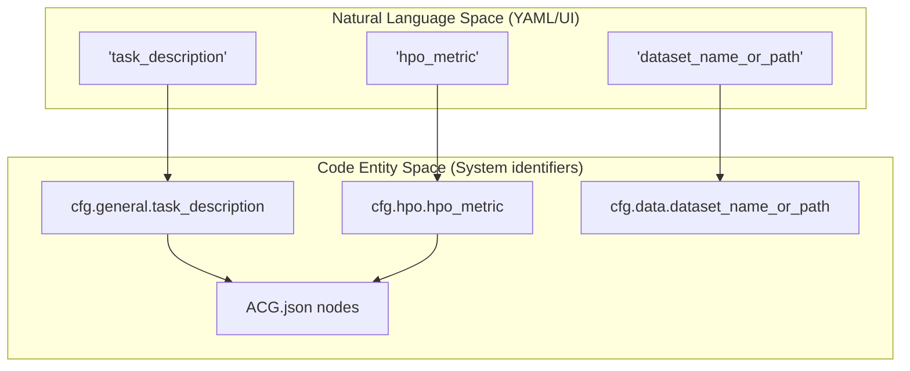
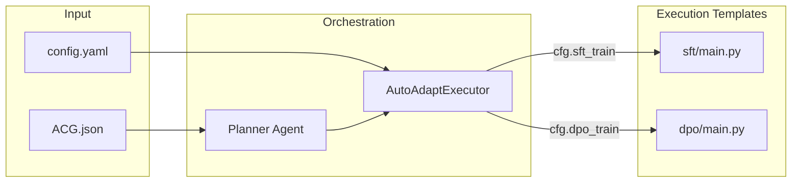

<!-- source: DeepWiki mcp.deepwiki.com · repo microsoft/AutoAdapt · page 2 Configuration System · fetched 2026-10-26 -->

# Configuration System

Relevant source files

The following files were used as context for generating this wiki page:

- [app/react/backend/conf/config_default.yaml](app/react/backend/conf/config_default.yaml)
- [app/sample/conf/config.yaml](app/sample/conf/config.yaml)
- [src/autoadapt/config/ACG.json](src/autoadapt/config/ACG.json)
- [src/autoadapt/dashboard/static/config_template.yaml](src/autoadapt/dashboard/static/config_template.yaml)
- [src/autoadapt/template/dpo/main.py](src/autoadapt/template/dpo/main.py)
- [src/autoadapt/template/sft/main.py](src/autoadapt/template/sft/main.py)

The AutoAdapt configuration system provides a structured, hierarchical approach to managing the complex parameters required for LLM adaptation. It bridges high-level user requirements (defined in YAML) with machine-executable adaptation strategies (defined in the Adaptation Configuration Graph). This system ensures that every phase of the pipeline—from multi-agent planning to hyperparameter optimization (HPO) and final execution—operates on a consistent, validated state.

### Configuration Workflow

The system follows a transformation path from human-readable files to a dynamic graph structure used by the execution engine:

1.  **YAML Definition**: Users provide task descriptions, dataset paths, and API credentials in a `config.yaml` file [app/sample/conf/config.yaml:16-114]().
2.  **ACG Loading**: The system loads the `ACG.json` file, which defines the "legal" search space of adaptation strategies (SFT, DPO, RAG) [src/autoadapt/config/ACG.json:1-8]().
3.  **Graph Instantiation**: The `AutoAdaptExecutor` uses the configuration to navigate the ACG, resolving selection nodes and parameter values during the Planning phase.
4.  **Final Pipeline**: The result is a fully specified `AdaptPipeline` that maps configuration keys to specific execution templates (e.g., `sft/main.py`) [src/autoadapt/template/sft/main.py:34-50]().

### Configuration Components to Code Mapping

The following diagram illustrates how configuration concepts in the Natural Language/YAML space map to specific identifiers and structures within the codebase.

**Configuration Entity Mapping**

**Sources:** [app/react/backend/conf/config_default.yaml:23-150](), [src/autoadapt/config/ACG.json:5-112]()

---

## YAML Configuration Schema

The primary interface for users is the YAML configuration system, powered by **OmegaConf** and **Hydra**. It is divided into several logical sections that control different aspects of the environment and the adaptation process.

*   **General & Agent**: Defines project paths, workspace locations, and the path to the model/dataset knowledge bases [app/react/backend/conf/config_default.yaml:16-59]().
*   **Data**: Specifies dataset formats (`json`, `csv`, `parquet`), column mappings for prompts/responses, and split ratios for training/validation/testing [app/react/backend/conf/config_default.yaml:60-103]().
*   **LLM**: Configures the backbone models used for planning and evaluation (Azure OpenAI or OpenAI), including API keys and deployment names [app/react/backend/conf/config_default.yaml:105-129]().
*   **HPO & Evaluation**: Controls the AutoRefine process, including the number of trials, the specific sampler (e.g., `llm_gp`), and the metrics used to judge model performance [app/react/backend/conf/config_default.yaml:137-179]().
*   **RAG Data**: Dedicated section for Retrieval-Augmented Generation, defining document paths and vector database settings [app/react/backend/conf/config_default.yaml:180-204]().

For a detailed field-by-field reference, see [YAML Configuration Schema](#2.1).

**Sources:** [app/react/backend/conf/config_default.yaml:1-207](), [app/sample/conf/config.yaml:1-196]()

---

## Adaptation Configuration Graph (ACG)

The **Adaptation Configuration Graph (ACG)** is a JSON-based schema that defines the "rules of the game" for the AutoAdapt agents. While YAML defines *what* the user wants, the ACG defines *how* the system is allowed to achieve it.

### Node Types in ACG.json
The ACG consists of a tree of nodes, starting from the `adapt` root [src/autoadapt/config/ACG.json:2-5]().

| Node Type | Description | Example from Code |
| :--- | :--- | :--- |
| `select:1` | Choose exactly one child node. | `adapt` (choose SFT, RAG, or DPO) [src/autoadapt/config/ACG.json:6-8]() |
| `select:any` | Choose any number of child nodes. | `sft` (includes `peft` and `sft_train`) [src/autoadapt/config/ACG.json:113-115]() |
| `parameter` | Defines a set of hyperparameters to be tuned. | `lora` (r, alpha, dropout) [src/autoadapt/config/ACG.json:128-162]() |
| `direct_parameter` | Parameters passed directly without HPO. | `rag_params` [src/autoadapt/config/ACG.json:23-43]() |

### Strategy Branching
The ACG defines three main branches for adaptation:
1.  **SFT (Supervised Fine-Tuning)**: Focuses on `peft` (LoRA/Prefix Tuning) and standard training args [src/autoadapt/config/ACG.json:112-120]().
2.  **DPO (Direct Preference Optimization)**: Includes parameters for preference-based alignment like `beta` [src/autoadapt/config/ACG.json:45-110]().
3.  **RAG (Retrieval-Augmented Generation)**: Configures retrievers and embedding models [src/autoadapt/config/ACG.json:13-43]().

For details on how the graph is traversed and modified, see [Adaptation Configuration Graph (ACG)](#2.2).

**Sources:** [src/autoadapt/config/ACG.json:1-194]()

---

## Configuration to Execution Bridge

The configuration system bridges the gap between static definitions and the dynamic execution of training scripts. The `AutoAdaptExecutor` takes the merged configuration and the ACG to produce a runtime configuration that the `main.py` templates consume.

**Config-to-Template Execution Flow**

**Sources:** [src/autoadapt/template/sft/main.py:34-40](), [src/autoadapt/template/dpo/main.py:35-41](), [app/react/backend/conf/config_default.yaml:130-136]()

### Key Code Entities
*   **`DictConfig`**: The Hydra/OmegaConf object used throughout the `run()` functions in templates to access parameters (e.g., `cfg.sft_train.learning_rate`) [src/autoadapt/template/sft/main.py:34-131]().
*   **`hpo_runtime` flag**: A special configuration key that tells the execution template to return metrics to the HPO sampler instead of performing a full test-set evaluation [src/autoadapt/template/sft/main.py:88-111]().

**Sources:** [src/autoadapt/template/sft/main.py:34-182](), [src/autoadapt/template/dpo/main.py:35-186]()

---

