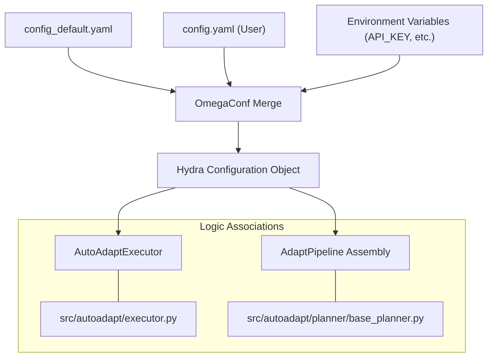
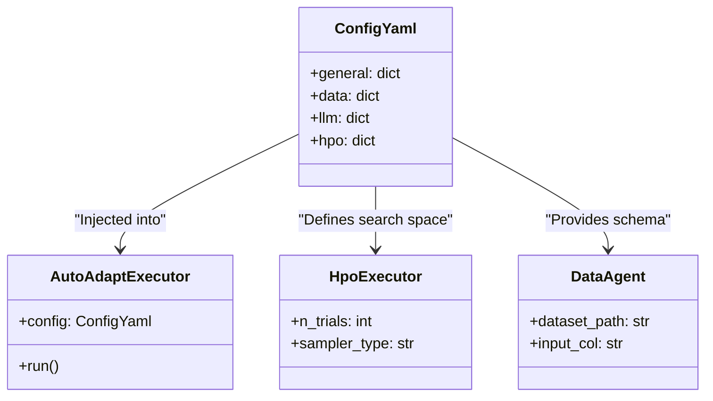

<!-- source: DeepWiki mcp.deepwiki.com · repo microsoft/AutoAdapt · page 2.1 YAML Configuration Schema · fetched 2026-10-26 -->

# YAML Configuration Schema

Relevant source files

The following files were used as context for generating this wiki page:

- [app/react/backend/conf/config_default.yaml](app/react/backend/conf/config_default.yaml)
- [app/sample/conf/config.yaml](app/sample/conf/config.yaml)
- [app/sample/conf/user_preference.md](app/sample/conf/user_preference.md)
- [src/autoadapt/dashboard/static/config_template.yaml](src/autoadapt/dashboard/static/config_template.yaml)
- [src/autoadapt/template/dpo/conf/config.yaml](src/autoadapt/template/dpo/conf/config.yaml)
- [src/autoadapt/template/rag/conf/config.yaml](src/autoadapt/template/rag/conf/config.yaml)
- [src/autoadapt/template/sft/conf/config.yaml](src/autoadapt/template/sft/conf/config.yaml)

AutoAdapt utilizes a hierarchical YAML-based configuration system powered by **OmegaConf** and **Hydra**. This schema defines the operational parameters for the entire adaptation lifecycle, including multi-agent planning, hyperparameter optimization (HPO), and template-specific execution (SFT, DPO, RAG).

## Configuration Architecture and Merging

The system relies on three primary YAML files to manage settings across different stages of the pipeline:

1.  **`config_default.yaml`**: The master template located in the backend configuration directory [app/react/backend/conf/config_default.yaml:1-207](). It contains all possible fields and their default values.
2.  **`config.yaml`**: The instance-specific configuration located in the user's project directory [app/sample/conf/config.yaml:1-197](). This file overrides defaults for specific tasks.
3.  **`config_template.yaml`**: A simplified template used by the dashboard and CLI to initialize new projects [src/autoadapt/dashboard/static/config_template.yaml:1-129]().

### Configuration Loading Flow

AutoAdapt uses OmegaConf's variable interpolation (e.g., `${general.project_path}`) and environment variable resolution (e.g., `${oc.env:API_KEY,}`) to create a dynamic configuration object.

**Sources:** [app/react/backend/conf/config_default.yaml:50-51](), [app/sample/conf/config.yaml:114-114]()

---

## Detailed Field Reference

### 1. General Section
Defines the project structure and hardware requirements.

| Field | Description | Source |
| :--- | :--- | :--- |
| `project_path` | Absolute path to the local AutoAdapt project. | [app/react/backend/conf/config_default.yaml:19]() |
| `workspace_path` | Directory for intermediate adaptation files. | [app/react/backend/conf/config_default.yaml:29]() |
| `task_description` | Natural language description of the target task. | [app/react/backend/conf/config_default.yaml:23]() |
| `domain` | Domain identifier (e.g., 'math', 'healthcare'). | [app/react/backend/conf/config_default.yaml:26]() |
| `use_gpu` | Boolean flag to enable CUDA acceleration. | [app/react/backend/conf/config_default.yaml:48]() |

### 2. Data Section
Configures dataset ingestion and splitting logic for the `DatasetStats` and `DataAgent`.

| Field | Description | Source |
| :--- | :--- | :--- |
| `dataset_name_or_path` | Path to training data or HuggingFace dataset ID. | [app/react/backend/conf/config_default.yaml:62]() |
| `dataset_format` | Supports `json`, `csv`, `parquet`, `hf_dataset`. | [app/react/backend/conf/config_default.yaml:69]() |
| `input_column` | The column name containing the prompt/question. | [app/react/backend/conf/config_default.yaml:90]() |
| `response_column` | The column name containing the ground truth. | [app/react/backend/conf/config_default.yaml:93]() |
| `test_ratio` | Percentage of data reserved for the test split. | [app/react/backend/conf/config_default.yaml:84]() |

### 3. LLM Section
Parameters for the agents and evaluators to communicate with model APIs.

| Field | Description | Source |
| :--- | :--- | :--- |
| `api_type` | Either `azure` or `openai`. | [app/react/backend/conf/config_default.yaml:106]() |
| `deployment_name` | The specific model deployment (e.g., `gpt-4o`). | [app/react/backend/conf/config_default.yaml:121]() |
| `reasoning_model` | Model used for complex debate rounds (e.g., `o1`). | [app/react/backend/conf/config_default.yaml:126]() |
| `api_key` | Resolved via `${oc.env:API_KEY,}`. | [app/react/backend/conf/config_default.yaml:119]() |

### 4. HPO Section (AutoRefine)
Controls the `HpoExecutor` and the custom Optuna samplers.

| Field | Description | Source |
| :--- | :--- | :--- |
| `n_trials` | Number of HPO iterations to perform. | [app/react/backend/conf/config_default.yaml:139]() |
| `sampler` | Selection of sampler: `llm_gp`, `llm`, or `auto`. | [app/react/backend/conf/config_default.yaml:155]() |
| `coreset_train_ratio` | Fraction of data used during HPO trials to save time. | [app/react/backend/conf/config_default.yaml:145]() |
| `hpo_metric` | Metric to maximize (e.g., `trained_model_accuracy`). | [app/react/backend/conf/config_default.yaml:150]() |

### 5. Evaluation Section
Configures how the adapted model is validated against the test set.

| Field | Description | Source |
| :--- | :--- | :--- |
| `use_llm` | Enables LLM-as-a-judge for qualitative evaluation. | [app/react/backend/conf/config_default.yaml:174]() |
| `eval_func` | Reference to the function in `src/autoadapt/utils/template.py`. | [app/react/backend/conf/config_default.yaml:166]() |
| `llm_eval_system_prompt` | The prompt used by the LLM judge to verify answers. | [app/sample/conf/config.yaml:174]() |

---

## Template-Specific Configurations

When the `AutoAdaptExecutor` selects a strategy (SFT, DPO, or RAG), it utilizes specialized configuration blocks within the template directories.

### SFT & DPO Training
Located in `src/autoadapt/template/sft/conf/config.yaml` and `src/autoadapt/template/dpo/conf/config.yaml`. These include:
*   **`lora`**: `lora_r`, `lora_alpha`, and `quantization_type` (int4/int8) [src/autoadapt/template/sft/conf/config.yaml:33-40]().
*   **`sft_train` / `dpo_train`**: `learning_rate`, `num_train_epochs`, and `gradient_accumulation_steps` [src/autoadapt/template/sft/conf/config.yaml:21-31]().

### RAG (Retrieval-Augmented Generation)
Located in `src/autoadapt/template/rag/conf/config.yaml`.
*   **`rag_data`**: Configures the `chroma_db_path` and `documents_column` for indexing [src/autoadapt/template/rag/conf/config.yaml:8-31]().
*   **`rag_params`**: Defines `retriever_top_k` and the `embedding_model` [src/autoadapt/template/rag/conf/config.yaml:33-37]().

---

## Code Entity Association

The YAML configuration is transformed into internal objects that drive specific classes.

**Sources:**
*   `general` / `data` / `llm` / `hpo` schemas: [app/react/backend/conf/config_default.yaml:16-162]()
*   `rag_data` schema: [app/react/backend/conf/config_default.yaml:180-204]()
*   Template overrides: [src/autoadapt/template/sft/conf/config.yaml:1-83](), [src/autoadapt/template/dpo/conf/config.yaml:1-84](), [src/autoadapt/template/rag/conf/config.yaml:1-63]()

---

