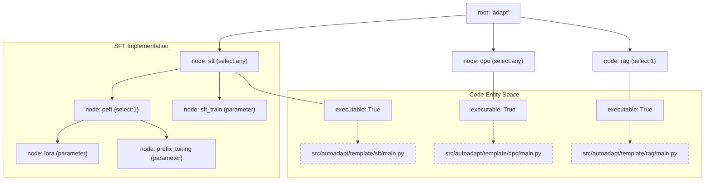
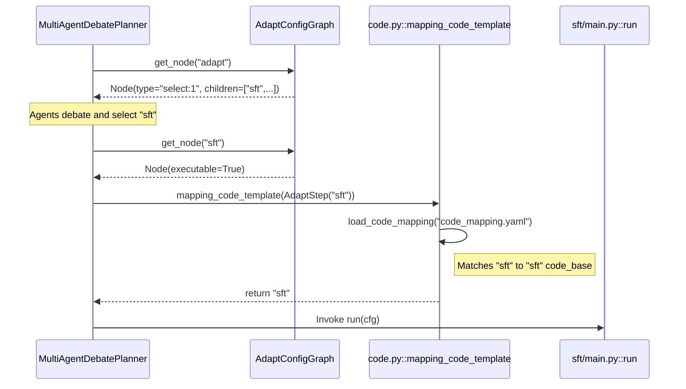

<!-- source: DeepWiki mcp.deepwiki.com · repo microsoft/AutoAdapt · page 2.2 Adaptation Configuration Graph (ACG) · fetched 2026-10-26 -->

# Adaptation Configuration Graph (ACG)

Relevant source files

The following files were used as context for generating this wiki page:

- [src/autoadapt/config/ACG.json](src/autoadapt/config/ACG.json)
- [src/autoadapt/config/code_mapping.yaml](src/autoadapt/config/code_mapping.yaml)
- [src/autoadapt/plan/adapt_config_graph.py](src/autoadapt/plan/adapt_config_graph.py)
- [src/autoadapt/template/dpo/main.py](src/autoadapt/template/dpo/main.py)
- [src/autoadapt/template/sft/main.py](src/autoadapt/template/sft/main.py)
- [src/autoadapt/utils/code.py](src/autoadapt/utils/code.py)

The **Adaptation Configuration Graph (ACG)** is the foundational structural representation of all possible adaptation strategies within AutoAdapt. It defines a hierarchical decision space that the planning agents traverse to assemble a concrete execution pipeline. The ACG separates the high-level strategy selection (e.g., SFT vs. RAG) from the low-level parameterization (e.g., LoRA rank or learning rate).

## Graph Structure and Node Types

The ACG is defined as a directed graph in a JSON format [src/autoadapt/config/ACG.json:1-3](). It is managed by the `AdaptConfigGraph` class, which parses the JSON and instantiates `AdaptConfigNode` objects [src/autoadapt/plan/adapt_config_graph.py:39-42]().

### Node Class Definition
Each node in the graph is represented by the `AdaptConfigNode` class [src/autoadapt/plan/adapt_config_graph.py:14-36]().
- **`name`**: Unique identifier for the node (e.g., `sft`, `lora`).
- **`type`**: Determines how the planner interacts with the node (see below).
- **`description`**: Natural language context used by LLM agents during the planning phase.
- **`children`**: List of potential child nodes in the hierarchy.
- **`parameters`**: A dictionary of hyperparameters associated with the node, including defaults and types.
- **`executable`**: A boolean flag indicating if this node represents a terminal adaptation strategy that can be mapped to code [src/autoadapt/plan/adapt_config_graph.py:68-68]().

### Node Type Taxonomy
The system utilizes four primary node types to control the planning flow [src/autoadapt/config/ACG.json:6-129]():

| Node Type | Behavior | Example |
| :--- | :--- | :--- |
| `select:1` | Exclusive choice; exactly one child must be selected. | `adapt` (SFT vs. RAG vs. DPO) |
| `select:any` | Multi-choice; zero or more children can be selected based on constraints. | `sft` (can select `peft` and `sft_train`) |
| `parameter` | Contains a set of hyperparameters that require optimization or setting. | `lora` (r, alpha, dropout) |
| `direct_parameter` | Similar to parameter, but typically implies fixed or restricted options. | `rag_params` |

**Sources:** [src/autoadapt/plan/adapt_config_graph.py:14-36](), [src/autoadapt/config/ACG.json:1-129]()

---

## Strategy Branches: SFT, DPO, and RAG

The ACG defines three main branches originating from the `adapt` root node [src/autoadapt/config/ACG.json:2-8]().

### 1. Supervised Fine-Tuning (SFT)
The SFT branch is designed for domain-specific model training. It allows for the selection of Parameter-Efficient Fine-Tuning (PEFT) methods.
- **Path**: `adapt` -> `sft` -> [`peft`, `sft_train`] [src/autoadapt/config/ACG.json:112-115]().
- **PEFT Options**: Includes `lora` and `prefix_tuning` [src/autoadapt/config/ACG.json:122-126]().

### 2. Direct Preference Optimization (DPO)
Used for aligning models with human preferences using triplet data (prompt, chosen, rejected).
- **Path**: `adapt` -> `dpo` -> [`dpo_train`, `peft`] [src/autoadapt/config/ACG.json:45-48]().

### 3. Retrieval-Augmented Generation (RAG)
Enhances generation by retrieving context from external sources. Unlike SFT/DPO, it is often treated as a `direct_parameter` set because it focuses on retrieval logic rather than weight updates.
- **Path**: `adapt` -> `rag` -> `rag_params` [src/autoadapt/config/ACG.json:13-16]().

### ACG Visual Representation
The following diagram illustrates the relationship between the ACG structure and the underlying code implementation classes.

**Sources:** [src/autoadapt/config/ACG.json:1-194](), [src/autoadapt/plan/adapt_config_graph.py:14-36]()

---

## Dynamic Modification and Resolution

The backend dynamically interacts with the ACG during the planning phase. The `AdaptConfigGraph` can load a custom ACG path if specified in the general configuration [src/autoadapt/plan/adapt_config_graph.py:43-46]().

### Code Mapping Logic
Once the planner traverses the ACG and selects a path (e.g., `sft` + `lora`), the system must resolve which code template to execute. This is handled by `mapping_code_template` [src/autoadapt/utils/code.py:60-69]().

1. **Key Generation**: A key is created by joining the step name and its configuration keys (e.g., `"sft,lora"`) [src/autoadapt/utils/code.py:64-64]().
2. **Lookup**: The system looks up this key in `code_mapping.yaml` [src/autoadapt/config/code_mapping.yaml:17-35]().
3. **Fallback**: If an exact match is not found, `get_fallback_keys` generates simpler versions (e.g., falling back from `sft,lora` to `sft`) [src/autoadapt/utils/code.py:37-57]().

### Data Flow: Graph to Execution
The following diagram shows how a path in the ACG is transformed into a running Python process.

**Sources:** [src/autoadapt/utils/code.py:60-69](), [src/autoadapt/config/code_mapping.yaml:17-35](), [src/autoadapt/plan/adapt_config_graph.py:83-85]()

---

## Implementation Details

### Configuration Parameters
Parameters defined in `ACG.json` include metadata that drives both the UI and the HPO (Hyperparameter Optimization) engine:
- **Default Values**: Used if the planner or user does not specify a value [src/autoadapt/config/ACG.json:29]().
- **Types**: `integer`, `float`, `string`, `boolean` [src/autoadapt/config/ACG.json:30-35]().
- **Descriptions**: Injected into LLM prompts to explain the impact of a parameter [src/autoadapt/config/ACG.json:28]().

### Constraints
Nodes can include constraints such as `required_children` to ensure the resulting pipeline is valid. For example, the `dpo` node requires the `dpo_train` child to be present [src/autoadapt/config/ACG.json:49-51]().

**Sources:** [src/autoadapt/config/ACG.json:1-194](), [src/autoadapt/plan/adapt_config_graph.py:14-36](), [src/autoadapt/utils/code.py:11-34]()

---

