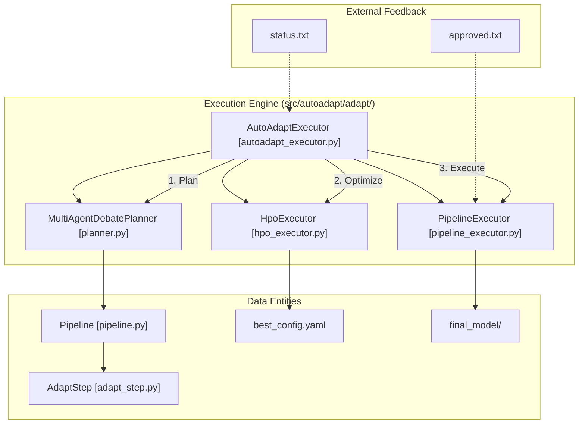

<!-- source: DeepWiki mcp.deepwiki.com · repo microsoft/AutoAdapt · page 3 Core Execution Engine · fetched 2026-10-26 -->

# Core Execution Engine

Relevant source files

The following files were used as context for generating this wiki page:

- [src/autoadapt/adapt/adapt_pipeline.py](src/autoadapt/adapt/adapt_pipeline.py)
- [src/autoadapt/adapt/adapt_step.py](src/autoadapt/adapt/adapt_step.py)
- [src/autoadapt/adapt/autoadapt_executor.py](src/autoadapt/adapt/autoadapt_executor.py)
- [src/autoadapt/adapt/pipeline.py](src/autoadapt/adapt/pipeline.py)
- [src/autoadapt/utils/misc.py](src/autoadapt/utils/misc.py)

The **Core Execution Engine** is the central nervous system of AutoAdapt. It orchestrates the transition from high-level user requirements to a concrete, optimized adaptation pipeline. The engine manages a multi-stage lifecycle including dataset analysis, agentic planning, hyperparameter optimization (HPO), and final execution with error recovery.

The primary entry point for this lifecycle is the `AutoAdaptExecutor` [src/autoadapt/adapt/autoadapt_executor.py:32-32](), which coordinates specialized sub-executors for each phase.

## Execution Lifecycle Overview

The execution lifecycle follows a sequential flow managed by the `run()` method of `AutoAdaptExecutor` [src/autoadapt/adapt/autoadapt_executor.py:236-236](). This process transforms an abstract Adaptation Configuration Graph (ACG) into a serialized `Pipeline` [src/autoadapt/adapt/pipeline.py:15-15]() consisting of discrete `AdaptStep` objects [src/autoadapt/adapt/adapt_step.py:17-17]().

### High-Level Execution Flow
The following diagram illustrates the relationship between the execution engine components and the files that define them.

**Diagram: Execution Engine Architecture**

**Sources:** [src/autoadapt/adapt/autoadapt_executor.py:32-63](), [src/autoadapt/adapt/pipeline.py:15-19](), [src/autoadapt/adapt/adapt_step.py:17-53]()

---

## 1. Pipeline Orchestration
The `AutoAdaptExecutor` initializes the environment, tracks token usage via `TokenUsageCallback` [src/autoadapt/adapt/autoadapt_executor.py:40-40](), and manages the global `SharedMemory` [src/autoadapt/adapt/autoadapt_executor.py:52-52]() used by agents. It also provides the `tee_output` context manager [src/autoadapt/utils/misc.py:165-165]() to ensure logs are simultaneously written to the console and a local `log.txt` for the UI to consume.

For details on initialization and status tracking, see **[AutoAdaptExecutor and Pipeline Orchestration](#3.1)**.

## 2. Planning Phase
The planning phase utilizes a `MultiAgentDebatePlanner` [src/autoadapt/adapt/autoadapt_executor.py:47-47](). It traverses the ACG to select the best adaptation strategy (e.g., SFT vs. RAG) and specific components (e.g., LoRA vs. Full Fine-tuning). This phase concludes with the creation of a `pipeline.pkl` file [src/autoadapt/adapt/autoadapt_executor.py:74-79](), which stores the ordered sequence of steps to be executed.

For details on agentic decision-making and ACG traversal, see **[Planning Phase: Multi-Agent Debate](#3.2)**.

## 3. HPO Execution (AutoRefine)
Once a pipeline is planned, the `HpoExecutor` [src/autoadapt/adapt/autoadapt_executor.py:61-61]() refines the hyperparameters for each step. This process, termed **AutoRefine**, uses Optuna studies to find optimal values for learning rates, rank, and other parameters. It can utilize "Coreset" selection from the `deepcore` library to accelerate trials by training on representative data subsets.

For details on the optimization objective and LLM-guided samplers, see **[HPO Execution: AutoRefine](#3.3)**.

## 4. Final Execution and Recovery
The `PipelineExecutor` [src/autoadapt/adapt/autoadapt_executor.py:58-58]() handles the heavy lifting of training or indexing. It loads the `best_config.yaml` generated during HPO and runs the adaptation scripts. If a failure occurs (e.g., CUDA Out-of-Memory), the engine can trigger an LLM-driven retry loop to adjust parameters like batch size or sequence length automatically.

For details on subprocess management and the approval gate, see **[Pipeline Execution and Error Recovery](#3.4)**.

---

### Core Entity Mapping
The following table maps the conceptual execution stages to the primary classes and files responsible for their implementation.

| Stage | Core Class | Primary File | Key Output |
| :--- | :--- | :--- | :--- |
| **Initialization** | `AutoAdaptExecutor` | `autoadapt_executor.py` | `SharedMemory` |
| **Data Analysis** | `DatasetStats` | `extract_dataset_stats.py` | `dataset_stats.json` |
| **Planning** | `MultiAgentDebatePlanner` | `multiagent_debate_planner.py` | `pipeline.pkl` |
| **Optimization** | `HpoExecutor` | `hpo_executor.py` | `best_config.yaml` |
| **Execution** | `PipelineExecutor` | `pipeline_executor.py` | Trained Model / Index |

**Sources:** [src/autoadapt/adapt/autoadapt_executor.py:32-63](), [src/autoadapt/utils/misc.py:35-64](), [src/autoadapt/adapt/adapt_pipeline.py:16-39]()

---

