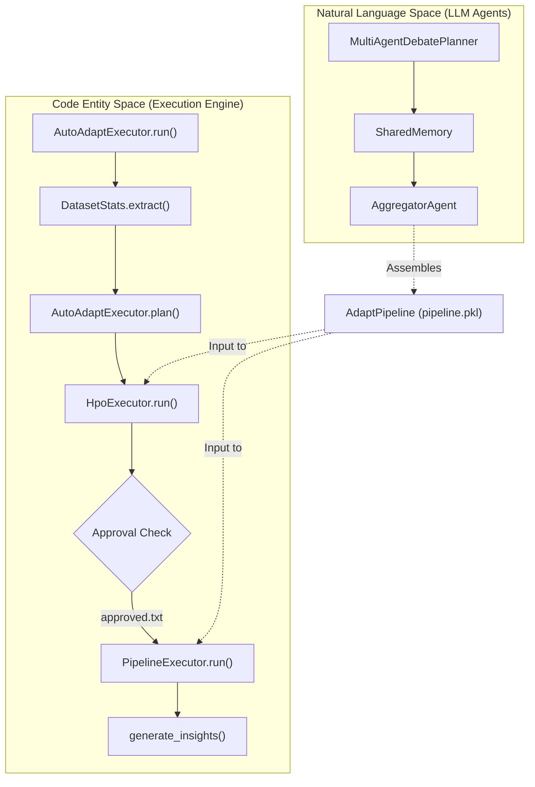
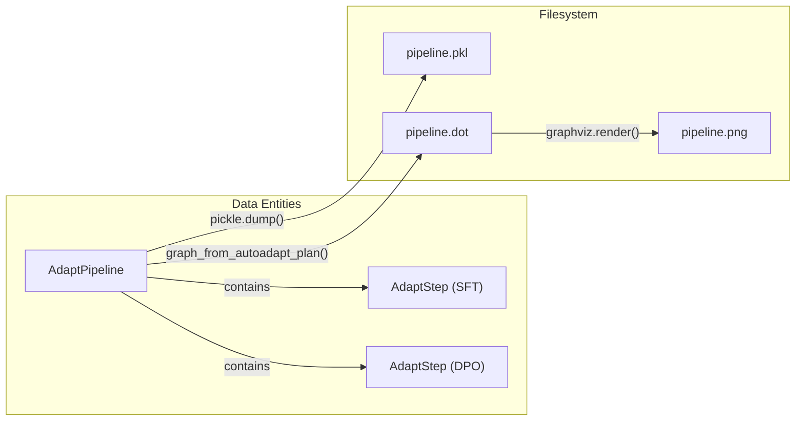

<!-- source: DeepWiki mcp.deepwiki.com · repo microsoft/AutoAdapt · page 3.1 AutoAdaptExecutor and Pipeline Orchestration · fetched 2026-10-26 -->

# AutoAdaptExecutor and Pipeline Orchestration

Relevant source files

The following files were used as context for generating this wiki page:

- [src/autoadapt/adapt/adapt_pipeline.py](src/autoadapt/adapt/adapt_pipeline.py)
- [src/autoadapt/adapt/adapt_step.py](src/autoadapt/adapt/adapt_step.py)
- [src/autoadapt/adapt/autoadapt_executor.py](src/autoadapt/adapt/autoadapt_executor.py)
- [src/autoadapt/adapt/base_executor.py](src/autoadapt/adapt/base_executor.py)
- [src/autoadapt/adapt/pipeline.py](src/autoadapt/adapt/pipeline.py)
- [src/autoadapt/memory/shared_memory.py](src/autoadapt/memory/shared_memory.py)
- [src/autoadapt/utils/misc.py](src/autoadapt/utils/misc.py)
- [src/autoadapt/utils/save_pipeline_graph.py](src/autoadapt/utils/save_pipeline_graph.py)

The `AutoAdaptExecutor` is the central orchestrator of the AutoAdapt system. It manages the end-to-end lifecycle of domain adaptation, from initial dataset analysis and multi-agent planning to hyperparameter optimization (HPO) and final model execution. It acts as a wrapper around specialized executors (`HpoExecutor`, `PipelineExecutor`) and planners (`MultiAgentDebatePlanner`), ensuring state persistence and status tracking across the long-running adaptation process.

## AutoAdaptExecutor Initialization

The `AutoAdaptExecutor` inherits from the base `Executor` class [src/autoadapt/adapt/base_executor.py:14-16]() and initializes the primary sub-components required for the adaptation lifecycle.

| Component | Class | Responsibility |
| :--- | :--- | :--- |
| **Planner** | `MultiAgentDebatePlanner` | Traverses the ACG and assembles the `Pipeline` via agent debate [src/autoadapt/adapt/autoadapt_executor.py:47-51](). |
| **Stats Extractor** | `DatasetStats` | Analyzes user datasets to provide context for agents [src/autoadapt/adapt/autoadapt_executor.py:55](). |
| **HPO Engine** | `HpoExecutor` | Executes hyperparameter search trials using Optuna [src/autoadapt/adapt/autoadapt_executor.py:61](). |
| **Pipeline Runner** | `PipelineExecutor` | Executes the final adaptation code and handles retries [src/autoadapt/adapt/autoadapt_executor.py:58](). |
| **Model Client** | `ChatCompletionModel` | Provides the LLM interface for all agents and samplers [src/autoadapt/adapt/autoadapt_executor.py:43-45](). |

**Sources:** [src/autoadapt/adapt/autoadapt_executor.py:32-65](), [src/autoadapt/adapt/base_executor.py:14-25]()

## The run() Lifecycle

The `run()` method defines the sequential execution flow of the system. It transitions through several distinct phases, updating a `status.txt` file at each step to allow external UIs (React/Streamlit) to monitor progress.

### 1. Dataset Statistics Extraction
The executor first invokes `dataset_stats_extractor.extract()` [src/autoadapt/adapt/autoadapt_executor.py:219](). This phase analyzes the provided dataset to determine domain, token distribution, and task type, which are stored in `SharedMemory` for the planning agents.

### 2. Planning Phase
The `plan()` method is called to generate an `AdaptPipeline` [src/autoadapt/adapt/autoadapt_executor.py:183](). 
- If a `pipeline.pkl` already exists, it is loaded unless `force_run` is True [src/autoadapt/adapt/autoadapt_executor.py:66-82]().
- Otherwise, the `MultiAgentDebatePlanner` executes a debate to select the best adaptation strategy (e.g., SFT vs. RAG) and hyperparameters.
- The resulting `Pipeline` object is serialized to `pipeline.pkl` [src/autoadapt/adapt/autoadapt_executor.py:246]().

### 3. HPO (AutoRefine)
The `hpo_executor` runs trials to find the optimal configuration [src/autoadapt/adapt/autoadapt_executor.py:270](). This step produces a `best_config.yaml` file.

### 4. Approval Gate
If `require_approval` is set to `True`, the executor pauses and waits for an `approved.txt` file to appear in the workspace [src/autoadapt/adapt/autoadapt_executor.py:280-285]().

### 5. Final Execution and Insights
The `pipeline_executor` runs the final adaptation with the best parameters [src/autoadapt/adapt/autoadapt_executor.py:291](). Upon completion, `generate_insights()` is called to explain the selection logic using the LLM [src/autoadapt/utils/misc.py:35-64]().

**Lifecycle Orchestration Diagram**

**Sources:** [src/autoadapt/adapt/autoadapt_executor.py:207-310](), [src/autoadapt/utils/misc.py:35-64](), [src/autoadapt/adapt/pipeline.py:15-30]()

## Pipeline Orchestration and Serialization

### AdaptPipeline and AdaptStep
The adaptation strategy is represented as an `AdaptPipeline` [src/autoadapt/adapt/pipeline.py:15](), which contains an ordered list of `AdaptStep` objects [src/autoadapt/adapt/adapt_step.py:17]().
- **AdaptStep**: Contains the `name`, `step_config` (fixed parameters), and `step_hparam_config` (search spaces for HPO) [src/autoadapt/adapt/adapt_step.py:23-33]().

### Persistence via pipeline.pkl
The `AutoAdaptExecutor` saves the entire `Pipeline` object to `pipeline.pkl` [src/autoadapt/adapt/autoadapt_executor.py:246](). This allows the system to resume from planning if the process is interrupted. The executor also includes a `parse_pipeline_graph` utility to convert this serialized object into a JSON-compatible format for visualization in the React UI [src/autoadapt/adapt/autoadapt_executor.py:85-181]().

### Visualization via Graphviz
The system uses `graph_from_autoadapt_plan` to generate visual representations of the selected pipeline [src/autoadapt/utils/save_pipeline_graph.py:160](). It maps internal step names (e.g., `sft_train`, `lora`) to human-readable descriptions and renders them using Graphviz [src/autoadapt/utils/save_pipeline_graph.py:36-65]().

**Pipeline Data Flow Diagram**

**Sources:** [src/autoadapt/adapt/pipeline.py:15-26](), [src/autoadapt/adapt/adapt_step.py:17-53](), [src/autoadapt/utils/save_pipeline_graph.py:160-202]()

## Status Tracking and Logging

### status.txt
The system tracks progress using `write_status` and `get_status` utilities [src/autoadapt/utils/misc.py:217-241](). This file contains a single string representing the current state (e.g., `PLANNING`, `HPO`, `FINETUNING`, `COMPLETED`), which the frontend polls to update the user interface.

### tee_output Context Manager
To ensure that all logs (stdout, stderr, and Python `logging`) are both visible in the console and captured for the UI, the executor uses the `tee_output` context manager [src/autoadapt/utils/misc.py:165]().

- **TeeStream**: A custom class that duplicates `write` and `flush` operations to multiple streams [src/autoadapt/utils/misc.py:150-162]().
- **Integration**: It redirects `sys.stdout`, `sys.stderr`, and the handlers for `optuna` and `transformers` loggers to the workspace log file [src/autoadapt/utils/misc.py:177-206]().

**Sources:** [src/autoadapt/utils/misc.py:150-215](), [src/autoadapt/utils/misc.py:217-241]()

---

