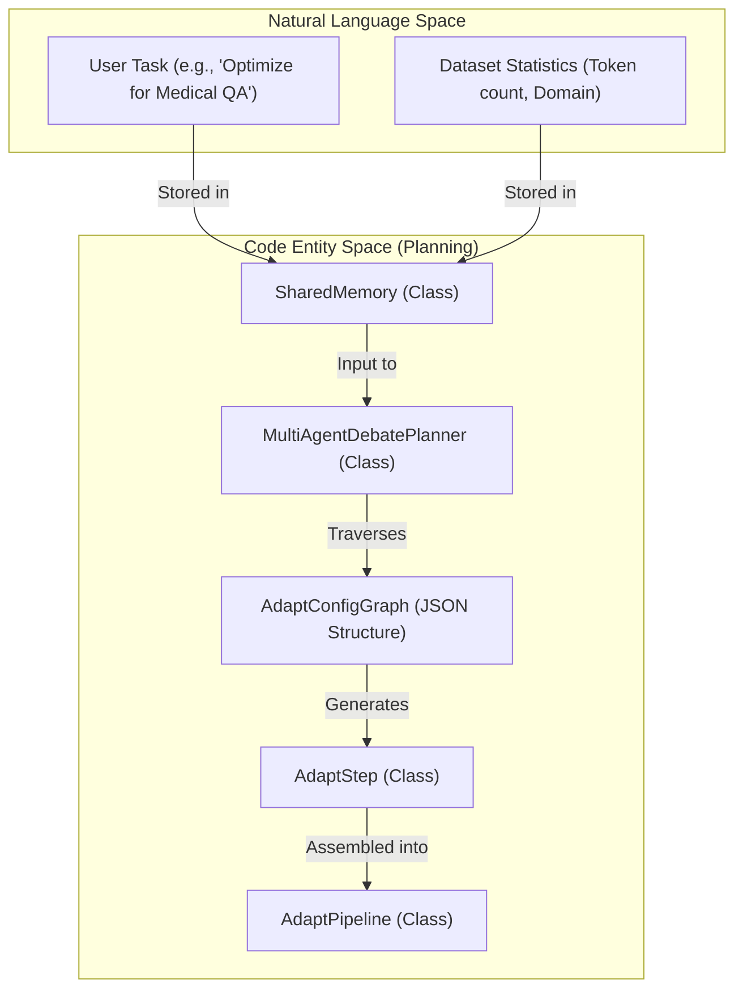
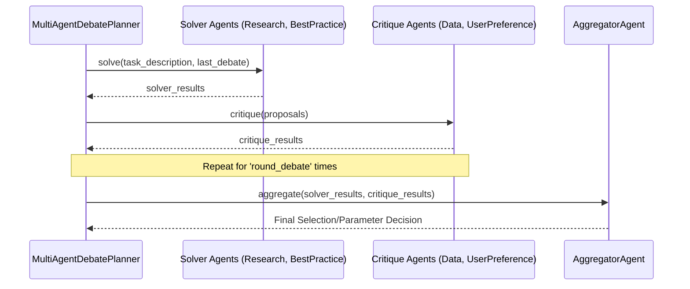

<!-- source: DeepWiki mcp.deepwiki.com · repo microsoft/AutoAdapt · page 3.2 Planning Phase: Multi-Agent Debate · fetched 2026-10-26 -->

# Planning Phase: Multi-Agent Debate

Relevant source files

The following files were used as context for generating this wiki page:

- [src/autoadapt/adapt/adapt_pipeline.py](src/autoadapt/adapt/adapt_pipeline.py)
- [src/autoadapt/adapt/adapt_step.py](src/autoadapt/adapt/adapt_step.py)
- [src/autoadapt/adapt/pipeline.py](src/autoadapt/adapt/pipeline.py)
- [src/autoadapt/memory/shared_memory.py](src/autoadapt/memory/shared_memory.py)
- [src/autoadapt/plan/base_planner.py](src/autoadapt/plan/base_planner.py)
- [src/autoadapt/plan/multiagent_debate_planner.py](src/autoadapt/plan/multiagent_debate_planner.py)

The Planning Phase is the core reasoning stage of AutoAdapt, where the system transforms a high-level user request and dataset into a structured execution plan. This phase is orchestrated by the `MultiAgentDebatePlanner`, which traverses the Adaptation Configuration Graph (ACG) and resolves complex decisions—such as selecting adaptation strategies or defining hyperparameter search spaces—through a structured multi-round debate between specialized agents.

## Planner Architecture and ACG Traversal

The planning logic is split between the `BasePlanner` and the `MultiAgentDebatePlanner`. The `BasePlanner` provides the foundation for ACG traversal using a Depth-First Search (DFS) approach, while the `MultiAgentDebatePlanner` implements the agentic reasoning logic.

### ACG Traversal Logic
The planner starts at the `adapt` root node of the ACG [src/autoadapt/plan/base_planner.py:314-316](). It recursively visits nodes to build a sequence of `AdaptStep` objects, which are eventually bundled into an `AdaptPipeline`.

| Node Type | Action | Implementation Detail |
| :--- | :--- | :--- |
| **Selection Node** | The planner must choose one or more child nodes to follow. | Calls `launch_agent_discussion` with a `SelectionRequest` [src/autoadapt/plan/base_planner.py:339-346](). |
| **Parameter Node** | The planner defines a search space (range/choices) for HPO. | Calls `launch_agent_discussion` with a `ParameterRangeRequest` [src/autoadapt/plan/base_planner.py:374-381](). |
| **Direct Parameter Node** | The planner selects specific, fixed values (skipping HPO). | Calls `launch_agent_discussion` with a `DirectParameterRequest` [src/autoadapt/plan/base_planner.py:392-401](). |
| **Executable Node** | Represents a concrete action (e.g., "SFT"). | Creates an `AdaptStep` and appends it to the pipeline [src/autoadapt/plan/base_planner.py:408-422](). |

### Mapping Natural Language to Code Entities
The following diagram illustrates how user intent and dataset characteristics are mapped to specific code entities during the planning process.

**Planning Context Mapping**

*Sources: [src/autoadapt/plan/multiagent_debate_planner.py:32-36](), [src/autoadapt/adapt/adapt_pipeline.py:16-19](), [src/autoadapt/memory/shared_memory.py:7-16]()*

## Multi-Agent Debate Mechanism

When the planner encounters a node requiring a decision, it triggers a multi-round debate. This process is managed by `launch_agent_discussion` [src/autoadapt/plan/multiagent_debate_planner.py:86-112]().

### The Debate Loop
The number of debate rounds is controlled by the configuration parameter `plan.round_debate` [src/autoadapt/plan/multiagent_debate_planner.py:119-120]().

1.  **Proposal Generation**: The `solver_agents` (Research, BestPractice, KnowledgeRetriever) generate initial proposals based on the task description and shared memory [src/autoadapt/plan/multiagent_debate_planner.py:127-135]().
2.  **Critique**: The `critique_agents` (UserPreference, Data) review the proposals and provide feedback [src/autoadapt/plan/multiagent_debate_planner.py:139-147]().
3.  **Iteration**: In subsequent rounds, agents receive the `last_debate` results (proposals and critiques) to refine their suggestions [src/autoadapt/plan/multiagent_debate_planner.py:129-153]().
4.  **Aggregation**: The `AggregatorAgent` synthesizes the final debate summary into a structured decision [src/autoadapt/plan/multiagent_debate_planner.py:158-173]().

**Agent Interaction Flow**

*Sources: [src/autoadapt/plan/multiagent_debate_planner.py:123-173]()*

## Shared Memory and Communication

The `SharedMemory` class acts as a thread-safe central repository for the planning process [src/autoadapt/memory/shared_memory.py:7-25](). Key keys used during planning include:

*   `request_type`: Identifies if the current node is a selection, parameter, or direct_parameter node [src/autoadapt/plan/multiagent_debate_planner.py:100-109]().
*   `current_request`: Stores the original `BaseModel` request object (e.g., `SelectionRequest`) for agent reference [src/autoadapt/plan/multiagent_debate_planner.py:114]().
*   `multiagent_debate_summary`: Stores the final round of proposals and critiques for the aggregator [src/autoadapt/plan/multiagent_debate_planner.py:155]().

## Pipeline Assembly

Once the DFS traversal of the ACG is complete, the `BasePlanner` returns an `AdaptPipeline` object [src/autoadapt/plan/base_planner.py:424-425]().

### AdaptStep and AdaptPipeline
*   **AdaptStep**: Represents a single unit of work (e.g., "Fine-tune with LoRA"). It contains the `step_config` (general settings) and `step_hparam_config` (the search space resolved during debate) [src/autoadapt/adapt/adapt_step.py:17-52]().
*   **AdaptPipeline**: A collection of `AdaptStep` objects. It provides an `execute()` method that runs each step sequentially [src/autoadapt/adapt/adapt_pipeline.py:16-34]().

If a node is a `direct_parameter` node, the `skip_hpo` flag is set to `True` in the `AdaptStep`, signaling the downstream `HpoExecutor` to use the fixed values provided by the planner instead of running an Optuna study [src/autoadapt/adapt/adapt_step.py:35-52]().

*Sources: [src/autoadapt/plan/base_planner.py:314-425](), [src/autoadapt/adapt/adapt_step.py:17-52](), [src/autoadapt/adapt/adapt_pipeline.py:16-38]()*

---

