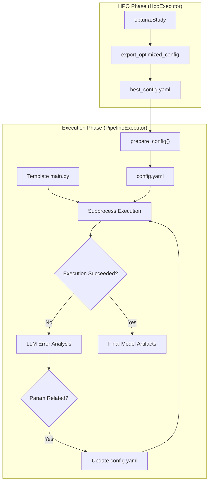
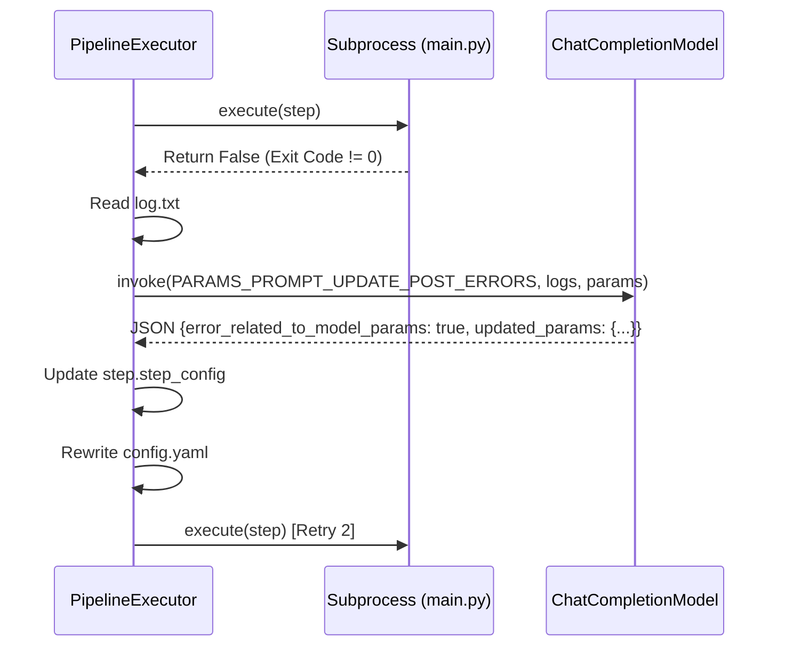

<!-- source: DeepWiki mcp.deepwiki.com · repo microsoft/AutoAdapt · page 3.4 Pipeline Execution and Error Recovery · fetched 2026-10-26 -->

# Pipeline Execution and Error Recovery

<details>
<summary>Relevant source files</summary>

The following files were used as context for generating this wiki page:

- [app/sample/run.py](app/sample/run.py)
- [app/sample/run_plan.py](app/sample/run_plan.py)
- [src/autoadapt/adapt/pipeline_executor.py](src/autoadapt/adapt/pipeline_executor.py)
- [src/autoadapt/dashboard/static/run.py](src/autoadapt/dashboard/static/run.py)
- [src/autoadapt/hpo/hpo_executor.py](src/autoadapt/hpo/hpo_executor.py)

</details>


The `PipelineExecutor` is the final stage of the AutoAdapt lifecycle, responsible for executing the optimized adaptation strategy determined during the planning and HPO phases. It handles the transition from hyperparameter search to full-scale training, manages subprocess execution, and implements an LLM-driven self-healing loop to recover from parameter-induced failures.

## PipelineExecutor Overview

The `PipelineExecutor` class [src/autoadapt/adapt/pipeline_executor.py:29-31]() inherits from the base `Executor` [src/autoadapt/adapt/base_executor.py]() and manages the execution of an `AdaptPipeline`. Unlike the `HpoExecutor`, which runs multiple trials with reduced datasets, the `PipelineExecutor` typically runs the "best" configuration on the full dataset.

### Key Responsibilities
- **Code Preparation**: Maps the `AdaptStep` to a specific template (e.g., SFT, DPO, or RAG) and populates the execution directory with the necessary source files [src/autoadapt/adapt/pipeline_executor.py:133-152]().
- **Config Finalization**: Merges the `best_config.yaml` generated by HPO with the step's parameters to create a final `config.yaml` for the subprocess [src/autoadapt/adapt/pipeline_executor.py:170-172]().
- **Subprocess Management**: Launches `main.py` within the template directory as a separate process to ensure memory isolation and environment stability.
- **Error Recovery**: Monitors the execution logs for failures and uses an LLM to suggest parameter adjustments if the failure is attributed to training configurations (e.g., OOM or divergence) [src/autoadapt/adapt/pipeline_executor.py:91-125]().

### Pipeline Execution Flow
The following diagram illustrates the transition from the HPO phase to the final execution managed by `PipelineExecutor`.

**Execution Lifecycle and Data Flow**

Sources: [src/autoadapt/hpo/hpo_executor.py:186-187](), [src/autoadapt/adapt/pipeline_executor.py:59-92](), [src/autoadapt/adapt/pipeline_executor.py:102-118]()

---

## Error Recovery and Self-Healing

AutoAdapt implements an LLM-driven retry loop to handle failures that occur during the execution of training scripts. This is specifically targeted at "parameter-related" errors such as CUDA Out-of-Memory (OOM), loss divergence, or configuration mismatches.

### The Retry Loop
The `run_step` method [src/autoadapt/adapt/pipeline_executor.py:59-66]() wraps the execution in a retry loop (defaulting to 3 attempts) [src/autoadapt/adapt/pipeline_executor.py:90-91](). If a step fails, the executor:
1.  Extracts relevant parameters from the current config (e.g., `sft_train`, `lora`, `prefix_tuning`) [src/autoadapt/adapt/pipeline_executor.py:98-99]().
2.  Reads the failure logs from `log.txt` [src/autoadapt/adapt/pipeline_executor.py:100-101]().
3.  Invokes the LLM using the `PARAMS_PROMPT_UPDATE_POST_ERRORS` prompt [src/autoadapt/adapt/pipeline_executor.py:106-108]().

### LLM Diagnosis
The LLM receives the `model_params` and the `error_log` [src/autoadapt/adapt/pipeline_executor.py:102-105](). It returns a JSON object containing:
- `error_related_to_model_params`: A boolean indicating if the LLM believes the error can be fixed by changing hyperparameters [src/autoadapt/adapt/pipeline_executor.py:110]().
- `reason`: A textual explanation of the failure [src/autoadapt/adapt/pipeline_executor.py:112]().
- Updated configuration blocks (e.g., reduced batch size for OOM, adjusted learning rate for divergence) [src/autoadapt/adapt/pipeline_executor.py:117-118]().

**LLM-Driven Recovery Logic**

Sources: [src/autoadapt/adapt/pipeline_executor.py:88-125](), [src/autoadapt/utils/llm.py]()

---

## Implementation Details

### Subprocess Execution
The executor uses `asyncio.to_thread` to run the blocking `self.execute` call [src/autoadapt/adapt/pipeline_executor.py:92](). The actual execution logic is inherited from the base `Executor`, which typically involves invoking the Python interpreter on the prepared `main.py` in the step's execution directory.

### Status Tracking
Execution progress is persisted to the filesystem to allow for resumption and UI monitoring:
- **status.txt**: Contains the current state: `Not started`, `In Process`, `Success`, or `Failed` [src/autoadapt/adapt/pipeline_executor.py:39-57]().
- **log.txt**: Captured via the `tee_output` context manager, which redirects stdout/stderr to both the console and a file [src/autoadapt/adapt/pipeline_executor.py:85-87]().

### User Approval Gate
While the `PipelineExecutor` handles the technical execution, the `AutoAdaptExecutor` (orchestrator) often enforces an approval gate before this phase begins.
- If `require_approval` is set to `True` [src/autoadapt/adapt/autoadapt_executor.py](), the system waits for the existence of an `approved.txt` file or a specific API signal from the React UI [app/react/backend/main.py]() before transitioning from HPO to `PipelineExecutor`.

### Directory Structure
During execution, the workspace is organized as follows:
```text
workspace/<project_id>/
├── hpo/                    # HPO trial artifacts
│   └── best_config.yaml    # Source for PipelineExecutor
├── execution/              # PipelineExecutor workspace
│   └── <step_name>/
│       ├── code/           # Copied template source
│       │   ├── main.py
│       │   └── conf/
│       │       └── config.yaml # Final merged config
│       ├── status.txt      # Execution status
│       └── log.txt         # Subprocess output
```
Sources: [src/autoadapt/adapt/pipeline_executor.py:68-71](), [src/autoadapt/adapt/pipeline_executor.py:145-157](), [src/autoadapt/hpo/hpo_executor.py:186-200]()

---

## Key Functions and Classes

| Entity | Role | Source |
| :--- | :--- | :--- |
| `PipelineExecutor` | Main class for running the final adaptation pipeline. | [src/autoadapt/adapt/pipeline_executor.py:29]() |
| `run_step` | Orchestrates the preparation, execution, and retry logic for a single step. | [src/autoadapt/adapt/pipeline_executor.py:59]() |
| `prepare_code` | Sets up the template files and final `config.yaml`. | [src/autoadapt/adapt/pipeline_executor.py:133]() |
| `PARAMS_PROMPT_UPDATE_POST_ERRORS` | LLM prompt used to diagnose and fix training failures. | [src/autoadapt/utils/llm.py]() |
| `tee_output` | Context manager for logging subprocess output to file. | [src/autoadapt/utils/misc.py]() |

Sources: [src/autoadapt/adapt/pipeline_executor.py](), [src/autoadapt/utils/llm.py](), [src/autoadapt/utils/misc.py]()

---

