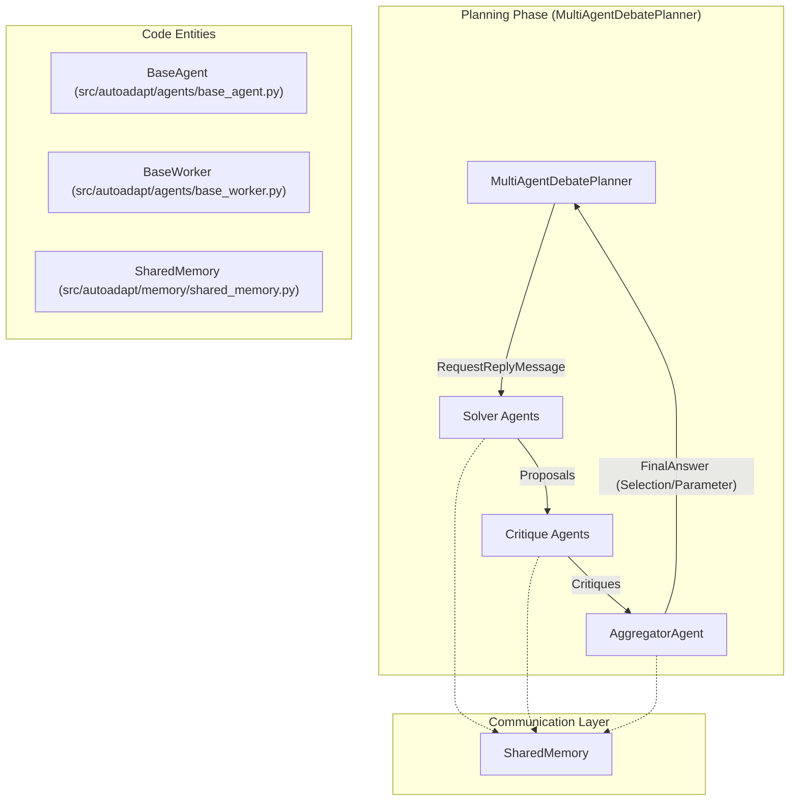
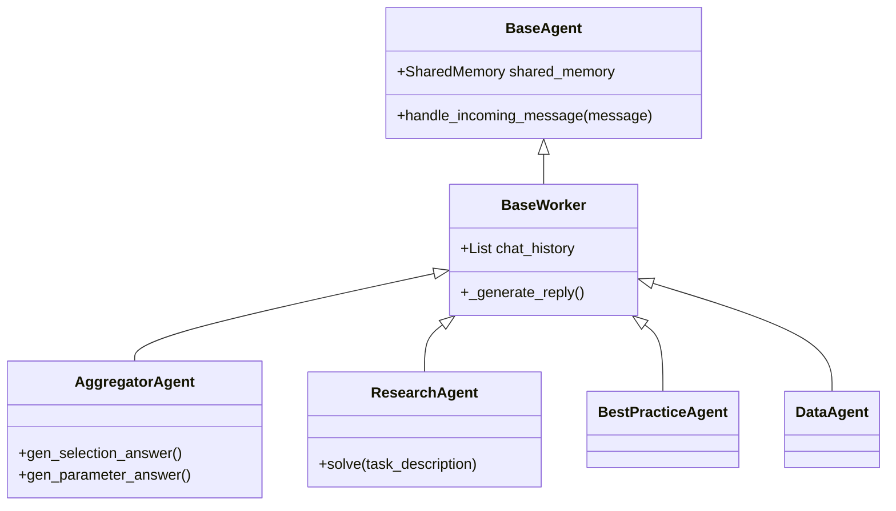

<!-- source: DeepWiki mcp.deepwiki.com · repo microsoft/AutoAdapt · page 4 Multi-Agent System · fetched 2026-10-26 -->

# Multi-Agent System

Relevant source files

The following files were used as context for generating this wiki page:

- [src/autoadapt/agents/aggregator_agent.py](src/autoadapt/agents/aggregator_agent.py)
- [src/autoadapt/agents/base_agent.py](src/autoadapt/agents/base_agent.py)
- [src/autoadapt/agents/base_worker.py](src/autoadapt/agents/base_worker.py)
- [src/autoadapt/agents/best_practice_agent.py](src/autoadapt/agents/best_practice_agent.py)
- [src/autoadapt/agents/knowledge_retriever_agent.py](src/autoadapt/agents/knowledge_retriever_agent.py)
- [src/autoadapt/agents/messages.py](src/autoadapt/agents/messages.py)
- [src/autoadapt/agents/research_agent.py](src/autoadapt/agents/research_agent.py)

AutoAdapt utilizes a multi-agent orchestration framework based on `autogen-core` to automate the planning and configuration of machine learning adaptation pipelines. The system employs a debate-based architecture where specialized agents—categorized into **Solvers**, **Critiques**, and **Aggregators**—collaborate to resolve the optimal path through the Adaptation Configuration Graph (ACG).

### Agent Architecture Overview

The system architecture is built upon the `BaseAgent` and `BaseWorker` classes, which provide the foundational messaging and state management capabilities. Agents communicate asynchronously via a `BroadcastMessage` protocol and share state through a `SharedMemory` object.

Multi-Agent Communication Flow:

**Sources:**
- `src/autoadapt/agents/base_agent.py:24-34` (BaseAgent definition)
- `src/autoadapt/agents/base_worker.py:26-42` (BaseWorker definition)
- `src/autoadapt/agents/messages.py:22-30` (Message types)

---

### Core Agent Roles

The multi-agent system divides labor across three primary roles to ensure that recommendations are technically sound, data-driven, and aligned with user constraints.

#### 1. Solver Agents
Solvers are responsible for generating initial proposals for pipeline nodes and hyperparameter settings. They leverage internal knowledge, static documentation, and live web retrieval.
*   **ResearchAgent**: Uses `knowledge.md` to provide reasoning based on documented best practices [src/autoadapt/agents/research_agent.py:60-84]().
*   **BestPracticeAgent**: Retrieves empirical data from model cards and dataset registries using fuzzy matching and vector search [src/autoadapt/agents/best_practice_agent.py:85-110]().
*   **KnowledgeRetrieverAgent**: Performs live queries to external sources like Arxiv, HuggingFace, and GitHub [src/autoadapt/agents/knowledge_retriever_agent.py:40-65]().

For details, see [Solver and Aggregator Agents](#4.1).

#### 2. Critique Agents
Critique agents evaluate solver proposals against the specific characteristics of the user's data and stated preferences.
*   **DataAgent**: Analyzes dataset statistics (e.g., token count, duplicate ratios) to invalidate proposals that are computationally infeasible or technically inappropriate for the data scale.
*   **UserPreferenceAgent**: Ensures that the pipeline adheres to constraints defined in `user_preference.md`.

For details, see [Critique Agents: Data and User Preference](#4.2).

#### 3. Aggregator Agent
The **AggregatorAgent** acts as the final decision-maker. It synthesizes the debate history, weighs solver proposals against critiques, and produces a structured `FinalAnswer` (e.g., `SelectionAnswer` or `ParameterAnswer`) [src/autoadapt/agents/aggregator_agent.py:53-78]().

For details, see [Solver and Aggregator Agents](#4.1).

---

### Shared Memory and Message Protocol

Agents do not maintain isolated states; they interact through a `SharedMemory` instance that stores the current request context, user tasks, and the history of the ongoing debate.

Agent-to-Code Mapping:

**Sources:**
- `src/autoadapt/agents/base_agent.py:24-42` (SharedMemory integration)
- `src/autoadapt/agents/aggregator_agent.py:83-113` (Selection logic)
- `src/autoadapt/agents/messages.py:89-138` (Response schemas)

### Knowledge Retrieval System
The agents are supported by a specialized retrieval infrastructure that indexes model cards and machine learning papers. This system uses a `RetrieverFactory` to switch between different vector database implementations (FAISS/ChromaDB).

For details, see [Best Practices Knowledge Base and Retrieval](#4.3).

---
**Sources:**
- `src/autoadapt/agents/base_agent.py:24-51`
- `src/autoadapt/agents/base_worker.py:26-75`
- `src/autoadapt/agents/aggregator_agent.py:31-50`
- `src/autoadapt/agents/messages.py:44-85`

---

