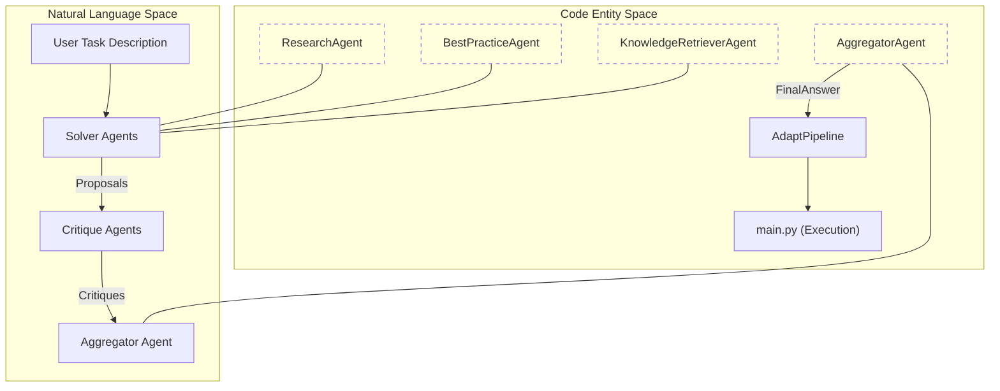
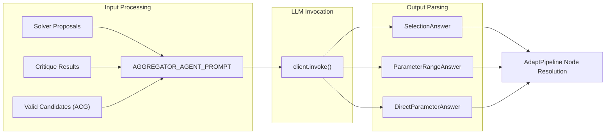

<!-- source: DeepWiki mcp.deepwiki.com · repo microsoft/AutoAdapt · page 4.1 Solver and Aggregator Agents · fetched 2026-10-26 -->

# Solver and Aggregator Agents

Relevant source files

The following files were used as context for generating this wiki page:

- [src/autoadapt/agents/aggregator_agent.py](src/autoadapt/agents/aggregator_agent.py)
- [src/autoadapt/agents/best_practice_agent.py](src/autoadapt/agents/best_practice_agent.py)
- [src/autoadapt/agents/knowledge_retriever/knowledge_retriever.py](src/autoadapt/agents/knowledge_retriever/knowledge_retriever.py)
- [src/autoadapt/agents/knowledge_retriever/web_search_grounding.py](src/autoadapt/agents/knowledge_retriever/web_search_grounding.py)
- [src/autoadapt/agents/knowledge_retriever_agent.py](src/autoadapt/agents/knowledge_retriever_agent.py)
- [src/autoadapt/agents/research_agent.py](src/autoadapt/agents/research_agent.py)
- [src/autoadapt/config/knowledge.md](src/autoadapt/config/knowledge.md)
- [src/autoadapt/config/knowledge_hparams.md](src/autoadapt/config/knowledge_hparams.md)
- [src/autoadapt/config/model_selection_kb.md](src/autoadapt/config/model_selection_kb.md)

This section details the specialized agents responsible for generating domain adaptation strategies and synthesizing final configurations. These agents operate within a multi-agent debate framework to resolve nodes in the **Adaptation Configuration Graph (ACG)**.

## Overview of Agent Roles

The solver agents (`ResearchAgent`, `BestPracticeAgent`, `KnowledgeRetrieverAgent`) act as domain experts that provide proposals based on different knowledge sources. The `AggregatorAgent` serves as the final decision-maker, synthesizing these proposals into a structured configuration.

### Data Flow and Interaction
The planning process follows a specific flow where solvers generate initial ideas, critique agents provide feedback, and the aggregator produces the final selection or parameter value.

**Agent Reasoning Flow**

**Sources:** [src/autoadapt/agents/aggregator_agent.py:31-50](), [src/autoadapt/agents/research_agent.py:37-57]()

---

## 1. ResearchAgent
The `ResearchAgent` provides reasoning based on static, curated knowledge bases. It primarily relies on local markdown files containing fine-tuning heuristics and model selection guides.

*   **Implementation:** Inherits from `BaseWorker` and uses `ChatCompletionModel` to process prompts [src/autoadapt/agents/research_agent.py:60-84]().
*   **Knowledge Source:** Loads content from `src/autoadapt/config/knowledge.md` [src/autoadapt/agents/research_agent.py:35-36](). This file contains decision rules for SFT vs. DPO vs. RAG and typical hyperparameter ranges [src/autoadapt/config/knowledge.md:3-38]().
*   **Key Function:** `solve(task_description, last_debate)` [src/autoadapt/agents/research_agent.py:90-140](). It dynamically switches its `response_format` based on the `request_type` (e.g., `SelectionAnswer`, `ParameterRangeAnswer`) stored in `shared_memory` [src/autoadapt/agents/research_agent.py:104-112]().

**Sources:** [src/autoadapt/agents/research_agent.py:1-140](), [src/autoadapt/config/knowledge.md:1-197]()

---

## 2. BestPracticeAgent
The `BestPracticeAgent` focuses on empirical evidence by retrieving "model cards" and "dataset cards" from a local database to find similar successful configurations.

*   **Retrieval Mechanism:** Uses the `BestPracticesRetriever` to search the `models_data_database` [src/autoadapt/agents/best_practice_agent.py:110]().
*   **Fuzzy Matching:** Implements `Levenshtein` distance to map retrieved model names to a valid `base_llm_list` [src/autoadapt/agents/best_practice_agent.py:22](), [src/autoadapt/agents/best_practice_agent.py:151-152]().
*   **Model Selection:** The function `get_base_llm_model_from_best_practice` invokes the LLM with a specialized `BASE_LLM_PROMPT` to extract recommended base models from retrieved text [src/autoadapt/agents/best_practice_agent.py:128-147]().
*   **Static Data:** Accesses `base_llm_list.json` and `model_card_parameter_distribution.json` to ground its recommendations in available hardware/software constraints [src/autoadapt/agents/best_practice_agent.py:112-126]().

**Sources:** [src/autoadapt/agents/best_practice_agent.py:85-152](), [src/autoadapt/agents/best_practices/best_practice_retriever.py:1-50]()

---

## 3. KnowledgeRetrieverAgent
This agent performs live web searches to gather the most recent state-of-the-art (SOTA) information from academic and community sources.

*   **Search Engines:** Orchestrates searches across **Arxiv**, **HuggingFace**, **PapersWithCode**, and **GitHub** [src/autoadapt/agents/knowledge_retriever/knowledge_retriever.py:25-200]().
*   **Web Search Grounding:** Uses the `WebSearchAgent` class, which interfaces with the `serpapi` (Google Search) to find organic results and snippets [src/autoadapt/agents/knowledge_retriever/web_search_grounding.py:11-53]().
*   **Summarization:** After retrieving documents (e.g., PDF content from Arxiv or JSON from PapersWithCode), it uses `chunk_and_retrieve` to extract relevant segments and an LLM to generate a single paragraph of insights [src/autoadapt/agents/knowledge_retriever/knowledge_retriever.py:127-151]().

**Sources:** [src/autoadapt/agents/knowledge_retriever_agent.py:40-83](), [src/autoadapt/agents/knowledge_retriever/knowledge_retriever.py:1-200](), [src/autoadapt/agents/knowledge_retriever/web_search_grounding.py:11-53]()

---

## 4. AggregatorAgent
The `AggregatorAgent` acts as the synthesis engine. It does not perform external retrieval but instead weighs the proposals and critiques to produce a structured output.

*   **Structured Output:** Uses Pydantic models to ensure the LLM returns valid JSON objects. Key formats include:
    *   `SelectionAnswer`: For choosing between discrete options (e.g., SFT vs RAG) [src/autoadapt/agents/aggregator_agent.py:83-113]().
    *   `ParameterRangeAnswer`: For defining search spaces for HPO [src/autoadapt/agents/aggregator_agent.py:139-169]().
    *   `DirectParameterAnswer`: For providing exact values when HPO is bypassed [src/autoadapt/agents/aggregator_agent.py:171-180]().
*   **Constraint Enforcement:** The prompt explicitly instructs the agent to prioritize preferences from the `DataAgent` or `UserPreferenceAgent` and to only select from the `valid_candidates` provided in the ACG [src/autoadapt/agents/aggregator_agent.py:41-50]().

### Aggregator Implementation Detail
The aggregator maps solver results into a structured prompt and parses the response back into code-usable objects.

**Aggregator Internal Logic**

**Sources:** [src/autoadapt/agents/aggregator_agent.py:53-180](), [src/autoadapt/agents/messages.py:1-50]()

---

