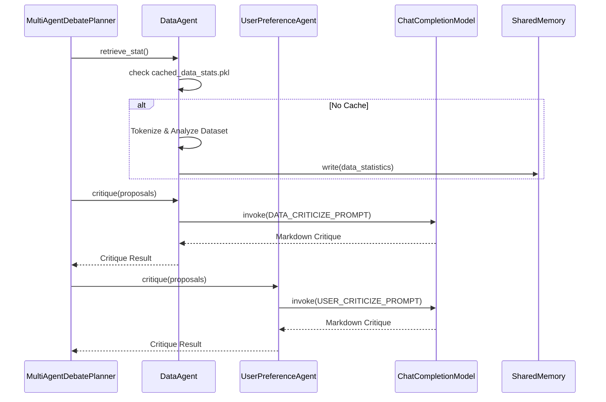

<!-- source: DeepWiki mcp.deepwiki.com · repo microsoft/AutoAdapt · page 4.2 Critique Agents: Data and User Preference · fetched 2026-10-26 -->

# Critique Agents: Data and User Preference

<details>
<summary>Relevant source files</summary>

The following files were used as context for generating this wiki page:

- [src/autoadapt/adapt/extract_dataset_stats.py](src/autoadapt/adapt/extract_dataset_stats.py)
- [src/autoadapt/agents/data_agent.py](src/autoadapt/agents/data_agent.py)
- [src/autoadapt/agents/knowledge_retriever/knowledge_utils.py](src/autoadapt/agents/knowledge_retriever/knowledge_utils.py)
- [src/autoadapt/agents/user_preference_agent.py](src/autoadapt/agents/user_preference_agent.py)
- [src/autoadapt/utils/agent.py](src/autoadapt/utils/agent.py)

</details>


Critique agents in AutoAdapt serve as the quality control layer during the planning phase. Unlike Solver agents that propose adaptation strategies, the `DataAgent` and `UserPreferenceAgent` evaluate these proposals against the ground truth of the provided dataset and the explicit constraints defined by the user. They ensure that the final adaptation pipeline is both technically feasible for the data and aligned with user expectations.

## DataAgent: Dataset Analysis and Critique

The `DataAgent` is responsible for deep analysis of the user-provided dataset. It extracts statistical features, identifies potential data quality issues, and uses these insights to critique adaptation proposals [src/autoadapt/agents/data_agent.py:49-54]().

### Technical Implementation

The agent performs two primary roles: statistical extraction and LLM-based critique.

1.  **Data Ingestion**: It supports both HuggingFace datasets and local files (json, csv, etc.) using `datasets.load_dataset` [src/autoadapt/agents/data_agent.py:126-131]().
2.  **Statistical Extraction**: The `retrieve_stat` method computes a comprehensive profile of the data [src/autoadapt/agents/data_agent.py:136-142]():
    *   **Tokenization Analysis**: Uses `tiktoken` or `AutoTokenizer` to calculate token lengths for inputs and outputs [src/autoadapt/agents/data_agent.py:186-189]().
    *   **Data Integrity**: Calculates duplicate ratios, missing input/output counts, and average word/character counts [src/autoadapt/agents/data_agent.py:153-161]().
    *   **Special Token Coverage**: Scans for specific markers (e.g., `<|endoftext|>`) to ensure model compatibility [src/autoadapt/agents/data_agent.py:204-210]().
3.  **Caching**: To optimize the planning phase, results are stored in `cached_data_stats.pkl` within the cache directory [src/autoadapt/agents/data_agent.py:145-149]().

### Data Critique Logic
The agent uses the `DATA_CRITICIZE_PROMPT` to evaluate proposals from other agents (like the `ResearchAgent`) against the extracted statistics [src/autoadapt/agents/data_agent.py:32-46](). It looks for distribution mismatches or inappropriate model choices relative to the dataset's complexity.

**Sources:**
*   [src/autoadapt/agents/data_agent.py:32-210]()

---

## DatasetStats: Domain Summarization

While `DataAgent` focuses on raw statistics, the `DatasetStats` class provides high-level semantic understanding of the data using LLMs.

### Domain and Difficulty Analysis
The `compute_dataset_summary` method selects a random subset of examples from the dataset and prompts an LLM using `llm.DATA_SUMMARIZATION_PROMPT` [src/autoadapt/adapt/extract_dataset_stats.py:101-140](). This produces:
*   **Data Summary**: A natural language description of what the dataset contains.
*   **Data Domain**: Identification of the field (e.g., Medical, Legal, Code).
*   **Difficulty Level**: An assessment of the task complexity [src/autoadapt/adapt/extract_dataset_stats.py:61-64]().

### Statistical Distribution
It uses `scipy` and `numpy` to generate histograms of sentence lengths and `nltk` to identify the most frequent non-stopword tokens [src/autoadapt/adapt/extract_dataset_stats.py:160-186]().

**Sources:**
*   [src/autoadapt/adapt/extract_dataset_stats.py:41-196]()

---

## UserPreferenceAgent: Constraint Enforcement

The `UserPreferenceAgent` ensures that the adaptation pipeline adheres to qualitative constraints provided by the user in a `user_preference.md` file [src/autoadapt/agents/user_preference_agent.py:30-37]().

### Implementation Details
*   **Preference Loading**: It reads the user preference file and strips markdown comments using regex [src/autoadapt/agents/user_preference_agent.py:38-44]().
*   **Critique Mechanism**: It implements the `critique` method, which takes proposals from other agents and evaluates them against the `USER_CRITICIZE_PROMPT` [src/autoadapt/agents/user_preference_agent.py:49-59]().
*   **Scope Awareness**: The agent is designed to recognize if a user preference is irrelevant to a specific node in the Adaptation Configuration Graph (ACG), allowing it to skip critiques when appropriate [src/autoadapt/agents/user_preference_agent.py:27-28]().

**Sources:**
*   [src/autoadapt/agents/user_preference_agent.py:14-59]()

---

## Data Flow: From Raw Data to Agent Critique

The following diagram illustrates how raw dataset files and user preference documents are transformed into structured critiques that influence the `MultiAgentDebatePlanner`.

### Data and Preference Processing Pipeline

```mermaid
graph TD
    subgraph "Natural Language Space"
        ["user_preference.md"]
        ["Dataset Samples"]
        ["Agent Proposals"]
    end

    subgraph "Code Entity Space"
        UP_Agent["UserPreferenceAgent"]
        D_Agent["DataAgent"]
        D_Stats["DatasetStats"]
        SM["SharedMemory"]
        
        UP_Agent -- "reads" --> ["user_preference.md"]
        D_Agent -- "load_data()" --> ["Dataset Samples"]
        D_Stats -- "compute_dataset_summary()" --> ["Dataset Samples"]
        
        D_Stats -- "DATA_SUMMARIZATION_PROMPT" --> LLM_Summary["LLM Response"]
        D_Agent -- "retrieve_stat()" --> Stats_Dict["stats dict"]
        
        Stats_Dict -- "stored in" --> SM
        LLM_Summary -- "stored in" --> SM
        
        UP_Agent -- "critique()" --> UP_Review["Structured Review"]
        D_Agent -- "DATA_CRITICIZE_PROMPT" --> D_Review["Data Critique"]
    end

    ["Agent Proposals"] -- "input to" --> UP_Agent
    ["Agent Proposals"] -- "input to" --> D_Agent
    UP_Review -- "influences" --> Planning["MultiAgentDebatePlanner"]
    D_Review -- "influences" --> Planning
```

**Sources:**
*   [src/autoadapt/agents/data_agent.py:100-114]()
*   [src/autoadapt/agents/user_preference_agent.py:36-44]()
*   [src/autoadapt/adapt/extract_dataset_stats.py:50-76]()

---

## Agent Interaction Architecture

This diagram details how the Critique agents interact with the shared memory and the LLM client during a debate round.

### Critique Agent Execution Logic



**Sources:**
*   [src/autoadapt/agents/data_agent.py:144-150]()
*   [src/autoadapt/agents/data_agent.py:32-46]()
*   [src/autoadapt/agents/user_preference_agent.py:49-59]()

---

## Key Prompts and Structures

The critique agents rely on specific prompt templates to standardize their output for the `AggregatorAgent`.

| Agent | Prompt Constant | Primary Goal |
| :--- | :--- | :--- |
| `DataAgent` | `DATA_CRITICIZE_PROMPT` | Identify distribution mismatches and inappropriate model choices based on `data_statistics`. |
| `UserPreferenceAgent` | `USER_CRITICIZE_PROMPT` | Identify violations of constraints defined in `user_preference.md`. |
| `DatasetStats` | `DATA_SUMMARIZATION_PROMPT` | Extract domain, summary, and difficulty level from dataset samples. |

**Sources:**
*   [src/autoadapt/agents/data_agent.py:32-46]()
*   [src/autoadapt/agents/user_preference_agent.py:14-29]()
*   [src/autoadapt/adapt/extract_dataset_stats.py:133-140]()

---

