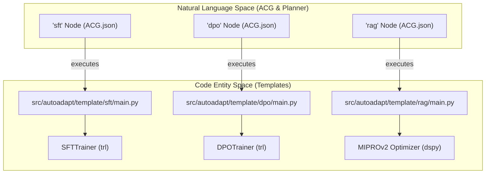

<!-- source: DeepWiki mcp.deepwiki.com · repo microsoft/AutoAdapt · page 5 Adaptation Templates · fetched 2026-10-26 -->

# Adaptation Templates

Relevant source files

The following files were used as context for generating this wiki page:

- [src/autoadapt/config/ACG.json](src/autoadapt/config/ACG.json)
- [src/autoadapt/template/dpo/conf/config.yaml](src/autoadapt/template/dpo/conf/config.yaml)
- [src/autoadapt/template/dpo/main.py](src/autoadapt/template/dpo/main.py)
- [src/autoadapt/template/sft/conf/config.yaml](src/autoadapt/template/sft/conf/config.yaml)
- [src/autoadapt/template/sft/main.py](src/autoadapt/template/sft/main.py)

Adaptation Templates are the core execution scripts in AutoAdapt that implement specific machine learning strategies to adapt Large Language Models (LLMs) to new domains or tasks. These templates are invoked as independent subprocesses by the `PipelineExecutor` after the planning and HPO phases have finalized the optimal configuration.

The system currently supports three primary adaptation strategies defined in the Adaptation Configuration Graph (ACG):
1.  **SFT (Supervised Fine-Tuning)**: Standard cross-entropy training on instruction-response pairs.
2.  **DPO (Direct Preference Optimization)**: Alignment-based tuning using preference pairs (chosen vs. rejected).
3.  **RAG (Retrieval-Augmented Generation)**: Non-parametric adaptation via external knowledge retrieval.

### Template Orchestration

The `ACG.json` file defines these strategies as "executable" nodes. When a strategy is selected, the `PipelineExecutor` maps the node name to a specific `main.py` entry point within the `src/autoadapt/template/` directory.

#### Strategy Selection in ACG
| Strategy | Node Type | Executable | Parameters (Examples) |
| :--- | :--- | :--- | :--- |
| **SFT** | `select:any` | Yes | `learning_rate`, `num_train_epochs`, `packing` |
| **DPO** | `select:any` | Yes | `beta`, `learning_rate`, `per_device_train_batch_size` |
| **RAG** | `select:1` | Yes | `retriever_top_k`, `embedding_model` |

**Sources:**
- [src/autoadapt/config/ACG.json:1-120]()

---

### SFT and DPO Training Templates

The training templates (SFT and DPO) share a similar execution flow managed by the `trl` library (Transformer Reinforcement Learning). They both support Parameter-Efficient Fine-Tuning (PEFT) methods like LoRA and Prefix Tuning, as well as model quantization (int4/int8) to reduce GPU memory requirements.

#### Training Lifecycle
1.  **Data Ingestion**: `load_user_data` handles multi-format datasets (CSV, HF) and splits them into train/validation/test sets.
2.  **Model Loading**: `get_model` initializes the base LLM with optional quantization.
3.  **Adapter Attachment**: `get_peft_model` applies LoRA or Prefix Tuning configurations.
4.  **Trainer Initialization**: Uses `SFTTrainer` or `DPOTrainer` with specialized `compute_metrics` logic.
5.  **Post-Processing**: Includes `merge_and_unload()` for PEFT adapters and model serialization.

For details, see [SFT and DPO Training Templates](#5.1).

**Sources:**
- [src/autoadapt/template/sft/main.py:34-150]()
- [src/autoadapt/template/dpo/main.py:35-153]()
- [src/autoadapt/template/sft/conf/config.yaml:33-40]()

---

### RAG Template: Indexing and Optimization

Unlike the training templates, the RAG template focuses on optimizing the retrieval pipeline and the generation prompts rather than the model weights. It utilizes `ChromaDB` for vector storage and `DSPy` for prompt optimization.

#### RAG Lifecycle
1.  **Indexing**: Documents are embedded using `BaseEmbeddingModel` and stored in a local vector store.
2.  **Optimization**: The `MIPROv2` optimizer from DSPy tunes the system prompts and retrieval parameters based on a `SemanticF1` metric.
3.  **Evaluation**: Uses `vLLM` for high-throughput inference to validate the retrieval-augmented responses.

For details, see [RAG Template: Indexing, Optimization, and Evaluation](#5.2).

**Sources:**
- [src/autoadapt/config/ACG.json:13-43]()

---

### Architectural Mapping: Template Execution

The following diagram illustrates how the `PipelineExecutor` bridges the high-level adaptation plan to the specific code entities within the template directory.

**Adaptation Execution Flow**

**Sources:**
- [src/autoadapt/config/ACG.json:1-120]()
- [src/autoadapt/template/sft/main.py:18-142]()
- [src/autoadapt/template/dpo/main.py:25-145]()

---

### Parameter Management and HPO Integration

Each template is designed to operate in two modes, controlled by the `hpo_runtime` flag in the configuration.

*   **HPO Mode (`hpo_runtime: True`)**: The template executes a "trial." It typically uses a `hpo_metric` (e.g., BLEU or Accuracy) and reports results back to the `HpoExecutor`. It skips full model saving and base model comparison to save time.
*   **Execution Mode (`hpo_runtime: False`)**: The template performs the final adaptation. It evaluates the base model, runs the full training/optimization, merges adapters, and saves the final artifacts to `trained_model_dir`.

**Comparison of Template Configurations**
| Feature | SFT Config | DPO Config |
| :--- | :--- | :--- |
| **Main Trainer** | `SFTTrainer` | `DPOTrainer` |
| **Loss Configuration** | `completion_only_loss` | `beta` (KL divergence) |
| **Data Columns** | `input_column`, `response_column` | `input_column`, `response_column`, `rejected_column` |
| **PEFT Support** | LoRA, Prefix Tuning | LoRA, Prefix Tuning |

**Sources:**
- [src/autoadapt/template/sft/main.py:88-116]()
- [src/autoadapt/template/dpo/main.py:78-107]()
- [src/autoadapt/template/sft/conf/config.yaml:83-83]()
- [src/autoadapt/template/dpo/conf/config.yaml:13-15]()

---

