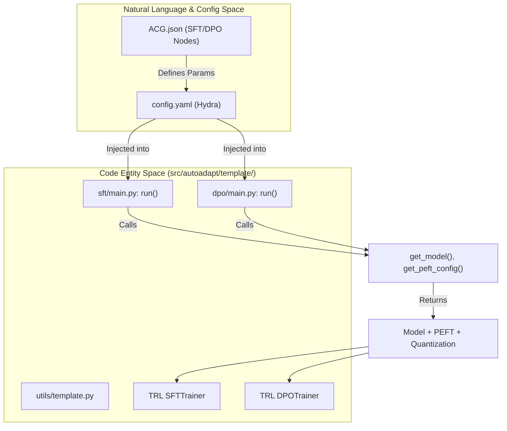
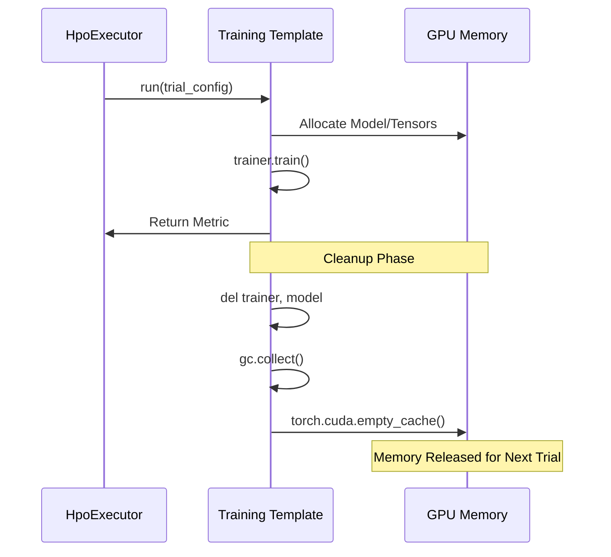

<!-- source: DeepWiki mcp.deepwiki.com · repo microsoft/AutoAdapt · page 5.1 SFT and DPO Training Templates · fetched 2026-10-26 -->

# SFT and DPO Training Templates

Relevant source files

The following files were used as context for generating this wiki page:

- [src/autoadapt/config/ACG.json](src/autoadapt/config/ACG.json)
- [src/autoadapt/evaluate/evaluator.py](src/autoadapt/evaluate/evaluator.py)
- [src/autoadapt/template/dpo/conf/config.yaml](src/autoadapt/template/dpo/conf/config.yaml)
- [src/autoadapt/template/dpo/main.py](src/autoadapt/template/dpo/main.py)
- [src/autoadapt/template/sft/conf/config.yaml](src/autoadapt/template/sft/conf/config.yaml)
- [src/autoadapt/template/sft/main.py](src/autoadapt/template/sft/main.py)
- [src/autoadapt/utils/template.py](src/autoadapt/utils/template.py)

This page provides a technical deep dive into the core training templates of AutoAdapt: Supervised Fine-Tuning (SFT) and Direct Preference Optimization (DPO). These templates serve as the execution entry points for model adaptation, handling data ingestion, model quantization, Parameter-Efficient Fine-Tuning (PEFT) setup, and evaluation.

## Overview of Training Entrypoints

The training logic is encapsulated in `run()` functions within `src/autoadapt/template/sft/main.py` and `src/autoadapt/template/dpo/main.py`. These scripts are invoked by the `PipelineExecutor` during the execution phase or by the `HpoExecutor` during hyperparameter optimization trials.

### System Flow: From Configuration to Training

The following diagram illustrates how the configuration and code entities interact during a training run.

**Training Template Execution Flow**

**Sources:** [src/autoadapt/template/sft/main.py:34-50](), [src/autoadapt/template/dpo/main.py:35-41](), [src/autoadapt/config/ACG.json:45-120]()

---

## Model Setup and Quantization

Both SFT and DPO templates utilize `utils/template.py` to initialize models with specific hardware optimizations.

### Quantization (int4/int8)
The system supports 4-bit and 8-bit quantization via `BitsAndBytesConfig`. This is controlled by the `quantization` and `quantization_type` fields in the ACG/YAML configuration.
- **int4:** Uses `load_in_4bit=True` with `nf4` quantization type and `torch.bfloat16` compute dtype [src/autoadapt/utils/template.py:202-211]().
- **int8:** Uses `load_in_8bit=True` [src/autoadapt/utils/template.py:213-217]().

### PEFT Setup (LoRA and Prefix Tuning)
AutoAdapt supports two primary PEFT methods:
1.  **LoRA (Low-Rank Adaptation):** Configured via `LoraConfig`. Key parameters include `r` (rank), `lora_alpha`, and `target_modules` [src/autoadapt/utils/template.py:330-343]().
2.  **Prefix Tuning:** Configured via `PrefixTuningConfig`, utilizing `num_virtual_tokens` [src/autoadapt/utils/template.py:345-350]().

The `get_peft_model` function from the `peft` library is used to wrap the base model before passing it to the trainer [src/autoadapt/template/sft/main.py:83-84](), [src/autoadapt/template/dpo/main.py:72-73]().

**Sources:** [src/autoadapt/utils/template.py:190-230](), [src/autoadapt/utils/template.py:321-355]()

---

## Trainer Configurations

The templates leverage the Hugging Face `trl` library for optimized training loops.

### SFTTrainer and completion_only_loss
The `SFTTrainer` is initialized with `SFTConfig`. A notable feature is the `completion_only_loss` flag, which is dynamically set to `True` if the task is identified as "Question Answering" [src/autoadapt/template/sft/main.py:137-140](). This ensures the model only learns from the response, not the prompt.

### DPOTrainer and Preference Data
The `DPOTrainer` requires a dataset with `prompt`, `chosen`, and `rejected` columns [src/autoadapt/template/dpo/main.py:47-63](). It uses the `beta` parameter (default 0.1) to control the deviation from the reference model [src/autoadapt/template/dpo/main.py:141]().

| Feature | SFT (Supervised Fine-Tuning) | DPO (Direct Preference Optimization) |
| :--- | :--- | :--- |
| **Trainer Class** | `SFTTrainer` | `DPOTrainer` |
| **Loss Type** | Cross-Entropy (Language Modeling) | Preference-based Reward Optimization |
| **Key Parameter** | `packing` (for sequence efficiency) | `beta` (KL divergence constraint) |
| **Data Format** | Prompt + Completion | Prompt + Chosen + Rejected |

**Sources:** [src/autoadapt/template/sft/main.py:118-149](), [src/autoadapt/template/dpo/main.py:110-153]()

---

## HPO Runtime Mode and Memory Management

During Hyperparameter Optimization (HPO), the templates operate in a specialized `hpo_runtime` mode to maximize efficiency.

### hpo_runtime Behavior
When `cfg.hpo_runtime` is `True`:
- **Metrics:** The trainer only computes the specific metric requested by the HPO sampler (e.g., BLEU or Accuracy) to save time [src/autoadapt/template/sft/main.py:110-112]().
- **Evaluation Strategy:** The `eval_strategy` is forced to `"steps"` to provide feedback to the HPO tuner during the run [src/autoadapt/template/sft/main.py:128]().
- **Output:** Result files for the UI are bypassed, and only the raw metric value is returned to the `HpoExecutor`.

### GPU Memory Cleanup
To prevent Out-of-Memory (OOM) errors between HPO trials, AutoAdapt performs aggressive cleanup.

**Memory Cleanup Sequence**

### merge_and_unload()
After training with PEFT (LoRA/Prefix Tuning), the template calls `model.merge_and_unload()` [src/autoadapt/template/sft/main.py:168](). This merges the adapter weights back into the base model, which is necessary for efficient inference and saving the final artifact as a standalone model [src/autoadapt/template/dpo/main.py:174]().

**Sources:** [src/autoadapt/template/sft/main.py:88-116](), [src/autoadapt/template/sft/main.py:167-169](), [src/autoadapt/utils/template.py:49-73]()

---

