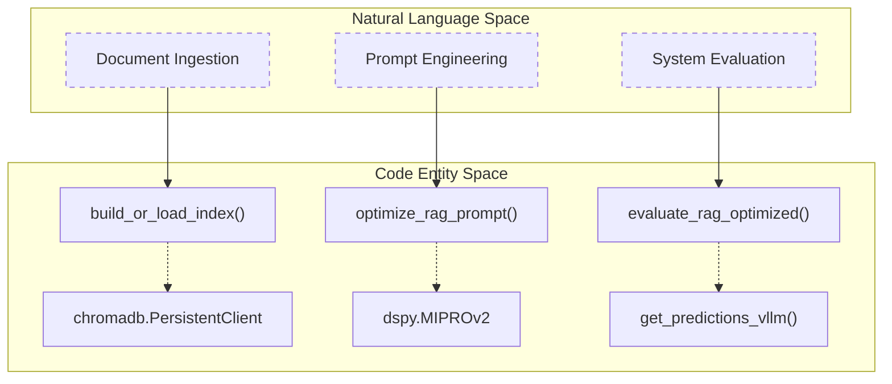
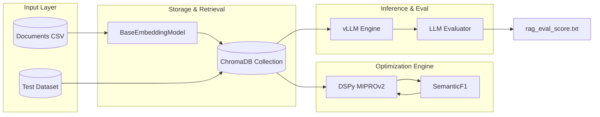

<!-- source: DeepWiki mcp.deepwiki.com · repo microsoft/AutoAdapt · page 5.2 RAG Template: Indexing, Optimization, and Evaluation · fetched 2026-10-26 -->

# RAG Template: Indexing, Optimization, and Evaluation

Relevant source files

The following files were used as context for generating this wiki page:

- [src/autoadapt/agents/best_practices/chromadb_retriever.py](src/autoadapt/agents/best_practices/chromadb_retriever.py)
- [src/autoadapt/agents/best_practices/create_datasets_indexer.py](src/autoadapt/agents/best_practices/create_datasets_indexer.py)
- [src/autoadapt/agents/best_practices/create_datasets_indexer_v2.py](src/autoadapt/agents/best_practices/create_datasets_indexer_v2.py)
- [src/autoadapt/agents/best_practices/datasets_indexer.py](src/autoadapt/agents/best_practices/datasets_indexer.py)
- [src/autoadapt/agents/best_practices/datasets_retriever.py](src/autoadapt/agents/best_practices/datasets_retriever.py)
- [src/autoadapt/agents/best_practices/datasets_retriever_v2.py](src/autoadapt/agents/best_practices/datasets_retriever_v2.py)
- [src/autoadapt/agents/best_practices/openai_embeddings.py](src/autoadapt/agents/best_practices/openai_embeddings.py)
- [src/autoadapt/template/rag/conf/config.yaml](src/autoadapt/template/rag/conf/config.yaml)
- [src/autoadapt/template/rag/main.py](src/autoadapt/template/rag/main.py)
- [src/autoadapt/template/rag/utils.py](src/autoadapt/template/rag/utils.py)

The RAG (Retrieval-Augmented Generation) template in AutoAdapt provides a complete lifecycle for building and refining retrieval-based AI systems. It automates the ingestion of documents into vector databases, optimizes system prompts using advanced techniques like DSPy MIPROv2, and performs rigorous evaluation using vLLM-based inference and LLM-as-a-judge metrics.

## RAG Lifecycle Overview

The RAG execution flow is managed by `src/autoadapt/template/rag/main.py` and consists of three primary stages: indexing, prompt optimization, and end-to-end evaluation [src/autoadapt/template/rag/main.py:42-77]().

### Natural Language Space to Code Entity Space: RAG Execution

The following diagram maps the logical stages of the RAG lifecycle to the specific code entities and files that implement them.

**RAG Lifecycle Mapping**

**Sources:** [src/autoadapt/template/rag/main.py:42-77](), [src/autoadapt/template/rag/utils.py:102-128]()

---

## 1. Document Indexing with ChromaDB

The indexing phase converts raw text documents into vector representations for retrieval. AutoAdapt uses **ChromaDB** as the vector store [src/autoadapt/template/rag/utils.py:113-115]().

### Implementation Details
- **Persistence:** The system uses `chromadb.PersistentClient` to ensure indices are saved to the path specified in `cfg.rag_data.chroma_db_path` [src/autoadapt/template/rag/utils.py:113-114]().
- **Embedding Generation:** Texts are embedded using the model specified in `cfg.rag_params.embedding_model` (e.g., `text-embedding-3-large`) [src/autoadapt/template/rag/conf/config.yaml:35]().
- **Chunking:** Documents are processed into fixed-size word chunks with configurable overlap to maintain context [src/autoadapt/template/rag/utils.py:44-57]().
- **Azure Integration:** For Azure OpenAI users, the `BaseEmbeddingModel` class manages authentication via `ManagedIdentityCredential` and `get_bearer_token_provider` [src/autoadapt/agents/best_practices/openai_embeddings.py:8-37]().

**Sources:** [src/autoadapt/template/rag/utils.py:102-128](), [src/autoadapt/agents/best_practices/openai_embeddings.py:40-76](), [src/autoadapt/template/rag/conf/config.yaml:33-37]()

---

## 2. DSPy Prompt Optimization (MIPROv2)

Rather than relying on static prompts, the RAG template utilizes **DSPy** to optimize the interaction between the retriever and the generator.

### Optimization Workflow
1. **SemanticF1 Metric:** Optimization is guided by the `SemanticF1` metric, which uses embeddings to evaluate the semantic similarity between generated answers and ground truth, providing a more robust signal than exact matching [src/autoadapt/template/rag/utils.py:14]().
2. **MIPROv2:** The system employs the `MIPROv2` (Multi-objective In-context Prompt Optimization) teleprompter to search for the best instructions and few-shot examples [src/autoadapt/template/rag/main.py:51-54]().
3. **Serialization:** The resulting optimized DSPy module is saved as `optimized_rag.json` in the output directory for deployment [src/autoadapt/template/rag/main.py:59]().

**Sources:** [src/autoadapt/template/rag/main.py:51-62](), [src/autoadapt/template/rag/utils.py:14]()

---

## 3. Evaluation and Inference

Evaluation measures the performance of the RAG pipeline on a test dataset using high-throughput inference engines.

### vLLM-Based Inference
For evaluation, AutoAdapt utilizes **vLLM** to generate responses for the test prompts. The `get_predictions_vllm` function handles batch inference on the local model specified by the planner [src/autoadapt/template/rag/utils.py:201]().

### Evaluation Pipeline
The `evaluate_rag` function orchestrates the following data flow:
1. **Data Loading:** Loads test data from CSV/JSON/HF formats [src/autoadapt/template/rag/utils.py:189-196]().
2. **Augmentation:** Queries the ChromaDB collection to retrieve context and constructs augmented prompts [src/autoadapt/template/rag/utils.py:200]().
3. **Generation:** Invokes vLLM to produce predictions [src/autoadapt/template/rag/utils.py:201]().
4. **Scoring:** Uses `evaluate_with_llm` (LLM-as-a-judge) to compare predictions against ground truth [src/autoadapt/template/rag/utils.py:19]().

**Sources:** [src/autoadapt/template/rag/utils.py:167-203](), [src/autoadapt/template/rag/main.py:64-77]()

---

## 4. Status Reporting and Monitoring

The RAG template communicates its progress to the AutoAdapt backend and UI through a series of status files. This allows real-time monitoring of long-running indexing or optimization tasks.

| Status File | Purpose |
| :--- | :--- |
| `rag_index_status.txt` | Tracks ChromaDB indexing progress (`In Process`, `Success`) [src/autoadapt/template/rag/main.py:43-47]() |
| `rag_optimize_status.txt` | Tracks DSPy prompt optimization progress [src/autoadapt/template/rag/main.py:52-60]() |
| `rag_eval_status.txt` | Tracks the final evaluation stage [src/autoadapt/template/rag/main.py:67-74]() |
| `rag_eval_score.txt` | Stores the final average accuracy score [src/autoadapt/template/rag/main.py:75]() |
| `rag_index_path.txt` | Points to the location of the persistent ChromaDB [src/autoadapt/template/rag/main.py:48]() |

**Sources:** [src/autoadapt/template/rag/main.py:32-36](), [src/autoadapt/template/rag/main.py:43-75]()

---

## 5. Architectural Data Flow

The following diagram illustrates the flow of data from raw documents to the final evaluated RAG pipeline.

**RAG Data Flow and Components**

**Sources:** [src/autoadapt/template/rag/utils.py:102-128](), [src/autoadapt/template/rag/utils.py:167-203](), [src/autoadapt/template/rag/main.py:42-77]()

---

