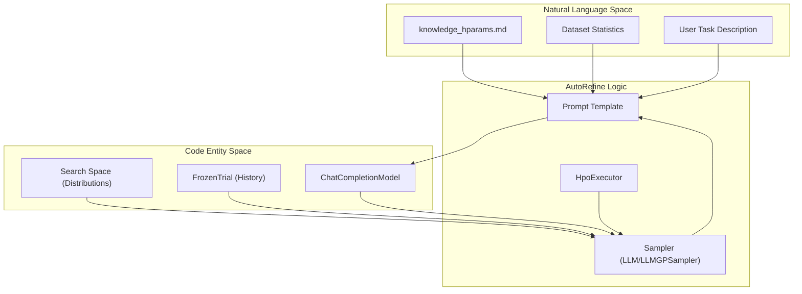
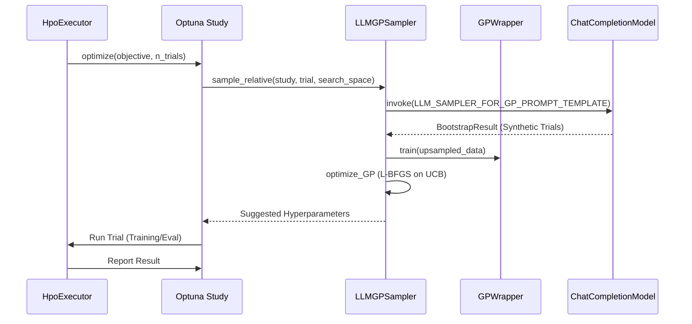

<!-- source: DeepWiki mcp.deepwiki.com · repo microsoft/AutoAdapt · page 6 LLM-Based Hyperparameter Optimization (AutoRefine) · fetched 2026-10-26 -->

# LLM-Based Hyperparameter Optimization (AutoRefine)

Relevant source files

The following files were used as context for generating this wiki page:

- [src/autoadapt/adapt/pipeline_executor.py](src/autoadapt/adapt/pipeline_executor.py)
- [src/autoadapt/hpo/hpo_executor.py](src/autoadapt/hpo/hpo_executor.py)
- [src/autoadapt/hpo/llm_gp_sampler.py](src/autoadapt/hpo/llm_gp_sampler.py)
- [src/autoadapt/hpo/llm_sampler.py](src/autoadapt/hpo/llm_sampler.py)
- [src/autoadapt/hpo/llm_surrogate_sampler.py](src/autoadapt/hpo/llm_surrogate_sampler.py)

AutoRefine is the hyperparameter optimization (HPO) engine within AutoAdapt. It leverages Large Language Models (LLMs) to navigate complex search spaces more efficiently than traditional black-box methods. By treating the LLM as a knowledgeable agent that understands machine learning best practices, AutoRefine can prune search spaces, suggest promising starting points, and even model the relationship between hyperparameters and performance metrics.

The system is implemented as a set of custom **Optuna samplers** that integrate directly into the `HpoExecutor` lifecycle [src/autoadapt/hpo/hpo_executor.py:16-18]().

## System Architecture

The `HpoExecutor` orchestrates the optimization process by setting up an Optuna study and selecting one of three specialized LLM-based samplers. These samplers interact with the `ChatCompletionModel` to generate or evaluate hyperparameter configurations.

### From Natural Language to Optimization Entities

The following diagram illustrates how the system bridges high-level ML knowledge and task descriptions into the structured search space used by the code.

**LLM-HPO Conceptual Mapping**

**Sources:** [src/autoadapt/hpo/hpo_executor.py:40-62](), [src/autoadapt/hpo/llm_gp_sampler.py:57-107]()

## Core Samplers

AutoAdapt provides three distinct strategies for LLM-driven optimization. Each sampler implements the `optuna.samplers.BaseSampler` interface, specifically overriding `sample_relative` to perform joint parameter sampling [src/autoadapt/hpo/llm_sampler.py:121-123]().

### 1. LLMSampler
The simplest implementation that directly prompts the LLM to suggest a single set of hyperparameters based on the current search space and trial history. It uses `LLM_SAMPLER_PROMPT_TEMPLATE` to frame the request [src/autoadapt/hpo/llm_sampler.py:30-40]().

*   **Key Feature:** Direct zero-shot or few-shot suggestion.
*   **For details, see [LLM Samplers: LLMSampler and LLMSurrogateSampler](#6.1)**.

### 2. LLMSurrogateSampler
An extension of the basic sampler that asks the LLM to suggest multiple trials (defaulting to 10) and predict the resulting metric for each [src/autoadapt/hpo/llm_surrogate_sampler.py:147-160](). It then uses `np.argmax` to select the trial the LLM is most confident in [src/autoadapt/hpo/llm_surrogate_sampler.py:168]().

*   **Key Feature:** Internal "mental" simulation by the LLM before selecting a candidate.
*   **For details, see [LLM Samplers: LLMSampler and LLMSurrogateSampler](#6.1)**.

### 3. LLMGPSampler (Hybrid Optimization)
The most advanced sampler, which combines LLM reasoning with the mathematical rigor of Gaussian Processes (GP). It uses the LLM to "bootstrap" synthetic data points, which are then used to train a `GPWrapper` [src/autoadapt/hpo/llm_gp_sampler.py:55]().

*   **Key Feature:** Uses LLM-generated synthetic trials to warm-start a surrogate model, followed by UCB (Upper Confidence Bound) optimization.
*   **For details, see [LLM-GP Sampler: Hybrid Gaussian Process Optimization](#6.2)**.

## Integration with HpoExecutor

The `HpoExecutor` manages the lifecycle of these samplers, including the injection of domain knowledge from `knowledge_hparams.md` [src/autoadapt/hpo/llm_gp_sampler.py:19-22]().

**Sampler Execution Flow**

**Sources:** [src/autoadapt/hpo/hpo_executor.py:203-240](), [src/autoadapt/hpo/llm_gp_sampler.py:350-450]()

## Key Components

| Component | File Path | Role |
| :--- | :--- | :--- |
| `HpoExecutor` | [src/autoadapt/hpo/hpo_executor.py:40]() | Orchestrates Optuna trials and selects the sampler. |
| `LLMSampler` | [src/autoadapt/hpo/llm_sampler.py:75]() | Basic LLM-based parameter proposer. |
| `LLMSurrogateSampler` | [src/autoadapt/hpo/llm_surrogate_sampler.py:62]() | LLM-based proposer with internal ranking. |
| `LLMGPSampler` | [src/autoadapt/hpo/llm_gp_sampler.py:228]() | Hybrid LLM and Gaussian Process sampler. |
| `GPWrapper` | [src/autoadapt/hpo/gaussian_process.py]() | GPyTorch-based wrapper for the surrogate model. |

## Child Pages
*   [LLM Samplers: LLMSampler and LLMSurrogateSampler](#6.1): Detailed breakdown of direct LLM prompting and surrogate selection logic.
*   [LLM-GP Sampler: Hybrid Gaussian Process Optimization](#6.2): In-depth look at synthetic data bootstrapping, GP training, and acquisition function optimization.

**Sources:**
- [src/autoadapt/hpo/hpo_executor.py:1-186]()
- [src/autoadapt/hpo/llm_sampler.py:1-175]()
- [src/autoadapt/hpo/llm_surrogate_sampler.py:1-182]()
- [src/autoadapt/hpo/llm_gp_sampler.py:1-152]()

---

