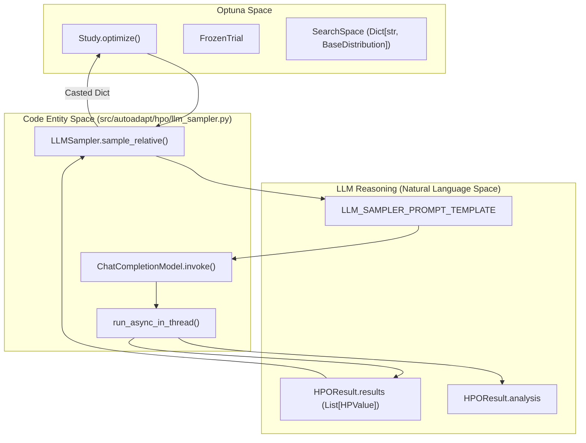
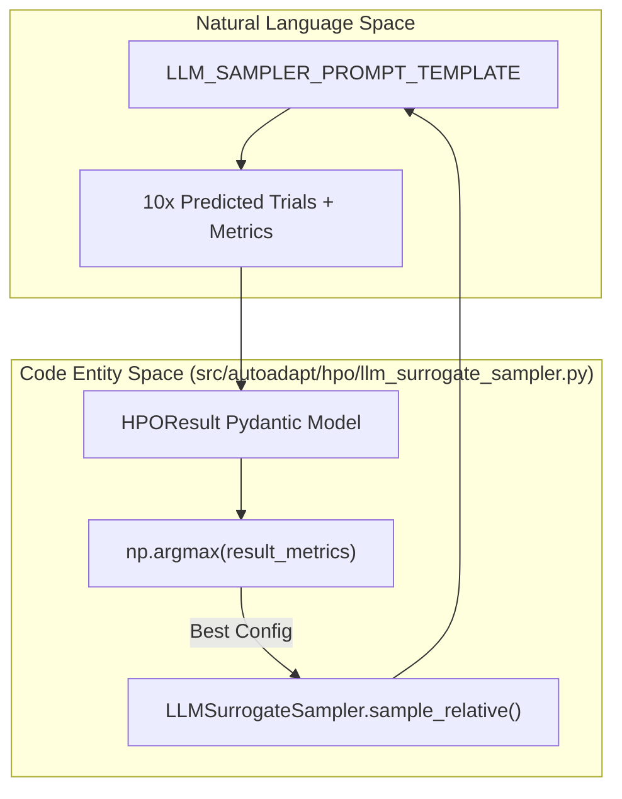

<!-- source: DeepWiki mcp.deepwiki.com · repo microsoft/AutoAdapt · page 6.1 LLM Samplers: LLMSampler and LLMSurrogateSampler · fetched 2026-10-26 -->

# LLM Samplers: LLMSampler and LLMSurrogateSampler

Relevant source files

The following files were used as context for generating this wiki page:

- [src/autoadapt/config/default_params_to_bootstrap.json](src/autoadapt/config/default_params_to_bootstrap.json)
- [src/autoadapt/config/knowledge.md](src/autoadapt/config/knowledge.md)
- [src/autoadapt/config/knowledge_hparams.md](src/autoadapt/config/knowledge_hparams.md)
- [src/autoadapt/hpo/llm_gp_sampler.py](src/autoadapt/hpo/llm_gp_sampler.py)
- [src/autoadapt/hpo/llm_sampler.py](src/autoadapt/hpo/llm_sampler.py)
- [src/autoadapt/hpo/llm_surrogate_sampler.py](src/autoadapt/hpo/llm_surrogate_sampler.py)

The AutoAdapt framework leverages Large Language Models (LLMs) to navigate hyperparameter search spaces more efficiently than traditional random or grid search methods. This is primarily achieved through custom Optuna samplers that implement the `sample_relative` interface. This page details the two primary LLM-driven samplers: `LLMSampler` and `LLMSurrogateSampler`.

## LLMSampler: Direct LLM Prompting

The `LLMSampler` is the most straightforward implementation of LLM-based optimization in AutoAdapt. It treats the LLM as a black-box optimizer that suggests a single set of hyperparameters for each trial based on the search space and historical results [src/autoadapt/hpo/llm_sampler.py:75-80]().

### Core Implementation
The sampler inherits from Optuna's `BaseSampler` and overrides `sample_relative` to perform the LLM call [src/autoadapt/hpo/llm_sampler.py:75-75]().

1.  **Search Space Inference**: It returns the entire search space defined in the configuration, allowing the LLM to consider all variable parameters simultaneously [src/autoadapt/hpo/llm_sampler.py:88-119]().
2.  **Prompt Construction**: It assembles a prompt using `LLM_SAMPLER_PROMPT_TEMPLATE` (v1 or v2) containing:
    *   The variable parameters and their distributions [src/autoadapt/hpo/llm_sampler.py:135-135]().
    *   A string representation of past trial results [src/autoadapt/hpo/llm_sampler.py:136-136]().
3.  **LLM Invocation**: The sampler uses `ChatCompletionModel` to invoke the LLM. Since Optuna's sampling process is synchronous, it uses `run_async_in_thread` to bridge the asynchronous LLM call [src/autoadapt/hpo/llm_sampler.py:151-161]().
4.  **Type Casting**: The raw string values returned by the LLM are cast back to the appropriate Python types (e.g., `float` for `FloatDistribution`, or the specific category type for `CategoricalDistribution`) before being returned to the Optuna study [src/autoadapt/hpo/llm_sampler.py:164-173]().

### LLMSampler Data Flow
The following diagram illustrates how the `LLMSampler` bridges the Natural Language reasoning of the LLM with the structured `Code Entity Space` of Optuna.

**LLMSampler Execution Flow**

Sources: [src/autoadapt/hpo/llm_sampler.py:75-175](), [src/autoadapt/utils/misc.py:39-39]()

---

## LLMSurrogateSampler: Multi-Trial Prediction

The `LLMSurrogateSampler` extends the direct prompting approach by asking the LLM to act as a "surrogate model." Instead of suggesting one set of parameters, it asks the LLM to suggest multiple trials (typically 10) and predict the expected metric result for each [src/autoadapt/hpo/llm_surrogate_sampler.py:62-67]().

### Selection Logic
1.  **Multi-Trial Generation**: The prompt explicitly requests `{num_trials}` (default 10) experiments [src/autoadapt/hpo/llm_surrogate_sampler.py:153-153]().
2.  **Expected Metrics**: The LLM provides a `result_metric` for every suggested configuration [src/autoadapt/hpo/llm_surrogate_sampler.py:133-135]().
3.  **Argmax Selection**: The sampler extracts all predicted metrics and uses `np.argmax()` to select the configuration the LLM believes will perform best [src/autoadapt/hpo/llm_surrogate_sampler.py:164-168]().
4.  **Configuration Context**: Unlike the basic sampler, this version passes the HPO metric name and description (e.g., "higher the better") to the LLM to improve prediction accuracy [src/autoadapt/hpo/llm_surrogate_sampler.py:143-156]().

### Data Structures
The sampler uses Pydantic models to enforce structured output from the LLM:
*   `HPValue`: Maps a parameter name to a value [src/autoadapt/hpo/llm_surrogate_sampler.py:126-128]().
*   `HPOSingleResult`: Contains reasoning, the predicted metric, and the list of `HPValue` objects [src/autoadapt/hpo/llm_surrogate_sampler.py:129-136]().
*   `HPOResult`: A wrapper containing the `results_list` of `HPOSingleResult` [src/autoadapt/hpo/llm_surrogate_sampler.py:137-138]().

**LLMSurrogateSampler Logic**

Sources: [src/autoadapt/hpo/llm_surrogate_sampler.py:125-170]()

---

## Integration with Domain Knowledge

Both samplers utilize external knowledge bases to ground the LLM's suggestions in empirical best practices.

### Knowledge Sources
*   **HParam Knowledge**: Detailed descriptions and impact analysis of parameters like `learning_rate`, `lora_r`, and `dpo_beta` are loaded from `knowledge_hparams.md` [src/autoadapt/hpo/llm_gp_sampler.py:19-22](), [src/autoadapt/config/knowledge_hparams.md:1-100]().
*   **Domain Best Practices**: The samplers receive model-specific information (e.g., Llama-3 vs Phi-4), optimizer types, and dataset statistics to tailor the search space [src/autoadapt/hpo/llm_gp_sampler.py:65-71]().
*   **Bootstrap Defaults**: For common models, default starting points are provided in `default_params_to_bootstrap.json` to initialize the search history [src/autoadapt/config/default_params_to_bootstrap.json:1-24]().

### Prompt Components
The prompts are dynamically constructed to include:
| Component | Description | Source |
| :--- | :--- | :--- |
| `{hparam_knowledge}` | Guidelines on how parameters affect training. | `knowledge_hparams.md` |
| `{history}` | Stringified list of previous Optuna trials and their values. | `study.get_trials()` |
| `{data_stats}` | Domain and token-level statistics of the user's dataset. | `DataAgent` output |
| `{metrics}` | The objective metric (e.g., `eval_loss`, `accuracy`). | `cfg.hpo.hpo_metric` |

Sources: [src/autoadapt/hpo/llm_gp_sampler.py:57-107](), [src/autoadapt/hpo/llm_sampler.py:42-73](), [src/autoadapt/config/knowledge_hparams.md:1-28]()

---

