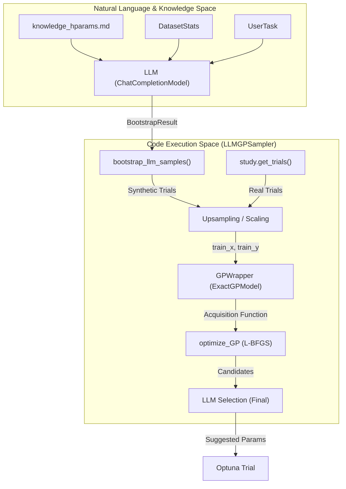
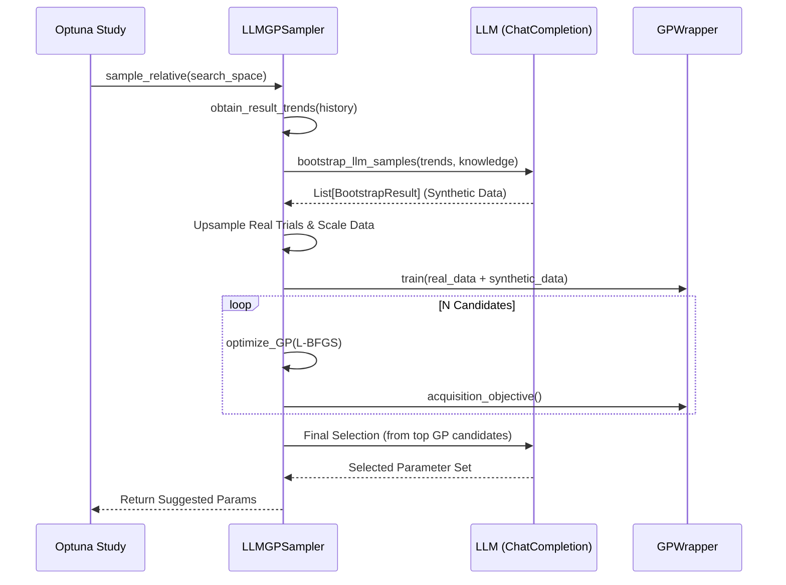

<!-- source: DeepWiki mcp.deepwiki.com · repo microsoft/AutoAdapt · page 6.2 LLM-GP Sampler: Hybrid Gaussian Process Optimization · fetched 2026-10-26 -->

# LLM-GP Sampler: Hybrid Gaussian Process Optimization

Relevant source files

The following files were used as context for generating this wiki page:

- [src/autoadapt/config/default_params_to_bootstrap.json](src/autoadapt/config/default_params_to_bootstrap.json)
- [src/autoadapt/hpo/gaussian_process.py](src/autoadapt/hpo/gaussian_process.py)
- [src/autoadapt/hpo/llm_gp_sampler.py](src/autoadapt/hpo/llm_gp_sampler.py)
- [src/autoadapt/hpo/llm_sampler.py](src/autoadapt/hpo/llm_sampler.py)
- [src/autoadapt/hpo/llm_surrogate_sampler.py](src/autoadapt/hpo/llm_surrogate_sampler.py)

The `LLMGPSampler` is a sophisticated Optuna sampler that combines the reasoning capabilities of Large Language Models (LLMs) with the mathematical rigor of Gaussian Processes (GP). It is designed to navigate high-dimensional hyperparameter search spaces by using LLMs to bootstrap initial data and a GP surrogate model to perform acquisition optimization via Upper Confidence Bound (UCB).

### Overview and Purpose
Traditional Bayesian Optimization (BO) often requires several initial random trials to start building a reliable surrogate model. In the context of expensive LLM fine-tuning, these random trials are costly. The `LLMGPSampler` addresses this by:
1.  **Bootstrapping**: Using an LLM to generate synthetic trials (parameters and expected results) based on empirical knowledge [src/autoadapt/hpo/llm_gp_sampler.py:55-56]().
2.  **Trend Analysis**: Extracting parameter-wise performance trends from historical data to guide the LLM [src/autoadapt/hpo/llm_gp_sampler.py:79-82]().
3.  **Hybrid Optimization**: Fitting a `GPWrapper` on both real and synthetic data, then optimizing an acquisition function to suggest the next candidate [src/autoadapt/hpo/llm_gp_sampler.py:453-470]().

---

### Implementation Architecture

The sampler implements the `BaseSampler` interface from Optuna, specifically overriding `sample_relative` to perform its multi-step optimization logic.

#### Data Flow and Code Entity Mapping
The following diagram illustrates how natural language domain knowledge and user tasks are transformed into numerical search space projections and GP model updates.

**Hybrid Optimization Pipeline**

**Sources:** [src/autoadapt/hpo/llm_gp_sampler.py:57-107](), [src/autoadapt/hpo/llm_gp_sampler.py:421-480](), [src/autoadapt/hpo/gaussian_process.py:10-21]()

---

### Key Components and Functions

#### 1. Trend Analysis (`obtain_result_trends`)
Before prompting the LLM, the sampler analyzes existing trial history to determine the correlation between individual hyperparameters and the target metric. It calculates a simple "trend" (increasing, decreasing, or stable) to provide the LLM with context on how parameters like `learning_rate` or `lora_alpha` have affected performance so far [src/autoadapt/hpo/llm_gp_sampler.py:253-300]().

#### 2. LLM Bootstrapping (`bootstrap_llm_samples`)
The sampler uses `LLM_SAMPLER_FOR_GP_PROMPT_TEMPLATE` to ask the LLM for `num_trials` (default 10) of synthetic data. 
- **Input**: Hyperparameter knowledge [src/autoadapt/hpo/llm_gp_sampler.py:21-22](), dataset statistics, and historical trends.
- **Output**: A list of `BootstrapResult` objects containing parameters, expected `result_metric_min/max`, and `result_metric_confidence` [src/autoadapt/hpo/llm_gp_sampler.py:302-315]().

#### 3. GPWrapper and ExactGPModel
The `GPWrapper` manages a `gpytorch.models.ExactGP` using a Constant Mean and a Scale Kernel with an RBF (Radial Basis Function) kernel [src/autoadapt/hpo/gaussian_process.py:10-19]().
- **Training**: Fits the model using the Adam optimizer for 25 iterations [src/autoadapt/hpo/gaussian_process.py:30-56]().
- **Acquisition**: Implements an acquisition objective (Mean + Variance) to balance exploration and exploitation [src/autoadapt/hpo/gaussian_process.py:69-97]().

#### 4. Acquisition Optimization (`optimize_GP`)
Once the GP is trained on the hybrid dataset, the sampler finds the global maximum of the acquisition function across the continuous search space.
- It uses the **L-BFGS** optimizer [src/autoadapt/hpo/llm_gp_sampler.py:183-219]().
- It projects the search space into a unit hypercube for optimization and then back-projects the results into the original parameter scales [src/autoadapt/hpo/llm_gp_sampler.py:192-195]().

**Sources:** [src/autoadapt/hpo/llm_gp_sampler.py:183-219](), [src/autoadapt/hpo/gaussian_process.py:10-58](), [src/autoadapt/hpo/llm_gp_sampler.py:253-315]()

---

### Data Models

The sampler relies on Pydantic models to enforce structure on LLM outputs, ensuring that synthetic trials can be parsed into tensors for the GP.

| Model | Description | Key Fields |
| :--- | :--- | :--- |
| `HPValue` | Represents a single parameter value. | `param_name`, `param_value` [src/autoadapt/hpo/llm_gp_sampler.py:118-120]() |
| `BootstrapResult` | A synthetic trial generated by the LLM. | `results`, `result_metric_min`, `result_metric_max`, `result_metric_confidence` [src/autoadapt/hpo/llm_gp_sampler.py:122-132]() |
| `HPOResult` | A collection of synthetic trials. | `results_list` [src/autoadapt/hpo/llm_gp_sampler.py:134-135]() |

**Sources:** [src/autoadapt/hpo/llm_gp_sampler.py:118-135]()

---

### Detailed Execution Flow

The `sample_relative` method coordinates the entire lifecycle of a single trial suggestion:

**LLMGPSampler Logic Flow**

1.  **Exploration Phase**: If history is empty, the sampler uses default parameters from `default_params_to_bootstrap.json` [src/autoadapt/hpo/llm_gp_sampler.py:431-435]().
2.  **Hybrid Dataset Construction**: Real trials from `study.get_trials()` are combined with LLM-generated synthetic trials. Synthetic trials are weighted by the LLM's reported `confidence` [src/autoadapt/hpo/llm_gp_sampler.py:309-311]().
3.  **Search Space Projection**: Categorical variables are encoded using `LabelEncoder`, and all numerical values are scaled to a `[0, 1]` range to stabilize GP training [src/autoadapt/hpo/llm_gp_sampler.py:340-360]().
4.  **L-BFGS Optimization**: The acquisition function (UCB) is maximized to find candidate points that are either likely to be high-performing (high mean) or highly uncertain (high variance) [src/autoadapt/hpo/llm_gp_sampler.py:183-219]().
5.  **Final LLM Selection**: Instead of blindly picking the GP's maximum, the sampler provides the top candidates back to the LLM. The LLM performs a final "sanity check" using `LLM_SAMPLER_FROM_GPRESULTS_PROMPT_TEMPLATE` to select the most promising configuration [src/autoadapt/hpo/llm_gp_sampler.py:475-495]().

**Sources:** [src/autoadapt/hpo/llm_gp_sampler.py:421-505](), [src/autoadapt/hpo/llm_gp_sampler.py:183-219](), [src/autoadapt/hpo/llm_gp_sampler.py:154-181]()

---

