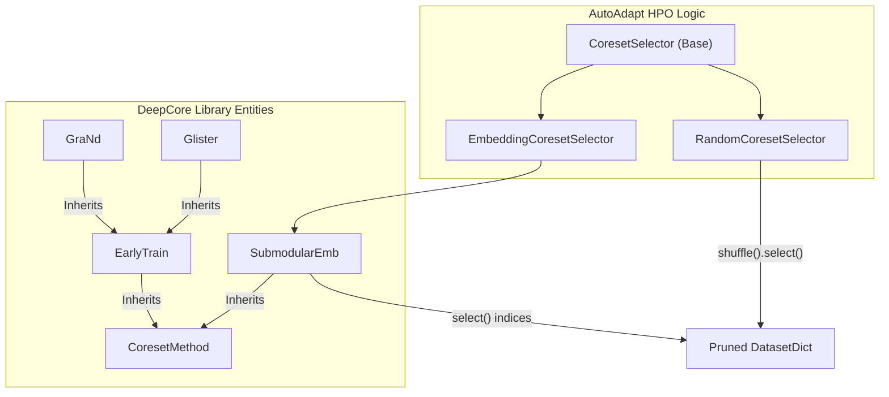
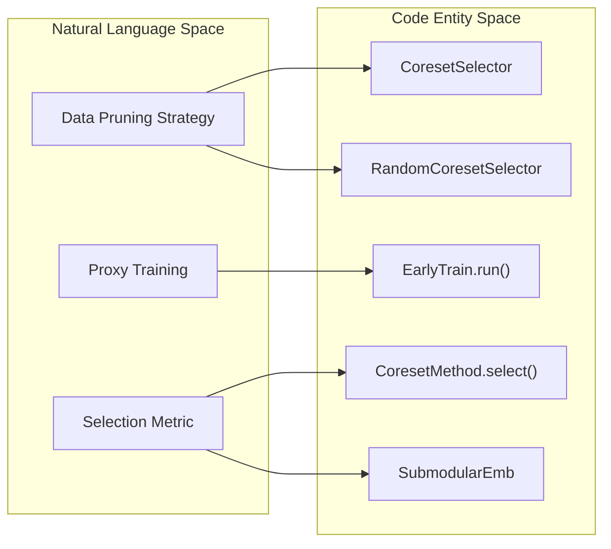

<!-- source: DeepWiki mcp.deepwiki.com · repo microsoft/AutoAdapt · page 7 Coreset Selection (deepcore) · fetched 2026-10-26 -->

# Coreset Selection (deepcore)

Relevant source files

The following files were used as context for generating this wiki page:

- [src/autoadapt/hpo/coreset_selection.py](src/autoadapt/hpo/coreset_selection.py)
- [src/deepcore/__init__.py](src/deepcore/__init__.py)
- [src/deepcore/methods/__init__.py](src/deepcore/methods/__init__.py)
- [src/deepcore/methods/contextualdiversity.py](src/deepcore/methods/contextualdiversity.py)
- [src/deepcore/methods/coresetmethod.py](src/deepcore/methods/coresetmethod.py)
- [src/deepcore/methods/earlytrain.py](src/deepcore/methods/earlytrain.py)
- [src/deepcore/methods/full.py](src/deepcore/methods/full.py)
- [src/deepcore/methods/glister.py](src/deepcore/methods/glister.py)
- [src/deepcore/methods/grand.py](src/deepcore/methods/grand.py)
- [src/deepcore/methods/methods_utils/__init__.py](src/deepcore/methods/methods_utils/__init__.py)
- [src/deepcore/methods/uncertainty.py](src/deepcore/methods/uncertainty.py)
- [src/deepcore/methods/uniform.py](src/deepcore/methods/uniform.py)

Coreset selection is a critical optimization technique integrated into AutoAdapt to accelerate Hyperparameter Optimization (HPO). By identifying and selecting a representative subset (a "coreset") of the training data, AutoAdapt reduces the computational cost of individual HPO trials without significantly sacrificing the quality of the resulting hyperparameters. This functionality is powered by the `deepcore` library, which provides a suite of advanced dataset pruning algorithms.

## Overview and Integration

In AutoAdapt, coreset selection is managed by the `CoresetSelector` interface. During the HPO phase, the system uses these selectors to prune the dataset before passing it to the training templates (SFT or DPO).

### Selection Strategies
AutoAdapt supports two primary high-level strategies for coreset selection:

1.  **Random Selection**: Implemented in `RandomCoresetSelector`, this method shuffles the dataset and selects a fixed fraction of the data based on `hpo.coreset_train_ratio` and `hpo.coreset_val_ratio` [src/autoadapt/hpo/coreset_selection.py:110-157]().
2.  **Embedding-based Selection**: Implemented in `EmbeddingCoresetSelector`, this method uses a pre-trained embedding model (e.g., `intfloat/e5-large-v2`) to represent data points in a high-dimensional space and then applies submodular optimization to select the most informative samples [src/autoadapt/hpo/coreset_selection.py:43-107]().

### Core Components Hierarchy

The `deepcore` library follows a strict class hierarchy to implement various pruning algorithms.

| Class | Role | Source |
| :--- | :--- | :--- |
| `CoresetMethod` | The abstract base class defining the `select()` interface. | [src/deepcore/methods/coresetmethod.py:1-18]() |
| `EarlyTrain` | A base class for methods requiring a "proxy" training run to calculate scores (e.g., gradients or loss). | [src/deepcore/methods/earlytrain.py:10-14]() |
| `Full` / `Uniform` | Baseline methods that either use the full dataset or perform balanced/unbalanced random sampling. | [src/deepcore/methods/full.py:5-10](), [src/deepcore/methods/uniform.py:5-32]() |

### Selection Workflow
The following diagram illustrates how the `CoresetSelector` interacts with the `deepcore` library to produce a pruned `DatasetDict`.

**Coreset Selection Architecture**

**Sources:** [src/autoadapt/hpo/coreset_selection.py:17-157](), [src/deepcore/methods/earlytrain.py:10-14](), [src/deepcore/methods/coresetmethod.py:1-18]()

---

## EarlyTrain Base Class and Training Lifecycle

Many advanced coreset methods (like GraNd or Glister) rely on the model's state during or after a short training period. The `EarlyTrain` class provides a standardized training loop with lifecycle hooks that subclasses override to perform specific calculations.

*   **Initialization**: Configures the proxy model, optimizer, and pre-training fractions [src/deepcore/methods/earlytrain.py:15-60]().
*   **The `run()` Loop**: Orchestrates the training process across specified epochs [src/deepcore/methods/earlytrain.py:96-140]().
*   **Lifecycle Hooks**: Includes `before_run`, `before_epoch`, `after_loss`, and `finish_run` to allow algorithms to capture gradients or track sample importance [src/deepcore/methods/earlytrain.py:64-94]().

For details on the training lifecycle and GPU setup, see **[EarlyTrain Base Class and Training Lifecycle Hooks](#7.1)**.

**Sources:** [src/deepcore/methods/earlytrain.py:10-140]()

---

## Selection Method Categories

The library implements several categories of selection algorithms, ranging from simple geometric heuristics to complex gradient-matching optimizations.

### Geometric and Submodular Methods
These methods treat data points as vectors in an embedding space and attempt to find a subset that "covers" the space efficiently.
*   **kCenterGreedy**: Minimizes the maximum distance between any data point and its nearest center in the coreset [src/deepcore/methods/contextualdiversity.py:9-12]().
*   **SubmodularEmb**: Uses submodular function maximization to ensure diversity [src/autoadapt/hpo/coreset_selection.py:74-75]().

### Gradient and Uncertainty Methods
These methods use the model's internal gradients or output probabilities to determine sample "hardness" or information gain.
*   **GraNd (Gradient Norm)**: Selects samples with the highest gradient norms, averaged over multiple initializations [src/deepcore/methods/grand.py:7-75]().
*   **Glister**: A bi-level optimization approach that selects a subset whose gradient most closely matches the gradient of a validation set [src/deepcore/methods/glister.py:8-140]().
*   **Uncertainty**: Selects samples based on metrics like `LeastConfidence`, `Entropy`, or `Margin` [src/deepcore/methods/uncertainty.py:6-85]().

For detailed algorithmic explanations, see **[Geometric and Gradient-Based Selection Methods](#7.2)**.

**Sources:** [src/deepcore/methods/grand.py:7-75](), [src/deepcore/methods/glister.py:8-140](), [src/deepcore/methods/uncertainty.py:6-85](), [src/deepcore/methods/contextualdiversity.py:9-33]()

---

## Entity Mapping: Code to Logic

This diagram maps the natural language concepts of coreset selection to the specific classes and methods in the codebase.

**System Entity Map**

**Sources:** [src/autoadapt/hpo/coreset_selection.py:17-43](), [src/deepcore/methods/earlytrain.py:96-105](), [src/deepcore/methods/coresetmethod.py:1-18]()

---

