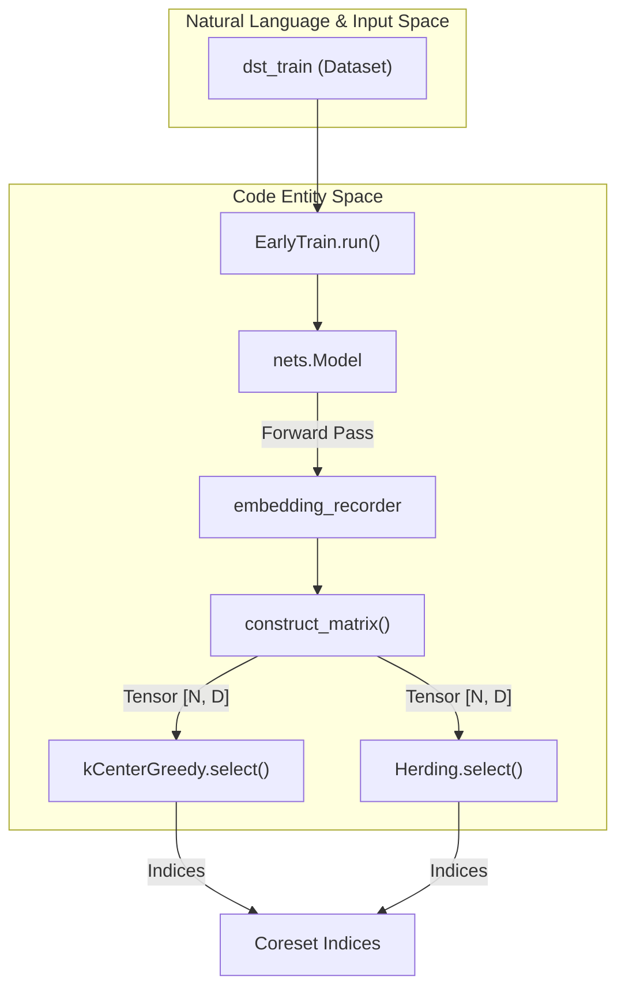
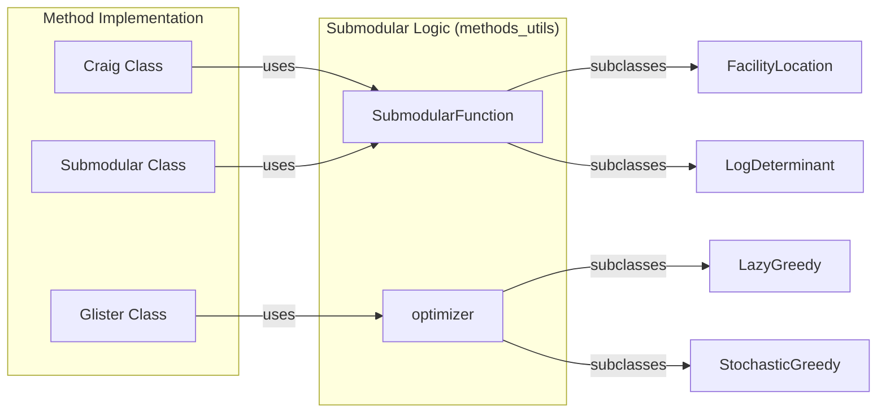

<!-- source: DeepWiki mcp.deepwiki.com · repo microsoft/AutoAdapt · page 7.2 Geometric and Gradient-Based Selection Methods · fetched 2026-10-26 -->

# Geometric and Gradient-Based Selection Methods

Relevant source files

The following files were used as context for generating this wiki page:

- [src/deepcore/methods/cal.py](src/deepcore/methods/cal.py)
- [src/deepcore/methods/craig.py](src/deepcore/methods/craig.py)
- [src/deepcore/methods/deepfool.py](src/deepcore/methods/deepfool.py)
- [src/deepcore/methods/earlytrain.py](src/deepcore/methods/earlytrain.py)
- [src/deepcore/methods/forgetting.py](src/deepcore/methods/forgetting.py)
- [src/deepcore/methods/glister.py](src/deepcore/methods/glister.py)
- [src/deepcore/methods/gradmatch.py](src/deepcore/methods/gradmatch.py)
- [src/deepcore/methods/grand.py](src/deepcore/methods/grand.py)
- [src/deepcore/methods/herding.py](src/deepcore/methods/herding.py)
- [src/deepcore/methods/kcentergreedy.py](src/deepcore/methods/kcentergreedy.py)
- [src/deepcore/methods/methods_utils/submodular_function.py](src/deepcore/methods/methods_utils/submodular_function.py)
- [src/deepcore/methods/methods_utils/submodular_optimizer.py](src/deepcore/methods/methods_utils/submodular_optimizer.py)
- [src/deepcore/methods/submodular.py](src/deepcore/methods/submodular.py)
- [src/deepcore/methods/submodular_emb.py](src/deepcore/methods/submodular_emb.py)

This page details the implementation of advanced coreset selection algorithms within the `deepcore` library. These methods leverage geometric properties in embedding space or gradient information to identify the most informative samples for model training, particularly during the HPO (Hyperparameter Optimization) phase of AutoAdapt.

## Geometric Selection Methods

Geometric methods focus on the distribution of data points in the embedding space of a neural network. They aim to select a subset that "covers" the entire dataset space or represents its diversity.

### kCenterGreedy
The `kCenterGreedy` method implements the k-Center problem using a greedy approach. It selects points that minimize the maximum distance between any point in the dataset and its nearest selected center [src/deepcore/methods/kcentergreedy.py:68-71]().

*   **Distance Matrix**: It maintains a `dis_matrix` of size `(selected + budget) x sample_num` to track distances from each point to the current set of centers [src/deepcore/methods/kcentergreedy.py:48-51]().
*   **Update Logic**: In each iteration, it finds the point with the maximum "minimum distance" to the existing centers (`torch.argmax(mins)`) and adds it to the coreset [src/deepcore/methods/kcentergreedy.py:57-58]().
*   **Embedding Extraction**: The method uses an `embedding_recorder` to capture the output of the penultimate layer of the model to form the feature matrix [src/deepcore/methods/kcentergreedy.py:129-147]().

### Herding
`Herding` selects samples such that their mean embedding matches the mean embedding of the entire dataset [src/deepcore/methods/herding.py:8-11]().
*   **Implementation**: It iteratively selects a point $p$ that, when added to the current selection, brings the running mean of selected points closest to the center of the full dataset distribution [src/deepcore/methods/herding.py:74-84]().

### Geometric Data Flow
The following diagram illustrates how raw data is transformed into an embedding matrix used by geometric solvers.

**Title: Geometric Selection Data Flow**

Sources: [src/deepcore/methods/kcentergreedy.py:129-147](), [src/deepcore/methods/herding.py:40-58](), [src/deepcore/methods/earlytrain.py:96-134]()

---

## Gradient-Based Selection Methods

Gradient-based methods utilize the sensitivity of the model's loss function with respect to its parameters. These methods often require a "warm-up" period where the model is partially trained (`EarlyTrain`) before selection occurs.

### GradMatch
`GradMatch` aims to find a weighted subset of data whose gradient matches the gradient of the full dataset (or a validation set) [src/deepcore/methods/gradmatch.py:11-16]().
*   **OMP Solver**: It uses Orthogonal Matching Pursuit (OMP) to solve the sparse approximation problem $\min_x \|Ax - b\|_2$ where $A$ is the matrix of per-sample gradients and $b$ is the target mean gradient [src/deepcore/methods/gradmatch.py:26-37]().
*   **Variants**: It supports both GPU-accelerated OMP [src/deepcore/methods/gradmatch.py:38-75]() and a NumPy-based CPU version [src/deepcore/methods/gradmatch.py:77-123]().

### Glister
`Glister` treats coreset selection as a discrete optimization problem, specifically targeting the improvement of validation set performance [src/deepcore/methods/glister.py:8-10]().
*   **Recursive Gradient Update**: Instead of recomputing gradients from scratch, it implements `update_val_gradients` to approximate the change in validation gradients after a hypothetical parameter update using a selected batch [src/deepcore/methods/glister.py:81-107]().
*   **Optimization**: It uses submodular optimizers (e.g., `LazyGreedy`) to select samples that maximize the inner product between the training sample gradient and the validation gradient [src/deepcore/methods/glister.py:128-132]().

### GraNd (Gradient Norm)
`GraNd` selects samples based on the norm of their gradients, averaged over multiple independent initializations [src/deepcore/methods/grand.py:7-15]().
*   **Logic**: High gradient norm samples are considered "hard" or more informative.
*   **Repeat Averaging**: The `repeat` parameter controls how many times the model is re-initialized and trained to obtain a stable estimate of the gradient norm [src/deepcore/methods/grand.py:58-65]().

---

## Submodular Optimization Framework

Many methods (Craig, Glister, Submodular) share a common infrastructure for submodular optimization located in `src/deepcore/methods/methods_utils/`.

### Submodular Function Hierarchy
| Class | Functionality | Source |
| :--- | :--- | :--- |
| `FacilityLocation` | Maximizes coverage/similarity to the whole set. | [submodular_function.py:28]() |
| `GraphCut` | Balances representation and diversity. | [submodular_function.py:75]() |
| `LogDeterminant` | Maximizes diversity via determinant of similarity matrix. | [submodular_function.py:113]() |

### Optimizer Strategies
Optimizers are selected via the `greedy` argument in the method constructor [src/deepcore/methods/submodular.py:13-15]().
*   **NaiveGreedy**: Standard $O(nk)$ selection [src/deepcore/methods/methods_utils/submodular_optimizer.py:19-40]().
*   **LazyGreedy**: Uses a priority queue to skip redundant gain calculations (Min-cut/Max-flow optimization) [src/deepcore/methods/methods_utils/submodular_optimizer.py:43-78]().
*   **StochasticGreedy**: Randomly samples a subset of candidates to evaluate at each step to improve speed [src/deepcore/methods/methods_utils/submodular_optimizer.py:81-113]().

**Title: Submodular Optimization Component Mapping**

Sources: [src/deepcore/methods/craig.py:93-101](), [src/deepcore/methods/submodular.py:95-102](), [src/deepcore/methods/methods_utils/submodular_function.py:4-5](), [src/deepcore/methods/methods_utils/submodular_optimizer.py:4-7]()

---

## Other Specialized Methods

### CAL (Contrastive Active Learning)
`Cal` selects samples where the model's predictions are most inconsistent with their neighborhood in the embedding space [src/deepcore/methods/cal.py:11-13]().
1.  **find_knn**: Uses a pretrained model (e.g., ResNet18) to find the $K$ nearest neighbors for every point [src/deepcore/methods/cal.py:40-80]().
2.  **calc_kl**: Calculates the KL-divergence between the target point's softmax probability and its neighbors' probabilities [src/deepcore/methods/cal.py:97-121]().

### DeepFool
Based on adversarial robustness, `DeepFool` calculates the minimum perturbation required to change a sample's predicted class [src/deepcore/methods/deepfool.py:6-12]().
*   Samples with small required perturbations (close to the decision boundary) are prioritized [src/deepcore/methods/deepfool.py:37-45]().
*   The implementation iteratively updates `cur_inputs` using the gradient of the logits until the prediction flips [src/deepcore/methods/deepfool.py:72-116]().

### Forgetting and Uncertainty
*   **Forgetting**: Tracks how many times a sample's prediction changes from "correct" to "incorrect" during early training.
*   **Uncertainty**: Standard active learning metrics like Least Confidence, Entropy, or Margin, typically calculated during the `finish_run` hook of `EarlyTrain`.

Sources: [src/deepcore/methods/cal.py:11-13](), [src/deepcore/methods/deepfool.py:6-12](), [src/deepcore/methods/earlytrain.py:1-10]()

---

