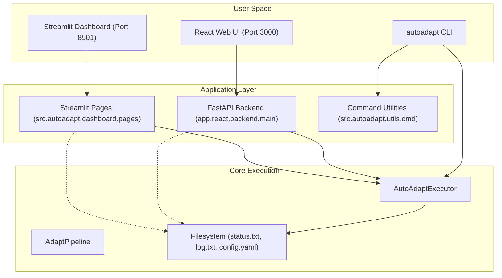
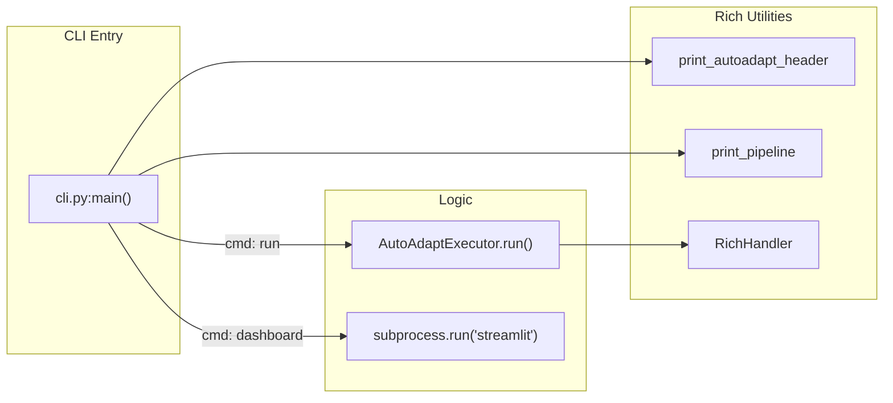

<!-- source: DeepWiki mcp.deepwiki.com · repo microsoft/AutoAdapt · page 8 User Interfaces · fetched 2026-10-26 -->

# User Interfaces

Relevant source files

The following files were used as context for generating this wiki page:

- [app/react/frontend/src/App.tsx](app/react/frontend/src/App.tsx)
- [app/react/frontend/src/components/DarkModeToggle.tsx](app/react/frontend/src/components/DarkModeToggle.tsx)
- [src/autoadapt/cli.py](src/autoadapt/cli.py)
- [src/autoadapt/dashboard/Home.py](src/autoadapt/dashboard/Home.py)
- [src/autoadapt/dashboard/pages/New_instance.py](src/autoadapt/dashboard/pages/New_instance.py)
- [src/autoadapt/dashboard/pages/View_status.py](src/autoadapt/dashboard/pages/View_status.py)
- [src/autoadapt/dashboard/utils.py](src/autoadapt/dashboard/utils.py)
- [src/autoadapt/utils/cmd.py](src/autoadapt/utils/cmd.py)

AutoAdapt provides multiple ways for users to interact with the system, ranging from a modern React-based web application to a lightweight Streamlit dashboard and a command-line interface (CLI). These interfaces serve as the entry point for configuring tasks, monitoring multi-agent planning, and tracking the execution of training pipelines.

### Interface Architecture Overview

The following diagram illustrates the relationship between the different UI layers and the core execution engine.

**Interface to Code Mapping**

**Sources:**
- [src/autoadapt/cli.py:24-90]()
- [app/react/frontend/src/App.tsx:90-129]()
- [src/autoadapt/dashboard/Home.py:21-34]()

---

## React Web UI

The React-based web interface provides the most feature-rich experience, utilizing a Vite-powered frontend and a FastAPI backend. It supports real-time updates via WebSockets and managed project workflows.

*   **Routing and Navigation**: Managed in `App.tsx`, handling transitions between the Home, New Instance, Planning, and Pipeline status views [app/react/frontend/src/App.tsx:17-88]().
*   **State Management**: Uses a `WebSocketProvider` to maintain real-time communication with the backend for streaming logs and planning updates [app/react/frontend/src/App.tsx:132-139]().
*   **Visual Elements**: Includes a `DarkModeToggle` for theme persistence using `localStorage` [app/react/frontend/src/components/DarkModeToggle.tsx:10-32]().

For details on the frontend implementation and routing logic, see [React Web UI](#8.1).

**Sources:**
- [app/react/frontend/src/App.tsx:1-143]()
- [app/react/frontend/src/components/DarkModeToggle.tsx:1-51]()

---

## FastAPI Backend

The FastAPI backend serves as the bridge between the React frontend and the `AutoAdaptExecutor`. It manages long-running machine learning operations using background tasks and provides RESTful endpoints for configuration and control.

*   **API Endpoints**: Handles configuration saving, pipeline initiation, and manual approval gates for fine-tuning.
*   **Real-time Streaming**: Implements WebSocket handlers to push status updates and multi-agent debate logs to the UI.
*   **Project Management**: Organizes outputs into structured project directories within the workspace.

For details on the API structure and backend orchestration, see [FastAPI Backend](#8.2).

---

## Streamlit Dashboard

The Streamlit dashboard offers a quick, Python-native interface for users who prefer a simpler setup without a separate Node.js frontend.

*   **Instance Management**: `New_instance.py` handles configuration loading via `OmegaConf` and triggers the `AutoAdaptExecutor.plan()` method [src/autoadapt/dashboard/pages/New_instance.py:33-34, 116-119]().
*   **Background Execution**: Launches the training pipeline as a background process using `nohup` to ensure persistence [src/autoadapt/dashboard/pages/New_instance.py:76-77]().
*   **Monitoring**: `View_status.py` polls `status.txt` and `log.txt` files across the workspace to visualize progress in a tabular format [src/autoadapt/dashboard/pages/View_status.py:87-112]().
*   **Cleanup**: Provides utilities to delete workspaces and terminate active `run.py` processes [src/autoadapt/dashboard/pages/View_status.py:148-161]().

For details on the dashboard pages and utility functions, see [Streamlit Dashboard and CLI](#8.3).

**Sources:**
- [src/autoadapt/dashboard/pages/New_instance.py:1-123]()
- [src/autoadapt/dashboard/pages/View_status.py:1-200]()
- [src/autoadapt/dashboard/utils.py:12-60]()

---

## Command Line Interface (CLI)

The `autoadapt` CLI provides a direct way to execute pipelines or launch the dashboard from a terminal.

*   **Execution**: The `run` command initializes the `AutoAdaptExecutor` and starts the full lifecycle without UI intervention [src/autoadapt/cli.py:58-64]().
*   **Dashboard Launch**: The `dashboard` command automates the `streamlit run` process for the internal dashboard files [src/autoadapt/cli.py:66-74]().
*   **Rich Output**: Utilizes the `rich` library to print formatted tables for pipeline steps and evaluation results [src/autoadapt/utils/cmd.py:77-109]().

**CLI Component Interaction**

For details on CLI arguments and terminal formatting, see [Streamlit Dashboard and CLI](#8.3).

**Sources:**
- [src/autoadapt/cli.py:24-90]()
- [src/autoadapt/utils/cmd.py:15-138]()

---

