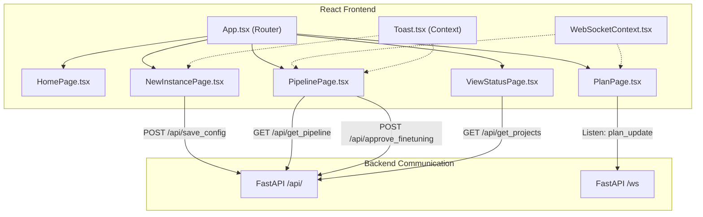
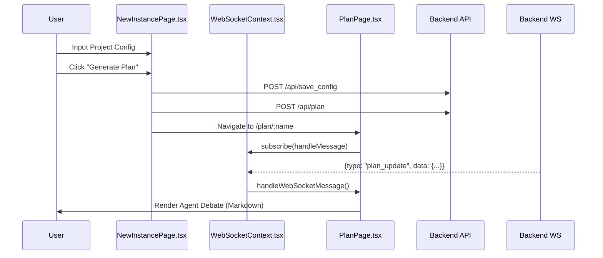

<!-- source: DeepWiki mcp.deepwiki.com · repo microsoft/AutoAdapt · page 8.1 React Web UI · fetched 2026-10-26 -->

# React Web UI

Relevant source files

The following files were used as context for generating this wiki page:

- [app/react/frontend/index.html](app/react/frontend/index.html)
- [app/react/frontend/package.json](app/react/frontend/package.json)
- [app/react/frontend/src/App.tsx](app/react/frontend/src/App.tsx)
- [app/react/frontend/src/components/ConnectionStatus.tsx](app/react/frontend/src/components/ConnectionStatus.tsx)
- [app/react/frontend/src/components/DarkModeToggle.tsx](app/react/frontend/src/components/DarkModeToggle.tsx)
- [app/react/frontend/src/components/HomePage.tsx](app/react/frontend/src/components/HomePage.tsx)
- [app/react/frontend/src/components/MessageRenderer.tsx](app/react/frontend/src/components/MessageRenderer.tsx)
- [app/react/frontend/src/components/NewInstancePage.tsx](app/react/frontend/src/components/NewInstancePage.tsx)
- [app/react/frontend/src/components/PipelinePage.tsx](app/react/frontend/src/components/PipelinePage.tsx)
- [app/react/frontend/src/components/PlanPage.tsx](app/react/frontend/src/components/PlanPage.tsx)
- [app/react/frontend/src/components/Toast.tsx](app/react/frontend/src/components/Toast.tsx)
- [app/react/frontend/src/components/ViewStatusPage.tsx](app/react/frontend/src/components/ViewStatusPage.tsx)
- [app/react/frontend/src/context/WebSocketContext.tsx](app/react/frontend/src/context/WebSocketContext.tsx)
- [app/react/frontend/src/hooks/usePlanMessageStore.ts](app/react/frontend/src/hooks/usePlanMessageStore.ts)
- [app/react/frontend/src/hooks/useWebSocketMessages.ts](app/react/frontend/src/hooks/useWebSocketMessages.ts)
- [app/react/frontend/src/vite-env.d.ts](app/react/frontend/src/vite-env.d.ts)
- [app/react/frontend/vite.config.js](app/react/frontend/vite.config.js)

The AutoAdapt React Web UI is a modern, single-page application built with **React**, **TypeScript**, and **Vite** [app/react/frontend/package.json:1-38](). It provides a graphical interface for configuring adaptation tasks, visualizing multi-agent planning in real-time via WebSockets, monitoring HPO (AutoRefine) logs, and approving final model execution.

## Frontend Architecture and Routing

The frontend uses a custom routing implementation within `App.tsx` that synchronizes the application state with the browser's `window.location` via `popstate` listeners [app/react/frontend/src/App.tsx:23-61](). 

### Core Navigation States
| Page State | URL Path | Component | Description |
| :--- | :--- | :--- | :--- |
| `home` | `/` | `HomePage` | Entry point for new projects or monitoring existing ones. |
| `new-instance` | `/newinstance` | `NewInstancePage` | Configuration wizard for SFT, DPO, and RAG. |
| `plan` | `/plan/:projectName` | `PlanPage` | Real-time visualization of the Multi-Agent planning debate. |
| `pipeline` | `/pipeline/:name` | `PipelinePage` | HPO monitoring, artifact viewing, and execution control. |
| `view-status` | `/view-stats` | `ViewStatusPage` | Dashboard for monitoring all historical and active projects. |

**Sources:** [app/react/frontend/src/App.tsx:15-129](), [app/react/frontend/src/components/HomePage.tsx]()

### Data Flow Diagram: Frontend Components

**Sources:** [app/react/frontend/src/App.tsx:90-139](), [app/react/frontend/src/context/WebSocketContext.tsx:38-166](), [app/react/frontend/src/components/NewInstancePage.tsx:255-320]()

---

## WebSocket Orchestration

Real-time updates for the planning phase are handled by the `WebSocketProvider` [app/react/frontend/src/context/WebSocketContext.tsx:38](). It maintains a singleton connection to the `/ws` endpoint [app/react/frontend/vite.config.js:25-31]().

- **Message Persistence**: The `usePlanMessageStore` hook persists messages in-memory so that navigating away and back to the `PlanPage` does not lose the agent debate history [app/react/frontend/src/context/WebSocketContext.tsx:43]().
- **Subscription Model**: Components use the `subscribe` function to register handlers for specific message types like `plan_update` [app/react/frontend/src/context/WebSocketContext.tsx:146-151]().
- **Message Rendering**: The `MessageRenderer` component handles diverse UI types, including `markdown` (via `react-markdown`), `agent` (with icons), and standard `text` [app/react/frontend/src/components/MessageRenderer.tsx:112-160]().

**Sources:** [app/react/frontend/src/context/WebSocketContext.tsx:5-166](), [app/react/frontend/src/components/MessageRenderer.tsx:102-161]()

---

## Configuration & New Instance Setup

The `NewInstancePage` serves as the entry point for defining the Adaptation Configuration Graph (ACG). It manages complex form state for SFT, DPO, and RAG workflows [app/react/frontend/src/components/NewInstancePage.tsx:9-43]().

- **Dynamic Inputs**: Based on the selected `adaptationTechnique`, the UI toggles between training fields (e.g., `nTrials`, `coresetTrainRatio`) and RAG fields (e.g., `ragDocumentsColumn`, `ragChromaDbPath`) [app/react/frontend/src/components/NewInstancePage.tsx:166-169]().
- **File Uploads**: Dataset files and ACG graphs are handled as `File` objects and sent to the backend via `FormData` [app/react/frontend/src/components/NewInstancePage.tsx:255-275]().
- **Plan Generation**: Upon submission, the UI calls `/api/save_config` followed by `/api/plan` to trigger the backend planning agents [app/react/frontend/src/components/NewInstancePage.tsx:280-310]().

**Sources:** [app/react/frontend/src/components/NewInstancePage.tsx:9-320]()

---

## Pipeline Execution and Monitoring

The `PipelinePage` and `ViewStatusPage` provide a deep dive into the `AutoRefine` (HPO) and final execution phases.

### Polling Strategy
Unlike the `PlanPage`, these pages use a polling strategy via `fetchPipelineData` to track long-running HPO trials and training progress [app/react/frontend/src/components/PipelinePage.tsx:139-240](). Polling is established using a `setInterval` stored in `pollingRef` [app/react/frontend/src/components/PipelinePage.tsx:45]().

### Key Features
1.  **AutoRefine Logs**: Displays real-time logs from the Optuna trials and LLM samplers [app/react/frontend/src/components/PipelinePage.tsx:21]().
2.  **Approval Gate**: For SFT/DPO, the UI displays an "Approve Finetuning" button. Execution only proceeds when the user clicks this, triggering `/api/approve_finetuning` [app/react/frontend/src/components/PipelinePage.tsx:29]().
3.  **Artifact Modals**:
    *   **Pipeline Image**: Renders the ACG/Pipeline graph as an SVG with pan and zoom capabilities [app/react/frontend/src/components/PipelinePage.tsx:35, 41-44]().
    *   **Insights**: Displays LLM-generated summaries of the adaptation process [app/react/frontend/src/components/PipelinePage.tsx:30]().
    *   **Parameters**: Shows the final `best_config.yaml` as a JSON modal [app/react/frontend/src/components/PipelinePage.tsx:31]().

### Status Mapping
The UI normalizes backend status strings into a unified `PipelineState` (`idle`, `loading`, `completed`, `error`) via `derivePipelineStatus` [app/react/frontend/src/components/PipelinePage.tsx:108-137]().

**Sources:** [app/react/frontend/src/components/PipelinePage.tsx:16-300](), [app/react/frontend/src/components/ViewStatusPage.tsx:120-153]()

---

## UI Component Interaction

The following diagram maps UI interactions to the specific React components and backend hooks.

**Sources:** [app/react/frontend/src/components/NewInstancePage.tsx:255-320](), [app/react/frontend/src/context/WebSocketContext.tsx:70-92](), [app/react/frontend/src/components/PlanPage.tsx:84-110]()

## Dark Mode and Theming
The UI supports a global dark mode toggle, managed by the `DarkModeToggle` component [app/react/frontend/src/components/DarkModeToggle.tsx](). It utilizes **Tailwind CSS** classes (e.g., `dark:bg-gray-800`) to adjust the visual presentation across all pages [app/react/frontend/src/App.tsx:134-137]().

**Sources:** [app/react/frontend/src/App.tsx:131-143](), [app/react/frontend/package.json:33]()

---

