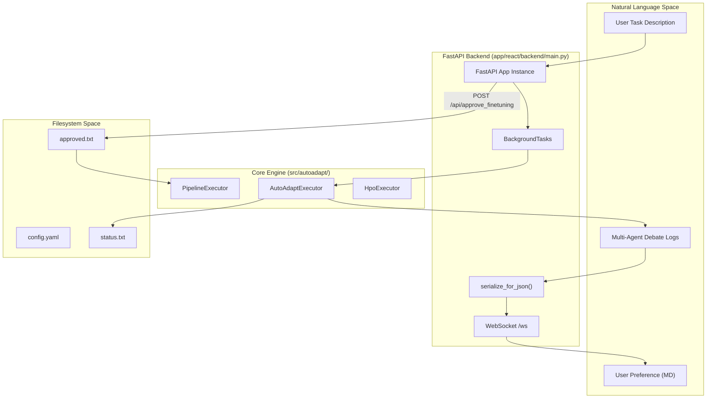
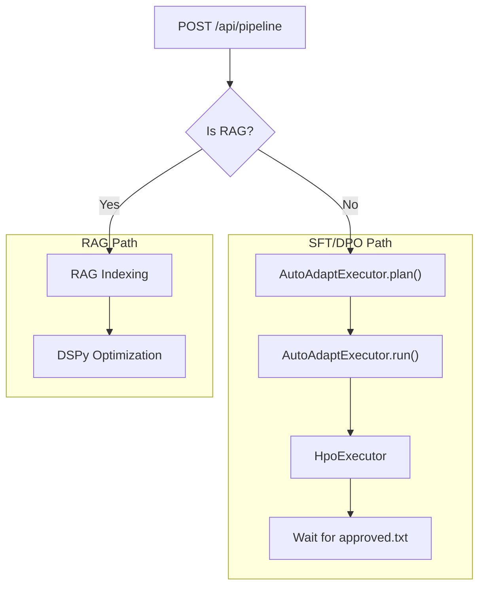

<!-- source: DeepWiki mcp.deepwiki.com · repo microsoft/AutoAdapt · page 8.2 FastAPI Backend · fetched 2026-10-26 -->

# FastAPI Backend

Relevant source files

The following files were used as context for generating this wiki page:

- [app/react/backend/conf/config_default.yaml](app/react/backend/conf/config_default.yaml)
- [app/react/backend/main.py](app/react/backend/main.py)
- [app/react/setup.sh](app/react/setup.sh)
- [app/react/start.sh](app/react/start.sh)
- [app/sample/conf/config.yaml](app/sample/conf/config.yaml)
- [src/autoadapt/dashboard/static/config_template.yaml](src/autoadapt/dashboard/static/config_template.yaml)
- [src/autoadapt/frontend/cli_message.py](src/autoadapt/frontend/cli_message.py)
- [src/autoadapt/frontend/streamlit_message.py](src/autoadapt/frontend/streamlit_message.py)

The FastAPI backend, located at `app/react/backend/main.py`, serves as the orchestration layer between the React frontend and the core AutoAdapt execution engine. It provides RESTful endpoints for configuration management and project lifecycle control, while leveraging WebSockets for real-time streaming of multi-agent planning and hyperparameter optimization (HPO) logs.

## Backend Architecture and Data Flow

The backend acts as a stateful bridge, managing the `AutoAdaptExecutor` instances and funneling events from the internal ML pipelines to the user interface. It utilizes `BackgroundTasks` to ensure that long-running operations (like planning and training) do not block the main API thread.

### System Interaction Diagram
The following diagram illustrates how the FastAPI backend connects "Natural Language Space" (User Inputs/Agent Debates) to "Code Entity Space" (Executor classes and status files).

**Title: Backend Entity and Data Flow**

**Sources:** `app/react/backend/main.py:26-30`(), `app/react/backend/main.py:116-154`(), `app/react/backend/main.py:317-340`()

## Key REST Endpoints

The backend exposes several critical endpoints for managing the adaptation lifecycle:

| Endpoint | Method | Purpose |
| :--- | :--- | :--- |
| `/api/save_config` | POST | Saves user-defined YAML configurations and task descriptions to the project directory [app/react/backend/main.py:255-296](). |
| `/api/plan` | POST | Triggers the `AutoAdaptExecutor.plan()` phase as a background task [app/react/backend/main.py:317-340](). |
| `/api/pipeline` | POST | Starts the execution phase (HPO and Training) [app/react/backend/main.py:355-385](). |
| `/api/get_pipeline` | GET | Retrieves the current state of the pipeline, including generated `best_config.yaml` [app/react/backend/main.py:421-447](). |
| `/api/approve_finetuning` | POST | Writes to `approved.txt` to signal the `PipelineExecutor` to proceed after HPO [app/react/backend/main.py:465-478](). |

**Sources:** `app/react/backend/main.py:255-478`()

## Real-Time Communication via WebSockets

The `/ws` endpoint is the primary conduit for streaming logs and agent activities. The backend captures events from the `AutoAdaptExecutor` via a specialized handler `ui_message`.

### The `ui_message` Handler
The `ui_message` function [app/react/backend/main.py:156-224]() is designed to be compatible with the executor's `ui_event_handler`. It categorizes messages into types such as `agent`, `node`, `metric`, or `best_config`, ensuring the frontend can render specific UI components (like agent icons or metric charts) dynamically.

### JSON Serialization Utility
Because the internal engine often passes complex objects (like ACG nodes or Pydantic models), the `serialize_for_json` utility [app/react/backend/main.py:65-113]() recursively converts these into JSON-safe dictionaries. It specifically handles:
* Objects with `__dict__` attributes [app/react/backend/main.py:91-99]().
* ACG Nodes by extracting `name`, `type`, `children`, and `constraints` [app/react/backend/main.py:102-110]().
* Standard primitives and collections [app/react/backend/main.py:79-88]().

**Sources:** `app/react/backend/main.py:65-113`(), `app/react/backend/main.py:156-224`()

## Adaptation Branching Logic

The backend handles the logical split between Fine-tuning (SFT/DPO) and RAG based on the user's project configuration.

**Title: Backend Execution Branching**

**Sources:** `app/react/backend/main.py:326-338`(), `app/react/backend/main.py:355-385`()

## Project Directory Structure
The backend expects a specific workspace layout to maintain state across restarts:
* **`conf/config.yaml`**: The primary configuration file [app/react/backend/main.py:277]().
* **`workspace/status.txt`**: Tracks the current execution stage (e.g., "Planning", "HPO", "Finished") [app/react/backend/main.py:425]().
* **`workspace/pipeline.pkl`**: Serialized `AdaptPipeline` object [app/react/backend/main.py:433]().
* **`workspace/approved.txt`**: A flag file created by the `/api/approve_finetuning` endpoint to resume the pipeline [app/react/backend/main.py:475]().

**Sources:** `app/react/backend/main.py:277-285`(), `app/react/backend/main.py:421-440`(), `app/react/backend/main.py:465-478`()

## Deployment and Setup
The backend is typically started via the `start.sh` script, which activates the `autoadapt` conda environment and runs `python main.py` [app/react/setup.sh:96-98](). By default, it listens on `http://localhost:5000` and allows CORS requests from the Vite frontend at `http://localhost:8080` [app/react/backend/main.py:34-38]().

**Sources:** `app/react/setup.sh:96-98`(), `app/react/backend/main.py:32-38`()

---

