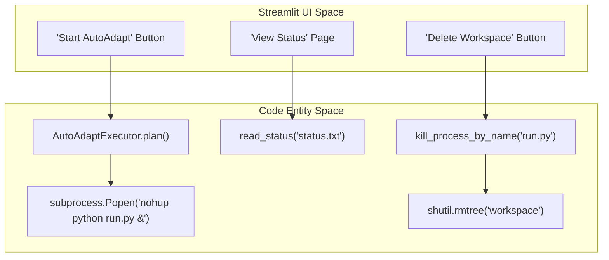
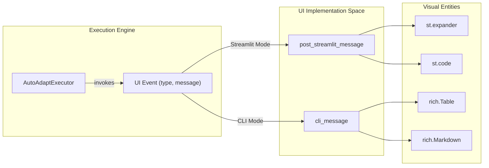

<!-- source: DeepWiki mcp.deepwiki.com · repo microsoft/AutoAdapt · page 8.3 Streamlit Dashboard and CLI · fetched 2026-10-26 -->

# Streamlit Dashboard and CLI

Relevant source files

The following files were used as context for generating this wiki page:

- [app/sample/run.py](app/sample/run.py)
- [app/sample/run_dashboard.sh](app/sample/run_dashboard.sh)
- [app/sample/run_plan.py](app/sample/run_plan.py)
- [src/autoadapt/cli.py](src/autoadapt/cli.py)
- [src/autoadapt/dashboard/.streamlit/config.toml](src/autoadapt/dashboard/.streamlit/config.toml)
- [src/autoadapt/dashboard/Home.py](src/autoadapt/dashboard/Home.py)
- [src/autoadapt/dashboard/pages/New_instance.py](src/autoadapt/dashboard/pages/New_instance.py)
- [src/autoadapt/dashboard/pages/View_status.py](src/autoadapt/dashboard/pages/View_status.py)
- [src/autoadapt/dashboard/run_chatbot.sh](src/autoadapt/dashboard/run_chatbot.sh)
- [src/autoadapt/dashboard/static/run.py](src/autoadapt/dashboard/static/run.py)
- [src/autoadapt/dashboard/utils.py](src/autoadapt/dashboard/utils.py)
- [src/autoadapt/frontend/cli_message.py](src/autoadapt/frontend/cli_message.py)
- [src/autoadapt/frontend/streamlit_message.py](src/autoadapt/frontend/streamlit_message.py)
- [src/autoadapt/utils/cmd.py](src/autoadapt/utils/cmd.py)
- [src/autoadapt/utils/ui.py](src/autoadapt/utils/ui.py)

The AutoAdapt user interface layer provides two primary modes of interaction: a multi-page **Streamlit Dashboard** for graphical management and a **CLI tool** for terminal-based execution. These interfaces abstract the underlying complexity of the `AutoAdaptExecutor`, allowing users to configure, launch, and monitor adaptation pipelines through high-level commands or web components.

## Streamlit Dashboard Architecture

The dashboard is structured as a multi-page Streamlit application located in `src/autoadapt/dashboard/`. It manages the lifecycle of adaptation instances by interacting with the filesystem for status tracking and launching background processes for execution.

### Dashboard Components and Data Flow

The dashboard consists of three main pages:
1.  **Home.py**: The entry point providing navigation and a high-level overview [src/autoadapt/dashboard/Home.py:21-33]().
2.  **New_instance.py**: Handles configuration loading, initial planning, and background process spawning [src/autoadapt/dashboard/pages/New_instance.py:28-123]().
3.  **View_status.py**: Monitors progress via `status.txt` files and streams logs from the workspace [src/autoadapt/dashboard/pages/View_status.py:31-200]().

#### Natural Language to Code Entity Space: Dashboard Execution
The following diagram illustrates how user actions in the Streamlit UI translate into backend execution entities.

Sources: [src/autoadapt/dashboard/pages/New_instance.py:76-122](), [src/autoadapt/dashboard/pages/View_status.py:148-160](), [src/autoadapt/dashboard/pages/View_status.py:88-112]()

### Background Process Management
When a user starts a new instance, the dashboard performs the following steps:
1.  **Planning**: Invokes `executor.plan()` synchronously within the Streamlit session to generate the initial `AdaptPipeline` [src/autoadapt/dashboard/pages/New_instance.py:116-119]().
2.  **Script Deployment**: Copies a static execution script `run.py` to the workspace directory [src/autoadapt/dashboard/pages/New_instance.py:64-68]().
3.  **Nohup Launch**: Executes the copied `run.py` using `subprocess.Popen` with `nohup` and `&`, ensuring the adaptation continues even if the Streamlit browser tab or server is closed [src/autoadapt/dashboard/pages/New_instance.py:76-77]().

### Status Monitoring and Log Streaming
The `View_status.py` page provides a real-time view of the pipeline by polling the filesystem:
*   **Status Tracking**: It reads `status.txt` files located in phase-specific directories (e.g., `workspace/sft/hpo/status.txt`) [src/autoadapt/dashboard/pages/View_status.py:95-96]().
*   **Log Display**: Logs are read from `log.txt` files and rendered using `st.code` within expandable sections [src/autoadapt/dashboard/pages/View_status.py:114-121]().
*   **Workspace Cleanup**: The `delete_workspace` function uses `shutil.rmtree` to wipe the project data and calls `kill_process_by_name("run.py")` to terminate any orphaned background adaptation tasks [src/autoadapt/dashboard/pages/View_status.py:148-160]().

## AutoAdapt CLI

The CLI tool, defined in `src/autoadapt/cli.py`, serves as the unified entry point for terminal users. It utilizes the `rich` library for formatted output and `argparse` for command routing [src/autoadapt/cli.py:9-41]().

### CLI Commands
| Command | Action | Implementation |
| :--- | :--- | :--- |
| `run` | Executes the full pipeline based on a YAML config. | `executor.run()` [src/autoadapt/cli.py:58-64]() |
| `dashboard` | Launches the Streamlit server. | `subprocess.run(["streamlit", "run", ...])` [src/autoadapt/cli.py:66-74]() |
| `help` | Displays command usage. | `parser.print_help()` [src/autoadapt/cli.py:76-89]() |

### Rich Terminal Utilities
AutoAdapt uses a set of utilities in `src/autoadapt/utils/cmd.py` to provide a high-quality terminal experience:
*   **Visual Headers**: `print_logo` uses `pyfiglet` to render ASCII art across multiple colors [src/autoadapt/utils/cmd.py:22-58]().
*   **Table Formatting**: `print_pipeline` and `print_eval_results_as_table` convert internal objects (`AdaptPipeline`, result dicts) into `rich.table.Table` objects for clean terminal display [src/autoadapt/utils/cmd.py:77-108]().
*   **Config Inspection**: `print_step_config` recursively traverses `DictConfig` objects to print flattened key-value pairs in a table, filtering out internal "general" configurations [src/autoadapt/utils/cmd.py:111-130]().

## Message Handling and UI Abstraction

To support both Streamlit and CLI, AutoAdapt employs a decoupled messaging system. The `AutoAdaptExecutor` accepts a `ui_event_handler` callback [src/autoadapt/adapt/autoadapt_executor.py:33]().

### Handler Implementations
*   **`post_streamlit_message`**: Maps internal events to Streamlit components. For example, a "node" event triggers an `st.expander` with JSON constraints, while an "agent" event displays a markdown block with a user icon [src/autoadapt/frontend/streamlit_message.py:37-58]().
*   **`cli_message`**: Maps the same events to `rich.console` prints, using different styles (e.g., "red bold" for agents) to distinguish sources in the terminal [src/autoadapt/frontend/cli_message.py:32-43]().

#### UI Event Mapping
The following diagram shows how the system bridges abstract adaptation events to specific UI implementations.

Sources: [src/autoadapt/frontend/streamlit_message.py:10-94](), [src/autoadapt/frontend/cli_message.py:13-44](), [src/autoadapt/adapt/autoadapt_executor.py:33]()

## Summary of Key Functions

| Entity | Location | Role |
| :--- | :--- | :--- |
| `execute_pipeline` | `New_instance.py:57` | Copies `run.py` and starts `nohup` background process. |
| `get_status_data` | `View_status.py:74` | Aggregates status from various `status.txt` files. |
| `generate_log_content`| `View_status.py:114` | Reads and displays text logs in the dashboard. |
| `print_autoadapt_header`| `cmd.py:15` | Prints ASCII logo and welcome message to CLI. |
| `main` | `cli.py:24` | Entry point for the `autoadapt` command-line tool. |

Sources: [src/autoadapt/dashboard/pages/New_instance.py:57-78](), [src/autoadapt/dashboard/pages/View_status.py:74-112](), [src/autoadapt/dashboard/pages/View_status.py:114-128](), [src/autoadapt/utils/cmd.py:15-20](), [src/autoadapt/cli.py:24-90]()

---

