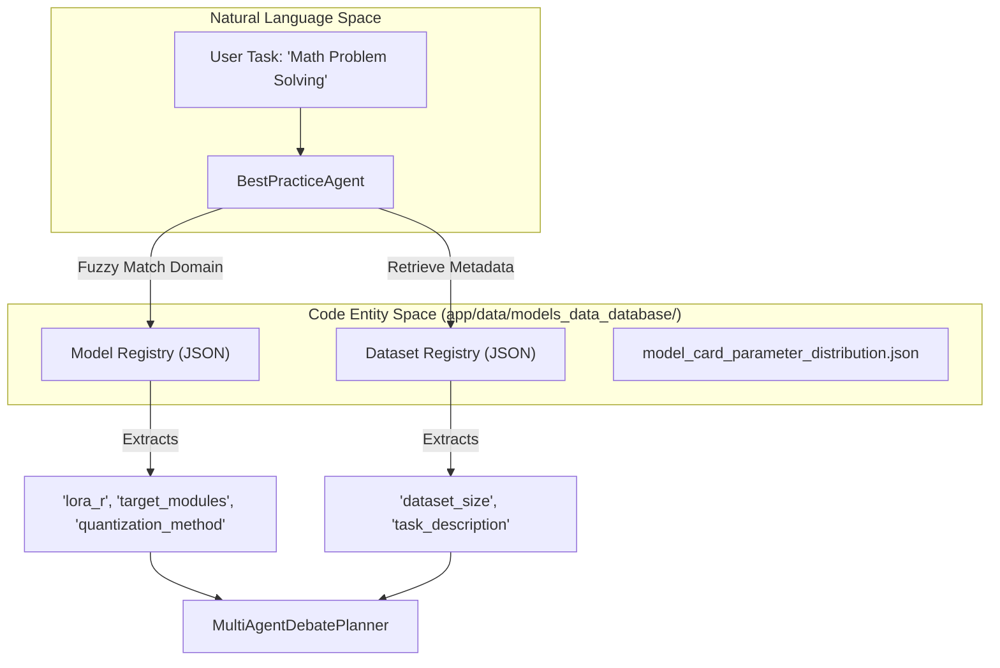
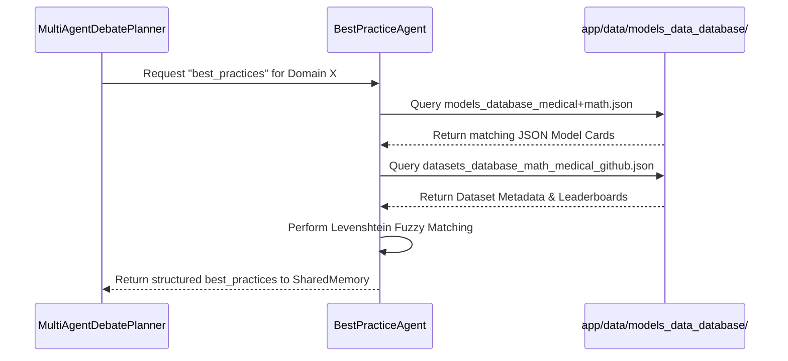

<!-- source: DeepWiki mcp.deepwiki.com · repo microsoft/AutoAdapt · page 9 Model and Dataset Knowledge Bases · fetched 2026-10-26 -->

# Model and Dataset Knowledge Bases

Relevant source files

The following files were used as context for generating this wiki page:

- [app/data/models_data_database/datasets_database_math_medical_github.json](app/data/models_data_database/datasets_database_math_medical_github.json)
- [app/data/models_data_database/github_models_card_base_llms_family_general_domain.json](app/data/models_data_database/github_models_card_base_llms_family_general_domain.json)
- [app/data/models_data_database/models_database_math_medical_github.json](app/data/models_data_database/models_database_math_medical_github.json)
- [app/data/models_data_database/models_database_medical+math.json](app/data/models_data_database/models_database_medical+math.json)

The **Model and Dataset Knowledge Bases** serve as the empirical backbone of the AutoAdapt system. Located in `app/data/models_data_database/`, these static assets provide the `BestPracticeAgent` and `KnowledgeRetrieverAgent` with historical data on successful model fine-tuning configurations and dataset characteristics. By leveraging these registries, the system can perform retrieval-augmented planning to suggest optimal hyperparameters, base models, and training techniques based on prior art from GitHub, HuggingFace, and academic literature.

### Knowledge Base Architecture

The knowledge base is structured to bridge high-level domain requirements (e.g., "Medical QA") with concrete code entities (e.g., `lora_r: 16`). It consists of two primary registries that feed into the `BestPracticeAgent` during the planning phase.

#### Knowledge Flow Diagram
This diagram illustrates how static JSON assets are transformed into actionable insights for the `AdaptPipeline`.

**Sources:** [app/data/models_data_database/models_database_medical+math.json:1-35](), [app/data/models_data_database/datasets_database_math_medical_github.json:1-21]()

---

### Model Registry and Model Cards

The Model Registry is a collection of detailed "Model Cards" that store the results of previous adaptation experiments. These cards include critical hyperparameters like learning rate, LoRA rank (`lora_r`), and target modules, as well as the hardware used for training.

*   **Schema Definition:** Each entry follows a structured JSON schema including `base_model`, `training_technique`, `peft` status, and `quantization_method` [app/data/models_data_database/models_database_medical+math.json:2-35]().
*   **Domain Specialization:** Databases are categorized into specific domains such as `math`, `medical`, and `general` to improve retrieval relevance [app/data/models_data_database/github_models_card_base_llms_family_general_domain.json:56-58]().
*   **Parameter Distributions:** The system uses `model_card_parameter_distribution.json` to understand common ranges for hyperparameters across different model families.

For details on the schema and model selection logic, see **[Model Registry and Model Cards](#9.1)**.

**Sources:** [app/data/models_data_database/models_database_medical+math.json:1-180](), [app/data/models_data_database/github_models_card_base_llms_family_general_domain.json:1-105]()

---

### Dataset Registry and Best Practice Datasets

The Dataset Registry provides metadata for hundreds of open-source datasets. This information allows the `DataAgent` and `BestPracticeAgent` to compare a user's uploaded dataset against known benchmarks to recommend similar training strategies.

*   **Metadata Coverage:** Includes `dataset_size`, `input_length_distribution`, `domains`, and `task_description` [app/data/models_data_database/datasets_database_math_medical_github.json:3-21]().
*   **Empirical Results:** Stores `leaderboard_evaluation` data (e.g., accuracy scores on specific models) to help the agent select the most promising base models [app/data/models_data_database/datasets_database_math_medical_github.json:34-50]().
*   **Source Indexing:** Aggregates data from Papers With Code (PWC), HuggingFace (HF), and GitHub [app/data/models_data_database/datasets_database_math_medical_github.json:10-15]().

For details on data source schemas and indexing methods, see **[Dataset Registry and Best Practice Datasets](#9.2)**.

**Sources:** [app/data/models_data_database/datasets_database_math_medical_github.json:1-188]()

---

### System Integration

The following diagram demonstrates how the `BestPracticeAgent` interacts with the knowledge base files to populate the `SharedMemory` used during the `MultiAgentDebatePlanner` execution.

**Sources:** [app/data/models_data_database/models_database_math_medical_github.json:1-100](), [app/data/models_data_database/models_database_medical+math.json:36-86]()

### Child Pages
- **[Model Registry and Model Cards](#9.1)**: Deep dive into JSON schemas, domain-specific databases, and base LLM lists.
- **[Dataset Registry and Best Practice Datasets](#9.2)**: Detailed breakdown of dataset metadata, evaluation results, and indexing strategies.

---

