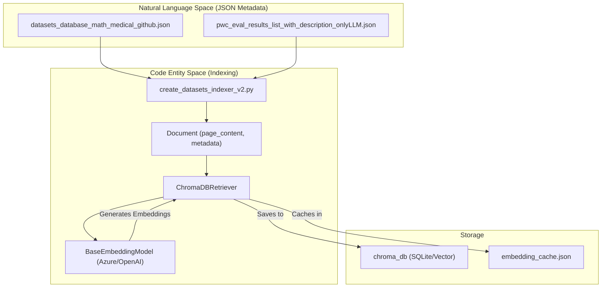
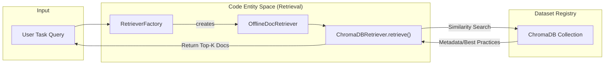

<!-- source: DeepWiki mcp.deepwiki.com · repo microsoft/AutoAdapt · page 9.2 Dataset Registry and Best Practice Datasets · fetched 2026-10-26 -->

# Dataset Registry and Best Practice Datasets

Relevant source files

The following files were used as context for generating this wiki page:

- [app/data/models_data_database/datasets_database_math_medical_github.json](app/data/models_data_database/datasets_database_math_medical_github.json)
- [app/data/models_data_database/datasets_with_eval_bestpractices_all_math_1000_train.json](app/data/models_data_database/datasets_with_eval_bestpractices_all_math_1000_train.json)
- [app/data/models_data_database/pwc_eval_results_list_with_description_onlyLLM.json](app/data/models_data_database/pwc_eval_results_list_with_description_onlyLLM.json)
- [src/autoadapt/agents/best_practices/chromadb_retriever.py](src/autoadapt/agents/best_practices/chromadb_retriever.py)
- [src/autoadapt/agents/best_practices/create_datasets_indexer.py](src/autoadapt/agents/best_practices/create_datasets_indexer.py)
- [src/autoadapt/agents/best_practices/create_datasets_indexer_v2.py](src/autoadapt/agents/best_practices/create_datasets_indexer_v2.py)
- [src/autoadapt/agents/best_practices/datasets_indexer.py](src/autoadapt/agents/best_practices/datasets_indexer.py)
- [src/autoadapt/agents/best_practices/datasets_retriever.py](src/autoadapt/agents/best_practices/datasets_retriever.py)
- [src/autoadapt/agents/best_practices/datasets_retriever_v2.py](src/autoadapt/agents/best_practices/datasets_retriever_v2.py)

The Dataset Registry provides the empirical backbone for AutoAdapt's planning phase. It consists of a curated collection of metadata from various sources (Hugging Face, Papers with Code, GitHub) that describes dataset characteristics, evaluation results, and training best practices. This data is indexed into vector databases to enable Retrieval-Augmented Generation (RAG) by the `BestPracticeAgent`, allowing the system to recommend adaptation strategies based on similar historical tasks.

### Dataset Metadata Sources

AutoAdapt utilizes three primary JSON databases located in `app/data/models_data_database/`. These files serve as the source of truth for the system's empirical knowledge.

| File Path | Description | Key Fields |
|:---|:---|:---|
| `datasets_database_math_medical_github.json` | Comprehensive registry of math and medical datasets including hallucination leaderboards. | `dataset_best_practices`, `leaderboard_evaluation`, `domains` |
| `datasets_with_eval_bestpractices_all_math_1000_train.json` | Specialized math dataset registry featuring persona-driven synthetic data and fine-tuning results. | `dataset_size`, `task_description`, `evaluation` |
| `pwc_eval_results_list_with_description_onlyLLM.json` | Data scraped from Papers with Code (PwC) focused on LLM evaluation results. | `metrics`, `methodology`, `paper`, `results` |

**Sources:** [app/data/models_data_database/datasets_database_math_medical_github.json:1-187](), [app/data/models_data_database/datasets_with_eval_bestpractices_all_math_1000_train.json:1-177](), [app/data/models_data_database/pwc_eval_results_list_with_description_onlyLLM.json:1-152]()

---

### Data Source Schemas and Indexing Logic

The indexing process transforms raw JSON into searchable vector documents. The `create_datasets_indexer.py` and `create_datasets_indexer_v2.py` scripts handle the mapping between source-specific schemas and the standard `Document` object used for retrieval.

#### Schema Mapping Table

| Source Type (`datasetsource`) | Mapping Logic |
|:---|:---|
| **pwc** | Uses the `description` field for the vector search content. [src/autoadapt/agents/best_practices/create_datasets_indexer_v2.py:88-89]() |
| **hf** (Hugging Face) | Uses the `task_description` field for content. [src/autoadapt/agents/best_practices/create_datasets_indexer_v2.py:90-91]() |
| **github** | Filters for entries where `model_card_description` is present and uses it as content. [src/autoadapt/agents/best_practices/create_datasets_indexer_v2.py:92-95]() |
| **github_data** | Requires both `task_description` and `dataset_best_practices` to be non-empty. [src/autoadapt/agents/best_practices/create_datasets_indexer_v2.py:96-101]() |

#### Indexing Flow (V1 vs V2)

AutoAdapt supports two indexing versions:
1.  **V1 (FAISS):** Uses `langchain_huggingface` with the `intfloat/e5-large-v2` model to create local FAISS indices. [src/autoadapt/agents/best_practices/datasets_indexer.py:64-75]()
2.  **V2 (ChromaDB):** Uses `ChromaDBRetriever` and `BaseEmbeddingModel` (OpenAI/Azure) with persistent caching. [src/autoadapt/agents/best_practices/create_datasets_indexer_v2.py:44-48]()

**Sources:** [src/autoadapt/agents/best_practices/create_datasets_indexer_v2.py:84-102](), [src/autoadapt/agents/best_practices/datasets_indexer.py:110-127]()

---

### Implementation Architecture

The following diagrams illustrate the transition from raw dataset metadata to the code entities that manage them.

#### Data Ingestion and Indexing Pipeline
This diagram bridges the **Natural Language Space** (Dataset Metadata) to the **Code Entity Space** (`ChromaDBRetriever`, `Document`).

**Sources:** [src/autoadapt/agents/best_practices/create_datasets_indexer_v2.py:36-65](), [src/autoadapt/agents/best_practices/chromadb_retriever.py:22-42]()

#### Retrieval-Augmented Planning Flow
This diagram shows how the `BestPracticeAgent` uses the registry to inform adaptation plans.

**Sources:** [src/autoadapt/agents/best_practices/datasets_retriever_v2.py:51-66](), [src/autoadapt/agents/best_practices/datasets_retriever_v2.py:107-121](), [src/autoadapt/agents/best_practices/chromadb_retriever.py:104-122]()

---

### Key Functions and Classes

#### `ChromaDBRetriever`
Located in `src/autoadapt/agents/best_practices/chromadb_retriever.py`, this class manages the persistent vector store.
*   **`_load_cache()`**: Reads `embedding_cache.json` to avoid redundant API calls for previously indexed text [src/autoadapt/agents/best_practices/chromadb_retriever.py:44-53]().
*   **`add_documents()`**: Computes hashes for document content and adds them to the ChromaDB collection [src/autoadapt/agents/best_practices/chromadb_retriever.py:79-102]().
*   **`retrieve()`**: Performs a similarity search using a query embedding generated via the configured embedding model [src/autoadapt/agents/best_practices/chromadb_retriever.py:104-122]().

#### `RetrieverFactory`
Provides a unified interface for creating different types of retrievers (offline, online, experience, demonstration).
*   **`create_retriever(retriever_type, ...)`**: Instantiates the appropriate class (e.g., `OfflineDocRetriever`) based on the system configuration [src/autoadapt/agents/best_practices/datasets_retriever.py:51-72]().

#### `datasets_indexer.py` (V1)
Handles the legacy FAISS-based indexing.
*   **`create_indexer()`**: Loads JSON, converts it to LangChain `Document` objects, and builds a FAISS index using `HuggingFaceEmbeddings` [src/autoadapt/agents/best_practices/datasets_indexer.py:77-116]().

**Sources:** [src/autoadapt/agents/best_practices/chromadb_retriever.py:22-128](), [src/autoadapt/agents/best_practices/datasets_retriever.py:51-72](), [src/autoadapt/agents/best_practices/datasets_indexer.py:77-150]()

---

