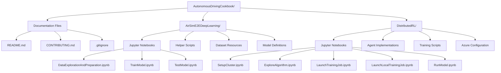
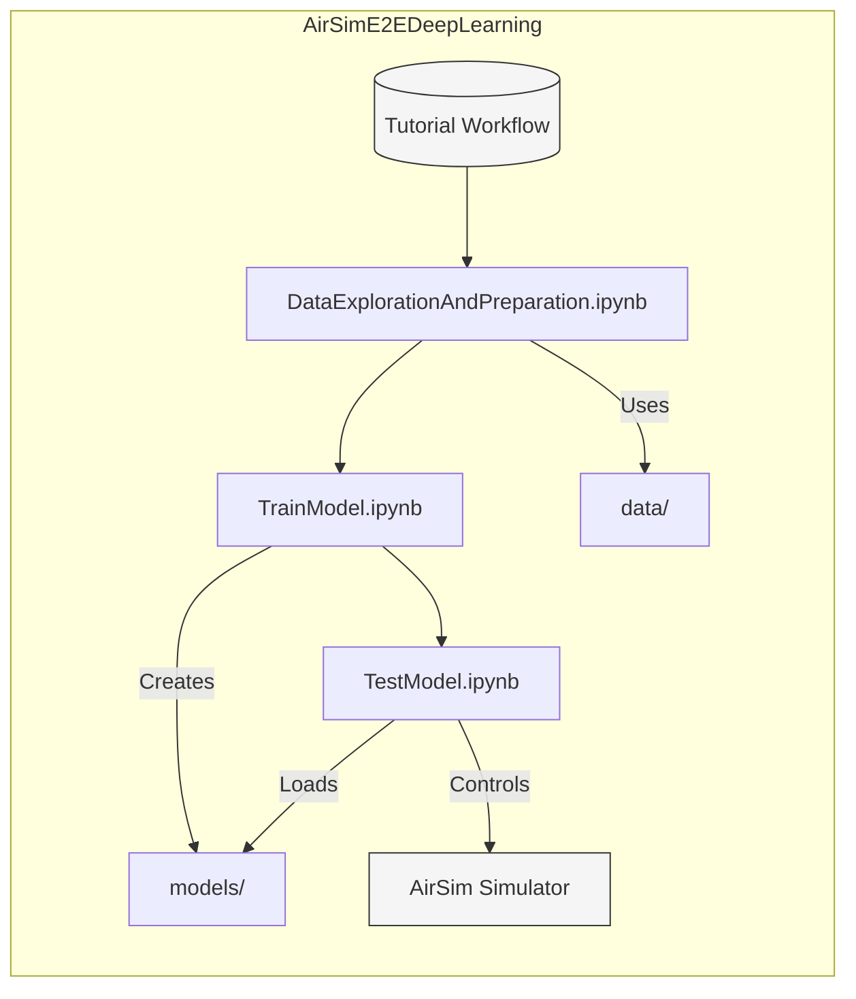
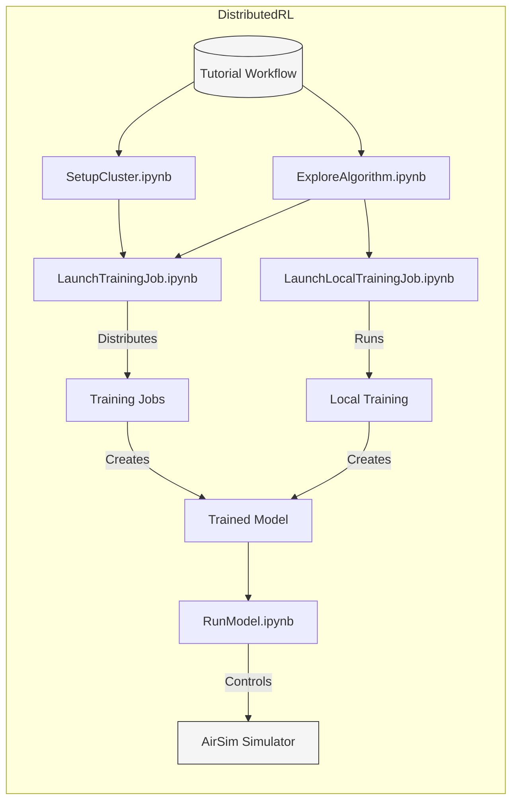
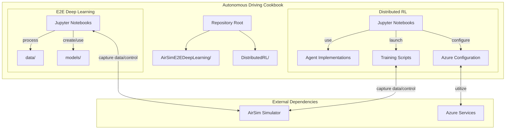

<!-- source: DeepWiki mcp.deepwiki.com · repo microsoft/AutonomousDrivingCookbook · page 1.1 Repository Structure · fetched 2026-10-26 -->

# Repository Structure

Relevant source files

The following files were used as context for generating this wiki page:

- [.gitignore](.gitignore)
- [AirSimE2EDeepLearning/.gitignore](AirSimE2EDeepLearning/.gitignore)
- [README.md](README.md)

## Purpose and Scope

This document outlines the organization and structure of the Autonomous Driving Cookbook repository. It provides an overview of the main components, their relationships, and the file organization to help you navigate the codebase efficiently. For information about setting up your environment to use these tutorials, see [Getting Started](#1.2).

Sources: [README.md:1-53]()

## Repository Overview

The Autonomous Driving Cookbook is organized around two main tutorial paths, each contained in its own directory:

1. **AirSimE2EDeepLearning** - End-to-End Deep Learning for Autonomous Driving
2. **DistributedRL** - Distributed Reinforcement Learning for Autonomous Driving

Both tutorials leverage the AirSim simulator for autonomous driving research, but they showcase different approaches to the problem of autonomous vehicle control.

**Repository Structure Diagram**

Sources: [README.md:1-53](), [AirSimE2EDeepLearning/.gitignore:290-296]()

## Main Components

### AirSimE2EDeepLearning

The AirSimE2EDeepLearning directory contains a complete tutorial on using deep learning for end-to-end autonomous driving with AirSim. This approach uses supervised learning to train a model that directly maps raw sensor inputs (images) to control outputs (steering commands).

**AirSimE2EDeepLearning Component Flow**

The tutorial consists of three main Jupyter notebooks that guide you through the process:

1. **DataExplorationAndPreparation.ipynb** - Explores and prepares the dataset for training
2. **TrainModel.ipynb** - Trains a deep learning model on the prepared data
3. **TestModel.ipynb** - Tests the trained model in the AirSim simulator

Additional files in this directory include:

- **data/** - Contains the dataset used for training (generated using AirSim)
- **models/** - Directory where trained models are saved
- **Helper scripts** - Various utility scripts to support the workflow

Sources: [README.md:38](), [AirSimE2EDeepLearning/.gitignore:294-296]()

### DistributedRL

The DistributedRL directory contains a tutorial on using distributed reinforcement learning for autonomous driving. This approach uses RL to train agents that learn to drive through trial and error, with the option to accelerate training through distribution across multiple machines.

**DistributedRL Component Flow**

The tutorial consists of five main Jupyter notebooks:

1. **SetupCluster.ipynb** - Sets up an Azure Batch cluster for distributed training
2. **ExploreAlgorithm.ipynb** - Explores the reinforcement learning algorithm
3. **LaunchTrainingJob.ipynb** - Launches distributed training jobs on Azure
4. **LaunchLocalTrainingJob.ipynb** - Launches training jobs on a local machine
5. **RunModel.ipynb** - Runs and evaluates the trained model in AirSim

Additional components in this directory include:

- **Agent implementations** - Code for the RL agents
- **Training scripts** - Scripts for training the agents
- **Azure configuration files** - Configuration for Azure Batch

Sources: [README.md:39]()

## Component Relationships

The following diagram illustrates how the different components of the cookbook interact with each other and with external dependencies:

**Repository Component Relationships**

Sources: [README.md:17-20]()

## Technical Dependencies

Both tutorials use Jupyter notebooks as the primary interface and rely on various technical components:

| Component | AirSimE2EDeepLearning | DistributedRL |
|-----------|:---------------------:|:-------------:|
| AirSim Simulator | ✓ | ✓ |
| Jupyter Notebooks | ✓ | ✓ |
| Python | ✓ | ✓ |
| Deep Learning Frameworks (Keras, TensorFlow/CNTK) | ✓ | ✓ |
| OpenCV | ✓ | - |
| NumPy | ✓ | ✓ |
| Matplotlib | ✓ | ✓ |
| Azure Batch | - | ✓ |
| Reinforcement Learning Libraries | - | ✓ |

The tutorials are designed to be accessible to beginners while also providing valuable insights for researchers and industry experts.

Sources: [README.md:28-32]()

## File Organization and Ignores

The repository follows standard GitHub project conventions, with `.gitignore` files to exclude certain types of files:

- Generated runtime data and model files are excluded
- Python notebook checkpoints (`.ipynb_checkpoints`) are excluded
- Dataset files in the `data/` directory are excluded due to their large size (though they are retrievable through the instructions in the notebooks)
- Built models in the `models/` directory are excluded

This ensures the repository remains clean and focused on the tutorial content while leaving runtime data to be generated locally.

Sources: [.gitignore:1-290](), [AirSimE2EDeepLearning/.gitignore:290-296]()

## Future Extensions

The repository is structured to allow additional tutorials to be added in the future, such as:

- Lane Detection using Deep Learning (planned)
- Other autonomous driving scenarios

Each new tutorial would follow the same pattern of organization as the existing ones, with its own directory containing Jupyter notebooks and supporting files.

Sources: [README.md:41-43]()

---

