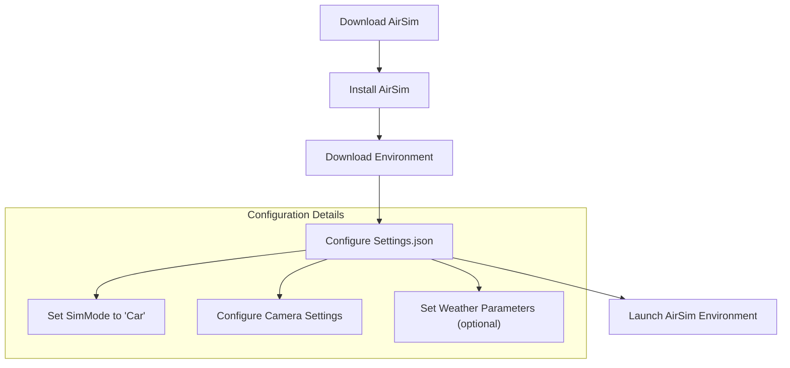
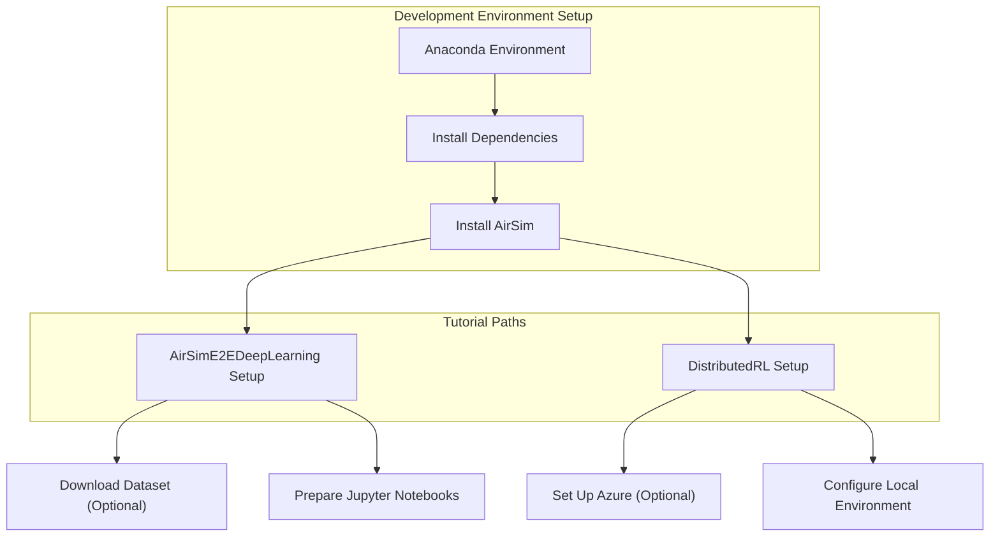
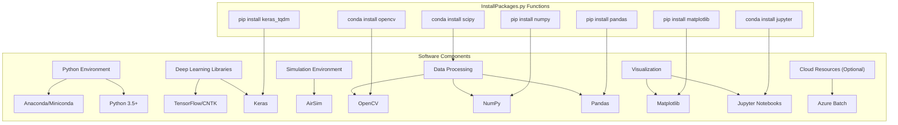
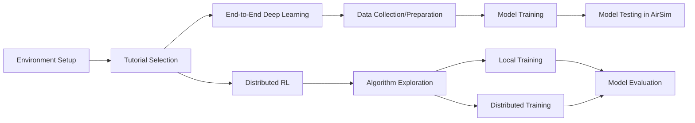

<!-- source: DeepWiki mcp.deepwiki.com · repo microsoft/AutonomousDrivingCookbook · page 1.2 Getting Started · fetched 2026-10-26 -->

# Getting Started

<details>
<summary>Relevant source files</summary>

The following files were used as context for generating this wiki page:

- [AirSimE2EDeepLearning/.gitignore](AirSimE2EDeepLearning/.gitignore)
- [AirSimE2EDeepLearning/InstallPackages.py](AirSimE2EDeepLearning/InstallPackages.py)
- [README.md](README.md)

</details>


This page provides instructions for setting up your development environment to work with the Microsoft Autonomous Driving Cookbook tutorials. It covers prerequisites, installation steps, and initial configuration required to run the two main tutorial paths: End-to-End Deep Learning and Distributed Reinforcement Learning.

For information about the overall repository structure, see [Repository Structure](#1.1).

## Prerequisites

Before starting with the tutorials, ensure you have the following prerequisites installed:

| Requirement | Purpose | Notes |
| ----------- | ------- | ----- |
| Python 3.5+ | Programming language used throughout the tutorials | Python 3.6 recommended |
| Anaconda or Miniconda | Environment management | Used to create isolated environments |
| AirSim Simulator | Simulation environment | For generating training data and testing models |
| GPU (recommended) | Accelerates training | NVIDIA GPU with CUDA support recommended |
| Azure account (optional) | For distributed training | Required only for the Distributed RL tutorial |

Sources: [README.md:1-53]()

## Development Environment Setup

To get started with the tutorials, follow these steps to set up your development environment:

### 1. Clone the Repository

```bash
git clone https://github.com/microsoft/AutonomousDrivingCookbook.git
cd AutonomousDrivingCookbook
```

### 2. Set Up Anaconda Environment

Create and activate a new Anaconda environment:

```bash
conda create -n autonomous-driving python=3.6
conda activate autonomous-driving
```

### 3. Install Required Packages

The repository includes a Python script to install all necessary packages. Run the following command:

```bash
python AirSimE2EDeepLearning/InstallPackages.py
```

This script will install the following dependencies:

- Jupyter Notebook
- Matplotlib
- OpenCV
- Keras with TensorFlow/CNTK
- msgpack-rpc-python
- Pandas
- NumPy
- SciPy

Sources: [AirSimE2EDeepLearning/InstallPackages.py:1-16]()

### 4. Install AirSim

AirSim is a critical component required for both tutorials. It provides the simulation environment for autonomous driving.

## AirSim Setup Workflow



1. **Download and Install AirSim**: Follow the official installation guide from the [AirSim GitHub repository](https://github.com/Microsoft/AirSim).

2. **Download Environment**: Download the appropriate environment for your operating system.

3. **Configure AirSim**: Create or modify the `settings.json` file to configure AirSim for autonomous driving.

Example `settings.json` configuration:

```json
{
  "SettingsVersion": 1.2,
  "SimMode": "Car",
  "CameraDefaults": {
    "CaptureSettings": [
      {
        "ImageType": 0,
        "Width": 256,
        "Height": 144
      }
    ]
  }
}
```

Sources: [README.md:17-20]()

## Tutorial Environments Setup

The repository contains two main tutorial paths, each with its own setup requirements:



### End-to-End Deep Learning Setup

For the AirSimE2EDeepLearning tutorial:

1. Navigate to the tutorial directory:
   ```bash
   cd AirSimE2EDeepLearning
   ```

2. You can either generate your own dataset using AirSim or use the provided dataset.

3. Start the Jupyter Notebook server:
   ```bash
   jupyter notebook
   ```

4. Open the notebooks in sequence:
   - `DataExplorationAndPreparation.ipynb`
   - `TrainModel.ipynb`
   - `TestModel.ipynb`

Sources: [README.md:36-39]()

### Distributed Reinforcement Learning Setup

For the DistributedRL tutorial:

1. Navigate to the tutorial directory:
   ```bash
   cd DistributedRL
   ```

2. If using Azure for distributed training, ensure you have an Azure account and follow the setup instructions in the notebooks.

3. Start the Jupyter Notebook server:
   ```bash
   jupyter notebook
   ```

4. Open the notebooks in sequence:
   - `SetupCluster.ipynb` (for Azure setup)
   - `ExploreAlgorithm.ipynb`
   - `LaunchTrainingJob.ipynb` or `LaunchLocalTrainingJob.ipynb`
   - `RunModel.ipynb`

Sources: [README.md:39-40]()

## Dependencies and System Components



Sources: [AirSimE2EDeepLearning/InstallPackages.py:1-16]()

## Workflow Overview

Once you have set up your environment, you can start working through the tutorials. The workflow typically follows these steps:



Sources: [README.md:35-40]()

## Common Issues and Troubleshooting

Here are some common issues you might encounter during setup and their solutions:

| Issue | Solution |
| ----- | -------- |
| Missing dependencies | Run `InstallPackages.py` again or install manually |
| AirSim connection problems | Ensure AirSim is running and properly configured |
| CUDA/GPU issues | Verify GPU drivers and CUDA installation |
| Jupyter Notebook not starting | Check if Jupyter is installed correctly |
| Azure access issues | Verify Azure credentials and permissions |

For more detailed troubleshooting, see [Troubleshooting and FAQ](#5).

## Next Steps

After successfully setting up your environment, proceed to one of the tutorial paths:

1. [End-to-End Deep Learning for Autonomous Driving](#2) - Learn how to train a deep learning model for autonomous driving using AirSim.

2. [Distributed Reinforcement Learning](#3) - Explore distributed reinforcement learning techniques for autonomous driving.

Sources: [README.md:35-40]()

---

