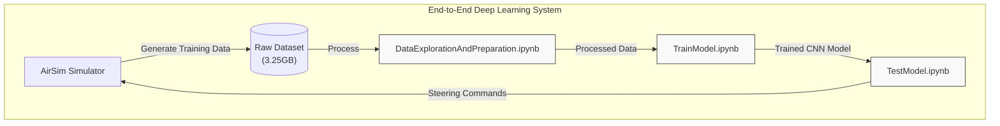
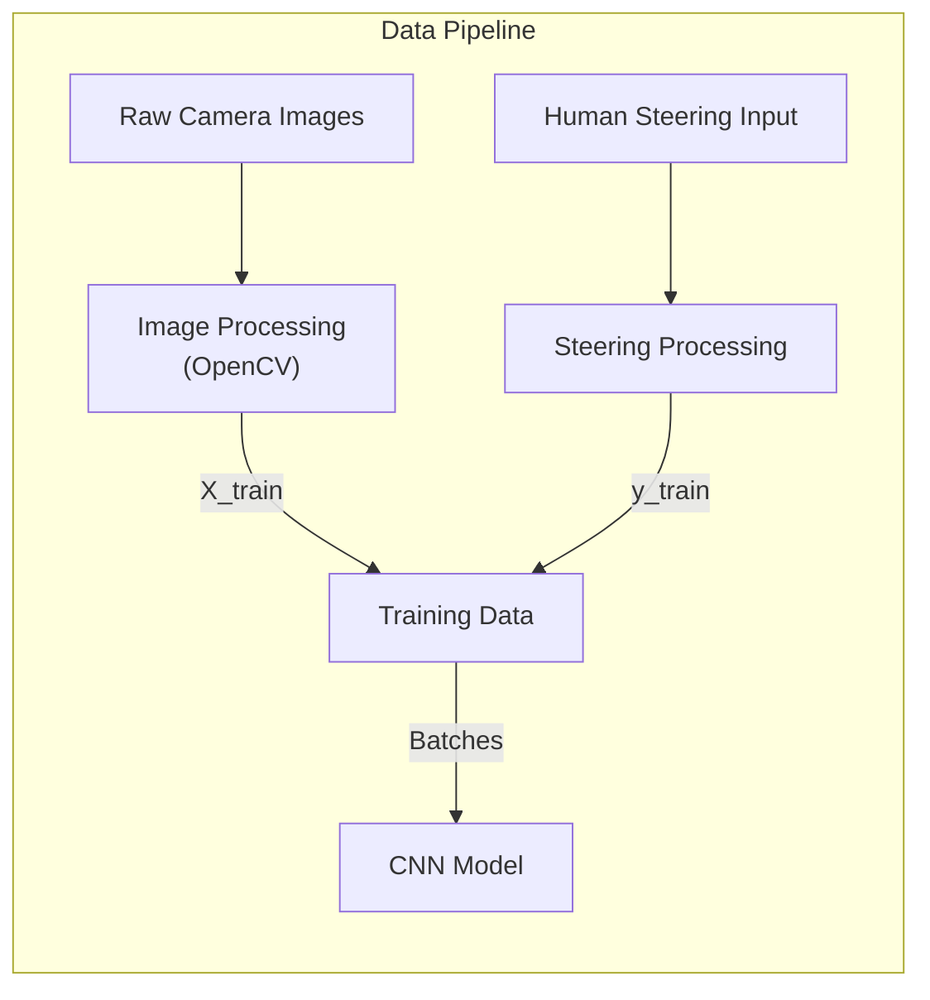
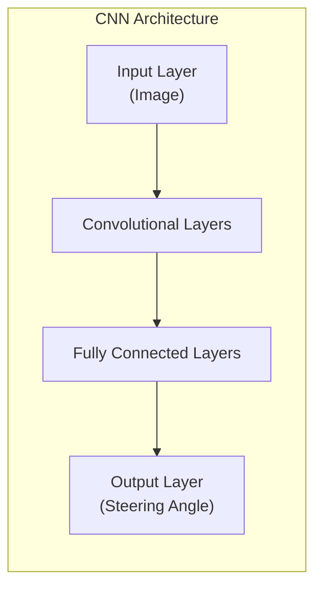
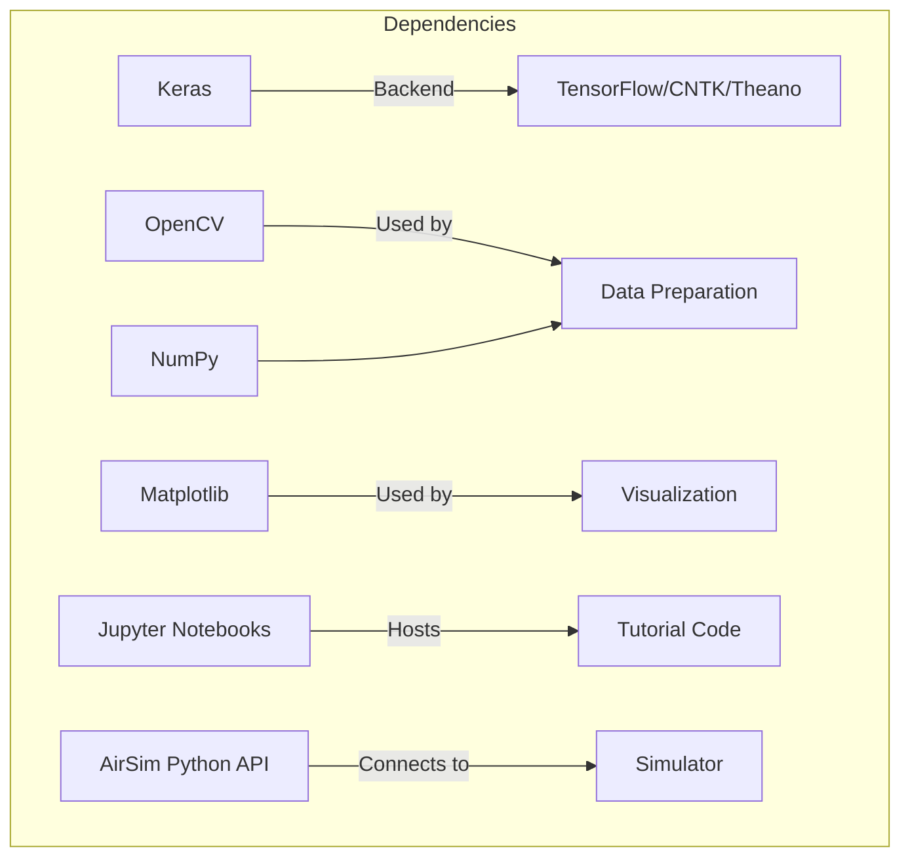
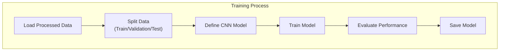
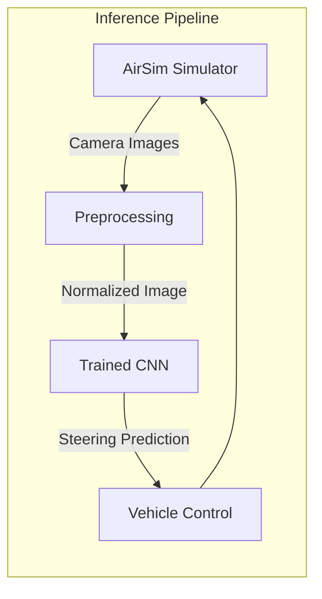

<!-- source: DeepWiki mcp.deepwiki.com · repo microsoft/AutonomousDrivingCookbook · page 2 End-to-End Deep Learning for Autonomous Driving · fetched 2026-10-26 -->

# End-to-End Deep Learning for Autonomous Driving

Relevant source files

The following files were used as context for generating this wiki page:

- [AirSimE2EDeepLearning/README.md](AirSimE2EDeepLearning/README.md)

## Purpose and Scope

This document provides a technical overview of the End-to-End Deep Learning approach for autonomous driving implemented in the AirSimE2EDeepLearning tutorial. The tutorial demonstrates how to train a deep neural network to drive a car autonomously using only visual input from a front-facing camera. The model learns to predict steering commands by observing the road ahead, mimicking how humans drive.

The scope of this document covers the architecture, workflow, components, and implementation details of the end-to-end deep learning system. For information about distributed reinforcement learning approaches to autonomous driving, see [Distributed Reinforcement Learning](#3).

Sources: [AirSimE2EDeepLearning/README.md:9-11]()

## System Overview

The End-to-End Deep Learning system teaches a car to drive autonomously through a portion of the Mountain/Landscape map in AirSim by learning directly from human driving data. Unlike traditional autonomous driving systems that separate perception, planning, and control into distinct modules, this approach uses a single neural network to map raw pixels from a front-facing camera directly to steering commands.

System Architecture Diagram: End-to-End Deep Learning Workflow

Sources: [AirSimE2EDeepLearning/README.md:19-29]()

## Key Components

### 1. AirSim Simulator

The system uses the AirSim simulator, which provides a realistic 3D environment for data collection and testing. AirSim is a cross-platform simulator built on Unreal Engine that offers physically and visually realistic simulations for autonomous vehicles.

| Feature | Description |
|---------|-------------|
| Environment | Mountain/Landscape map |
| Input | Single front-facing camera |
| Physics | Realistic vehicle dynamics |
| Connectivity | Python API for vehicle control and data collection |

Sources: [AirSimE2EDeepLearning/README.md:59-67]()

### 2. Data Pipeline

Data Pipeline Diagram: From Raw Data to Training Input

The data pipeline involves:
1. Collecting raw images and corresponding steering angles from human driving in AirSim
2. Processing and normalizing images
3. Preparing training, validation, and test datasets
4. Creating batches for model training

Sources: [AirSimE2EDeepLearning/README.md:75-77]()

### 3. Deep Learning Model

The system uses a Convolutional Neural Network (CNN) implemented in Keras. The model architecture is designed to:
- Process image inputs from the front-facing camera
- Learn features relevant to driving
- Output steering angle predictions

CNN Architecture Diagram: Basic Flow of Data Through the Model

Sources: [AirSimE2EDeepLearning/README.md:19-21]()

### 4. Notebooks Workflow

The tutorial is organized into three Jupyter notebooks that guide the user through the entire process:

| Notebook | Purpose | Key Functions |
|----------|---------|---------------|
| DataExplorationAndPreparation | Explore and prepare the dataset | Data loading, visualization, preprocessing |
| TrainModel | Train the deep learning model | Model definition, training, evaluation |
| TestModel | Test the model in AirSim | Model loading, inference, vehicle control |

Sources: [AirSimE2EDeepLearning/README.md:25-29]()

## Technical Implementation

### System Dependencies

The end-to-end learning system relies on several key libraries and frameworks:

Dependencies Diagram: Key Libraries and Frameworks

Sources: [AirSimE2EDeepLearning/README.md:42-57]()

### Data Processing Details

The data processing pipeline converts raw simulator data into a format suitable for neural network training:

1. **Data Collection**: Human driving in the AirSim simulator
2. **Data Storage**: ~3.25GB dataset containing images and steering angles
3. **Preprocessing**:
   - Image normalization
   - Steering angle scaling
   - Train/validation/test splitting
4. **Batch Generation**: Creating batches of data for model training

Sources: [AirSimE2EDeepLearning/README.md:75-77]()

### Training Process

Training Process Diagram: Key Steps in Model Training

The training process involves:
1. Loading the prepared dataset
2. Defining the CNN architecture in Keras
3. Training the model using the training data
4. Evaluating performance on validation data
5. Saving the trained model for later use

Training typically takes around 45 minutes with a GPU like NVIDIA GTX970.

Sources: [AirSimE2EDeepLearning/README.md:69-73]()

### Testing and Inference

Inference Pipeline Diagram: Real-time Prediction and Control

During testing:
1. The trained model is loaded
2. Images are captured from the AirSim simulator in real-time
3. Images are preprocessed and fed to the model
4. The model predicts steering angles
5. Steering commands are sent back to control the vehicle in AirSim

Sources: [AirSimE2EDeepLearning/README.md:29]()

## Setup and Usage

### Prerequisites

To use the end-to-end deep learning system, you need:

1. **Knowledge Requirements**:
   - Basics of neural networks and deep learning
   - Familiarity with Convolutional Neural Networks
   - Comfort with Python

2. **Hardware Requirements**:
   - GPU recommended (NVIDIA GTX970 or equivalent)
   - Alternative: Azure Deep Learning VM

3. **Software Requirements**:
   - Anaconda with Python 3.5+
   - CNTK or TensorFlow
   - Keras
   - Additional packages (OpenCV, NumPy, etc.)

Sources: [AirSimE2EDeepLearning/README.md:35-57]()

### Installation Steps

1. Install Anaconda with Python 3.5 or higher
2. Install a deep learning backend (CNTK or TensorFlow)
3. Install h5py and configure Keras
4. Install AzCopy and add to system path
5. Run the provided InstallPackages.py script to install remaining dependencies
6. Download and set up the AirSim simulator package
7. Download the training dataset (~3.25GB)

Sources: [AirSimE2EDeepLearning/README.md:42-57](), [AirSimE2EDeepLearning/README.md:59-77]()

### Running the Tutorial

The tutorial is executed through three sequential Jupyter notebooks:

1. **DataExplorationAndPreparation.ipynb**:
   - Load and explore the dataset
   - Preprocess and prepare data for training

2. **TrainModel.ipynb**:
   - Define the CNN architecture
   - Train the model on the prepared data
   - Evaluate model performance

3. **TestModel.ipynb**:
   - Load the trained model
   - Connect to AirSim
   - Run inference in real-time
   - Control the vehicle based on model predictions

Sources: [AirSimE2EDeepLearning/README.md:25-29]()

## Summary

The End-to-End Deep Learning for Autonomous Driving system demonstrates a fundamental approach to autonomous vehicle control using deep learning. By mapping directly from raw pixels to steering commands, the system learns to drive based on visual input alone, similar to how humans drive. This approach, while simpler than production autonomous driving systems, provides a excellent introduction to applying deep learning techniques to autonomous driving problems.

For more advanced approaches using reinforcement learning, see the [Distributed Reinforcement Learning](#3) section of this cookbook.

Sources: [AirSimE2EDeepLearning/README.md:79-81]()

---

