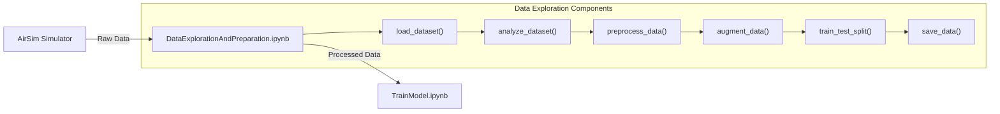
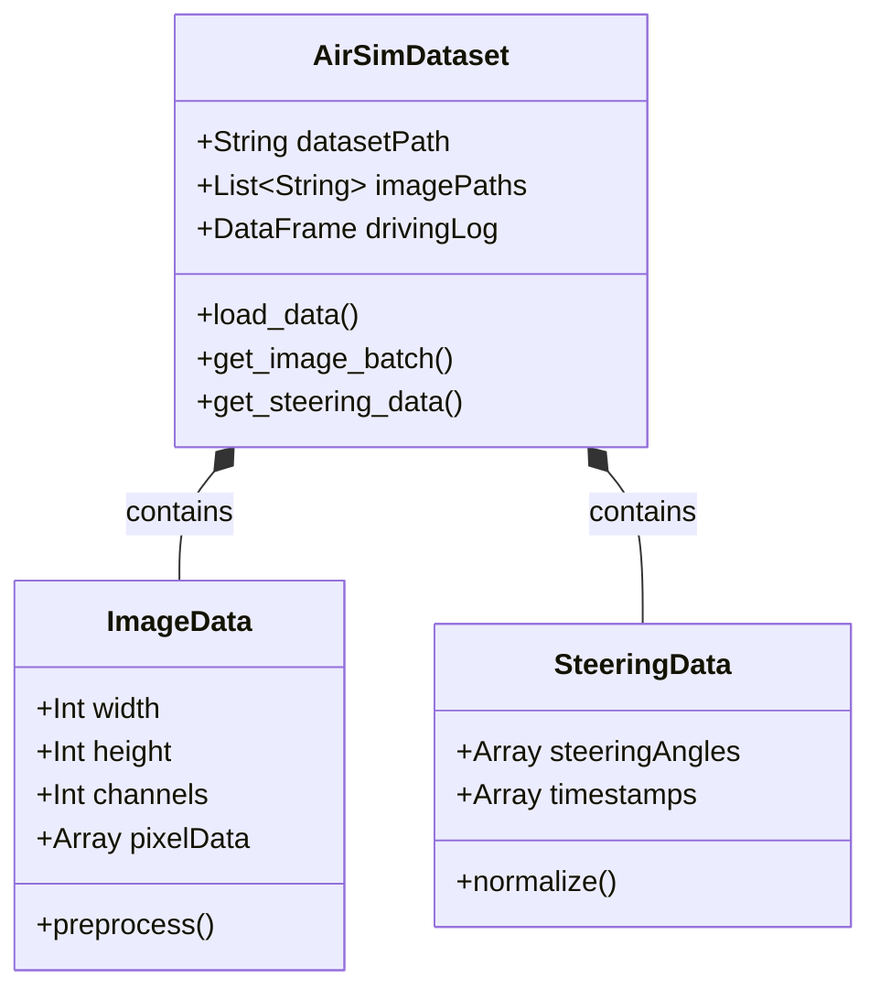
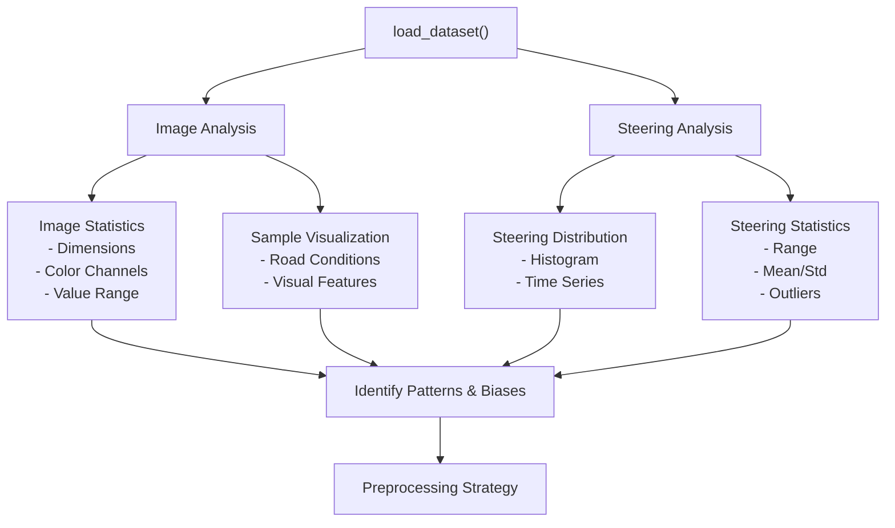
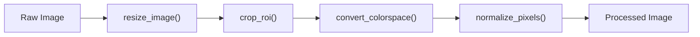
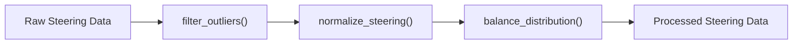
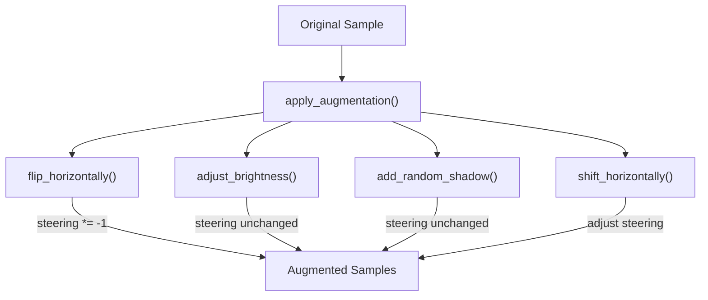
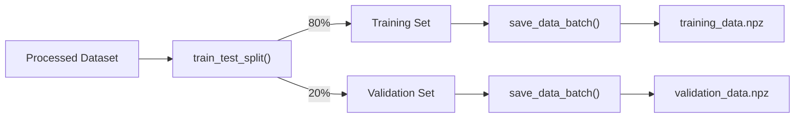
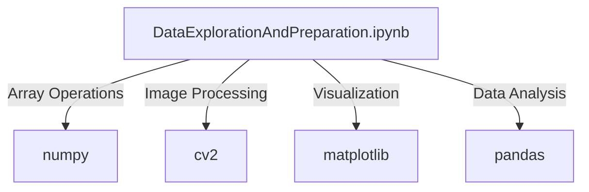

<!-- source: DeepWiki mcp.deepwiki.com · repo microsoft/AutonomousDrivingCookbook · page 2.1 Data Exploration and Preparation · fetched 2026-10-26 -->

# Data Exploration and Preparation

Relevant source files

The following files were used as context for generating this wiki page:

- [AirSimE2EDeepLearning/DataExplorationAndPreparation.ipynb](AirSimE2EDeepLearning/DataExplorationAndPreparation.ipynb)

## Purpose and Scope

This document details the process of exploring and preparing data for training an end-to-end deep learning model for autonomous driving using the AirSim simulator. This is the first step in the AirSimE2EDeepLearning tutorial, where raw simulator data is analyzed and transformed into a format optimized for neural network training.

For information about the subsequent model training process, see [Training the Deep Learning Model](#2.2).

## System Overview

The Data Exploration and Preparation system serves as the critical bridge between data collection from the AirSim simulator and model training:

Sources: Based on the overall repository architecture and AirSimE2EDeepLearning workflow

## Dataset Structure

The dataset used in this tutorial consists of two primary components:

Sources: Based on common autonomous driving dataset structures

The dataset typically includes:
1. **Images**: Front-facing camera views captured from the simulated vehicle
2. **Steering controls**: Corresponding steering angle values recorded during driving sessions
3. **Metadata**: Information about the data collection environment and parameters

## Data Exploration Process

The exploration phase analyzes dataset characteristics to identify patterns and inform preprocessing decisions:

Sources: Based on common data exploration practices in autonomous driving projects

Key exploration activities include:
- Visualizing sample images to understand road conditions and visual features
- Analyzing steering angle distribution to identify potential biases
- Computing statistics on both image and steering data
- Identifying correlations between visual features and steering angles

## Image Preprocessing Pipeline

Based on exploration insights, images undergo several preprocessing steps:

Sources: Based on common image preprocessing techniques in deep learning for autonomous driving

Typical preprocessing operations include:
- **Resizing**: Reducing image dimensions to a standard size (e.g., 200x66 pixels)
- **Cropping**: Removing irrelevant portions like the sky or car hood
- **Color conversion**: Converting between color spaces (e.g., BGR to YUV)
- **Normalization**: Scaling pixel values to a standard range (e.g., [0,1] or [-1,1])

## Steering Data Preprocessing

The steering angle data also undergoes preprocessing:

Sources: Based on common control data preprocessing techniques

Key steps include:
- Filtering outliers or erroneous values
- Normalizing steering angles to a standard range (typically [-1,1])
- Addressing class imbalance (often more straight driving than turns)

## Data Augmentation Techniques

To improve model generalization, data augmentation expands the dataset with synthetic variations:

Sources: Based on common augmentation techniques for autonomous driving datasets

These techniques create artificial variations of the original data, helping the model learn to generalize better to new situations.

## Train/Test Split and Storage

After preprocessing and augmentation, the data is split into training and validation sets:

Sources: Based on common practices in machine learning pipelines

The processed data is typically saved in a compressed format (like NPZ) that preserves the relationship between images and steering angles while enabling efficient loading during training.

## Key Libraries and Dependencies

The Data Exploration and Preparation notebook relies on several key libraries:

Sources: Based on standard data science libraries used in computer vision and autonomous driving

These libraries provide the core functionality for loading, analyzing, processing, and visualizing the dataset.

## Integration with Model Training

The output of this process feeds directly into the model training phase:

Sources: Based on the end-to-end workflow in the AirSimE2EDeepLearning tutorial

The processed data serves as the foundation for training the convolutional neural network that will predict steering angles from visual input.

## Summary

The Data Exploration and Preparation process is a critical foundation for the AirSimE2EDeepLearning pipeline. It transforms raw simulator data into optimized formats for neural network training through systematic analysis, preprocessing, and organization.

Key outcomes include:
- Standardized image data with normalized formats
- Aligned and balanced steering control data
- Augmented training examples for improved generalization
- Structured training and validation datasets

This process sets the stage for successful model training in the next phase of the autonomous driving pipeline.

---

