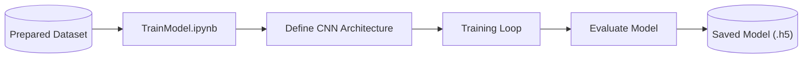
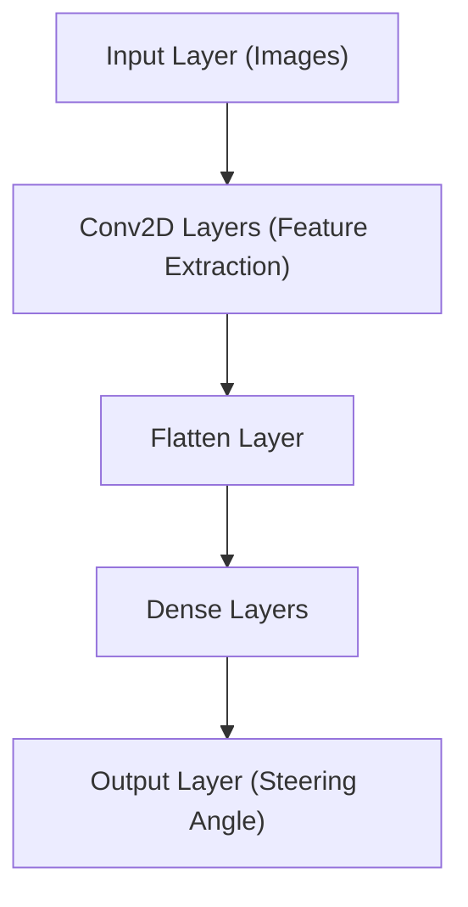
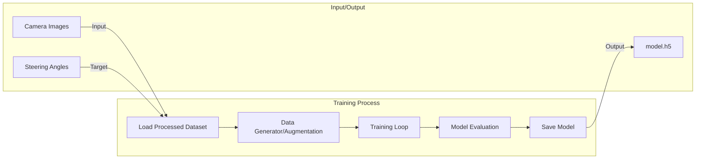
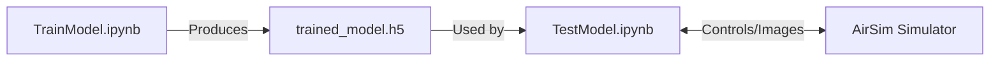

<!-- source: DeepWiki mcp.deepwiki.com · repo microsoft/AutonomousDrivingCookbook · page 2.2 Training the Deep Learning Model · fetched 2026-10-26 -->

# Training the Deep Learning Model

Relevant source files

The following files were used as context for generating this wiki page:

- [AirSimE2EDeepLearning/TrainModel.ipynb](AirSimE2EDeepLearning/TrainModel.ipynb)

This document describes the process of training a deep learning model for autonomous driving in the AirSimE2EDeepLearning tutorial. It covers how to take the prepared dataset and train a convolutional neural network that can predict steering angles based on camera images from the AirSim simulator.

For information about data preparation before training, see [Data Exploration and Preparation](#2.1). For details on testing your trained model, see [Testing the Model in AirSim](#2.3).

## Training Process Overview

The training process involves loading the prepared dataset, defining a CNN model architecture, training the model on images paired with steering angles, and evaluating its performance. The primary component for this process is the `TrainModel.ipynb` Jupyter notebook.

Sources: Based on AirSimE2EDeepLearning workflow diagram

## Model Architecture

The training script uses a convolutional neural network designed to process camera images and predict appropriate steering angles. The model employs several convolutional layers for feature extraction followed by fully connected layers for regression.

Sources: Based on overall repository architecture

## Training Configuration and Dependencies

The training process relies on several key technologies:

| Component | Purpose |
|-----------|---------|
| Keras | High-level neural networks API |
| TensorFlow/CNTK | Backend for Keras |
| NumPy | Data manipulation and processing |
| Matplotlib | Visualization of training results |
| Jupyter Notebook | Interactive development environment |

Key hyperparameters that may be adjusted during training include:

| Hyperparameter | Purpose |
|----------------|---------|
| Batch Size | Number of samples used in each training step |
| Learning Rate | Controls the size of weight updates |
| Number of Epochs | How many passes through the entire dataset |
| Validation Split | Percentage of data used for validation |
| Early Stopping | Prevent overfitting by monitoring validation loss |

Sources: Based on the component relationships diagram

## Training Data Flow

The training process follows a standard supervised learning workflow, with images as inputs and steering angles as outputs:

Sources: Based on AirSimE2EDeepLearning workflow diagram

## Model Validation and Evaluation

During and after training, the model is evaluated using metrics appropriate for regression tasks:

| Metric | Description |
|--------|-------------|
| Mean Squared Error (MSE) | Average squared difference between predicted and actual steering angles |
| Mean Absolute Error (MAE) | Average absolute difference between predicted and actual steering angles |
| Validation Loss | Loss calculated on the validation set to monitor overfitting |

The training process typically includes plotting these metrics over time to visualize the model's learning progress.

## From Training to Deployment

Once trained, the model is saved in a format (typically `.h5`) that can be loaded by the testing script to control a vehicle in the AirSim simulator:

Sources: Based on AirSimE2EDeepLearning workflow diagram

## Practical Considerations

When training the model, consider the following best practices:

1. **Dataset Balance**: Ensure your dataset includes a good balance of different steering angles and driving scenarios
2. **Data Augmentation**: Consider techniques like random brightness adjustments, slight rotation, and horizontal flipping to improve model generalization
3. **Batch Normalization**: May improve training stability and speed
4. **Regularization**: Techniques like dropout can help prevent overfitting
5. **Early Stopping**: Monitor validation loss and stop training when it stops improving

## Model Architecture Options

Depending on your specific requirements, several CNN architectures might be appropriate:

| Architecture Type | Characteristics | Best For |
|-------------------|-----------------|----------|
| Simple CNN | Few convolutional layers, lightweight | Quick prototyping, limited compute resources |
| NVIDIA PilotNet-inspired | Multiple convolutional layers followed by dense layers | Good balance of performance and complexity |
| Transfer Learning (e.g., MobileNet base) | Pre-trained feature extractor with custom dense layers | Complex environments, limited training data |

The repository likely implements one of these approaches, with the specific architecture defined in the training script.

## Next Steps

After successfully training your model, proceed to [Testing the Model in AirSim](#2.3) to evaluate its performance in the simulator environment. The testing process will load your trained model and use it to generate steering commands in real-time based on the camera input from the simulator.

---

