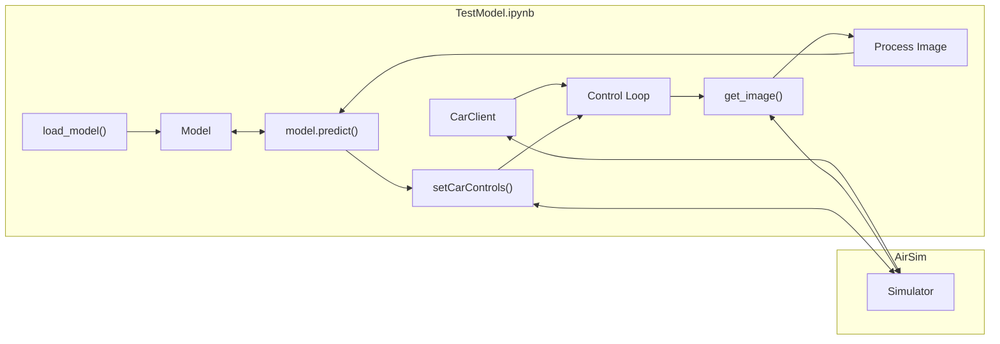
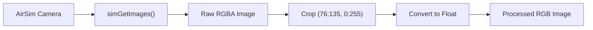
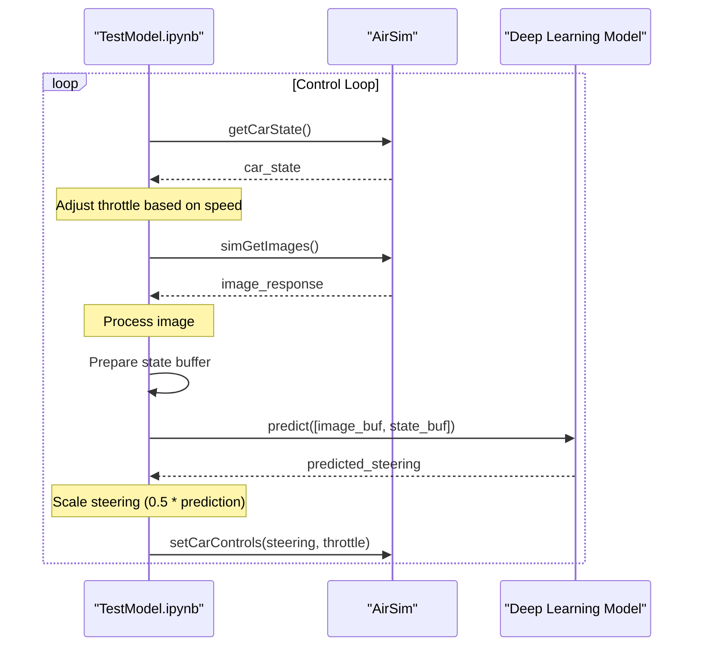
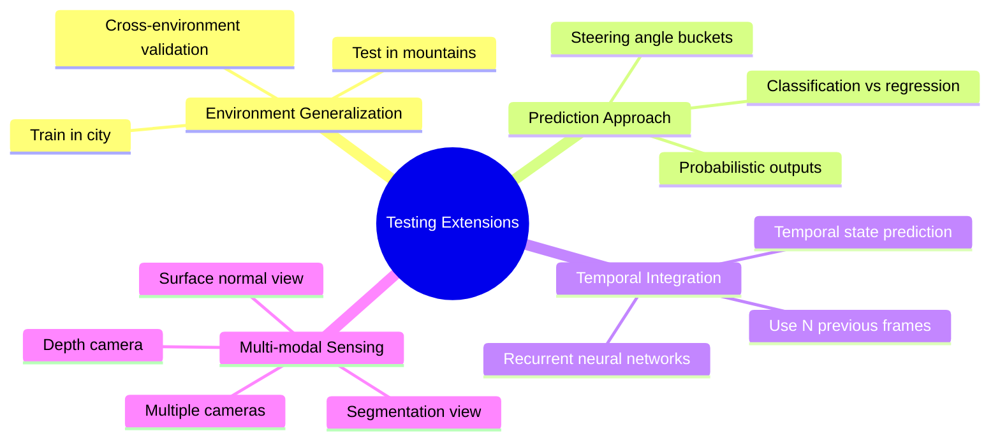

<!-- source: DeepWiki mcp.deepwiki.com · repo microsoft/AutonomousDrivingCookbook · page 2.3 Testing the Model in AirSim · fetched 2026-10-26 -->

# Testing the Model in AirSim

<details>
<summary>Relevant source files</summary>

The following files were used as context for generating this wiki page:

- [AirSimE2EDeepLearning/TestModel.ipynb](AirSimE2EDeepLearning/TestModel.ipynb)

</details>


## Purpose and Scope

This document provides technical instructions for testing a trained deep learning model in the AirSim simulator. It covers the process of loading a previously trained model, connecting to AirSim, and implementing a control loop that enables autonomous driving based on the model's predictions. For information about training the model itself, see [Training the Deep Learning Model](#2.2).

## Prerequisites

Before testing your model in AirSim, ensure you have:

1. A trained model from the previous step
2. AirSim simulator running in a separate process (in the Landscape environment)
3. Python environment with required dependencies (Keras, NumPy)

Sources: [AirSimE2EDeepLearning/TestModel.ipynb:3-41]()

## Testing Architecture

The testing system forms a closed-loop control system where the trained model drives a vehicle in the AirSim simulator autonomously.



Sources: [AirSimE2EDeepLearning/TestModel.ipynb:64-70](), [AirSimE2EDeepLearning/TestModel.ipynb:111-116](), [AirSimE2EDeepLearning/TestModel.ipynb:134-149]()

## Setting Up the Testing Environment

### Loading the Model

The system first loads the trained model from disk. If no specific model path is provided, it automatically selects the most recently created model from the `model/models/` directory.

```python
# If no model path is specified, use the most recent model
if (MODEL_PATH == None):
    models = glob.glob('model/models/*.h5') 
    best_model = max(models, key=os.path.getctime)
    MODEL_PATH = best_model

model = load_model(MODEL_PATH)
```

Sources: [AirSimE2EDeepLearning/TestModel.ipynb:30-39](), [AirSimE2EDeepLearning/TestModel.ipynb:64]()

### Connecting to AirSim

The system establishes a connection with the AirSim simulator and enables API control of the vehicle:

```python
client = CarClient()
client.confirmConnection()
client.enableApiControl(True)
car_controls = CarControls()
```

Sources: [AirSimE2EDeepLearning/TestModel.ipynb:66-69]()

### Initializing Control and Buffer Variables

Before starting the control loop, the system initializes the car control parameters and creates buffers for storing images and state information:

| Variable | Type | Purpose |
|----------|------|---------|
| `car_controls.steering` | float | Control the steering angle of the vehicle |
| `car_controls.throttle` | float | Control the acceleration of the vehicle |
| `car_controls.brake` | float | Control the braking of the vehicle |
| `image_buf` | numpy array | Buffer for storing the processed camera image |
| `state_buf` | numpy array | Buffer for storing the vehicle state information |

Sources: [AirSimE2EDeepLearning/TestModel.ipynb:88-93]()

## Image Processing

The system includes a helper function `get_image()` that:
1. Requests an RGB image from AirSim's front camera
2. Converts the image data to a numpy array
3. Crops the image to focus on the road (rows 76-135, all 255 columns)
4. Returns the processed image as a float array



Sources: [AirSimE2EDeepLearning/TestModel.ipynb:111-116]()

## Control Loop Implementation

The main control loop performs the following operations in sequence:

1. **Get car state**: Retrieves the current state of the car from AirSim
2. **Speed control**: Applies throttle based on the current speed (targets 5 m/s)
3. **Image acquisition**: Gets and processes an image from AirSim
4. **State preparation**: Creates a state vector containing current controls and speed
5. **Model prediction**: Uses the model to predict the steering angle
6. **Control application**: Sends the updated controls back to AirSim



The control loop uses the following formula to determine the steering angle:
```
car_controls.steering = 0.5 * model_output[0][0]
```

The throttle is managed by a simple conditional:
```
if (car_state.speed < 5):
    car_controls.throttle = 1.0
else:
    car_controls.throttle = 0.0
```

Sources: [AirSimE2EDeepLearning/TestModel.ipynb:134-149]()

## Observations and Potential Improvements

Testing reveals both strengths and limitations of the trained model:

### Strengths
- The car successfully navigates the road
- Keeps to the right side of the road
- Handles sharp turns

### Limitations
- Motion is not smooth, especially on bridges
- Car eventually veers off the road after approximately 5 minutes
- Has difficulty climbing hills

### Potential Improvements

| Issue | Potential Solution |
|-------|-------------------|
| Unsmooth motion on bridges | Increase training data for bridge sections |
| Crashes on hills | Analyze the car's view during ascent; may need more hill training data |
| Limited generalization | Train on more diverse environments |
| Regression vs. Classification | Experiment with classification approach for steering predictions |
| Single image prediction | Incorporate temporal information (previous N frames) |
| Limited input data | Use additional camera views and sensing modes (depth, segmentation) |

Sources: [AirSimE2EDeepLearning/TestModel.ipynb:156-180]()

## Extending the Testing Framework

The testing framework can be extended in several ways:



Sources: [AirSimE2EDeepLearning/TestModel.ipynb:156-180]()

## Troubleshooting

| Issue | Solution |
|-------|----------|
| Connection failure | Ensure AirSim is running before executing the testing code |
| Model not found | Verify the correct path to the trained model file |
| Car doesn't move | Check that API control is enabled and throttle is being applied |
| Erratic behavior | Reduce the scaling factor for steering (currently 0.5) |

Sources: [AirSimE2EDeepLearning/TestModel.ipynb:46-70]()

---

