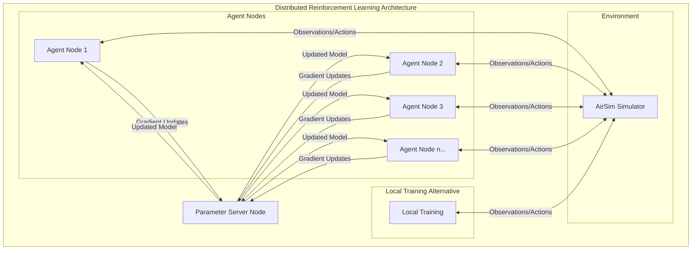
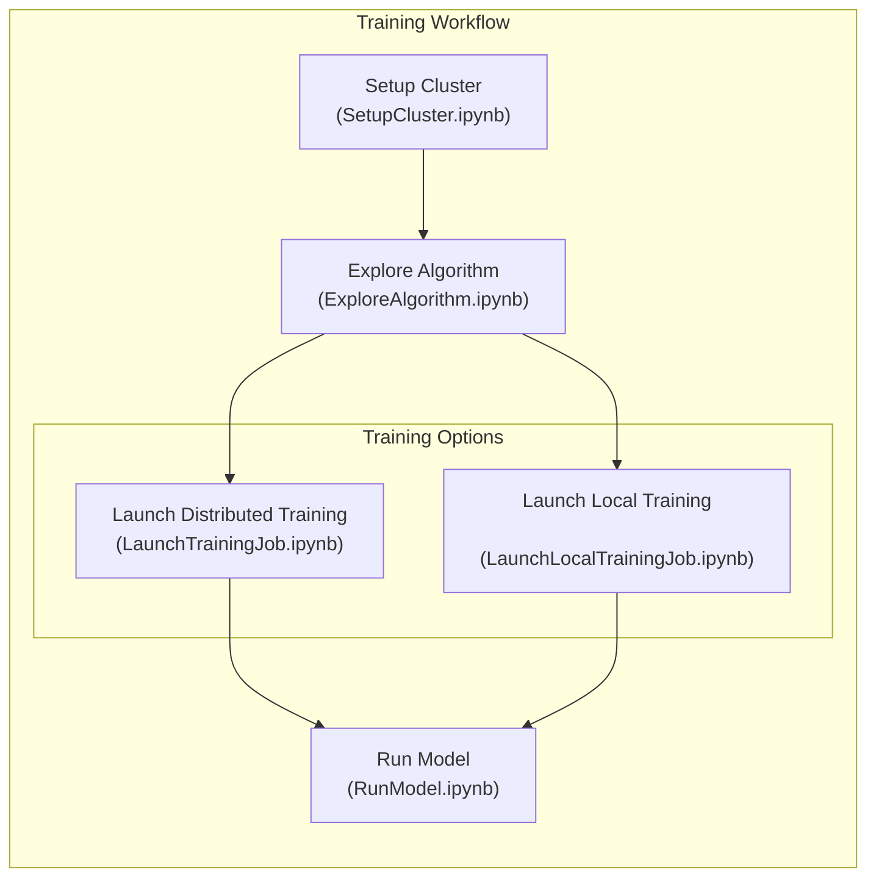
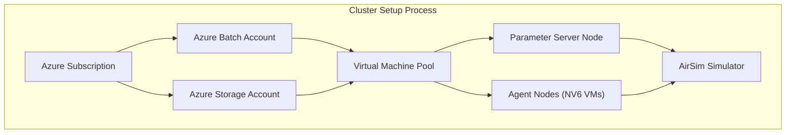
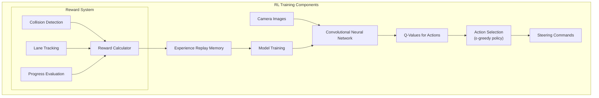
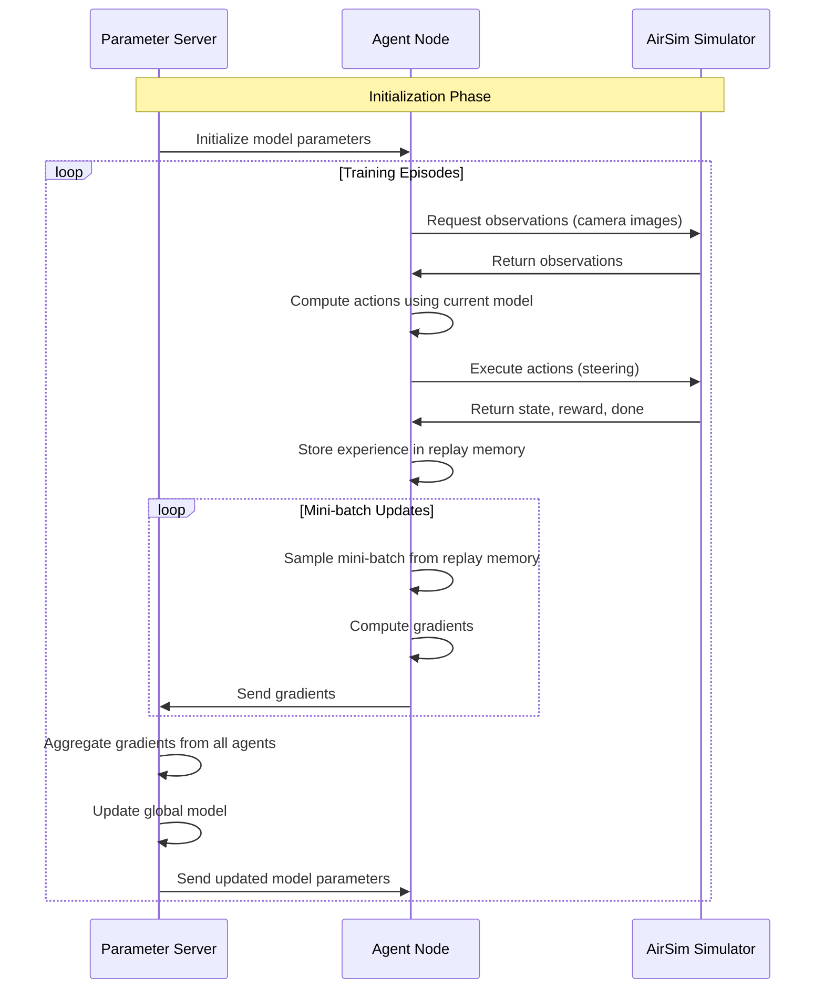
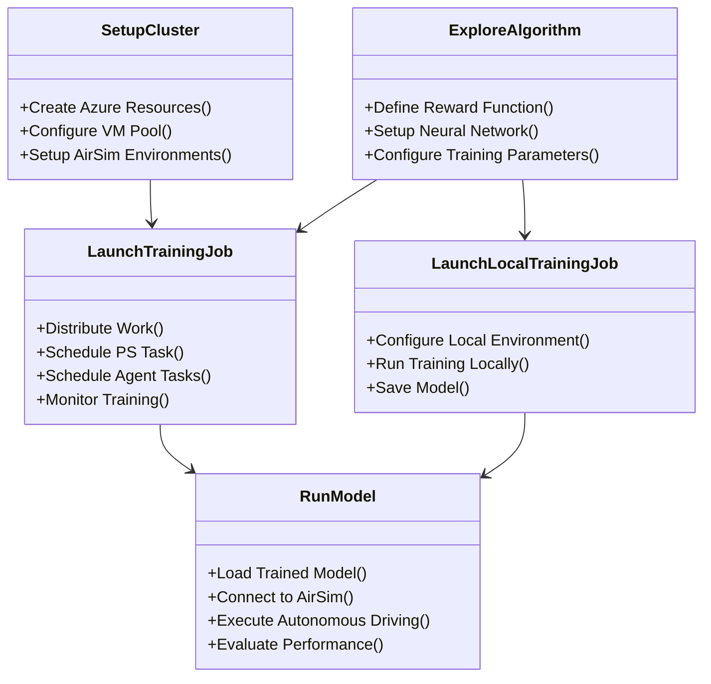

<!-- source: DeepWiki mcp.deepwiki.com · repo microsoft/AutonomousDrivingCookbook · page 3 Distributed Reinforcement Learning · fetched 2026-10-26 -->

# Distributed Reinforcement Learning

<details>
<summary>Relevant source files</summary>

The following files were used as context for generating this wiki page:

- [DistributedRL/README.md](DistributedRL/README.md)

</details>


## Purpose and Scope

This document provides an overview of the Distributed Reinforcement Learning system in the Autonomous Driving Cookbook. It explains the architecture, components, and workflow for training deep reinforcement learning models at scale for autonomous driving using the AirSim simulator and cloud computing resources. The system allows for both distributed training across multiple virtual machines and local training on a single machine.

This page covers the high-level architecture and concepts of the Distributed RL system. For specific implementation details about setting up Azure Batch clusters, see [Setting Up Azure Batch Cluster](#3.1). For details about the RL algorithm used, see [Exploring the RL Algorithm](#3.2).

Sources: [DistributedRL/README.md:12-21]()

## System Overview

The Distributed Reinforcement Learning system enables training autonomous driving models using reinforcement learning techniques distributed across multiple nodes. This approach leverages cloud computing resources to accelerate training by parallelizing the simulation and learning process. The system uses AirSim as the simulation environment and Azure Batch to manage the distribution of training tasks.

### Architecture Diagram



Sources: [DistributedRL/README.md:12-21](), [DistributedRL/README.md:66-72]()

### Key Components

The system consists of several key components:

1. **Parameter Server Node**: Central node that aggregates gradient updates from agent nodes and maintains the global model
2. **Agent Nodes**: Virtual machines running AirSim instances that interact with the environment, collect experiences, and compute gradient updates
3. **AirSim Simulator**: Provides the simulation environment where the car learns to drive
4. **Azure Batch Service**: Manages the virtual machine cluster and schedules the training jobs
5. **Local Training Alternative**: Option to train the model on a single machine without distributed computing

Sources: [DistributedRL/README.md:21-21](), [DistributedRL/README.md:75-94]()

## Training Workflow

The training process follows a systematic workflow that includes setting up the cluster, exploring the algorithm, launching the training job, and running the trained model.

### Workflow Diagram



Sources: [DistributedRL/README.md:75-94]()

### Setup Process

The training process begins with setting up an Azure Batch cluster of virtual machines, each running the AirSim simulation environment. The cluster typically consists of one parameter server node and multiple agent nodes. For local training, only a single machine with a GPU is required.



Sources: [DistributedRL/README.md:21-21](), [DistributedRL/README.md:66-72](), [DistributedRL/README.md:77-77]()

## Reinforcement Learning Implementation

The system implements a deep reinforcement learning approach for training autonomous driving models. The implementation includes a deep neural network model, reward function design, and training algorithms for both distributed and local scenarios.

### Model Architecture and Training Components



Sources: [DistributedRL/README.md:28-31]()

### Distributed vs. Local Training

The system supports two training approaches:

1. **Distributed Training**: Uses multiple VMs coordinated through a parameter server for parallel training, significantly reducing training time but requiring Azure resources.

2. **Local Training**: Runs the entire training process on a single machine with a GPU, taking longer but not requiring cloud resources.

| Training Method | Infrastructure | Training Time (from scratch) | Training Time (transfer learning) | Requirements |
|----------------|----------------|------------------------------|----------------------------------|--------------|
| Distributed    | Azure Batch (4 nodes) | ~3 days                     | ~6 hours                         | Azure subscription, NV6 VMs |
| Local          | Single Machine | ~5 days                     | Few hours                        | GPU-equipped machine |

Sources: [DistributedRL/README.md:66-72](), [DistributedRL/README.md:87-94]()

## Data Flow During Training

The following diagram illustrates the data flow during distributed training:



Sources: [DistributedRL/README.md:12-21]()

## Code Structure and Implementation

The implementation of the Distributed RL system is organized around several key Jupyter notebooks that guide users through the workflow:

1. **SetupCluster.ipynb**: Sets up the Azure Batch cluster for distributed training
2. **ExploreAlgorithm.ipynb**: Explains the reinforcement learning algorithm used
3. **LaunchTrainingJob.ipynb**: Launches the distributed training job
4. **LaunchLocalTrainingJob.ipynb**: Alternative for launching local training
5. **RunModel.ipynb**: Runs and evaluates the trained model



Sources: [DistributedRL/README.md:75-94]()

## Hardware and Software Requirements

To use the Distributed RL system, certain hardware and software requirements must be met:

### Hardware Requirements

- For distributed training: Azure subscription with access to NV6 VM instances
- For local training: Machine with GPU
- For running the trained model: GPU-equipped machine (local or Azure Data Science VM)

### Software Dependencies

- Python 3.5 or higher (via Anaconda)
- TensorFlow
- Keras
- h5py
- AzCopy
- Azure PowerShell
- Azure CLI
- Additional Python packages:
  - jupyter
  - matplotlib v. 2.1.2
  - image
  - keras_tqdm
  - opencv
  - msgpack-rpc-python
  - pandas
  - numpy
  - scipy

Sources: [DistributedRL/README.md:35-53](), [DistributedRL/README.md:66-72]()

## Getting Started

To get started with the Distributed RL system, you should:

1. Set up the required environment as specified in the prerequisites
2. Download and set up the AirSim simulator package
3. Follow the Jupyter notebooks in sequence:
   - For distributed training: SetupCluster → ExploreAlgorithm → LaunchTrainingJob → RunModel
   - For local training: ExploreAlgorithm → LaunchLocalTrainingJob → RunModel

For the AirSim simulator package, download it from the provided link and run:
```
.\AD_Cookbook_Start_AirSim.ps1 neighborhood
```

Sources: [DistributedRL/README.md:56-63](), [DistributedRL/README.md:75-94]()

---

