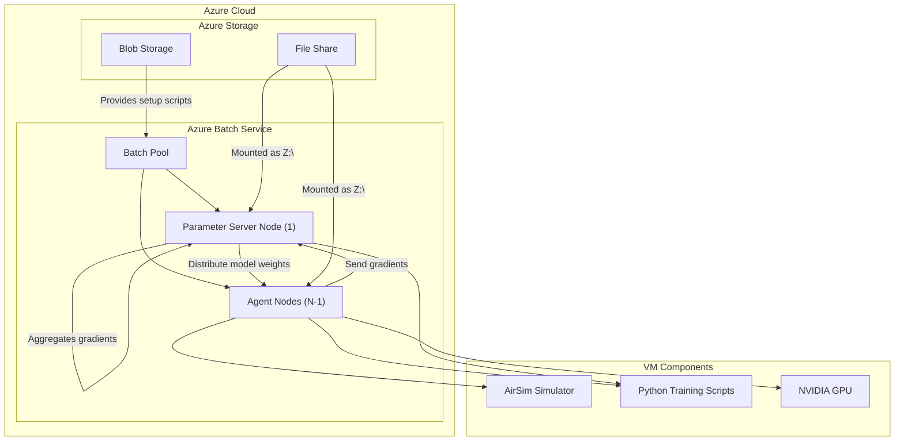
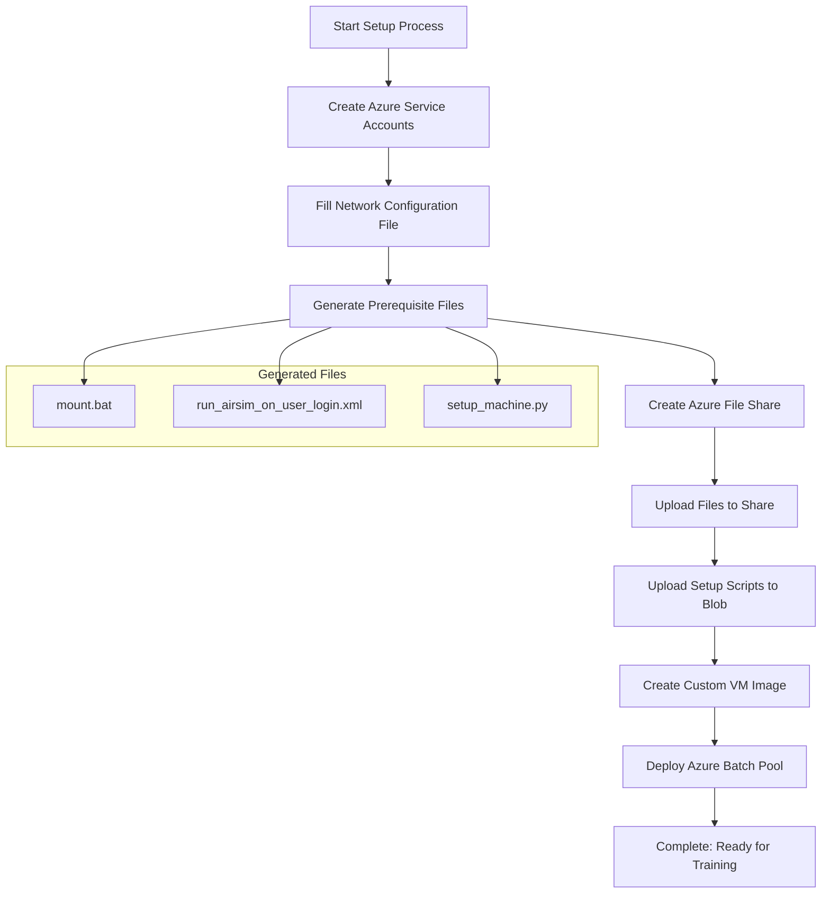
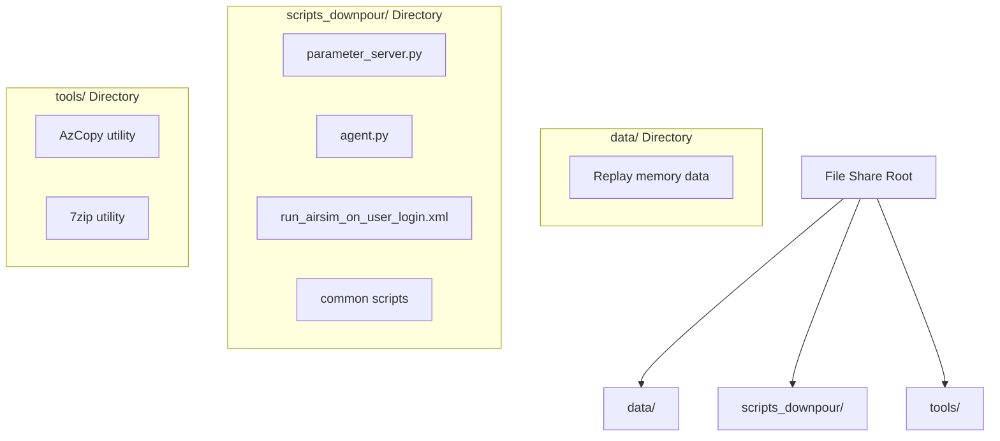
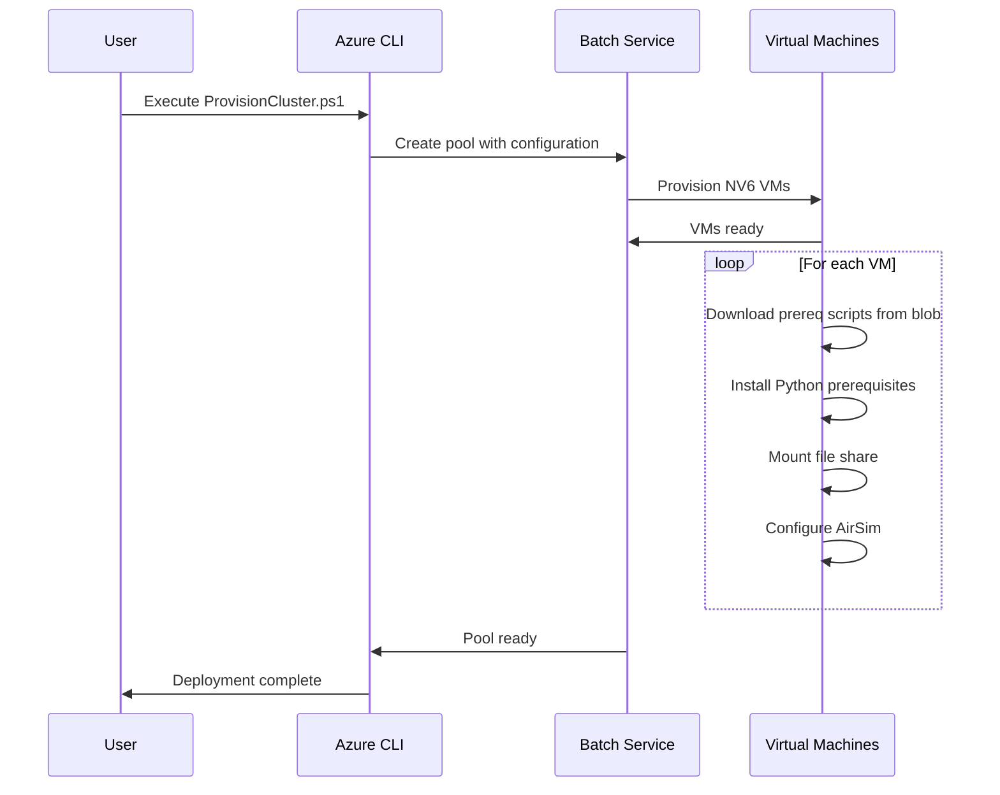

<!-- source: DeepWiki mcp.deepwiki.com · repo microsoft/AutonomousDrivingCookbook · page 3.1 Setting Up Azure Batch Cluster · fetched 2026-10-26 -->

# Setting Up Azure Batch Cluster

<details>
<summary>Relevant source files</summary>

The following files were used as context for generating this wiki page:

- [DistributedRL/SetupCluster.ipynb](DistributedRL/SetupCluster.ipynb)

</details>


## Purpose and Scope

This document provides a comprehensive guide for setting up an Azure Batch cluster to support distributed reinforcement learning (RL) for autonomous driving. This is a critical prerequisite step in the Distributed RL workflow that enables training across multiple virtual machines, each running AirSim simulations in parallel. For information about the specific RL algorithm used in this system, see [Exploring the RL Algorithm](#3.2).

The setup process involves creating necessary Azure resources, configuring storage, generating setup scripts, and deploying a pool of GPU-enabled virtual machines that communicate with each other during training.

Sources: [DistributedRL/SetupCluster.ipynb:6-12]()

## Architecture Overview

### Distributed RL Training Cluster Architecture



Sources: [DistributedRL/SetupCluster.ipynb:6-12](), [DistributedRL/SetupCluster.ipynb:267-276]()

### Setup Process Workflow



Sources: [DistributedRL/SetupCluster.ipynb:12-39](), [DistributedRL/SetupCluster.ipynb:76-84]()

## Prerequisites

Before setting up the Azure Batch cluster, you will need:

1. An **active Azure subscription** - Required to create and manage Azure resources
2. **Azure PowerShell** - Latest version required for script execution
3. **AzCopy utility** - For transferring the custom VM image
4. **Python packages**:
   - `azure-storage-file`
   - `azure-storage-blob`
   - `cryptography` 
   - `azure-batch`
   - `azure-storage`

Sources: [DistributedRL/SetupCluster.ipynb:10-12](), [DistributedRL/SetupCluster.ipynb:47-72](), [DistributedRL/SetupCluster.ipynb:237-238]()

## Creating Azure Service Accounts

Two primary Azure services are required for setting up the distributed RL infrastructure:

| Account Type | Purpose | Required Information |
|--------------|---------|----------------------|
| Azure Storage Account | Stores code files and data in a file share accessible to all nodes | Resource group name, account name, access key |
| Azure Batch Account | Manages the pool of VMs and schedules training jobs | Account name, access key, batch account URL |

### Azure Storage Account Setup

1. Create a general-purpose storage account through the Azure portal
2. Note the resource group name, account name, and primary access key
3. This account will host both file shares and blob storage used during setup and training

### Azure Batch Account Setup

1. Create an Azure Batch account through the Azure portal
2. Note the account name, primary access key, and the batch account URL
3. Ensure your subscription has enough quota for the VM size you plan to use (NV-series VMs for GPU support)

Sources: [DistributedRL/SetupCluster.ipynb:12-19]()

## Network Configuration File

The system requires a configuration file named `network_config.json` that contains all the necessary connection information and settings. This file must be completed before proceeding with the setup process.

| Configuration Field | Description |
|---------------------|-------------|
| `subscription_id` | Your Azure subscription ID |
| `resource_group_name` | Resource group containing the storage account |
| `storage_account_name` | Name of your Azure storage account |
| `storage_account_key` | Primary access key for the storage account |
| `file_share_name` | Name for the file share to be created |
| `batch_account_name` | Name of your Azure Batch account |
| `batch_account_key` | Primary access key for the Batch account |
| `batch_account_url` | URL of your Batch account |
| `batch_job_user_name` | Username for the VM admin account |
| `batch_job_user_password` | Password for the VM admin account |
| `batch_pool_name` | Name for your VM pool |
| `batch_pool_size` | Number of VMs in the pool (minimum 2) |

**Important**: The `batch_pool_size` should be at least 2, with one VM serving as the parameter server and the remaining VMs as agent nodes. For example, if you want 5 agent VMs, set the pool size to 6.

Sources: [DistributedRL/SetupCluster.ipynb:20-36]()

## Generating Prerequisite Files

The setup process automatically generates several critical configuration files that prepare the VMs for distributed training:

### Generated Files and Their Purposes

| File | Purpose |
|------|---------|
| `mount.bat` | Batch script that mounts the Azure file share to the Z:\ drive on each VM |
| `run_airsim_on_user_login.xml` | XML scheduled task definition that restarts AirSim when a user logs in (for visualization) |
| `setup_machine.py` | Python script that installs prerequisites and configures the VM |

These files are generated using template files and filled with information from your configuration:

```python
mount_bat_cmd = mount_bat_cmd\
                    .replace('{storage_account_name}', NOTEBOOK_CONFIG['storage_account_name'])\
                    .replace('{file_share_name}', NOTEBOOK_CONFIG['file_share_name'])\
                    .replace('{storage_account_key}', NOTEBOOK_CONFIG['storage_account_key'])
```

Sources: [DistributedRL/SetupCluster.ipynb:76-128]()

## Setting Up Azure File Share

The Azure File Share serves as a central repository for all code and data files that need to be accessed by the VM nodes. This share will be mounted as the Z:\ drive on each VM.

### File Share Structure



The script creates the file share and uploads all the necessary files from the local `Share` directory, preserving the directory structure. This includes:

1. **data/** - Contains data files used by the executable
2. **scripts_downpour/** - Contains the main Python scripts for the parameter server and agent nodes
3. **tools/** - Contains utilities like AzCopy and 7zip for VM setup

Sources: [DistributedRL/SetupCluster.ipynb:134-140](), [DistributedRL/SetupCluster.ipynb:180-202]()

## Setting Up Blob Storage

In addition to the file share, the system uses Azure Blob Storage to host prerequisite files needed during VM provisioning:

1. A container named `prereq` is created in the same storage account
2. Setup scripts from the local `Blob` directory are uploaded to this container
3. These scripts will be downloaded during the VM provisioning process

Sources: [DistributedRL/SetupCluster.ipynb:209-231]()

## Creating a Custom VM Image

AirSim requires specific GPU drivers and configurations to run properly. The setup process creates a custom VM image with these components pre-installed:

1. The script uses PowerShell to execute `CreateImage.ps1`
2. This script copies a pre-prepared image from Microsoft's storage account to your storage account
3. The image contains NVIDIA drivers and other prerequisites for AirSim
4. **Note**: This process can take up to an hour to complete

Sources: [DistributedRL/SetupCluster.ipynb:236-261]()

## Deploying the Azure Batch Pool

The final step creates the pool of virtual machines in Azure Batch that will run your distributed training jobs.

### Pool Configuration

The pool configuration is defined in `pool.json` and includes these key components:

| Configuration Setting | Value | Description |
|----------------------|-------|-------------|
| VM Size | NV6 | NV-series VM with NVIDIA GPU support |
| Node Count | `batch_pool_size` | Total number of VMs in the pool |
| Inter-node Communication | Enabled | Allows VMs to communicate (limits pool to 40 nodes) |
| User Account | Custom administrator | User account for running batch jobs and visualization |
| Start Task | Setup script | Task that runs when machines are provisioned |

### Deployment Process

1. The pool configuration is generated from a template and values in your network config
2. A PowerShell script (`ProvisionCluster.ps1`) is executed to create the pool
3. The script requires authentication to your Azure account
4. The VMs are provisioned and configured automatically



After successful deployment, the pool will be visible in your Azure Batch account, and the cluster is ready for training jobs.

Sources: [DistributedRL/SetupCluster.ipynb:264-307]()

## Next Steps

Once the Azure Batch cluster is successfully provisioned, you are ready to proceed to [Exploring the RL Algorithm](#3.2), where you will learn about the reinforcement learning algorithm used for autonomous driving and prepare to launch distributed training jobs.

Sources: [DistributedRL/SetupCluster.ipynb:313-315]()

---

