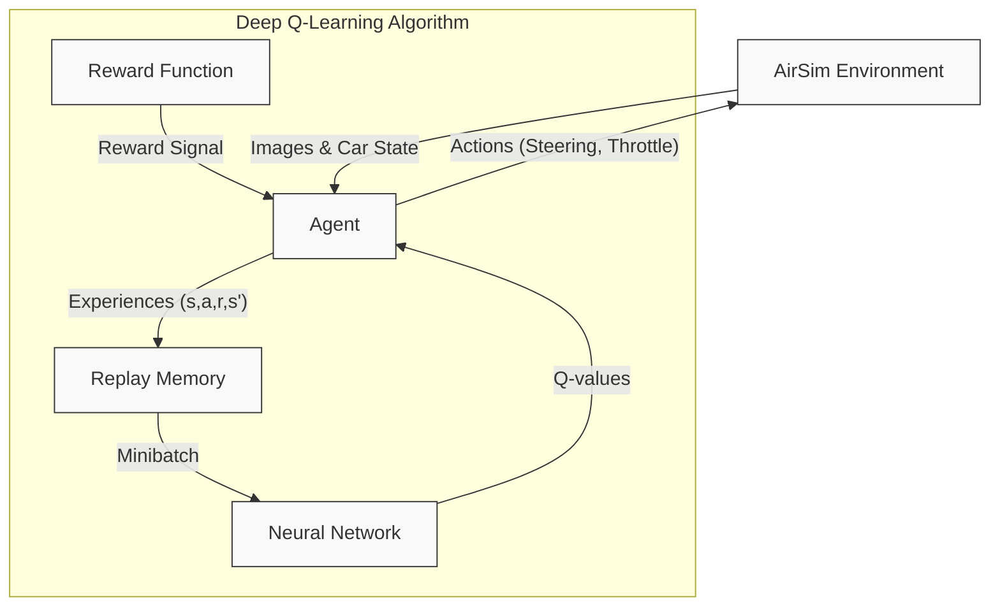
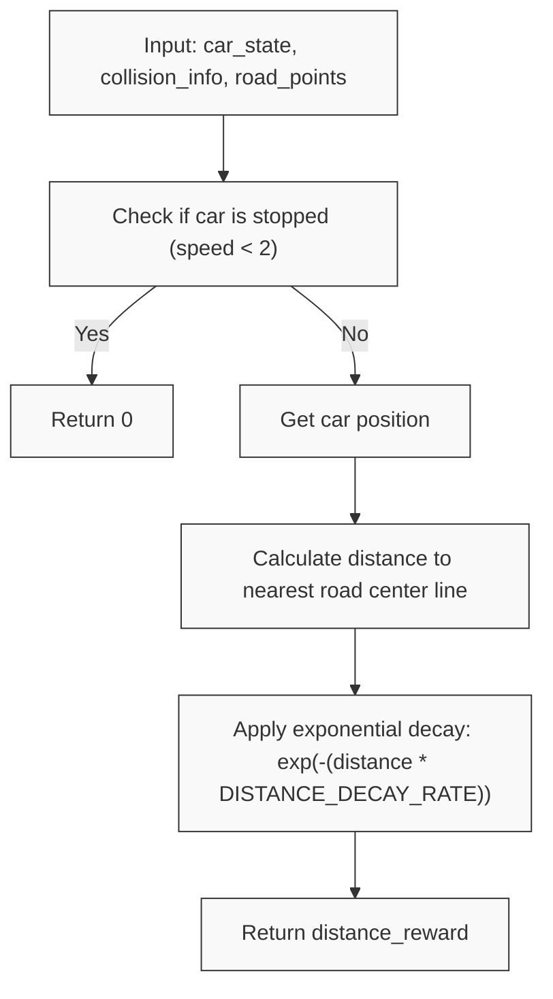
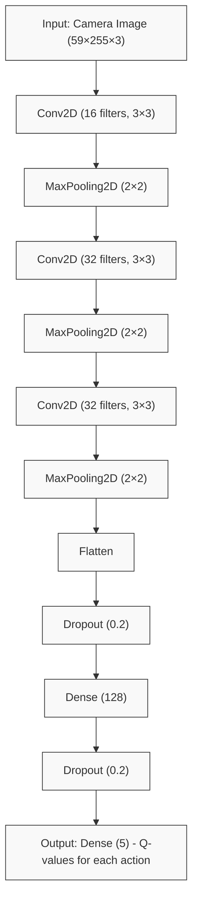
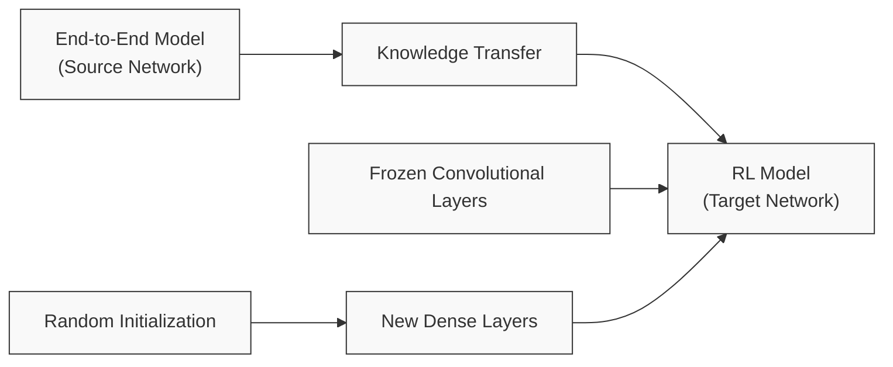
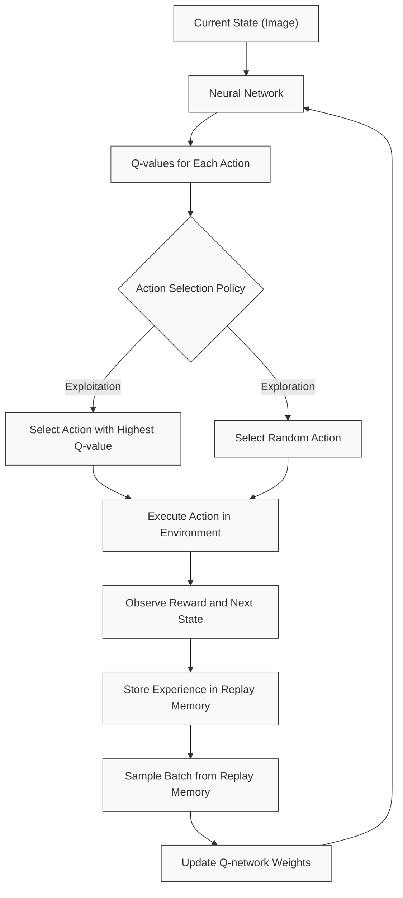
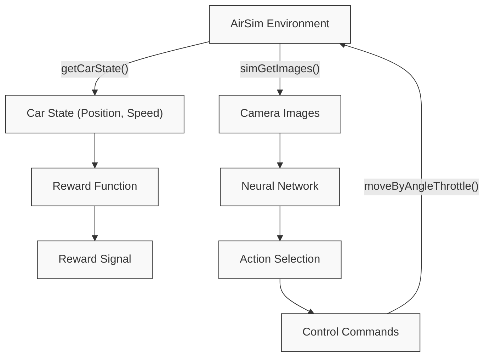

<!-- source: DeepWiki mcp.deepwiki.com · repo microsoft/AutonomousDrivingCookbook · page 3.2 Exploring the RL Algorithm · fetched 2026-10-26 -->

# Exploring the RL Algorithm

<details>
<summary>Relevant source files</summary>

The following files were used as context for generating this wiki page:

- [DistributedRL/ExploreAlgorithm.ipynb](DistributedRL/ExploreAlgorithm.ipynb)

</details>


This wiki page provides an in-depth explanation of the reinforcement learning (RL) algorithm used in the Distributed RL tutorial. It covers the reward function, neural network architecture, and key implementation details. For information about setting up a distributed training environment, see [Setting Up Azure Batch Cluster](#3.1), and for actually launching the training job, see [Launching Distributed Training](#3.3) or [Launching Local Training](#3.4).

## Reinforcement Learning Approach

The RL algorithm used in this tutorial is based on deep Q-learning, which was introduced by Google DeepMind and has been successful in learning to play Atari games. The algorithm learns to drive a car in the AirSim environment by exploring different actions and receiving rewards based on how well it stays on the road.

### RL Algorithm Overview



Sources: [ExploreAlgorithm.ipynb:7-15]()

## Reward Function

The reward function is a critical component of any reinforcement learning algorithm. It defines the goal for the agent by providing feedback on how good or bad its actions are. In this tutorial, the reward function is designed to encourage the car to stay in the center of the road.

### Reward Calculation



The reward function takes the following inputs:
- `car_state`: Contains the car's position, speed, and other state information
- `collision_info`: Information about any collisions that have occurred
- `road_points`: A list of points defining the center lines of the roads

Key parameters in the reward function:
- `THRESH_DIST = 3.5`: Maximum distance from the road center to compute reward
- `DISTANCE_DECAY_RATE = 1.2`: Rate at which reward decays with distance
- `CENTER_SPEED_MULTIPLIER = 2.0`: Ratio of preference for distance reward over speed reward

The reward value is between 0 and 1, with 1 being the best (car is perfectly centered on the road) and 0 being the worst (car is far from the center or stopped).

```python
def compute_reward(car_state, collision_info, road_points):
    # Define constant parameters for the reward function
    THRESH_DIST = 3.5               # Maximum distance from center to compute reward
    DISTANCE_DECAY_RATE = 1.2       # Rate at which reward decays with distance
    CENTER_SPEED_MULTIPLIER = 2.0   # Preference ratio for distance vs speed
    
    # Return 0 if the car is stopped
    speed = car_state.speed
    if (speed < 2):
        return 0
    
    # Get car position and compute distance to nearest center line
    car_point = np.array([car_state.kinematics_true[position_key][x_val_key], 
                          car_state.kinematics_true[position_key][y_val_key], 0])
    
    # Find the minimum distance to any road center line
    distance = 999
    for line in road_points:
        # [Projection calculation to find distance to line segment]
        distance = min(distance, local_distance)
    
    # Apply exponential decay to get the final reward
    distance_reward = math.exp(-(distance * DISTANCE_DECAY_RATE))
    
    return distance_reward
```

### Limitations of the Current Reward Function

The current reward function is intentionally simple and has several limitations:
1. It only considers distance from the road center, not the car's orientation
2. It doesn't account for obstacles or other vehicles
3. It doesn't consider traffic laws, speed limits, or road signs
4. It doesn't incentivize smooth driving or passenger comfort

These limitations were designed as thought exercises for users to consider how a more comprehensive reward function might be developed.

Sources: [ExploreAlgorithm.ipynb:54-110](), [ExploreAlgorithm.ipynb:116-196]()

## Neural Network Architecture

The neural network is responsible for approximating the Q-function, which estimates the expected future reward for each possible action from a given state. The state is represented by an image from the car's front-facing camera.

### Network Structure



The network architecture consists of:
1. **Input Layer**: Accepts an image of shape (59, 255, 3) - a cropped view from the car's front camera
2. **Convolutional Layers**: Three convolutional layers with ReLU activation extract spatial features from the image
3. **Pooling Layers**: Max pooling reduces the spatial dimensions after each convolution
4. **Flatten Layer**: Converts the 3D feature maps into a 1D feature vector
5. **Dropout Layers**: Help prevent overfitting by randomly disabling neurons during training
6. **Dense Layers**: Fully connected layers that map features to Q-values
7. **Output Layer**: Produces 5 Q-values, one for each possible action the car can take

This architecture is similar to the one used in the End-to-End Deep Learning tutorial, which enables transfer learning between the two models.

### Network Parameters

| Layer              | Output Shape        | Parameters |
|--------------------|---------------------|------------|
| Input              | (None, 59, 255, 3)  | 0          |
| Convolution0       | (None, 59, 255, 16) | 448        |
| MaxPooling2D       | (None, 29, 127, 16) | 0          |
| Convolution1       | (None, 29, 127, 32) | 4,640      |
| MaxPooling2D       | (None, 14, 63, 32)  | 0          |
| Convolution2       | (None, 14, 63, 32)  | 9,248      |
| MaxPooling2D       | (None, 7, 31, 32)   | 0          |
| Flatten            | (None, 6944)        | 0          |
| Dropout (0.2)      | (None, 6944)        | 0          |
| Dense              | (None, 128)         | 888,960    |
| Dropout (0.2)      | (None, 128)         | 0          |
| Output             | (None, 5)           | 645        |
| **Total**          |                     | **903,941**|

Sources: [ExploreAlgorithm.ipynb:202-247](), [ExploreAlgorithm.ipynb:307-331]()

## Transfer Learning

One key feature of this implementation is the ability to use transfer learning to accelerate the training process. Instead of training from scratch with random weights, the model can leverage knowledge from a previously trained network.

### Benefits of Transfer Learning



The transfer learning approach involves:
1. Loading weights from a pre-trained model (like the one from the End-to-End Deep Learning tutorial)
2. Freezing the convolutional layers to preserve the learned feature extraction capabilities
3. Only training the new dense layers that map these features to Q-values

This approach offers several advantages:
- Faster convergence during training
- Less random initial behavior of the car
- Requires less training data to achieve good performance
- Better generalization to new environments

When using transfer learning, the `train_conv_layers` flag is set to `False`, making the convolutional layers non-trainable. This effectively freezes the learned feature extraction capabilities from the previous model while allowing the fully connected layers to adapt to the new RL task.

Sources: [ExploreAlgorithm.ipynb:257-260](), [ExploreAlgorithm.ipynb:312-314]()

## Action Space and Q-Learning

The reinforcement learning algorithm uses Q-learning to determine the best action to take in any given state. The model outputs 5 Q-values, corresponding to 5 possible actions the car can take.

### Q-Learning Process



The 5 actions in the model's action space likely correspond to different steering and throttle combinations:
1. Left turn
2. Slight left
3. Straight ahead
4. Slight right
5. Right turn

During training, the agent follows an epsilon-greedy policy that balances exploration (trying random actions) and exploitation (choosing the action with the highest Q-value). Over time, as the agent learns from its experiences, it gradually reduces the exploration rate and relies more on its learned Q-values.

Sources: [ExploreAlgorithm.ipynb:9-11](), [ExploreAlgorithm.ipynb:325-326]()

## Integration with AirSim

The RL algorithm interacts with the AirSim environment to collect data, execute actions, and receive rewards. This interaction is critical for the training process.

### AirSim Interaction Flow



Key components of the AirSim integration:
1. **Image Capture**: Retrieving images from the front camera using `simGetImages()`
2. **State Information**: Getting the car's position and speed using `getCarState()`
3. **Collision Detection**: Checking for collisions using `getCollisionInfo()`
4. **Road Definition**: Using predefined road points to calculate the car's distance from the road center
5. **Action Execution**: Controlling the car by sending throttle and steering commands

The `get_image` function processes the raw camera image from AirSim, cropping it to focus on the road ahead and returning a properly formatted array for input to the neural network.

Sources: [ExploreAlgorithm.ipynb:26-47](), [ExploreAlgorithm.ipynb:235-246](), [ExploreAlgorithm.ipynb:179-195]()

## Next Steps

After exploring the RL algorithm, you can proceed to either:
1. [Launching Distributed Training](#3.3) if you want to train the model on an Azure Batch cluster
2. [Launching Local Training](#3.4) if you want to train the model on your local machine

The distributed approach is recommended for faster training, especially if you're training from scratch, while the local approach is more suitable for testing and small-scale experiments.

Sources: [ExploreAlgorithm.ipynb:337-338]()

---

