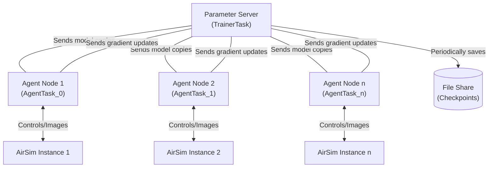
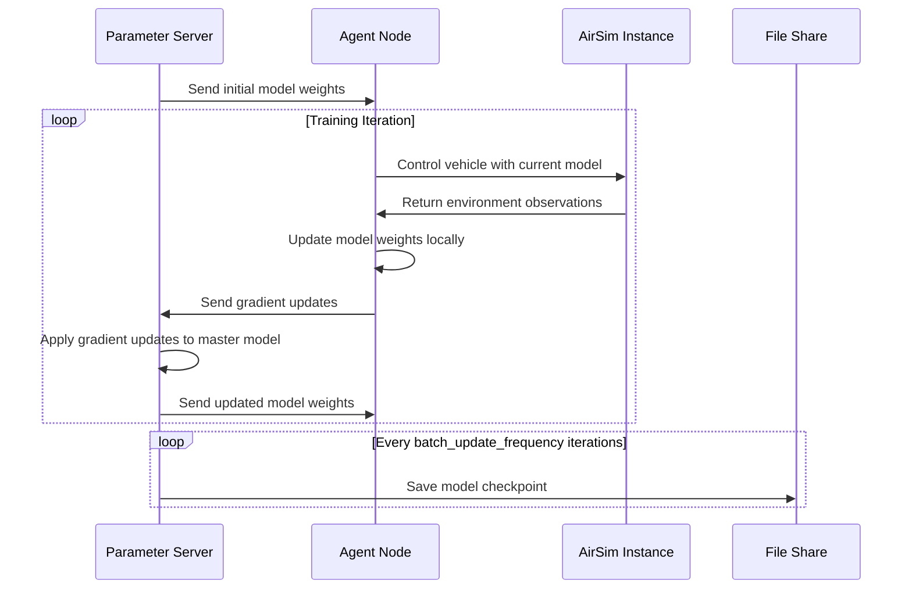
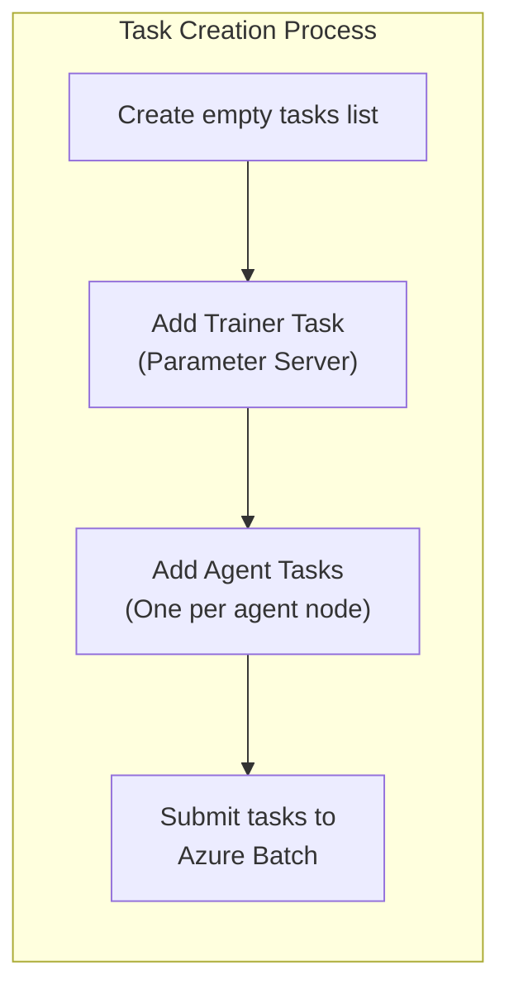
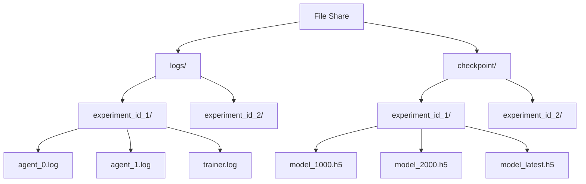

<!-- source: DeepWiki mcp.deepwiki.com · repo microsoft/AutonomousDrivingCookbook · page 3.3 Launching Distributed Training · fetched 2026-10-26 -->

# Launching Distributed Training

<details>
<summary>Relevant source files</summary>

The following files were used as context for generating this wiki page:

- [DistributedRL/LaunchTrainingJob.ipynb](DistributedRL/LaunchTrainingJob.ipynb)

</details>


## Purpose and Scope

This document provides detailed instructions for launching distributed reinforcement learning (RL) training jobs on an Azure Batch cluster. It assumes you have already set up the required Azure Batch infrastructure as described in [Setting Up Azure Batch Cluster](#3.1) and have explored the reinforcement learning algorithm covered in [Exploring the RL Algorithm](#3.2). For information about training on a local machine without distributed resources, see [Launching Local Training](#3.4).

## Distributed RL Architecture Overview

The distributed RL system uses multiple machines to accelerate the training process. The architecture consists of one parameter server node and multiple agent nodes working in parallel.



Sources: [DistributedRL/LaunchTrainingJob.ipynb:11-15]()

### Key Roles and Responsibilities

- **Parameter Server**: Maintains the master copy of the model. It distributes model weights to agent nodes and receives gradient updates from them.
- **Agent Nodes**: Each runs an instance of AirSim, receives model copies from the parameter server, performs training iterations locally, and sends gradient updates back.
- **File Share**: Stores model checkpoints and logs for monitoring and debugging.

The updates between nodes happen asynchronously, allowing for efficient parallelization of the training process.

Sources: [DistributedRL/LaunchTrainingJob.ipynb:11-15]()

## Distributed Training Process Flow



Sources: [DistributedRL/LaunchTrainingJob.ipynb:11-15](), [DistributedRL/LaunchTrainingJob.ipynb:46-55]()

## Configuring Training Hyperparameters

Before launching the distributed training job, you need to configure the hyperparameters that will control the training process:

| Hyperparameter | Description |
|----------------|-------------|
| `batch_update_frequency` | Frequency at which weights are copied from the active network to the target network and saved to disk |
| `max_epoch_runtime_sec` | Maximum runtime for each epoch in seconds |
| `per_iter_epsilon_reduction` | Amount by which epsilon is reduced each iteration (for epsilon-greedy exploration) |
| `min_epsilon` | Minimum value for epsilon after annealing |
| `batch_size` | Size of minibatches used for training |
| `replay_memory_size` | Number of examples to keep in the replay memory buffer |
| `weights_path` | Path to pretrained weights if using transfer learning |
| `train_conv_layers` | Whether to train convolutional layers (if using pretrained weights) |

Example configuration:

```python
batch_update_frequency = 300
max_epoch_runtime_sec = 30
per_iter_epsilon_reduction = 0.003
min_epsilon = 0.1
batch_size = 32
replay_memory_size = 2000
weights_path = 'Z:\\data\\pretrain_model_weights.h5'
train_conv_layers = 'false'
```

Sources: [DistributedRL/LaunchTrainingJob.ipynb:46-73]()

## Launching the Distributed Training Job

Launching a distributed training job involves the following steps:

1. Connect to Azure Batch service
2. Create a unique job ID
3. Create the job in Azure Batch
4. Create and submit tasks for both the parameter server and agent nodes

### Connecting to Azure Batch

First, establish a connection to the Azure Batch service using your account credentials:

```python
batch_credentials = batchauth.SharedKeyCredentials(NOTEBOOK_CONFIG['batch_account_name'], 
                                                 NOTEBOOK_CONFIG['batch_account_key'])
batch_client = batch.BatchServiceClient(batch_credentials, 
                                       base_url=NOTEBOOK_CONFIG['batch_account_url'])

# Create a unique job ID
job_id = 'distributed_rl_{0}'.format(str(uuid.uuid4()))
```

Sources: [DistributedRL/LaunchTrainingJob.ipynb:28-94]()

### Creating the Job

Next, create the job and assign it to your Azure Batch pool:

```python
job = batch.models.JobAddParameter(
    job_id,
    batch.models.PoolInformation(pool_id=NOTEBOOK_CONFIG['batch_pool_name']))

batch_client.job.add(job)
```

Sources: [DistributedRL/LaunchTrainingJob.ipynb:105-117]()

### Creating and Submitting Tasks

Create tasks for both the parameter server (trainer) and the agent nodes:



Sources: [DistributedRL/LaunchTrainingJob.ipynb:123-164]()

The trainer task (parameter server) is configured with:
- A command line that activates the Python environment
- Mounts the file share
- Runs the Django web server (`manage.py runserver`) for parameter server functionality
- Passes the experiment name and hyperparameters

The agent tasks are configured with:
- A command line that activates the Python environment
- Mounts the file share
- Runs the distributed agent script (`distributed_agent.py`)
- Passes the experiment name and hyperparameters

One agent task is created for each node in the pool (excluding the node used for the parameter server).

Sources: [DistributedRL/LaunchTrainingJob.ipynb:140-164]()

## Monitoring Training Progress

After launching the job, two new directories will be created on the file share:

1. **logs**: Contains the stdout for the agent and trainer nodes, useful for debugging
2. **checkpoint**: Contains the trained models, saved periodically based on the `batch_update_frequency` parameter

Each directory will contain a subdirectory with your experiment ID.



Sources: [DistributedRL/LaunchTrainingJob.ipynb:167-179]()

You can monitor the training by:

1. Checking the log files for progress and errors
2. Remote desktop connecting to agent machines to see the training code driving vehicles in AirSim
3. Examining the saved model checkpoints to track improvement

## Training Duration and Next Steps

Training will continue indefinitely until manually stopped. It's recommended to let the model train for at least 300,000 iterations for good results.

Once training is complete, download the final model weights from the checkpoint directory and proceed to [Running the Trained Model](#3.5) to evaluate your model's performance.

Sources: [DistributedRL/LaunchTrainingJob.ipynb:167-179]()

## Technical Implementation Details

The distributed training system uses a modification of the asynchronous SGD approach where:

1. The parameter server is implemented as a Django web application that:
   - Serves the current model weights
   - Receives gradient updates via HTTP requests
   - Applies updates to the master model
   - Periodically saves checkpoints

2. The agent nodes:
   - Interact with AirSim to collect experiences
   - Maintain a local replay memory buffer
   - Train the model on minibatches from replay memory
   - Calculate gradients and send them to the parameter server
   - Implement epsilon-greedy exploration with linear annealing

For more detailed information about the technical implementation, see [Distributed Agent Architecture](#4.1) and [Parameter Server Implementation](#4.2).

Sources: [DistributedRL/LaunchTrainingJob.ipynb:11-15](), [DistributedRL/LaunchTrainingJob.ipynb:46-55]()

---

