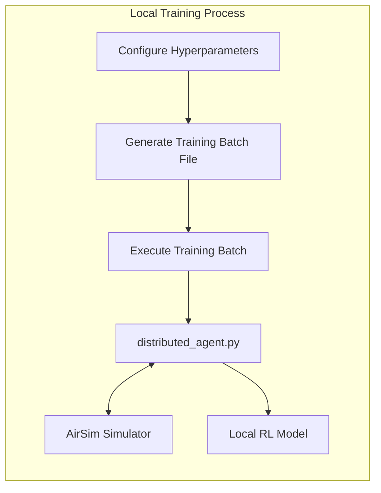
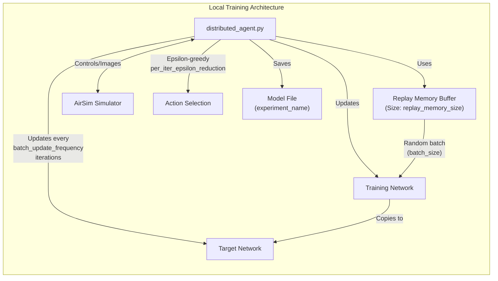
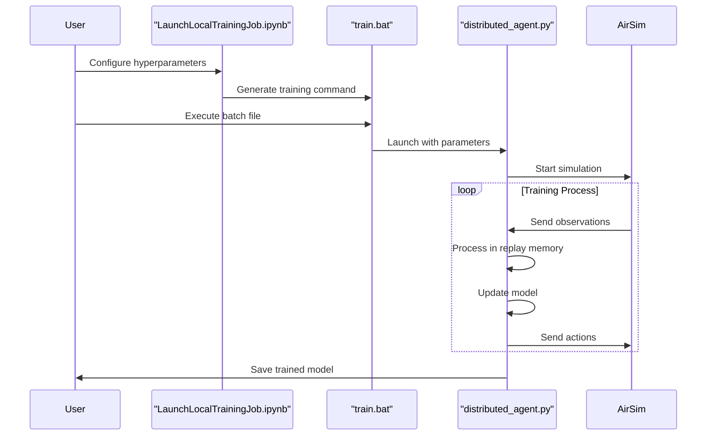

<!-- source: DeepWiki mcp.deepwiki.com · repo microsoft/AutonomousDrivingCookbook · page 3.4 Launching Local Training · fetched 2026-10-26 -->

# Launching Local Training

<details>
<summary>Relevant source files</summary>

The following files were used as context for generating this wiki page:

- [DistributedRL/LaunchLocalTrainingJob.ipynb](DistributedRL/LaunchLocalTrainingJob.ipynb)

</details>


## Purpose and Scope

This document provides a detailed guide on how to train a reinforcement learning model for autonomous driving on a single local machine. This approach offers an alternative to distributed training on Azure Batch (covered in [Launching Distributed Training](#3.3)), allowing developers to train models without cloud resources. Upon completing the local training process outlined here, you will be ready to proceed to [Running the Trained Model](#3.5).

## Overview of Local Training

Local training enables running reinforcement learning model training on a single machine using the AirSim simulator. This approach uses the same core algorithm as distributed training but executes on a single GPU, simplifying setup at the cost of longer training times.



**Diagram: Local Training Process Flow**

Sources: [DistributedRL/LaunchLocalTrainingJob.ipynb:1-121]()

## Training Hyperparameters

The local training process requires configuring several hyperparameters that control the learning behavior of the reinforcement learning agent.

| Parameter | Description | Default Value |
|-----------|-------------|--------------|
| batch_update_frequency | How often the weights from the actively trained network get copied to the target network and saved to disk | 10 |
| max_epoch_runtime_sec | Maximum runtime for each epoch in seconds | 30 |
| per_iter_epsilon_reduction | Amount by which epsilon is reduced each iteration in the epsilon-greedy strategy | 0.003 |
| min_epsilon | Minimum value for epsilon | 0.1 |
| batch_size | The minibatch size used for training | 32 |
| replay_memory_size | Number of examples kept in the replay memory buffer | 50 |
| weights_path | Path to pre-trained model weights if using transfer learning | 'Share/data/pretrain_model_weights.h5' |
| train_conv_layers | Whether to train convolutional layers (true/false) | 'false' |
| airsim_path | Path to the folder containing AirSim executables | 'E:/AD_Cookbook_AirSim/' |
| data_dir | Path to the directory containing road_points.txt and reward_points.txt for reward computation | 'Share' |
| experiment_name | Unique identifier for the training experiment | 'local_run' |

Sources: [DistributedRL/LaunchLocalTrainingJob.ipynb:22-59]()



**Diagram: Local Training Architecture Components**

Sources: [DistributedRL/LaunchLocalTrainingJob.ipynb:25-37]()

## Setting Up Local Training

### Prerequisites

Before starting local training, ensure you have:

1. AirSim simulator installed and configured
2. Python environment with required dependencies
3. A GPU for efficient training (CPU training is possible but significantly slower)
4. Sufficient disk space for model checkpoints

### Environment Configuration

You'll need to set the `airsim_path` parameter to point to your AirSim installation directory and ensure the `data_dir` parameter correctly points to the directory containing road and reward point data.

## Launching the Training Process

The `LaunchLocalTrainingJob.ipynb` notebook generates a batch file that initiates the training process. The workflow is as follows:



**Diagram: Local Training Execution Flow**

Sources: [DistributedRL/LaunchLocalTrainingJob.ipynb:68-90]()

### Step-by-step Instructions

1. Open and run the `LaunchLocalTrainingJob.ipynb` notebook
2. Set appropriate hyperparameters for your training scenario
3. Execute the notebook cells to generate the training batch file
4. Navigate to the `Share/scripts_downpour/app` directory
5. Activate your Python environment
6. Run the generated `train.bat` file

The batch file executes the `distributed_agent.py` script with all the configured parameters:

```
python distributed_agent.py batch_update_frequency=10 max_epoch_runtime_sec=30 per_iter_epsilon_reduction=0.003 min_epsilon=0.1 batch_size=32 replay_memory_size=50 weights_path=[path_to_weights] train_conv_layers=false airsim_path=[airsim_path] data_dir=[data_dir] experiment_name=local_run local_run=true
```

Sources: [DistributedRL/LaunchLocalTrainingJob.ipynb:74-89]()

## Training Duration and Performance

The training process can be time-intensive, particularly when starting from scratch:

- **Training from scratch**: Up to 5 days on a powerful GPU
- **Using pre-trained weights**: Model should begin to visibly converge after approximately 3 hours of training

During training, the model will gradually improve its ability to navigate autonomously in the AirSim environment.

Sources: [DistributedRL/LaunchLocalTrainingJob.ipynb:92-97]()

## Monitoring Progress

As the training progresses, the agent will:

1. Collect experiences by interacting with the AirSim environment
2. Store these experiences in the replay memory
3. Sample random batches for training
4. Update the model parameters
5. Periodically save model checkpoints

You can monitor the training progress through:
- Console output showing reward values and epsilon decay
- Model checkpoints saved to disk
- Observable improvement in the agent's behavior in AirSim

## Next Steps

After the training completes, the final model will be saved according to your specified experiment name. You can then proceed to [Running the Trained Model](#3.5) to evaluate its performance and visualize the autonomous driving capabilities.

Sources: [DistributedRL/LaunchLocalTrainingJob.ipynb:92-97]()

---

