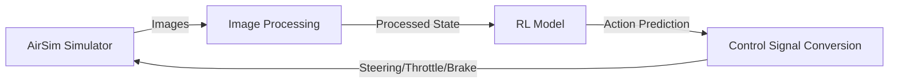
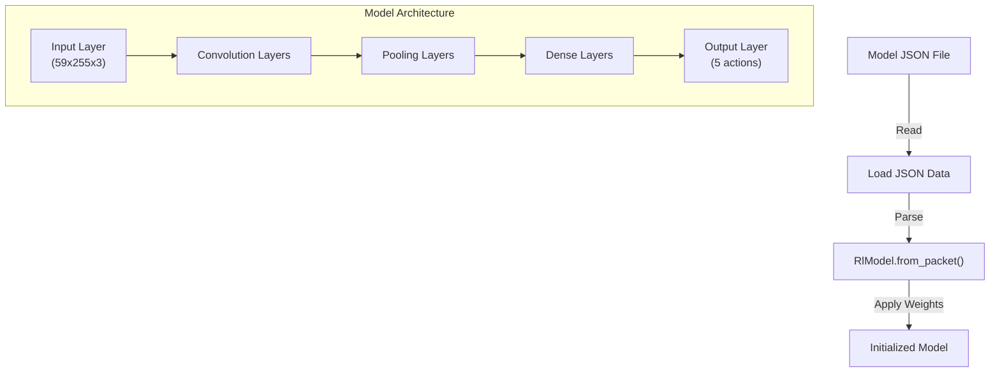
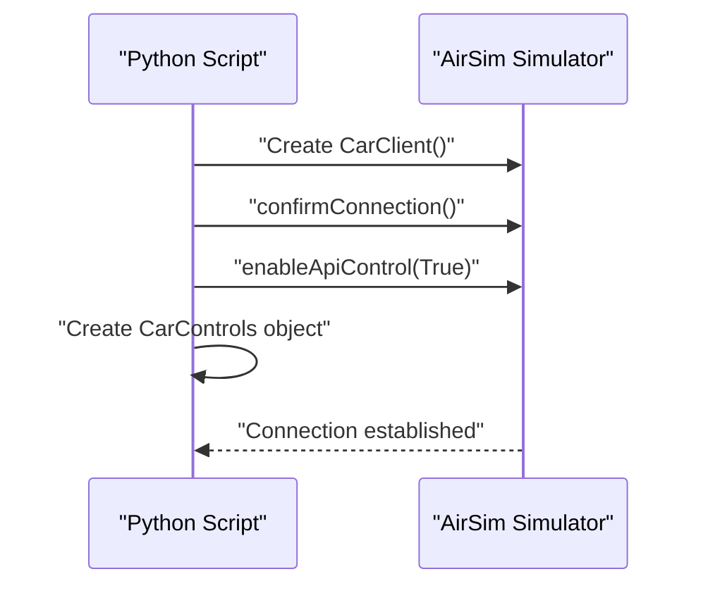
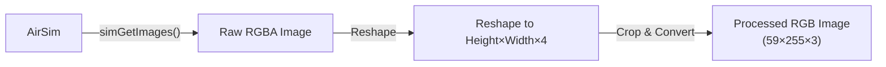
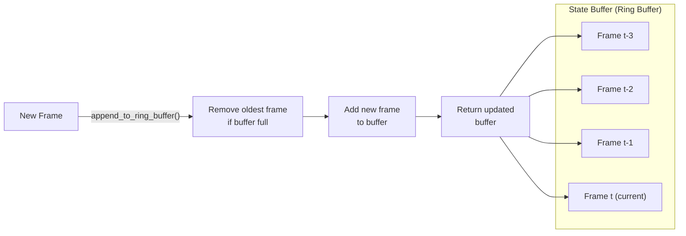
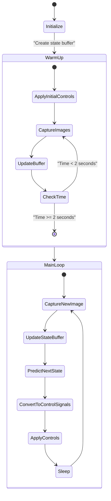
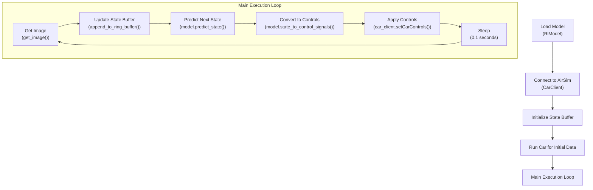

<!-- source: DeepWiki mcp.deepwiki.com · repo microsoft/AutonomousDrivingCookbook · page 3.5 Running the Trained Model · fetched 2026-10-26 -->

# Running the Trained Model

Relevant source files

The following files were used as context for generating this wiki page:

- [DistributedRL/RunModel.ipynb](DistributedRL/RunModel.ipynb)

## Purpose and Scope

This document explains how to execute a trained reinforcement learning model to control a vehicle in the AirSim simulator. It covers loading the model from disk, connecting to AirSim, capturing and processing simulator images, and running the execution loop that translates model predictions into vehicle controls. This page assumes you have already trained a model using either distributed training (see [Launching Distributed Training](#3.3)) or local training (see [Launching Local Training](#3.4)).

## Overview

Running a trained model involves several key steps that connect the reinforcement learning model to the AirSim simulator, allowing the model to control the vehicle based on visual input.

Sources: [DistributedRL/RunModel.ipynb:20-30](), [DistributedRL/RunModel.ipynb:137-143](), [DistributedRL/RunModel.ipynb:177-191]()

## Prerequisites

Before running your model, ensure you have:

| Requirement | Description |
|-------------|-------------|
| Trained Model | A JSON file containing the trained model weights |
| AirSim | The simulator running in a separate window |
| Python Environment | All dependencies installed (numpy, PIL, etc.) |

Sources: [DistributedRL/RunModel.ipynb:9-12](), [DistributedRL/RunModel.ipynb:20-30]()

## Model Loading Process

The first step is to load your trained model from a JSON file into a `RlModel` object.

The model architecture consists of:
- Input layer accepting images of size 59×255×3
- Multiple convolutional and max pooling layers
- Flatten and dropout layers
- Dense layers
- Output layer with 5 possible actions

### Implementation

To load the model:

1. Set the `MODEL_FILENAME` variable to point to your trained model JSON file
2. Create an instance of `RlModel`
3. Load the model weights from the JSON file

Sources: [DistributedRL/RunModel.ipynb:30](), [DistributedRL/RunModel.ipynb:87-90]()

## Connecting to AirSim

After loading the model, establish a connection to the AirSim simulator.

The connection process involves:
1. Creating a `CarClient` instance
2. Confirming the connection to AirSim
3. Enabling API control of the vehicle
4. Creating a `CarControls` object to send control commands

Sources: [DistributedRL/RunModel.ipynb:116-121]()

## Image Processing for Model Input

The model requires properly formatted image data from AirSim. A helper function `get_image()` handles this process.

The image processing involves:
1. Requesting an image from AirSim using `simGetImages()`
2. Converting the raw image data to a numpy array
3. Reshaping the array to the proper dimensions
4. Cropping to focus on the relevant part of the scene (rows 76-135, columns 0-255)
5. Extracting only the RGB channels (0-3)
6. Converting to float format for model input

Sources: [DistributedRL/RunModel.ipynb:137-143]()

## State Buffer Mechanism

The model doesn't use single frames but instead uses a sequence of recent frames stored in a state buffer.

The ring buffer implementation:
1. Maintains a fixed-size buffer (4 frames)
2. When a new frame is added, the oldest is removed if the buffer is full
3. This provides temporal context to the model, allowing it to detect motion

Sources: [DistributedRL/RunModel.ipynb:158-162](), [DistributedRL/RunModel.ipynb:164-165]()

## Execution Loop

The main execution loop continuously captures images, makes predictions, and controls the vehicle.

The execution process:
1. Initialize a state buffer to store the last 4 frames
2. Warm-up phase: Run the car for a few seconds to populate the state buffer
3. Main execution loop:
   - Capture a new image from AirSim
   - Update the state buffer with the new image
   - Use the model to predict the next state
   - Convert the state prediction to control signals
   - Apply the control signals to the car
   - Sleep briefly to control the update rate
   - Repeat

Sources: [DistributedRL/RunModel.ipynb:164-191]()

## Control Signal Mapping

The model predicts a discrete state, which is then converted to continuous control signals:

| Model Output | Steering | Throttle | Brake |
|--------------|----------|----------|-------|
| State prediction | Converted to -1.0 to 1.0 | Converted to 0.0 to 1.0 | Converted to 0.0 to 1.0 |

The conversion from state prediction to control signals is handled by the `state_to_control_signals()` method in the `RlModel` class, which takes into account both the predicted state and the current car state.

Sources: [DistributedRL/RunModel.ipynb:180-185]()

## Code Execution Workflow

The complete workflow combines all these elements:

Sources: [DistributedRL/RunModel.ipynb:87-191]()

## Troubleshooting Tips

If you encounter issues while running your model:

1. **Model Loading Errors**: Ensure your JSON file is correctly formatted and the path is valid
2. **AirSim Connection Failures**: Make sure AirSim is running before executing the notebook
3. **Poor Performance**: 
   - Try using the provided sample model as a reference
   - Consider retraining your model with different parameters
   - Verify that the image processing crops the same region as was used during training

Sources: [DistributedRL/RunModel.ipynb:9-12](), [DistributedRL/RunModel.ipynb:116-121]()

## Conclusion

Running your trained model lets you see the results of your reinforcement learning work in action. The process forms a complete observation-prediction-action loop, with the model continuously making decisions based on visual input from the simulator. You can now evaluate your model's performance in real-time and make adjustments to improve its behavior if necessary.

---

